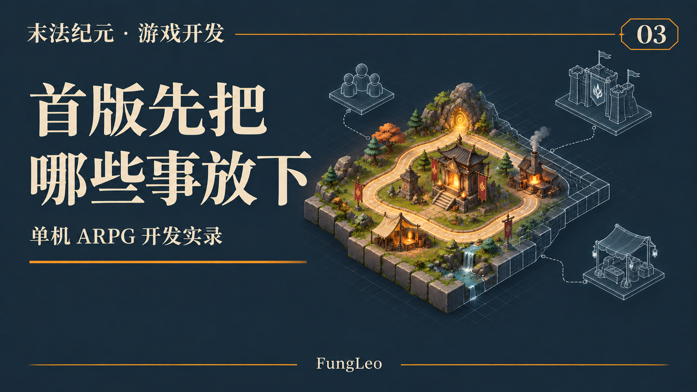
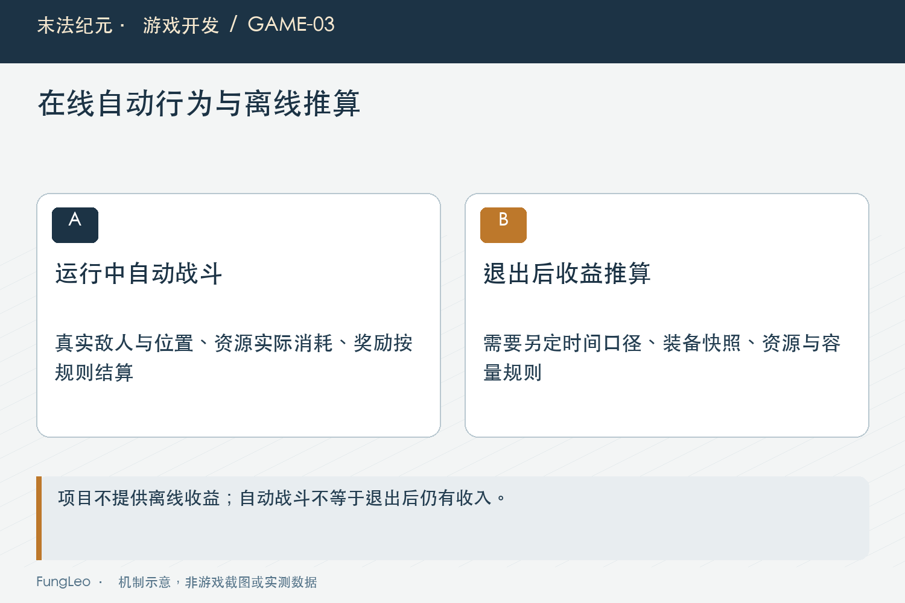
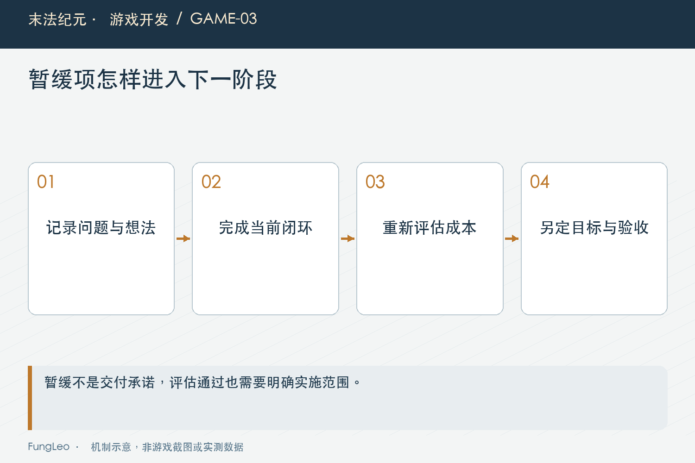

# 末法纪元·游戏开发03：想做的越来越多，首版到底不做什么

> 本文回顾《末法纪元》的开发过程，技术描述以 2026 年 11 月 5 日审阅快照为准。封面为主题插画，内文图为机制示意。

### 前言

各位看官，第02篇《打宝、成长、探索，怎样变成能验收的目标》聊了怎么把体验目标拆成验收。目标清楚了，接下来有件同样要紧的事：划范围。

游戏这东西，太容易往里面加东西了。装备有了，合成是不是也来一套？怪物能打了，多人一起打是不是更热闹？地图做出来了，再加几个章节好像也挺顺。

单看每条建议，都有道理。凑到一起，就得问问：这一版究竟什么时候能交付？

《末法纪元》的产品文档专门写了“不做什么”。回头看，这张清单值得单独拿出来聊。



### 能做，和这一版值得做，是两道题

全栈开发者看到账号、服务器、交易市场，容易觉得亲切。可这些东西一进来，游戏要承担的事情就变了。

一个人在本地打怪，先处理角色、怪物、奖励和存档。多人一起打，就要回答谁负责判伤害、奖励归谁、断线后怎么办、两个人同时拿同一件装备怎么处理。

原先的一条循环，会接进一整套状态同步和可信结算问题。

所以项目起点就排除了联网、账号、公会、交易市场和PvP。先集中精力把单机里的战斗、掉落和成长接顺。

这份选择的价值，在于后面遇到一个诱人的新点子时，有东西可对照。否则每一次讨论都从“好像可以加”开始，谁也说不清它应该排到哪里。

### 自动战斗不顺便包办离线收益

《末法纪元》有自动战斗和自动拾取，游戏退出后不继续累计收益。

这两条放一起，特别容易被顺手合并：既然都自动打了，关掉游戏以后算一下，不也挺方便？

可一旦要算离线收益，就得重新定义时间和奖励。按哪张地图算，用退出时的装备还是读档时的装备，打不过怎么办，背包满了怎么办，药水消耗怎么算？

这些问题最后都会落回玩家的资源和成长速度。

游戏正在运行时，世界里有真实的敌人、位置和资源变化。退出以后做收益推算，是新增一套产品规则，需要单独设计和验证。

**名字听起来像同一个功能，不代表工程上只差一个开关。**



### 首版不做，也要写清楚是哪一版

这里有个细节，做复盘时尤其得注意。

项目最初的边界里，有“不做复杂制造系统”。后来工程里已经有合成、保星升级和重铸了。拿今天的代码去看早期那句话，很容易觉得文档自相矛盾。

实际整理时，要把时间拆开。

早期先把移动、战斗、掉落、背包、货郎和存档串起来。等基础循环有了，再设计新的装备消耗和成长通道。后来的扩展不能倒写成第一天就具备的能力，也不能因为开头没做，就永远不许做。

范围是阶段决策。改变范围，可以；改变以后，要说明新规则、成本和验收怎么变。

我更在意的是，这次新增有没有明确目的。例如后期材料积压，需要消耗出口，就应该拿实际问题来讨论。只因为“别的游戏都有”，还不足以决定马上开工。

### 拿一个新点子，走一遍取舍过程

假设现在有人提议：“让怪物掉一张配方，收集材料以后打造装备。”这个例子用于说明判断方法，并不是项目里某次对话的原文。

我会先问，它想改善哪一段体验？如果是普通掉落缺少期待，配方可能提供长期目标；如果只是背包里材料太多，需要一个出口，未必非得增加一整套配方系统。重铸、兑换或者已有合成规则，都可能承接这件事。

接着看玩家为了使用它，需要学会什么。配方有没有等级，材料是否占格，产物是否随机，失败会不会损失投入，任务要不要引导？这些规则一列出来，原来那句“加个配方”就有了真实轮廓。

再看工程成本。物品生成可以复用，但材料锁定、数量预览、扣费、满包处理、存档和提示，仍然要逐项对接。复用一部分系统，不等于整个功能没有新增成本。

最后才是排期：眼前的闭环已经稳定了吗？这项功能会不会让正在验收的装备规则重新变化？如果会，先把当前阶段交付，再安排一批独立扩展，通常更容易比较前后效果。

这样讨论以后，结论可能是做，也可能是先用更小的改动解决问题。至少双方知道这次决定基于什么，而不是谁描述得更令人兴奋。

### 暂缓的东西，给它留一个能找回来的地方

把想法放下很难，尤其是刚想到的时候，怎么看都挺有意思。

我的项目里有产品文档、创意文档和工程方案，它们可以承接不同成熟度的内容。一个点子先记下来，和承诺这一版交付，是不同的状态。

实际使用时，我会建议给暂缓项至少留下三件事：它解决什么问题，什么时候值得重新看，以及加入以后会碰到哪些已有系统。

比如“将来考虑UGC地图”，可以先评估编辑器通用化、资源格式和外部输入边界。评估结束，不等于这版就答应做UGC平台。

这样处理，后续回来看时有理由可循，不用重新猜当初为什么没做。



### 别把范围缩成一个没法玩的半成品

控制范围也可能走向另一个极端：地图先不做，背包先不管，存档以后再说，只留下角色和怪物互相扣血。

这能验证攻击，却还验证不了打宝成长的循环。

第01篇《一个全栈开发者，开始做自己的单机ARPG》说过，玩家打怪、捡东西、换装备，再去挑战，是连在一起的。范围可以小，关键环节得接上。

所以最小版本可以只有少量敌人和装备，外观也可以先占位，但获得的物品要能使用，进度要能保存，下一次进入还得接着玩。

否则试玩得出的结论容易失真：没有成长和奖励的战斗，让人玩几分钟就觉得无聊，未必说明整条产品思路有问题。

### 把暂缓项写到可以重新启动

我觉得一张好用的范围记录，除了列名称，还应该能回答“重新做的时候从哪里开始”。可以用下面这样的轻量格式。它是整理需求的方法示例，不是要求游戏新增这些字段：

```yaml
idea: 配方打造装备
problem: 希望普通战斗也有值得积累的长期目标
current_release: 暂缓
revisit_when: 最小掉落与成长循环完成校准后
reuse: 物品实例生成、背包容量检查
new_work: 配方发现、材料计划、确认与结算
acceptance: 取消不扣材料，失败不留下半完成状态
```

这里的关键，是把一个想法和当前承诺分开。“暂缓”不应该让人误以为已经有具体交付日期；“重新评估”也不代表到了那天就自动开工，还得看原来的问题是否存在。

例如，后面调整掉落结构以后，普通战斗已经有了稳定的小惊喜，那么当初为了弥补奖励单调提出的配方，必要性就可能下降。反过来，如果玩家长期积累却没有花费渠道，旧想法也可能重新有价值。

对首版还有一条很实用的检查：删掉某项内容以后，玩家还能不能完整地完成一次获得、使用、保存和继续挑战？如果删掉的是装饰或额外分支，影响可能有限；如果删掉的是保存、奖励恢复或基本反馈，就要小心把产品缩成展示片段。

范围控制也不是以后从不返工。第一次做出来的循环，会暴露新的问题。重要的是把变更放进下一轮清楚的目标里，而不是旧阶段还没验完，新规则已经换了三套，最后谁也说不清哪些结果仍然成立。

各位看官给自己的项目做这张表时，可以顺便写下一个退出条件：什么现象证明这个点子暂时不值得继续？愿意删掉不再解决问题的想法，和愿意记下新想法一样重要。

### 小结

这一版不做什么，背后要有具体理由：它引入了什么成本，是否服务当前目标，会不会打断最小闭环。

《末法纪元》的范围也经历了扩展。把早期边界和后来的决策分别记清楚，才能看见项目是怎样长起来的。

各位看官准备新项目时，不妨也列一张暂缓清单。每少承诺一项没有想清楚的功能，眼前的闭环就多一点完成的机会。

下一篇，聊聊选定Godot以后，工程第一天到底要准备些什么。

### 相关内容

- 第01篇《一个全栈开发者，开始做自己的单机ARPG》——本系列的产品定位。
- 第02篇《打宝、成长、探索，怎样变成能验收的目标》——判断功能去留之前，先明确体验目标。
