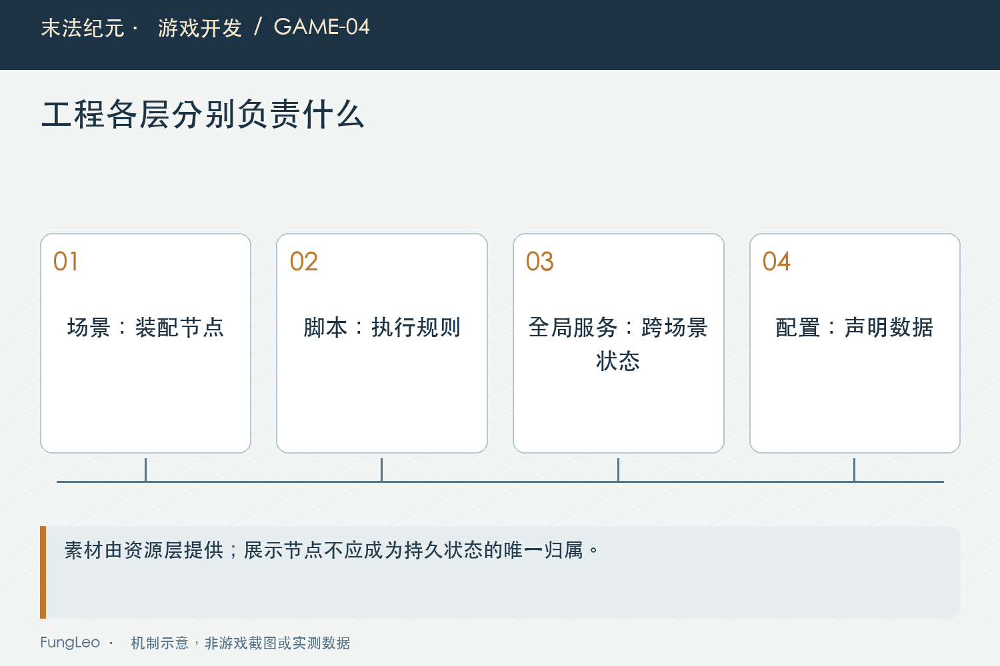
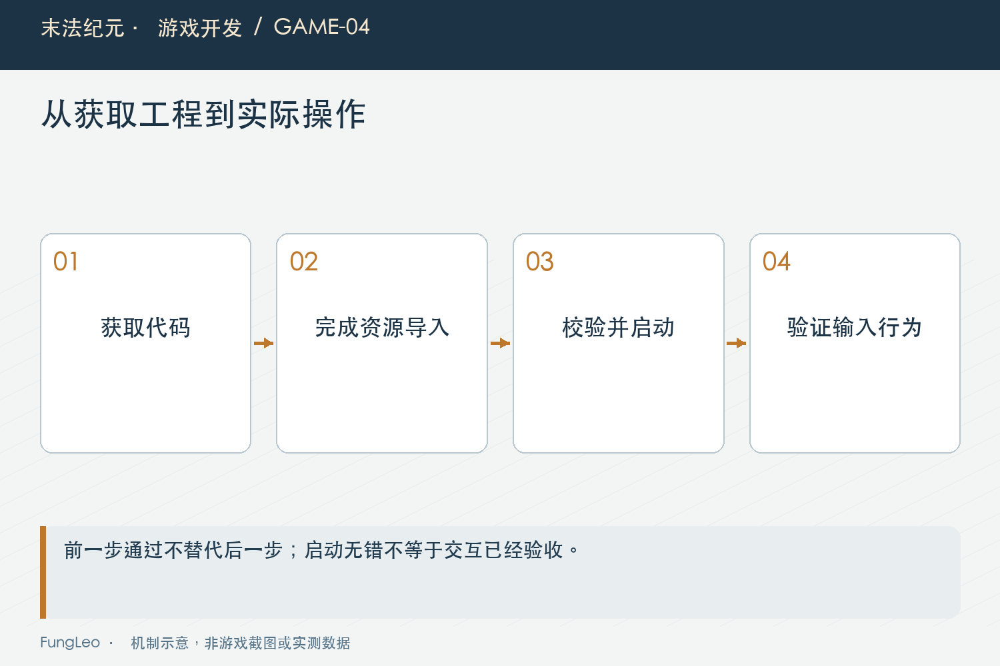

# 末法纪元·游戏开发04：选了Godot以后，工程第一天要准备什么

> 本文回顾《末法纪元》的开发过程，技术描述以 2026 年 11 月 5 日审阅快照为准。封面为主题插画，内文图为机制示意。

### 前言

各位看官，第03篇《想做的越来越多，首版到底不做什么》把首版范围收住了，这一篇聊工具和起步。

引擎选哪个，很容易聊成一场技术辩论。能讨论的点太多：功能、生态、语言、编辑器、跨平台，随便展开一项都够聊半天。

《末法纪元》最后用Godot 4和GDScript。但选完以后，还有个更实际的问题：工程第一天，要留下什么东西，后面的开发才能接着往下走？

这一篇先把项目当时的选择讲清楚，再聊开工的底座。


### 选择要放回这个项目里

仓库的技术决策文档记录了2026年10月11日的选型：Godot 4，首版用GDScript。

项目是2D等距单机游戏，最初面向macOS，同时希望保留以后扩展其他桌面平台的空间。开发还需要频繁查看和修改场景、脚本与配置。

在这些条件下，Godot的文本项目结构很合适。场景是`.tscn`，脚本是`.gd`，项目设置也能以文本查看。修改可以进Git，出了问题能对照差异，协作时也容易把具体文件交给工具处理。

GDScript则让起步少了一层额外语言运行环境的准备，可以先沿着引擎自己的脚本体系把闭环跑起来。

这些是这个项目的取舍。换成重3D、大型商业素材管线，或者已有成熟团队工具链的项目，问题条件就变了，不能直接照搬答案。

还有一点得单独提醒：引擎的许可和下载素材的许可，要分别核对。选了一个开源引擎，不代表网上找到的素材都能随便商用。

### 先让目录表达职责

起步时的目录不需要复杂，但最好能让人一眼找到东西。

《末法纪元》按场景、脚本、全局服务、数据和资源分开组织。简化来看，大致是这样：

```text
scenes/     场景装配
scripts/    游戏行为与规则
                  
autoload/   跨场景服务和状态
data/       地图、物品、技能等配置
assets/     运行时使用的资源
```

这里的目录只是在表达职责，没有要求所有代码都套进某个固定框架。

一个怪物属于场景里的运行实体；一张怪物模板表描述它怎么生成；伤害计算可以独立成规则。先把这些边界分开，后面改掉落时，就不至于顺手把怪物移动也改了。

第01篇《一个全栈开发者，开始做自己的单机ARPG》聊过全栈经验的迁移，目录和职责就是一个很直接的落点。



### 全局服务，先给必要的东西留位置

Godot里的Autoload可以让节点跨场景存在。项目起步准备了全局状态、数据加载、存档和事件总线这些入口。

它们解决的是不同问题：当前玩家有哪些持久状态，配置从哪里读，进度从哪里保存，系统之间怎样传递变化。

有了这些入口，后面背包、商店、任务就能沿着共同规则接入。

但“访问方便”也很容易变成陷阱。地图上的怪物、临时掉落和面板控件，如果都长期挂进全局状态，切图时谁来清理就难说了。

所以第一天要定的，是哪些东西确实需要跨场景活着。临时对象仍然要有明确的创建者和释放位置。

### 配置先少一点，校验先有一点

把JSON文件建出来，不代表数据层已经可靠。

怪物引用了不存在的掉落表，地图出口写错目标ID，装备等级填了非法值，这些问题要等到玩家走到对应位置才发现，排查就很绕。

工程起步就应该检查最基本的约束：ID是否重复，引用能不能找到，字段类型和数值范围是否合规。

第一批数据可以很少。先有足够跑通测试的地图、怪物和装备，就能验证加载链路。暂时用不上的内容，不需要为了目录看起来整齐而填满。

**越早把错误拦在加载入口，越少让运行时替配置收拾残局。**

### 第一天的成果，得能在另一台机器上重新出现

只在自己的编辑器里按F5成功，还少了一步。

Godot会生成导入缓存和全局脚本类信息。新机器没有这些缓存，直接运行可能遇到类型尚未注册、资源尚未导入的问题。

项目的换机指南因此写了先导入、再验证启动的步骤。这里不展开某一版本的安装命令，正式操作应以仓库当时的指南和实际引擎路径为准。

我更想强调检查顺序：拿到代码，完成资源导入，验证配置加载，启动最小场景，再确认输入和画面。

这一条能走通，后面说“这个版本有问题”，才比较容易排除机器上残留缓存的干扰。



### 给第一天留一组能执行的检查

光说“环境正常”还是太宽。我会把它拆成几个不同的结果：引擎可以被调用，项目资源完成导入，主场景可以装配，最小测试能正常结束。

在这个项目里，下面是一组可以使用的检查入口。命令在项目根目录执行，引擎路径通过运行器参数指定；第一条只查看帮助，后两条会创建隔离测试环境。这里展示用法，不把它们写成本轮已经跑出的结果。

```sh
python3 tools/run_isolated_tests.py --help
python3 tools/run_isolated_tests.py --godot /Applications/Godot.app/Contents/MacOS/Godot SmokeTest
python3 tools/run_isolated_tests.py --godot /Applications/Godot.app/Contents/MacOS/Godot MenuFlowTest
```

为什么不只留一条按F5？因为不同检查回答的问题不同。配置和基础逻辑有问题，可以先从冒烟检查定位；主场景装配失败，则需要继续看它的依赖。实际窗口里的视觉、鼠标交互和高分屏表现，仍然要另外操作确认。

读者换一台机器复现时，最值得保存的是引擎版本、代码提交和失败日志。命令看着一样，使用的二进制、配置和资源快照不同，结果就不具备直接对照的条件。

我也不建议把玩家真实存档复制进去，作为每次环境验证的默认材料。先用隔离数据证明基础流程能跑，再对特定兼容问题安排独立验证，出问题也更容易恢复。

### 别把第一天花在建设一个未来框架上

目录有了，服务有了，数据入口也有了，就该让角色动起来了。

这一阶段不需要提前解决所有扩展问题。需要的是能承接下一步工作的入口，以及判断它有没有坏的最小检查。

比如主场景能启动，配置错误能明确报告，移动输入已经登记，最小测试能够执行。带着这些结果进入战斗、掉落和背包，后面才有实际问题来推动设计。

要是第一周都在给未来十种职业设计通用继承树，眼前却还没有一次能打完的战斗，顺序就得重新看看了。

### 看一眼项目设置，比凭记忆配环境可靠

仓库里的project.godot记录了主场景、渲染特征和自动加载服务等内容。下面摘出与本篇有关的一小段，省略其他设置：

```ini
[application]
run/main_scene="res://scenes/Main.tscn"
config/features=PackedStringArray("4.7", "GL Compatibility")

[autoload]
EventBus="*res://autoload/event_bus.gd"
GameState="*res://autoload/game_state.gd"
DataLoader="*res://autoload/data_loader.gd"
SaveManager="*res://autoload/save_manager.gd"
```

这段能告诉我们工程实际接了哪些入口，但不是一份拿到任何项目都能照抄的完整配置。新增服务是否依赖别的服务，初始化顺序是否成立，仍然要读实现。

同样，运行时可能会根据显示设置调整相机和界面策略。看到项目文件中的初始值，不能就断言所有玩家始终采用同一套窗口表现。配置、初始化和运行时应用要放在一起理解。

另一个容易混淆的地方，是仓库应该保存什么。源码、资源引用元信息和需要复现的配置，要按项目约定保留；本地生成的缓存则不应成为别人成功启动的隐藏前提。一个工程只有在作者电脑上保留某个旧缓存才能跑，复现链路就还没有整理好。

第一天可以用一次干净副本验证来暴露这种依赖：先固定提交，再导入，再运行最小检查。如果缺的是配置或源码，就补齐版本控制；如果只是本机导入没结束，就把步骤写进启动指南。两者不要混着修。

做完这些，下一次功能失败时就有一份可信的起点。我们知道基础环境曾经怎样成立，也能通过相同步骤判断它有没有退回去。这比截图里有一个能动的角色，多留下了一层可以继续工作的依据。

### 小结

Godot的选择，要结合这个项目的2D、单机、桌面平台和文本协作需求来理解。

选完工具以后，工程第一天该准备的是清楚的目录职责、必要服务、配置校验和可复现的启动过程。做到这些，就可以拿具体玩法检验底座了。

下一篇沿着仓库历史，看看从最小闭环到后续扩展，里程碑是怎样一步步变化的。

### 相关内容

- 第03篇《想做的越来越多，首版到底不做什么》——工具选择要服务当前范围。
- [成为全栈·产品篇·技术选型不是投票](https://blog.csdn.net/fungleo/article/details/164121738)——从目标和约束出发评估技术。
