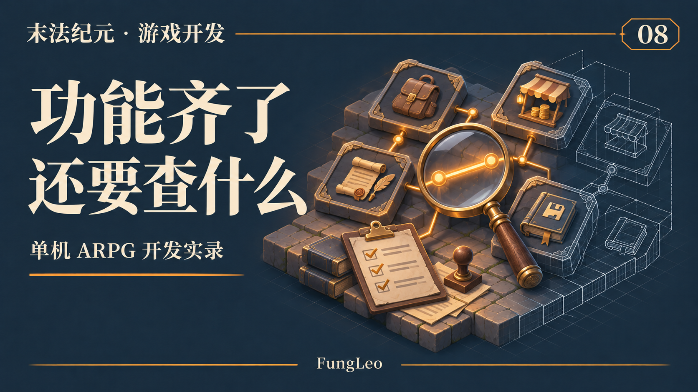
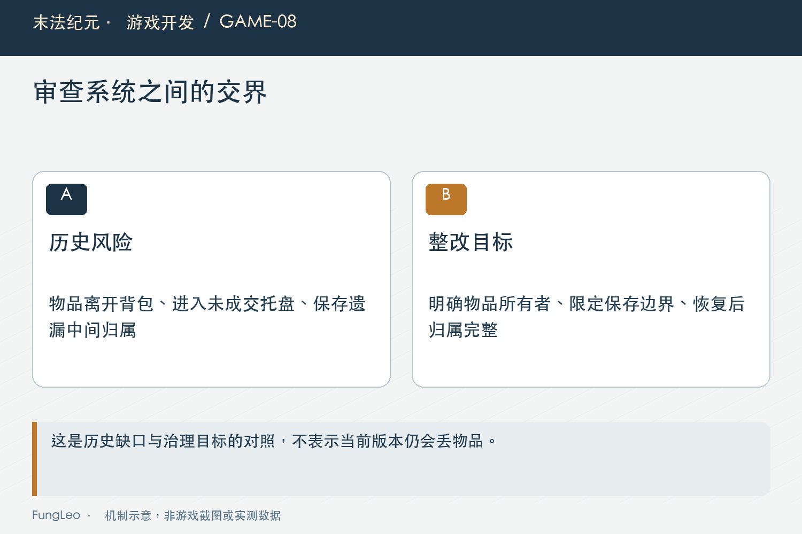
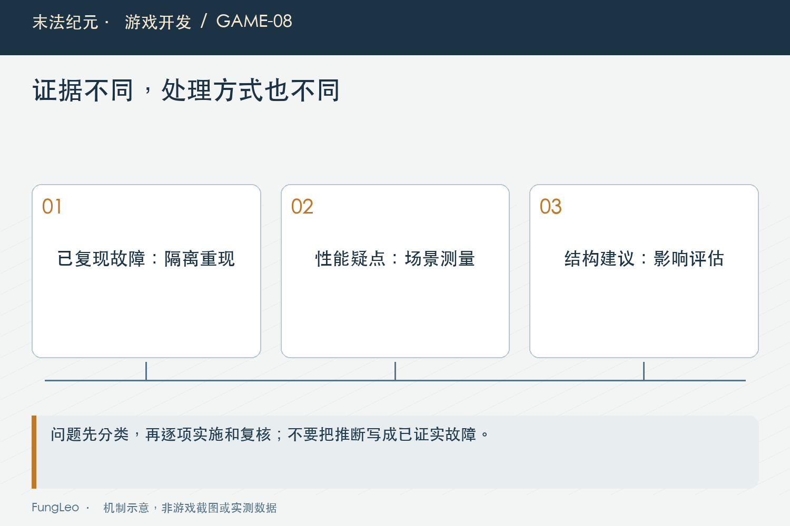

# 末法纪元·游戏开发08：功能越来越齐，什么时候该停下来审查一次

> 本文回顾《末法纪元》的开发过程，技术描述以 2026 年 11 月 5 日审阅快照为准。封面为主题插画，内文图为机制示意。

### 前言

各位看官，游戏做着做着，很容易进入一个状态：背包有了，商店有了，任务和地图也有了，打开菜单一看，功能还挺丰富。

接下来是继续加，还是先停一下？

《末法纪元》的工程里做过核心完整度审查、章节开发审阅，后来又有全项目代码深度审阅。这些工作的价值，在于把“各个功能都能用”放到连续流程里重新检查。

毕竟，问题经常藏在功能之间。

这一篇就用项目里的实际审阅案例，聊聊什么时候该查，查什么，以及查出来以后怎么处理。



### 系统单独正常，接在一起仍然可能丢东西

2026年11月3日的一轮审阅，发现过一个具体问题：商店出售托盘里的未成交物品，没有进入完整的存档保护。

当时的行为是，物品放进托盘后已经离开背包，由界面持有；一部分事件触发的保存请求会检查托盘状态，但定时和退出保存走的路径没有统一守住这个边界。

保存时如果只收集背包、仓库和穿戴装备，托盘里的东西就可能漏掉。

单独看背包，物品确实被移走了；单独看商店，物品也确实显示在托盘里；单独看存档，文件还能正常写出来。

把“未成交托盘存在时保存，再读取”串起来，问题才显现。

这份发现对应当时的代码基线，后续已经有整改记录。这里讲的是问题怎样暴露，不能把它写成当前版本仍然存在的故障。

### 完整度检查，要沿着物品和状态往下追

从这个例子出发，审查可以问得很具体：一件装备现在归谁持有？什么时候离开原容器？中间状态会不会被保存？失败以后谁负责恢复？

同样的追问也可以用在其他流程里。

任务已经完成但奖励未领，切图或退出后还能不能继续领？Boss已经死亡，玩家没来得及拾取，离开地图后奖励怎么保留？合成确认打开以后，材料发生变化，最终提交会用哪一批？

这些问题各自有技术实现，但审查的视角相通：沿着一份真实状态，走过创建、变化、交接、保存和恢复。

只按文件夹逐个说“这个模块看过了”，很容易漏掉交接处。



### 哪些时候，值得专门停一轮

没必要每改一句提示都做全项目审查，但有几种时机值得留时间。

第一是准备交付一个可玩版本。功能已经接上，现在要确认玩家能连续走完流程，而不是每一项都只能从开发存档单独体验。

第二是内容规模变了。多了一整章地图、新职业，或者开始支持高等级循环，原先的数据范围、共享规则和性能假设都可能不够用了。

第三是修复开始反复碰到同一类问题。几个面板都在刷新时抖动，多条奖励路径都要补保护，这就值得看看共同入口和生命周期，而不只是继续追加局部判断。

第四是准备正式导出。编辑器里能运行，不能替代对导出内容和目标环境的核对。

第05篇《从最小闭环到M10，里程碑怎样一步步长出来》讲过收口阶段，这些检查就应该进入阶段安排，而不是等所有新功能排完以后再说。

### 发现问题，先分清结论的分量

代码审阅很容易发现“不够漂亮”的地方：文件长、常量多、旧接口还在、目录里有相似文件。

可它们与“玩家进度会丢”不在同一个处理顺序上。

11月3日的审阅把问题分了优先级。托盘漏存属于应先处理的可靠性问题；职责划分、重复登记和文档治理，也有价值，但需要结合影响和证据安排。

同样，看到一次全表遍历，可以记录性能风险，却不能直接宣布它造成了实际卡顿。要做性能结论，还得测场景、耗时和调用频率。

一份好的审阅，不光要敢指出问题，也要控制自己的推断范围。

### 测试通过，还要确认是谁通过了

这轮审阅还有一个很有代表性的点：测试结束标记要绑定测试身份。

如果运行器只认日志里出现过某个通用“通过”字样，场景装配里其他测试输出的文字就可能造成误判。再加上异步测试提前退出，命令结束了，也未必代表该做的检查已经执行完。

因此，验证工具本身也在审查范围内。

我们依赖测试判断改动是否可靠，就要知道测试是否真的走到了终点、失败是否能被识别、使用的又是哪一份代码和数据。

这些细节后面会有独立文章展开。这里先记住：审查既查游戏，也查我们拿来相信游戏的依据。



### 复现要保留到原来的错误真的消失

托盘问题适合怎样验证？可以在隔离环境里准备一件确定身份的装备，先保存，再走正式暂存入口，把它从背包移到未成交托盘，随后触发对应保存路径，最后重新读取并核对实例。

这里重要的是覆盖那条曾经漏掉的路径。只点一次手动保存，不能证明定时保存和退出保存都经过了统一保护；只看背包数量相同，也不能证明恢复的是原来的实例。

还要检查重复提交。托盘成交以后，金币变化可能触发其他监听者更新。如果物品所有权还没认领完成，同一批材料会不会被二次结算？这就是为什么整改会把一次性认领和广播顺序放在一起处理。

有了这样的复现，修复以后再让同一个场景通过，证据链就比较完整。随后再扩展到空托盘、取消、满背包恢复等相邻情况，检查补丁有没有在边界上制造新缺口。

复现不是为了留下一个永远只对旧代码报错的脚本。它应该固定业务不变量，让后来实现即使重构了，也仍然守住玩家物品不丢、不重复的约束。

### 修复不等于趁机重写

发现全局状态文件职责过多，很容易产生一个念头：干脆把所有业务一次拆出去。

项目整改选择了更具体的边界：把有实际故障关联的交易业务整理到服务里，同时保留稳定门面；其他成长和锻造入口没有因为文件长就跟着全部搬家。

去重也是一样。内容相同，可以作为候选；源稿、运行副本和有历史用途的资料，还要按实际用途判断。不能拿到一张哈希重复表，就开始整批删除。

这样做让每次改动的目的比较清楚。对应问题修了什么，哪些行为保持，验证覆盖哪里，都能逐项对照。

第07篇《从产品文档到代码，中间那一步怎么拆》讲任务拆解，修复同样需要这一步。范围一旦失控，审查发现的几个问题，就可能变成另一场难以验收的大改造。

### 怎么读一份审阅结论

项目的隔离测试运行器提供了定向检查和全量检查入口。下面是与交易案例相关的验证命令示例，这里仅提供入口，没有重新执行这些测试：

```sh
python3 tools/run_isolated_tests.py TradeTraySaveTest SellGearTransactionTest
python3 tools/run_isolated_tests.py --all --committed-tree
```

定向用例帮助确认修复点，全量快照检查用来观察更广的回归。两者的结论都要附代码版本，不能拿修复前跑过的全量结果，替修复后的新逻辑作保。

审阅还应该写清“看见了什么”和“没有验证什么”。代码里找到一段缺少校验的路径，可以形成待复现问题；隔离场景真实触发丢物品，结论就更强；导出资源包检查通过，也仍然不代表目标平台可执行程序已经运行过。

读报告时保留这些区别，才能按证据安排下一步。否则一个静态建议可能被误传成已发生事故，一份历史通过结果又可能被当作今天所有环境都能用的保证。

各位看官自己整理审查结果，不妨在每项后面补一句：别人要重复确认这条结论，应该从哪个版本、哪组条件和哪条入口开始？写得出来，整改就比较容易接上。

### 小结

完整度审查适合发生在可玩版本收口、内容规模扩大、共性问题反复出现和准备导出这些节点。

重点是检查系统交界，区分实证和推断，按玩家影响安排优先级，再用明确范围逐项修复。每份报告还要留下代码基线和验证限制，方便以后理解。

到这里，第一卷“立项与开发方法”就讲完了。从目标、范围、工程起步，到阶段推进、协作、拆解和审查，都是后面具体系统的前置功课。

下一篇进入架构和数据，看看从网页状态走到游戏状态，职责该怎样安排。

### 相关内容

- 第05篇《从最小闭环到M10，里程碑怎样一步步长出来》——给收口留出明确阶段。
- 第06篇《和AI一起做游戏，需求为什么要写成契约》——交付证据需要说明边界。
- 第07篇《从产品文档到代码，中间那一步怎么拆》——把发现的问题拆成可验证的修复。
