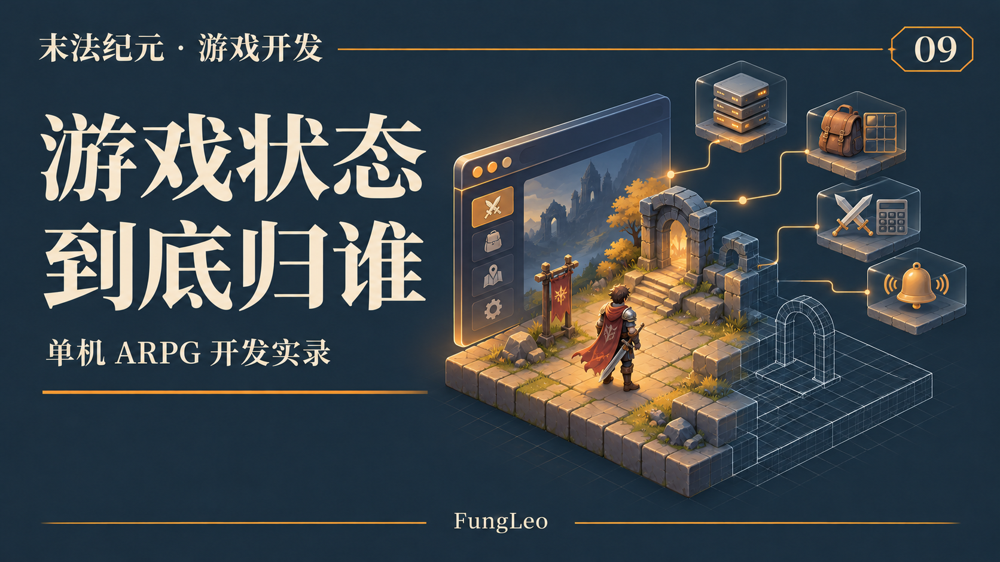
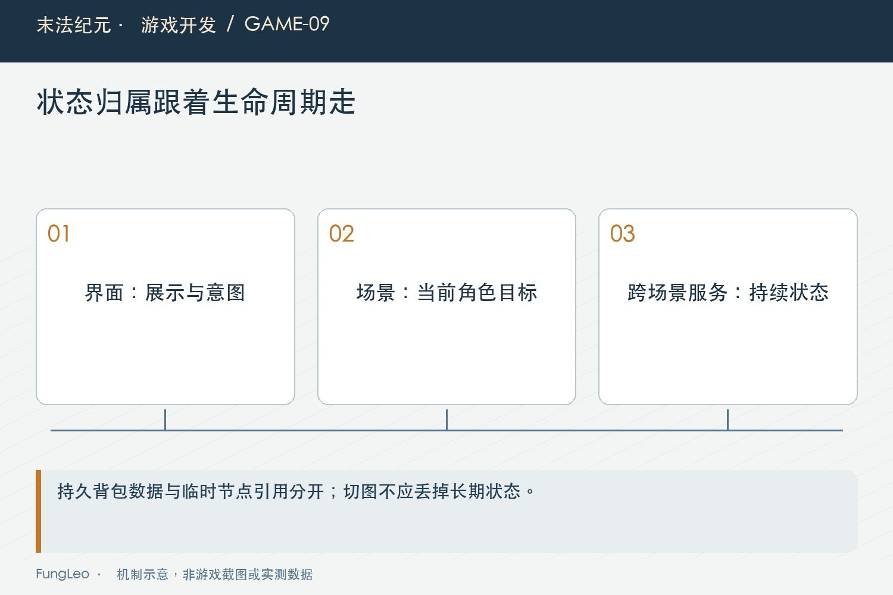
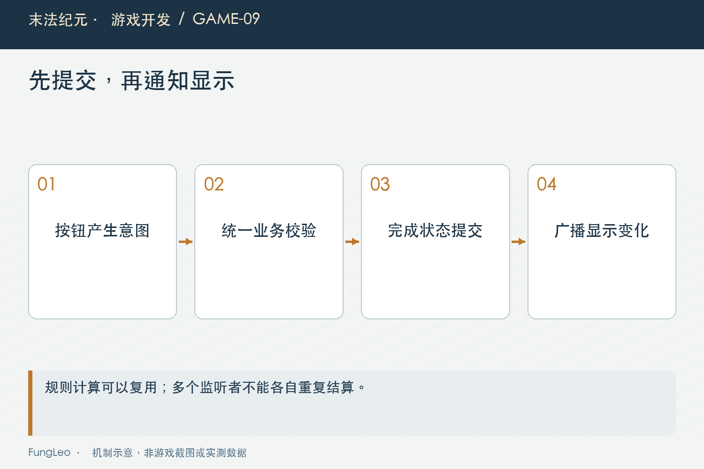

# 末法纪元·游戏开发09：从网页状态走到游戏状态，职责该怎么分

> 本文回顾《末法纪元》的开发过程，技术描述以 2026 年 11 月 5 日审阅快照为准。封面为主题插画，内文图为机制示意。

### 前言

各位看官，第一卷聊完开发方法，这一篇开始往工程里面走。

做前端的时候，我们经常处理组件状态、请求数据和页面之间的共享信息。换成游戏，照样要管理状态，只是状态的主人多了：角色、怪物、地图、背包，还有跨场景活着的服务。

一开始最省事的写法，是谁用到就让谁改。面板顺手扣金币，怪物顺手加物品，全局单例再帮忙保管几个节点。

功能少时还好，切一次图、关一次窗口，引用和状态就开始互相找不着了。

《末法纪元》的工程怎样分这些职责？这一篇用几条具体调用链讲。



### 先问这份状态需要活多久

血条控件会显示生命值，但生命值不应该归血条持有。关掉面板，角色还得活着。

地图里的怪物节点需要记录当前目标和攻击计时，但切图以后，这个节点可能释放。它不能因为被某个全局数组引用着，就一直承担旧地图的工作。

角色的等级、背包和已穿戴装备，则需要跨场景继续存在，还要进入存档。

这三类信息摆在一起，归属就比较清楚了：界面负责展示和发起操作；场景实体负责当前世界里的行为；持久状态和跨场景服务承接需要保留的信息。

**状态放哪里，先看谁拥有它、何时失效。** 访问方便当然重要，但不能只凭方便决定生命周期。

### 全局入口是入口，规则可以拆出去

项目里有GameState，也有DataLoader、SaveManager、MapService等服务。它们跨场景存在，负责各自的状态或流程。

这不意味着所有规则都要写进单例。

背包存储规则在Inventory里，函数显式接收数组；伤害公式在Combat里，接收攻防和随机源等参数。它们不需要知道屏幕上开了哪个面板，也不必持有地图节点。

简化来看，可以这样理解：

```text
界面发起穿戴请求
    ↓
统一业务入口检查条件、更新状态
    ↓
共用规则负责容量、槽位与属性等判断
    ↓
提交完成，通知界面刷新
```

这张图是职责示意，具体穿戴流程还会有自己的校验和反馈。

纯规则便于单独验证，统一入口则让不同操作方式经过相同的业务边界。两者配合，比让每个按钮各算一遍更容易维护。



### 事件通知变化，不替代结算

项目的EventBus集中登记了拾取、金币变化、装备变化、任务相关等信号。

一个系统提交了变化，其他系统可以按需响应。例如背包变化后，面板更新显示；等级变化后，相关提示刷新。

可事件一多，也容易让人看不清谁真正负责改状态。

如果按钮发一个事件，三个监听者各扣一次费用，就算彼此没有直接引用，业务也照样乱。事件适合广播已经发生的变化，不能靠“谁恰好监听到”来决定唯一奖励和费用的所有权。

第08篇《功能越来越齐，什么时候该停下来审查一次》提到的交易托盘整改，就涉及这个边界：先处理真实物品的所有权和结算，再让观察者看到提交后的状态。

### 界面可以关，世界可能还在继续

游戏比一般静态页面多了一个很直观的压力：玩家打开背包时，后台可能继续战斗。

装备耐久在变，物品在进入背包，面板不能把打开那一刻的快照永远当成当前状态。反过来，也没必要每个物理步都重新搭一遍控件树。

因此要区分业务状态改变和显示如何更新。前者应有明确入口，后者订阅必要变化，再按影响范围刷新。

面板隐藏以后，相关动画和处理是否仍在空转，也要检查。节点还存在，不代表它每帧都必须做事。

这类性能问题后面有独立专题。架构这里先把所有者和通知边界划清楚，优化才有可以落脚的地方。



### 用一段背包操作，看规则怎样脱离面板

Inventory里的移动交换函数，能说明这种职责划分。下面摘取实际实现的核心，省略与本例无关的常量：

```gdscript
## 拖到空格为移动，拖到占用格为交换；保留物品实例。
static func move_or_swap(inv: Array, source: int, target: int) -> bool:
    if source < 0 or target < 0 or source >= inv.size() or target >= inv.size() \
            or source == target or not inv[source] is Dictionary:
        return false
    var displaced: Variant = inv[target]
    inv[target] = inv[source]
    inv[source] = displaced
    return true
```

它不需要知道鼠标坐标、格子控件和拖拽影子，也不负责播放提示动画。输入是容器和两个位置，结果是交换是否成立。调用方负责把玩家动作转换成请求，再按结果更新显示。

这样同一条规则可以用于鼠标拖拽，也可以在隔离测试里直接传数组验证。以后换一个背包界面，不需要把交换逻辑复制一遍。

但要注意，独立规则不等于绝不修改状态。这个函数会修改传入数组。说它“没有全局依赖”，和说它“是没有副作用的纯函数”，是两个判断。把这点标清，调用方才知道是否需要先在副本里演练。

同样，业务层可能需要在交换成功后发一次背包变化通知。通知放在哪个调用层，要看统一入口的约定；不能让存储函数、界面和外层服务各发一次，结果一轮移动刷新三遍面板。

### 切图是一次很好的职责检查

如果想检验模块有没有缠在一起，可以沿着一次切图追一遍。

旧怪物、计时器、目标引用和地图缓存如何清理？新世界准备好以后，玩家状态从哪里恢复？界面还会不会收到旧节点发来的更新？

全局服务确实需要继续存在，但它持有的数据不应无意中把旧地图也留住。异步等待恢复时，还要检查原来的目标和场景是否有效。

这些检查与第04篇《选了Godot以后，工程第一天要准备什么》的目录职责是一体的。目录划分只是让代码好找，真正的边界还要体现在运行时的依赖与释放上。

### 谁持有引用，谁也要考虑失效

再看锁定目标。界面要显示怪物血量，自动战斗要向它移动，技能还可能等一个前摇以后命中。几处都能访问目标，不代表目标就必须一直存在。

怪物死亡、切图或读档，都可能让旧目标失效。延迟回调恢复时，要重新检查节点是否有效、是否仍属于当前流程，以及目标有没有被玩家换掉。否则一次等待之前的正确选择，可能在等待以后变成旧指令。

这里可以用“意图”和“结果”分开理解。按下攻击时表达了对某个目标的意图；真正结算时，还要满足当下的规则。不能因为之前选中过，就跨越死亡和切图继续执行。

缓存也有类似问题。某条路线由旧导航状态算出，门打开以后它是否仍能用？全局服务里存着一个地图投影参数，窗口缩放以后有没有更新？这些都需要定义失效事件，而不是只问缓存能不能命中。

从前端经验看，这有点像异步请求回来时，页面筛选条件已经变了。旧结果即使本身正确，也可能不再适合当前界面。游戏里还多了节点释放和物理世界变化，需要更明确的检查。

我会建议先把一条完整流程画出来，标出每个对象的创建者、持有者和释放点。画到某个地方，大家都觉得“反正别人会清”，那往往就是值得回代码里确认的位置。

职责划分也要适度。只有一次简单调用的辅助函数，不必立刻拆成独立服务；真正需要复用或跨生命周期维护的逻辑，再给它清楚的接口。目标是让状态变化好追踪，不是让每个动作都经过五层管理器。

还有一个实用检查，是把面板关掉以后再执行同一条业务。如果物品规则必须依赖某个已经释放的控件才能完成，说明显示和结算可能仍然绑得太紧。业务能够独立成立，界面才能放心地重建、替换或隐藏。

### 小结

从网页状态走到游戏状态，原来的状态管理经验仍然管用，但需要多问生命周期和所有权。

《末法纪元》用场景实体、跨场景服务、共用规则和UI分别承担职责。具体实现还会继续演变，不能只靠一个漂亮的目录图证明架构已经合理。

各位看官整理自己的工程时，可以先挑一份状态，问它属于谁、谁能修改、退出场景后还应不应该存在。答案比“要不要再抽一个管理器”更有用。

下一篇拿装备继续拆：模板、玩家手里的实例、界面显示的数据，为什么值得分开？

### 相关内容

- 第04篇《选了Godot以后，工程第一天要准备什么》——目录和服务的起点。
- 第08篇《功能越来越齐，什么时候该停下来审查一次》——从状态交接处发现问题。
