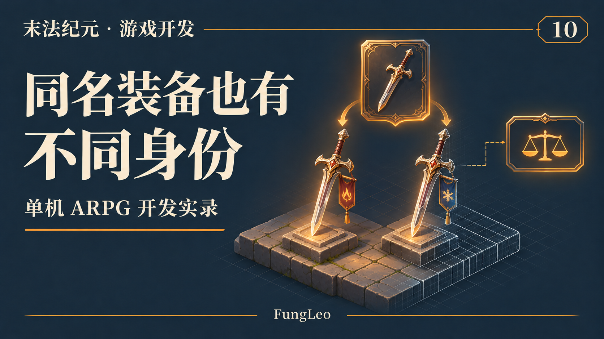
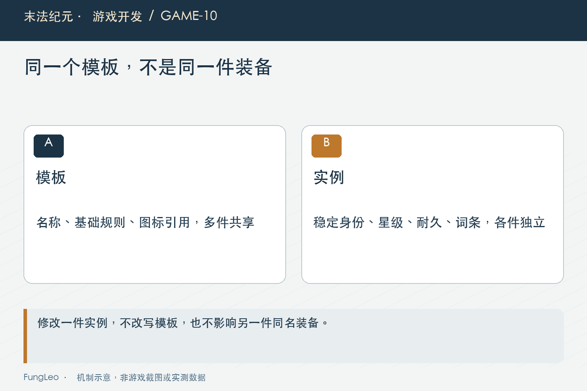
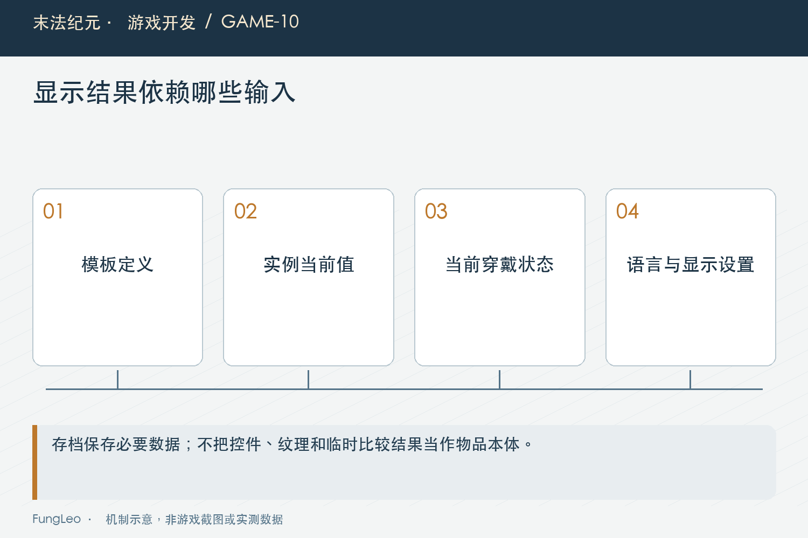

# 末法纪元·游戏开发10：同一种武器，为什么不能共用一份装备数据

> 本文回顾《末法纪元》的开发过程，技术描述以 2026 年 11 月 5 日审阅快照为准。封面为主题插画，内文图为机制示意。

### 前言

各位看官，第09篇《从网页状态走到游戏状态，职责该怎么分》聊状态归谁，这一篇拿装备继续拆。

假设地上掉了两把铁制短刃，名字相同，图标相同，部位也相同。程序是不是只存两次物品ID就行？

如果装备没有任何个体差异，也许暂时够用。可一旦有品质、星级、随机词条和耐久，就要回答：玩家强化的到底是哪一把？

再往前一步，背包提示框里显示的评分、颜色和比较箭头，又是不是都应该跟着装备写进存档？

这几类信息放在一起很方便，长久维护却容易混。模板、实例和显示数据，值得先分清。



### 模板回答“这是什么”

《末法纪元》的装备配置里，铁制短刃有稳定ID、名称、槽位、图标、基础档位和词条池等信息。

这些描述的是这一种装备。它允许哪些属性，默认怎么展示，属于哪个部位，都可以在模板里查到。

模板不应该承担“玩家这把武器已经强化三次”这样的状态。

同一个模板可能生成很多件装备。改一件实例的耐久，不应让所有同名武器一起磨损；出售其中一把，也不能把模板本身删了。

如果把模板当成玩家物品来改，最开始省掉的那点代码，后面通常要靠排查共享引用补回来。

### 实例回答“具体是哪一件”

项目的ItemFactory是装备实例的共用生成入口。掉落、商店和任务沿着同一套规则生成装备，再交给各自流程处理。

实例有自己的instanceId，以及生成后的等级、品质、星级、属性和词条等数据。

下面只是关系示意，省略了正式结构中的很多字段：

```text
模板：铁制短刃
   ├─ 实例A：自己的ID、品质、星级、词条、耐久
   └─ 实例B：另一个ID、另一组生成结果
```

背包整理可能把实例A从第3格移到第8格，但它还是同一件装备。格子下标描述位置，实例ID描述身份。

这个区别会一路影响拖拽、交易确认、材料预选和存档。把“当时第3格的东西”当成身份，整理一次背包就可能选错材料。



### 随机生成以后，得把结果留下

随机词条是生成时做出的结果。打开背包、重新穿戴或者读取存档，都不应该顺便再摇一次。

否则玩家明明没做重铸，装备却在重新登录后变了属性，这就很难解释。

因此，哪些内容按模板查询，哪些内容属于生成快照，要明确约定。模板改动以后，旧装备是否跟着变，也需要有版本策略，不能依赖“每次都从最新表重算”碰运气。

项目里生成基础属性时有复制，词条也生成到实例自己的结构中。但看到duplicate这个名字，还不能断言所有嵌套数据都安全了。浅复制和深复制的范围不同，要看后续是否会修改里面的数组和字典。

最直接的验证，是修改一件实例，然后检查另一件实例和原模板都没有跟着变。

### 显示数据回答“现在怎样解释给玩家看”

品质颜色、名称、评分、与已穿装备的比较，是另一层工作。

ItemUtil集中提供品质名称和颜色等共用口径，Equipment里有评分与比较入口。地面物品、背包和提示框可以复用，避免同一件装备在不同界面显示成两种品质含义。

但“比当前装备强”是有上下文的。身上换了一件东西，比较结果就可能改变。它不适合当成这件装备永久不变的属性存下来。

图标纹理、控件引用和临时提示框布局，更不应该混进持久物品数据。

显示层可以加工一份供界面使用的结果，但要知道依赖了什么：模板、实例、当前穿戴、语言，或者某项设置。相关输入变了，旧显示结果就可能失效。



### 从源码里看一眼，实例到底保存了什么

ItemFactory生成装备时，会把基础属性复制出来，并把一部分规则倍率留下快照。下面是正式生成函数中的字段节选，不是完整的可执行函数，变量来自前面的校验与计算：

```gdscript
var raw: Dictionary = (raw_bases[str(tier_start)] as Dictionary).duplicate(true)
return {
    "kind": "equip", "itemId": item_id,
    "instanceId": "%s_%s" % [instance_prefix, Crypto.new().generate_random_bytes(16).hex_encode()],
    "equipmentRuleVersion": RULE_VERSION_DYNAMIC if dynamic else RULE_VERSION_BASE,
    "requiredLevel": required_level, "level": required_level,
    "quality": quality, "star": 0,
    "rawBaseAttrs": raw,
    "qualityMultiplierSnapshot": float(q.get("baseMultiplier", 1.0)),
    "starMultiplierSnapshot": float(cfg.get("starMult", 0.1)),
    "affixes": rolled.affixes, "pctAttrs": rolled.pctAttrs, "count": 1,
}
```

这里同时保留模板引用和实例结果，很有代表性。模板ID让我们知道它属于哪种装备，基础属性和词条则描述这件物品生成后的内容。规则版本为后续识别和兼容留下依据。

倍率快照也不是为了把最新配置再抄一遍。它让这件装备的生成语义有机会被保留下来。后面调整品质或星级规则时，哪些旧装备继续沿用、哪些要迁移，就能按明确版本处理，而不是在打开背包时悄悄全部改值。

具体哪些字段应当快照，要由玩法与兼容策略决定。这里展示项目当前做法，不建议读者把所有系统都照着这些字段复制。尤其动态等级装备还有自己的缩放逻辑，不能删掉前面的校验，只留这个返回字典就当作生成器。

### 分开以后，也要防止重复保存

三层分开，不意味着每一层都复制一整套装备信息。

模板里已有、且明确允许运行时查询的内容，就沿着稳定ID去找；实例必须保留的生成结果，按规则保存；临时显示结果则在需要时组织和更新。

真正的边界要结合兼容要求决定。为了避免存档变大，把所有实例属性都删掉再重新随机，显然不行；为了省一次查询，把整张模板和资源对象塞进每件装备，也会付出代价。

第08篇《功能越来越齐，什么时候该停下来审查一次》讲过沿物品追踪所有权。这里可以接着追：这份信息最初在哪里产生，谁负责修改，读档时又从哪里恢复。

### 用一组操作检查分层有没有串起来

可以准备两件同模板装备，记录各自身份和生成属性，然后按一条连续路径操作：整理背包，穿上其中一件，卸下来，再保存和读取。

这几步以后，位置允许变化，穿戴关系按操作变化，实例身份与不应重掷的属性则要保持。只比较名称看不出来，至少要核对实例ID和关键快照字段。

再让其中一件发生合法修改，例如改变耐久或者执行一次强化。另一件装备和原始模板应该保持自己的状态。如果它们一起变了，就要检查是否共享了可变字典或数组。

显示层另外测。把当前穿戴装备换掉，候选装备的比较结果应随上下文更新；换一种语言或显示设置，也可能需要刷新文本和颜色。这样的变化通常不需要重建那件装备的随机结果，更不应因此给它一个新实例ID。

还有一个容易漏的边界，是临时预览。商店和重铸面板可能显示某种预计结果，但预览不一定意味着真实实例已经生成。每次悬停就消耗随机数、每次刷新就换一组词条，会让“查看”反过来影响最终产物。

因此要明确预览承诺了什么。它可以显示档位、件数和确定的成本；随机结果如果只有提交时才生成，界面就不要把尚未成立的数值当成保证。反过来，如果流程确实已经锁定产物，就要保存计划，不在重试时偷偷换一件。

这组检查横跨数据、业务与显示，能帮我们看到分层是不是只停留在文件名上。真正的收益，是同一件物品经过不同界面和场景以后，仍然有清楚的身份、属性来源和修改规则。

同样，物品ID不是文件路径，实例ID也不是背包位置。给模板换图标时，不应顺便改变身份；把装备移进仓库时，也不应重新生成实例。把这些“不该发生的变化”写成检查项，比只看界面上还有一把同名武器更可靠。

### 小结

模板描述一种装备，实例保留具体一件的身份与状态，显示数据结合当前上下文向玩家解释它。

把这几层分开，装备的生成、修改、保存和展示才更容易对齐。各位看官做别的业务系统也一样能用到：商品资料、成交快照和页面展示，并不总是同一份数据。

下一篇聊配置。表越来越多以后，怎样尽早拦住那些看着像JSON、实际已经配错的内容？

### 相关内容

- 第09篇《从网页状态走到游戏状态，职责该怎么分》——状态归属和生命周期。
- [成为全栈·产品篇·领域建模：一个文章系统有哪些实体、什么关系](https://blog.csdn.net/fungleo/article/details/164139553)——从关系和约束理解数据。
