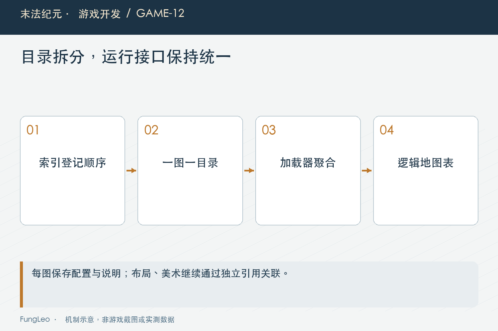
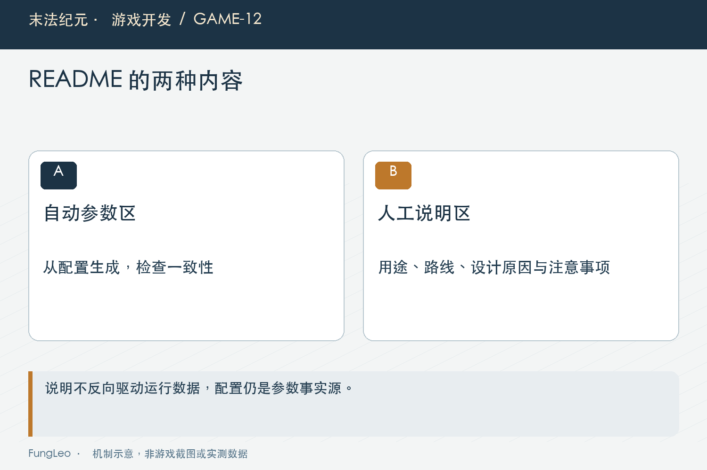

# 末法纪元·游戏开发12：地图越来越多，为什么拆成一图一目录

> 本文回顾《末法纪元》的开发过程，技术描述以 2026 年 11 月 5 日审阅快照为准。封面为主题插画，内文图为机制示意。

### 前言

各位看官，地图少的时候，一张JSON总表挺好用。打开文件，所有地图都在里面，想找什么搜一下就行。

等地图多起来，一次改动可能同时碰到尺寸、NPC、刷新点、出口和解锁条件。再往里面加说明，还得记得JSON不能直接写注释。

《末法纪元》后来把地图拆成一图一目录，配置旁边放README，再用索引统一加载。

但光把大文件剪成小文件，还不能算这件事做好了。这一篇聊目录拆分之后，要一起守住哪些边界。


### 先看目录承担了什么

当前地图组织大致是这样：

```text
data/maps/
  index.json
  ch01/
    camp/
      map.json
      README.md
```

地图配置放map.json，章节目录组织归属，地图目录名与稳定ID一致。入口索引只登记有序的相对路径。

这带来的第一个好处很直接：改一张地图，可以把运行参数和维护说明放在一起看。审阅差异时，也更容易知道这次到底动了哪张图。

但“一图一目录”不意味着这张图涉及的所有资源都搬进来。可通行布局仍有自己的目录，美术也沿用资源组织方式。地图配置通过路径引用它们，不再复制一份作为新源头。

### 拆存储，不必让调用方全改

DataLoader按索引聚合地图，对外仍提供maps逻辑表。

也就是说，文件组织可以变，游戏系统访问地图的入口仍然可以保持稳定。

这点很关键。否则只是想方便编辑配置，却让切图、任务、存档和地图UI都开始自己拼路径、读文件，后面的维护成本反而更大。

工具侧也有map_catalog模块负责统一读写，生成器不再各自直读旧总表。

第09篇《从网页状态走到游戏状态，职责该怎么分》讲职责分开，这里对应的是物理存储和业务接口的分开。调用方需要地图定义，不一定需要知道它来自哪个小文件。



### README解释原因，不能变成另一份配置

地图参数本身适合结构化存储，设计意图则未必。

为什么入口放在这里，这条路要玩家经过哪个区域，刷新密度想形成什么节奏，这些解释放在README里，读起来比往JSON塞自造备注字段更清楚。

可如果README再手工抄一遍所有参数，迟早有一份会过期。

项目的做法是划分自动参数区和人工说明区。工具从map.json生成参数表，人工维护用途、路线和注意事项。

所以“配置源”仍然是map.json。README中的表格帮助人阅读，不参与运行结算。改参数以后再同步生成，避免两边各自维护一套数字。

### 自动生成，也有它覆盖不到的部分

这里有个容易误会的地方：工具能更新参数，不代表说明全文就自动正确。

地图从直达改成中途穿越另一区域，参数可以更新，但人工写的路线说明也要跟着改。章节用途变化以后，旧的设计理由更不能一直留着。

因此项目规则要求每次编辑地图同步README。自动区交给工具，人工区还是要审阅。

如果文档里出现两个安全区描述，看起来互相冲突，也应该回到实际配置与运行规则核查。机器生成能减少抄写错误，不能替维护者消除所有语义矛盾。



### 索引不是放进去就完事

一张地图目录建好了，却忘记登记索引，游戏可能根本不会加载它。反过来，索引路径指向已经移动的文件，启动又会失败。

check_map_catalog会检查实际目录和登记是否一致，还核对目录ID、章节归属、布局文件和README参数区。

工具入口是：

```sh
python3 tools/check_map_catalog.py
```

需要刷新自动参数区时，工具另有更新选项。正式编辑时先看影响范围，别把一次只想检查的操作变成改写文件。

目录检查通过，也不等于地图已经能玩。出口引用、门禁、实际通行和跨图行为，还要跑对应配置与场景测试。

第11篇《JSON越写越多，怎样把配置错误拦在进游戏之前》区分过校验层次，这里正好对应：文件和说明一致，只是其中一层。

### 拿一次出口调整，走完整个维护过程

假设要把一条道路改为先经过另一张野外图，不能只修改出口的目标ID。还要核对目标入口、解锁条件、返回路线，以及玩家看到的目的地名称。旧任务导航是否依赖原路线，也应沿引用查一遍。

运行配置修改以后，自动参数区需要同步，人工说明里“从这里直接到达某地”的描述也要更新。生成工具只知道字段变了，不知道哪句话的设计解释已经过期。

这时可以先看Git差异，再运行只读检查。需要刷新参数区时，使用带更新参数的命令，但要知道它会写入说明文件：

```sh
 git diff -- data/maps/
python3 tools/check_map_catalog.py
python3 tools/check_map_catalog.py --update
 git diff -- data/maps/
```

它们不是必须无脑顺序执行的流水线。第一次只读检查帮助确认不一致，更新命令用于同步机器维护区，最后再看差异，确认没有覆盖人工说明或混入其他地图的改动。

如果只改了设计理由，没有动运行参数，可能不需要刷新整个目录。工具让重复动作省力，但操作者仍然要控制改动范围，不能因为命令方便就把所有文件重新格式化一遍。

目录一致以后，再到游戏里验证道路。正向走得通，还要试返回、锁定状态和存读档；文档同步通过，只证明资料之间的一部分关系成立。

### 新增一张地图，要能完整找回来

实际加图时，可以顺着一条检查线走：建配置与README，登记索引，更新章节说明，核对稳定ID和外部引用，再验证布局与往返路线。

这套过程不复杂，却能让后来的人找到地图、理解用途、定位配置，还知道怎么复核。

如果只有作者本人记得某个生成脚本会偷偷改总表，工程一换人，就容易断在这里。

### 工具怎样避免把说明整篇重写

map_catalog里的README更新方法，用两段标记定位机器维护区，替换其中的参数表，保留前后的人工内容。下面是这个处理的简化示意，省略了标题与新文件生成逻辑：

```python
# 示意：正式实现还会校验参数区标记唯一。
before, remainder = current.split(START, 1)
_, after = remainder.split(END, 1)
updated = before + parameter_section(data) + after
```

标记唯一性很重要。如果一个README里复制了两段自动区，工具不能随便猜应该改哪一段；直接报错，维护者反而容易发现异常。若参数表完全由人工改写，下次生成被覆盖，也应当是有文档约定的行为。

索引同样不应该复制地图属性。它负责加载顺序和路径，如果再保存地图等级、名字和尺寸，就又出现一份需要同步的配置源。路径可以被校验，属性则回到地图自己的文件读取。

还有一种维护问题，是文件移动以后漏了脚本。游戏加载器已经按目录聚合，旧生成器却仍然写总表；运行时看到的是新目录，开发者以为自己改的是有效配置。统一工具读写入口，就是为了切断这种两套来源并存的情况。

新增或移动地图时，应当搜索旧路径的引用，核对生成器、测试和文档都已经迁移。只在游戏里试一次没有报错，不足以证明下次生成不会把变化写回旧位置。

最后，稳定ID和显示名称要分别对待。想把地图改个更合适的中文名，通常不需要改变跨图引用身份；如果确实要换ID，就涉及任务、出口、存档与历史记录，不能当成一次普通文件夹重命名。

这也是目录治理真正带来的要求：它让每张图好找，同时让每次变化有明确的同步边界。文件拆小以后，维护责任反而要写得更清楚。

如果一次检查发现多个说明不同步，先确认是不是生成器版本变化导致，不要直接把所有差异都当成本次地图设计修改。把格式变化和玩法变化分开看，审阅者才能准确判断这一轮到底改了哪条路、哪些规则。

### 小结

一图一目录解决的是编辑和维护组织；索引聚合保留业务接口；README补充设计意图；生成工具与检查器负责降低重复维护的成本。

这几部分配合起来，拆文件才真正有收益。各位看官遇到大配置表时，也可以先问：拆完以后，谁负责聚合，谁是唯一配置源，说明怎样保持同步？

下一篇看怪物。它们也按章组织了，但行为能力为什么不能继续按怪物名字写分支？

### 相关内容

- 第09篇《从网页状态走到游戏状态，职责该怎么分》——接口与职责的边界。
- 第11篇《JSON越写越多，怎样把配置错误拦在进游戏之前》——目录检查与运行校验的分工。
