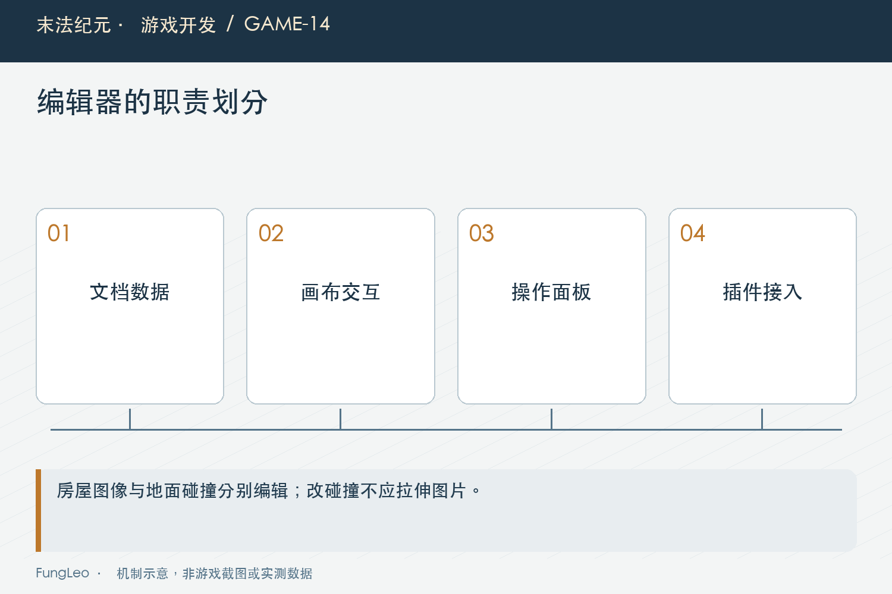
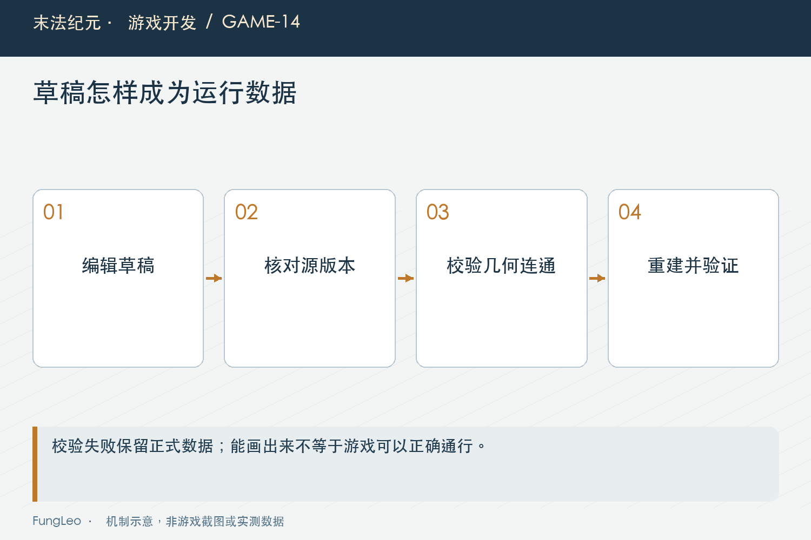

# 末法纪元·游戏开发14：游戏还没做完，值得先做一个地图编辑器吗

> 本文回顾《末法纪元》的开发过程，技术描述以 2026 年 11 月 5 日审阅快照为准。封面为主题插画，内文图为机制示意。

### 前言

各位看官，地图配置可以手改，坐标可以手填，碰撞多边形也能在JSON里一点点调整。

可如果只是想把房子挪开一点、给路边补些碎石，每次都得对照坐标、改文件、重建、进游戏再看，重复几轮以后，就会开始惦记一个能直接拖的工具。

《末法纪元》做了一个营地地图编辑器，作为Godot里的编辑器插件使用。

这一篇聊它为什么值得做，以及怎样让工具真正减少重复劳动，而不是再添一个需要长期照顾的新项目。


### 先解决一张图里的明确操作

营地编辑器有四种模式：绘制地面装饰、编辑碰撞、移动整体物件、调整道路控制点。

范围很具体。它能移动既有房屋、树和围栏，能改碰撞顶点，也能用已有笔刷处理地面装饰。但不能随意新增删除所有物件，不改地图尺寸，也没有扩展成所有地图通用工具。

这让第一版有了可验证的目标：在画面上完成一组经常发生的调整，应用以后，游戏按相同位置和通行结果运行。

如果一开始就追求“任何地图都能做”，光编辑模型和工具选项，就可能把眼前的营地工作拖住。

### 可视化背后，仍然需要明确数据

编辑器分为文档、画布、面板和插件接入几部分。

文档管理布局、撤销和草稿；画布绘制并处理鼠标；面板提供操作入口；插件把它接到Godot编辑器主屏幕。

这套分工让“数据改了什么”和“鼠标怎么点”不用挤在一起。

例如拖动碰撞顶点，应该修改碰撞轮廓，不应该顺便拉伸房屋贴图。移动整体物件，则需要把图像位置、脚底层级和碰撞一起移动。

玩家最后看到的是一个房子，工具里仍然要把表现范围和玩法轮廓分清。



### 草稿保存，不等于立即改正式地图

编辑器保存草稿时，游戏不会加载草稿文件。点击应用，才进入校验和重建链路。

这中间检查源文件哈希、地面格、多边形、边界、NPC和出入口等固定点，以及连通性。

源哈希也很实用。编辑期间如果另一个任务修改了正式布局，旧草稿不能无声覆盖新内容，需要重新载入。

正式应用还会调用构建工具，同步重建布局、地面覆盖、道路和实体清单。失败时保留原正式文件，成功后删除草稿。

这里需要的是可重复的编译流程，不需要每次让AI重新猜一遍“这个画面应该变成什么地图”。

第12篇《地图越来越多，为什么拆成一图一目录》讲配置源，这里同样要明确创作源、草稿和运行产物之间的方向。

### 看着能拖，不代表交互已经好用

工具本身也会有很具体的Bug。

历史修复里，Shift点击线段想加顶点，却先命中了附近旧顶点，结果变成拖点。还有碰撞标记被美术矩形盖住，大幅平移后画布内容跑到工具栏上面。

这些都不是地图数据错了，而是命中优先级、绘制顺序和画布裁切的问题。

所以编辑器验收要覆盖操作：加点、删点、撤销、重做、平移、缩放，还要确认平移不会修改地图数据。

工具是给开发者用的，也有用户。一次操作老是点不中，省下的文件编辑时间很快就会被找按钮和重试消耗掉。



### 从拖一下房子，到游戏里真的能走

可以拿一个很小的改动检查工具链：把路边的一栋既有房屋挪开，让道路稍宽一些。先记下原始位置，再拖动整体物件，确认碰撞和脚底层级一起移动，保存草稿以后不要立刻假定正式地图已经改变。

应用时要检查固定落点和通行关系。房屋让开了道路，却可能压住旁边NPC；外观位置合理，碰撞轮廓也可能越界。工具应当把这些条件挡在正式产物替换之前。

然后重新进入营地，用角色从相关道路走一遍，检查转角和边缘。图上轮廓看起来没有相交，不代表带碰撞半径的角色就一定能够通过。编辑画布的几何检查与实际移动验证，需要互相补充。

如果撤销这次操作，也要明确撤销的是哪一层。草稿中的撤销栈，不能被误认为会自动恢复已经应用到正式地图的所有文件。工具要么提供明确的重新加载与版本恢复流程，要么把边界说明白，避免用户以为一次快捷键就能跨越所有阶段。

还有一种更隐蔽的情况：应用失败以后，部分贴图已生成、部分配置没更新。玩家进入游戏看到的就可能是新画面配旧碰撞。因此原文件保留和生成失败恢复，属于工具交付的重要部分，不能只靠“平常不会报错”省掉。

这些检查听着琐碎，恰恰决定工具能不能放心交给别人反复使用。

### 值不值，算的是重复成本

判断要不要做编辑器，可以先看三件事：操作重复多少次，手工出错有什么代价，工具能稳定承接多少内容。

一次性坐标调整，未必值得为它开一整套界面。持续要改道路、碰撞和物件摆放，且每次都需要联动重建，工具价值就更明确。

不过，不能因为做了编辑器，就保证所有修改都安全。图上能画出来，不代表布局可通行；校验通过，也还要进游戏检查实际移动和遮挡。

第11篇《JSON越写越多，怎样把配置错误拦在进游戏之前》讲分层验证，这里是同一原则。工具把容易重复的工作接走，人仍然要判断设计是否合理。

### 编辑器测试，最好真的经过鼠标交互入口

历史上的碰撞加点问题，适合用一个明确场景复核：选一条靠近旧顶点的边，按住Shift点击，检查新增点数量和位置，再撤销，确认恢复原轮廓。如果只直接调用“插点”函数，可能绕过当时真正错误的鼠标命中分支。

平移也是一样。按住空格拖动画布，视图位置应该改变，地图数据不应该改变。画布内容还得被裁切在工作区内，不能盖住工具栏。测试时看的是输入、显示与数据三者的关系。

项目里有编辑器用例，也有实际窗口入口。下面这组命令展示如何分别观察逻辑和窗口行为，不表示本轮重新执行了历史验收：

```sh
python3 tools/run_isolated_tests.py CampMapEditorTest
python3 tools/run_isolated_tests.py --rendered CampMapEditorTest
```

真正要操作应用按钮时，还应在隔离副本中进行，避免测试草稿改写正在使用的正式营地。单纯打开工具和查看画布，与会生成正式文件的操作，影响范围并不相同。

工具成本也可以更具体地记录。原来调整一次物件需要改哪些文件、重建几步、验证多久；有工具以后，减少了哪些手工操作，又新增了哪些维护负担。没有前后记录，就先讲节省了步骤，不急着承诺效率提升多少倍。

长期来看，数据格式比按钮位置更值得稳住。只要草稿能明确表达操作结果，校验和编译可以重复运行，界面再调整也比较容易迁移。反过来，所有变化只藏在画布节点里，关窗口才发现没有可靠文档模型，后面扩展和测试都会吃力。

这也是为什么营地先作为试点很合适。它能用有限对象验证编辑模型、应用链和交互反馈，不需要为了证明价值就立刻把所有章节都接进来。试点中真正成立的能力，再逐步提取成共用工具，扩展时风险更清楚。

各位看官可以先选一个最常发生的修改，把修改前、草稿、应用结果和运行验证四个状态留下来。它们能一一对照时，工具就不只是一个看着方便的画布，而是开始承接真实生产流程了。

### 小结

营地编辑器值得写，是因为它把明确的重复操作接成了草稿、校验、重建和运行验证这一条线。

它的边界也同样重要：这是营地试点，使用已有对象和笔刷，没有因为能拖动几样东西，就自动变成通用关卡平台。

各位看官准备做内部工具时，不妨先选一项最常返工的操作，把它做到能可靠应用，再决定下一步扩展。

下一篇沿着这个问题继续：把内部编辑器做成独立软件，再让网友制作地图，中间还差哪些东西？

### 相关内容

- 第11篇《JSON越写越多，怎样把配置错误拦在进游戏之前》——校验与实际行为的边界。
- 第12篇《地图越来越多，为什么拆成一图一目录》——配置源与维护链路。
