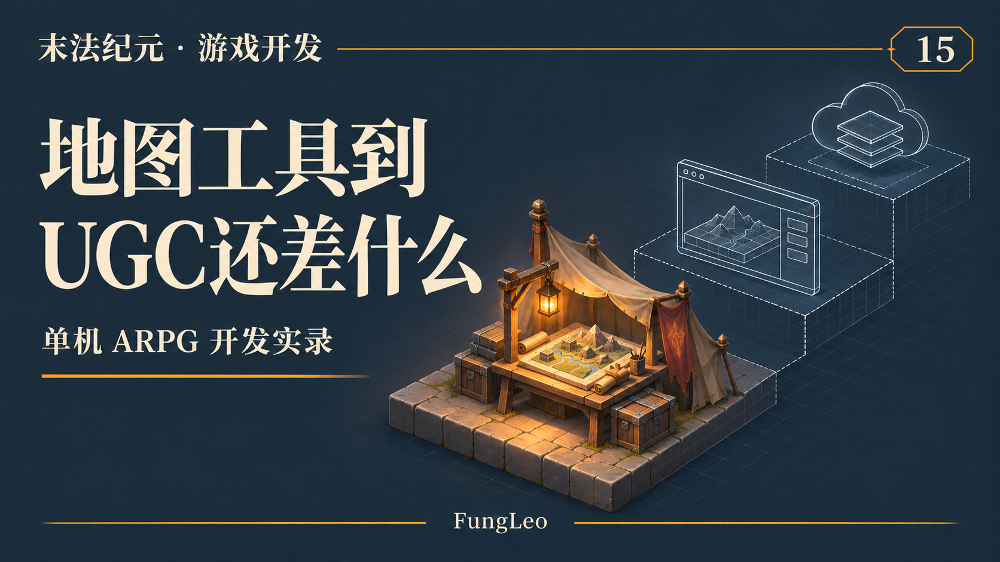
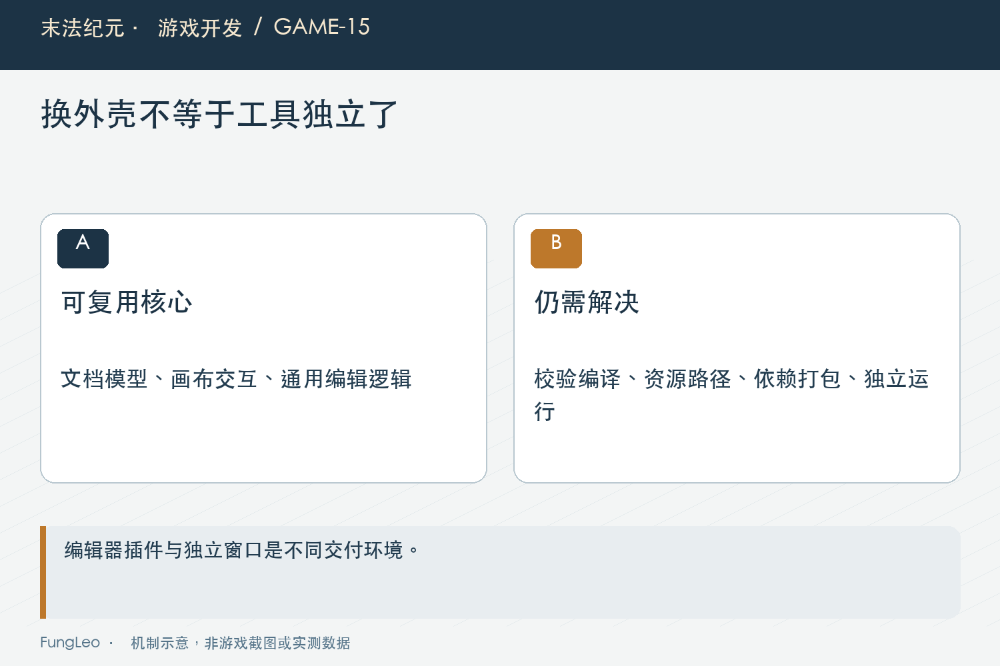
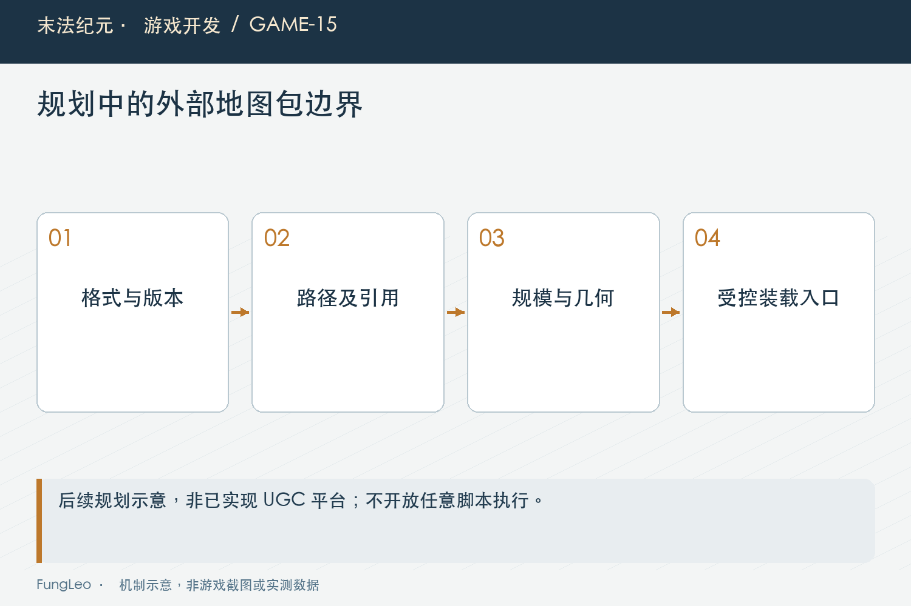

# 末法纪元·游戏开发15：能编辑营地以后，离网友帮我做地图还有多远

> 本文回顾《末法纪元》的开发过程，技术描述以 2026 年 11 月 5 日审阅快照为准。封面为主题插画，内文图为机制示意。

### 前言

各位看官，第14篇《游戏还没做完，值得先做一个地图编辑器吗》介绍了营地地图编辑器。

既然已经能拖物件、改碰撞、调整道路，很自然就会想到下一步：把工具发出去，让别人也来做地图，做好以后放进游戏。

这个方向挺有吸引力，但“自己能用”“独立软件”“网友做的图能安全接进游戏”，分别是不同阶段。

《末法纪元》做过这条路线的可行性评估。这一篇聊差距和推进顺序，不把评估建议当成已经交付的平台功能。



### 换一个外壳，确实不一定要重写

当前工具的文档层和画布层，是普通数据对象与Control；插件入口负责接入Godot编辑器。

这种分工给独立化留下了复用空间。把编辑器专属接口换掉，文档和画布的一部分逻辑可以继续使用。

这也是评估倾向用Godot导出独立应用的原因。熟悉的坐标、资源与画布逻辑可以沿用，不必马上另写一套浏览器渲染器。

但这里不能把“可以复用”说成“点一下导出就完成”。桌面应用还要有自己的文件打开、保存、错误反馈和资源定位方式，离开工程目录以后也得能运行。

### 真正的依赖，藏在应用按钮后面

营地编辑器的应用流程会调用Python工具，再调用地图生成器。

在开发机上，Python、工程源码和所需资源都在，流程能顺着走。发给别人以后，对方未必装了Python，也没有同一棵目录树。

所以独立化要算的账，包括校验和编译怎样自包含。可以打包依赖，也可以迁移关键逻辑，但无论选哪种，都需要验证生成结果与原流程一致。

如果外壳独立了，应用按钮仍然只能找到作者机器上的脚本，这个软件还没有真正走出开发环境。



### 一个地图包，需要说明什么

编辑器能保存文件，还缺游戏能够理解的地图包契约。

包里有哪些必需内容，使用什么格式版本，地图ID怎样避免冲突，引用哪些发行资源，缺少依赖时怎么报告，都需要明确。

第12篇《地图越来越多，为什么拆成一图一目录》的内部目录约定可以提供经验，但不能直接把整棵开发目录交给玩家，当成通用格式。

创作源、编译产物和游戏需要加载的信息，也得说清。哪些内容可以由工具重建，哪些必须随包携带，决定了兼容和体积成本。

格式升级以后，旧包是迁移、拒绝，还是只支持部分字段，也需要一个明确答案。

### 外部数据进来，校验边界就变了

开发者自己维护的配置，主要防误填；外部地图包则不能假设作者一定遵守规则。

路径是否越出允许目录，资源引用是否合法，尺寸和对象数量是否超预算，碰撞和任务引用是否完整，都应在加载前检查。

首轮完全可以限制为只允许数据和发行版已有素材，不允许地图包执行任意脚本。创作自由需要与格式能力对应，没必要第一版就开放所有运行行为。

这不是给工具额外贴一张复杂清单。只要游戏开始读取外部包，就必须定义它到底接受什么，以及不接受时怎样失败。

第11篇《JSON越写越多，怎样把配置错误拦在进游戏之前》讲的数据校验，在这里还要加上资源路径、规模和包版本这些边界。



### 游戏要有真正的装载通道

当前正式地图通过res://下的目录索引进入DataLoader。网友把文件放到某个本地目录，游戏不会自动知道它是一张可玩的地图。

因此还要设计用户地图的发现、校验、加载和卸载流程，处理它与正式地图、存档和任务之间的关系。

一张外部图被删除了，角色存档还停在里面怎么办？新版本替换同ID地图，旧的探索和坐标还能不能恢复？这些都不是编辑画布负责的事情。

评估文档提出的UGC装载通道，属于后续新增工作。这不意味着当前游戏已经支持任意外部地图。

### 先用一份最小包，验证契约到底够不够

讨论地图包时，可以先把必须回答的问题写成一个结构示意。下面使用虚构字段，只是评估契约的方法，不是当前游戏已经支持的加载格式：

```json
{
  "formatVersion": 1,
  "mapId": "example_camp_extension",
  "requiresGameVersion": "待定义",
  "layout": "layout.json",
  "assetRefs": ["发行版允许引用的资源ID"],
  "entryPoints": ["main"]
}
```

这里每一项都牵出具体责任。格式版本决定解释方式，地图ID决定引用身份，布局路径要被限制在包内，资源引用需要存在于允许集合，入口则要在实际几何中成立。

游戏版本要求也不能只当展示文字。如果某种新地图依赖新能力，旧游戏应该在加载前明确拒绝，而不是等玩家进去以后才遇到看不见的墙或缺失的交互。

第一次验证可以很小：一张没有任务链的地图，只用发行资源，有一个明确入口和一条可走道路。先证明包能够导出、检查、载入、退出和再次恢复，再增加复杂目标。这样的顺序能把格式问题与玩法问题分开。

随后要试坏包：路径指向包外、引用不存在资源、尺寸异常、缺少入口。拒绝时让游戏保持可用，不能因为一个用户包损坏就连正式营地也打不开。

这些验证可以先发生在开发环境里，不需要同时建好公开分发网站。先把核心装载边界做可靠，再考虑更多用户流程。

### 给别人用，还得有内容和说明

除了程序，还有很现实的一层：工具提供了什么可以选？

如果资源库只有营地的少量笔刷和既有物件，即使窗口已经变成独立应用，创作者能做的事情仍然有限。

许可也要分清。游戏中可以使用某项资源，不一定代表允许再把源素材作为创作库分发给所有人。地图包能携带什么，应该按具体授权确定。

如果进一步提供公开分享渠道，还会涉及版本展示、内容管理和问题反馈。这些要按实际发布方式安排，不能把“导出一个文件”当作共建流程的终点。

### 换电脑，往往比换窗口更能看出独立化缺口

要判断工具是否真正独立，可以先只拿准备分发的产物，放到一台没有工程目录、没有开发脚本环境的机器上。打开、创建、保存、导出各走一遍，记录缺少的东西。

这并不要求第一天覆盖所有平台。先在一个目标系统上把依赖收齐，比在开发机上同时生成三个看起来像安装包的文件更有意义。平台支持需要分别验证，不能从资源包能导出直接推到所有设备都能运行。

在仓库内，也可以先盘点应用按钮背后的外部调用。下面是只读检索示例，帮助找到依赖，不会执行编译或修改地图：

```sh
rg -n 'OS.execute|python|apply_camp_map_editor' addons/camp_map_editor tools/apply_camp_map_editor.py
```

查到Python调用以后，继续看它读取什么源文件、写出哪些产物、依赖哪些相对路径。把清单列全，才好决定打包依赖还是迁移逻辑。只替换最外面一层调用，很容易漏掉生成器内部的第二层依赖。

独立工具还要能解释失败。普通用户没有开发控制台，找不到资源时需要知道该重新载入包、选择目录，还是使用不兼容版本。错误信息要面向操作，不能只把一整段栈追踪扔过去。

最后，地图分享与玩家存档的关系值得提前设计。用户包被删除或升级时，应当有明确的安全返回策略和数据保留规则。不能把“地图加载失败”变成悄悄重建人物，或者让已经获得的物品一起消失。

所以UGC的工作量，很大一部分在创作画布之外。把这些缺口提前说明，不会降低路线价值，反而能让每一阶段的交付更具体，也更容易判断接下来究竟该投入在哪个位置。

### 小结

内部地图工具已经解决了一段创作流程，独立应用要解决依赖和使用环境，UGC还要接上包格式、运行装载、版本兼容和分享规则。

比较合适的推进方式，是先让内部工具稳定，再让编译流程自包含，随后泛化地图能力，最后明确外部包契约与装载入口。

各位看官做工具时，也可以沿着这条线逐段确认。每走完一段，知道自己真正交付了什么，就不会被一句“顺便开放给网友”带着跑。

下一篇回到一个更基础的问题：资源文件明明在，为什么游戏还是起不来？

### 相关内容

- 第12篇《地图越来越多，为什么拆成一图一目录》——内部数据组织与统一加载。
- 第14篇《游戏还没做完，值得先做一个地图编辑器吗》——营地工具当前能力与边界。
