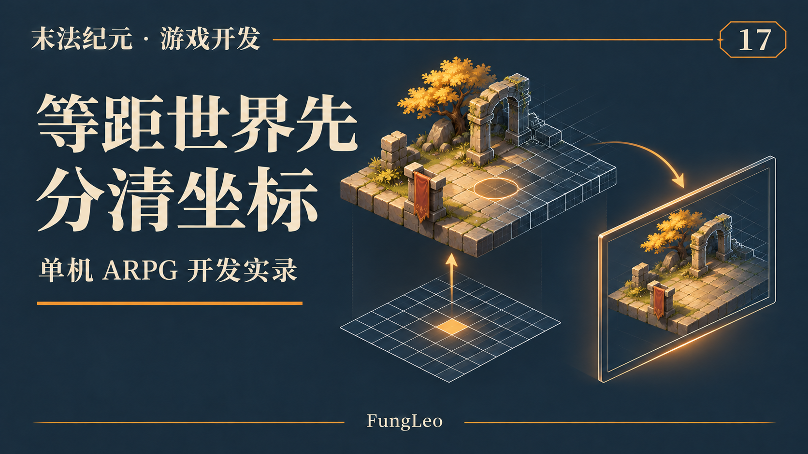
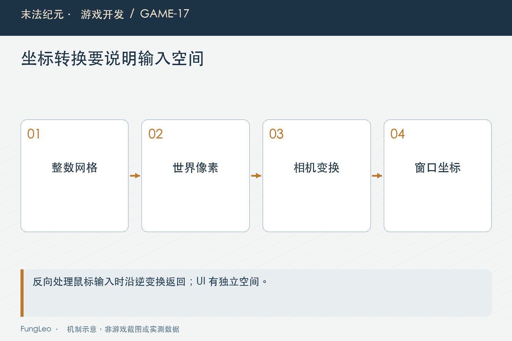
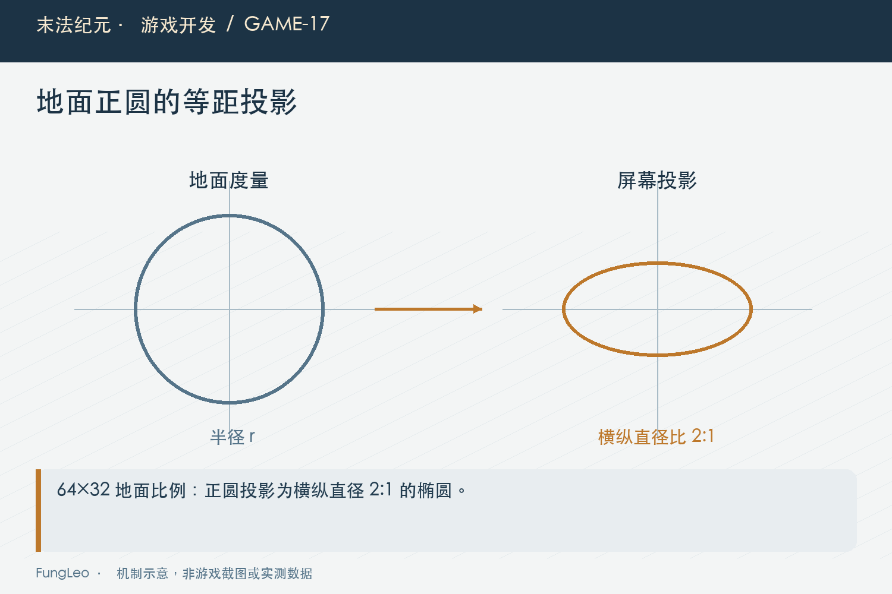

# 末法纪元·游戏开发17：斜着看的世界，坐标不能跟着乱

> 本文回顾《末法纪元》的开发过程，技术描述以 2026 年 11 月 5 日审阅快照为准。封面为主题插画，内文图为机制示意。

### 前言

各位看官，第二卷把架构和工具讲了一遍，现在终于可以把角色放进地图里，认真聊聊“走路”了。

等距地图看着很直观：地砖是菱形，人物站在上面，房子挡在前面。可程序同时要处理格子、世界像素、鼠标位置和地面距离。如果大家都叫它“坐标”，用起来就很容易串。

比如角色看着离怪物不远，却还要往前走；地上的技能范围像一块竖起来的圆片；点击大地图，目的地偏出去一截。这些问题未必是寻路错了，也可能第一步就在错误空间里做了计算。

这一篇先把《末法纪元》的坐标约定拆开，后面的移动、碰撞和自动行为都从这里接下去。



### 先认清格子和世界像素

项目地面采用六十四乘三十二的等距瓦片。格子坐标表示逻辑位置，世界像素表示投影以后节点所在的位置，两者通过Iso转换。

这里还有方向约定：横向来自列减行，纵向来自列加行再取负值。地图主要向世界原点上方展开，不能照搬另一份教程里向下增长的公式，只改其中半行。

下面摘取项目的转换函数。前面的两个常量分别是瓦片宽、高的一半，参数是整数格中心：

```gdscript
## 网格格中心转换为世界像素。
static func grid_to_world(cell: Vector2i) -> Vector2:
    return Vector2(float(cell.x - cell.y) * HALF_W,
        -float(cell.x + cell.y) * HALF_H)
```

一个格子向某轴前进，画面上会同时改变横纵位置。所以“往右一格”和“屏幕向右移动一段”并不是一回事。写输入、放入口和解释地图坐标时，都要说明自己说的是哪一种。

### 反过来转换，还没有得到一个可走格

鼠标点到世界中的某个位置，可以通过逆变换得到浮点网格坐标。整数格中心能精确往返，格子边缘则涉及取整策略。

```gdscript
## 世界像素转换为浮点网格坐标。
static func world_to_grid(pos: Vector2) -> Vector2:
    var a := pos.x / HALF_W
    var b := -pos.y / HALF_H
    return Vector2((a + b) * 0.5, (b - a) * 0.5)
```

得到浮点坐标以后，仍然要决定选哪个格、是否越界、是否可走。不要把转换函数变成一个偷偷夹取落点的万能入口，否则调试时很难区分数学变换和规则修正。

点击墙面时，最近格也未必适合角色站立。落点解析要继续经过布局和碰撞约束，转换正确只解决第一层问题。



### 世界位置也不等于窗口上的鼠标像素

相机移动和缩放，会改变世界在窗口里的显示方式。UI还可能在独立画布上，使用自己的缩放与布局。

因此窗口里的鼠标位置，不能直接当成玩家的世界目标。点击被UI接管时，也不应该把同一位置顺便传给角色走路。

这与第09篇《从网页状态走到游戏状态，职责该怎么分》的职责划分相连：输入层负责取得正确空间里的意图，移动层再按世界规则执行。若每个面板各算一套转换，窗口一缩放就容易出现不同偏差。

排查这类问题时，可以同时记录鼠标窗口点、转换后的世界点和解析出的网格点。三个值有了，才好判断错误发生在哪个环节。

### 地上的圆，投影以后就是椭圆

项目还区分了世界像素与地面度量。地面纵向在投影中被压成横向的一半，直接用屏幕上的圆表达地面范围，会让上下与左右看起来不一致。

Iso提供地面转换和距离函数，将纵向还原后再计算。下面是实际实现中彼此配套的两个入口：

```gdscript
## 世界像素还原为地面坐标。
static func to_ground(p: Vector2) -> Vector2:
    return Vector2(p.x, p.y / GROUND_SQUASH)

## 两个世界位置之间的地面距离。
static func ground_distance(a: Vector2, b: Vector2) -> float:
    return to_ground(a).distance_to(to_ground(b))
```

它们解决的是地面几何口径，不能拿来无差别替换所有距离判断。某些界面命中容差本来就按屏幕像素定义，换成地面距离反而会改变鼠标体验。

### 画出来的范围，得和判定用同一套约定

地面圆的边界按相同压缩比例生成，才有机会和地面距离判定对齐。不能绘制用一个随手调的椭圆，伤害又用另一套半径。

判断范围是否一致，可以取正上、正下、正左、正右四个边界点，再看斜方向。横向半径相同的地面圆，投影后的纵向半径应当对应压缩比例。

这不需要先做复杂美术。用几条辅助线和明确坐标就能检查。视觉越漂亮，反而越要防止边缘光效把真实判定范围藏起来。

本篇只是建立空间口径，技能命中和地面效果的专题后面再展开，不把一个数学函数当成全部战斗正确性的证明。



### 深度排序，要看角色站在哪里

人物、树和墙相互遮挡时，排序依据通常落在脚底或地面锚点，而不是图片中心。树冠很高，不代表它应该永远盖住整张地图里的所有角色。

如果用格子列行之和表达顺序，还要结合当前纵向取负的投影以及实际节点排序规则核对，不能只背一句“数值越大越靠前”。公式中的方向和渲染使用方式必须一起看。

第14篇《游戏还没做完，值得先做一个地图编辑器吗》提过移动整体物件时同步脚底层级，这里就是原因。贴图挪了，排序锚点还留在原处，人物经过时就可能突然穿到错误层次。

地面贴片、立体对象、UI则各有职责。不是把所有东西都交给同一个Y排序，就能自动处理透明边缘和地面层叠。

### 用往返和边界验证，不靠看着差不多

基础测试可以先覆盖几类点：原点、正负方向、地图边缘，以及转换后带小数的位置。格中心投影再逆变换，应该回到原格；非格中心则按既定容差比较浮点结果。

接着改变窗口和相机比例，确认同一个世界位置仍然能被正确选中。最后再到墙边和地图边缘，检查目标修正是否明确，而不是转换函数默默吞掉非法坐标。

仓库的基础冒烟与洞穴布局用例可以作为检查入口，命令如下。本文没有新增游戏测试结果：

```sh
python3 tools/run_isolated_tests.py SmokeTest CaveLayoutTest
```

它们不能替代所有窗口条件下的鼠标验收。逻辑转换和实际画布显示，要分别留证据。

### 拿一个点击偏移，顺着数据追下去

假设玩家点击一扇门，角色却往门旁边走。第一步别急着给目标加偏移量，先把点击和移动之间的几个结果画出来。

鼠标窗口位置转换成世界点以后，它是不是确实落在门口？如果这里已经偏了，就去查相机和画布变换。如果世界点正确，转换出来的格子却不是预期入口，再核对公式、取整和地图原点。

格子也正确，最终目标却变了，就继续看落点修正。也许入口被配置成不可走，服务因此选了附近合法格。这种情况下，给鼠标转换补一个常数，只会掩盖真正的布局问题。

最后才看角色怎么移动。目标点没错但路线拐弯，可以是碰撞余量或转角安全策略导致；角色停在目标附近，也可能是到达容差和交互范围口径不同。它们需要自己的规则解释，不能都归到“等距坐标不准”。

这个排查过程的好处，是每一步都有可观察结果。修完以后再改变窗口大小和相机比例，若同一个入口仍能到达，才更有把握说明没有只适配一张截图。

### 数字命名里，把单位也带出来

项目里很多值都是向量，类型系统并不能直接区分地面点、世界点和控件点。变量名与函数说明就变得重要。

例如明确写鼠标世界位置、目标格和地面半径，比三个变量都叫位置更容易审阅。接口如果返回投影后的像素，就不要在注释里笼统称为逻辑距离；半径如果按地面单位解释，也别让调用方拿格数直接传入。

这类约定看起来比写算法琐碎，但它能提前挡住不少“某个方向偶尔不对”的问题。尤其后面加入小地图与路线显示，几套画布都会消费同一个世界位置，单位越明确，复用越可靠。

### 小结

等距地图里最先要稳住的，是格子、世界像素、地面度量和窗口画布之间的关系。

公式集中在共用入口，规则修正不要混进数学转换，绘制与判定也使用相同几何口径。各位看官遇到角色偏移或范围奇怪时，先把每个值的空间和单位写出来，通常比反复调常数更快找到原因。

下一篇继续聊输入：键盘、鼠标和自动移动，同时想指挥角色的时候，究竟该听谁的？

### 相关内容

- 第09篇《从网页状态走到游戏状态，职责该怎么分》——输入、状态和显示的分工。
- 第14篇《游戏还没做完，值得先做一个地图编辑器吗》——地面锚点与整体物件编辑。
