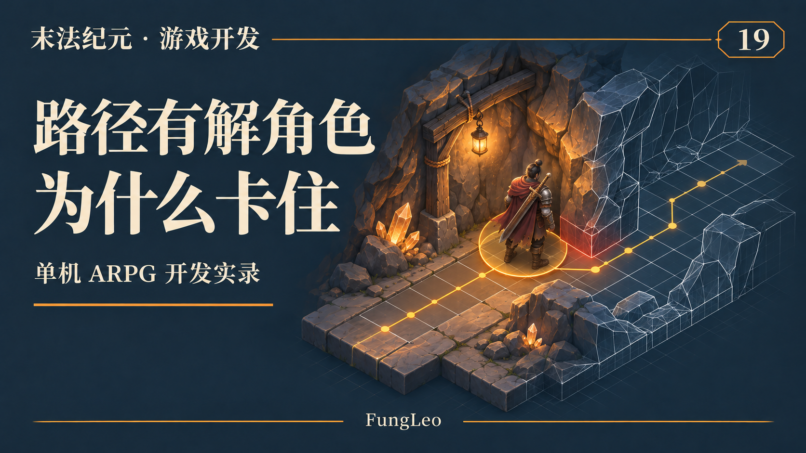
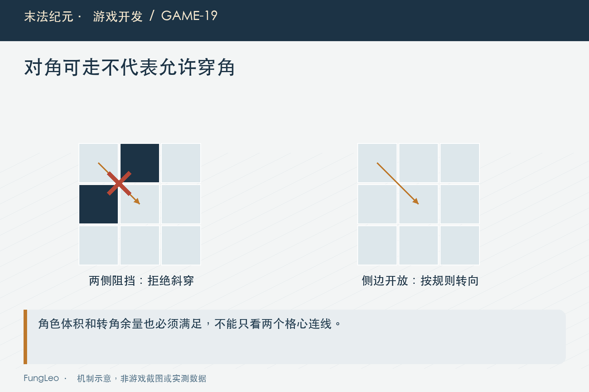
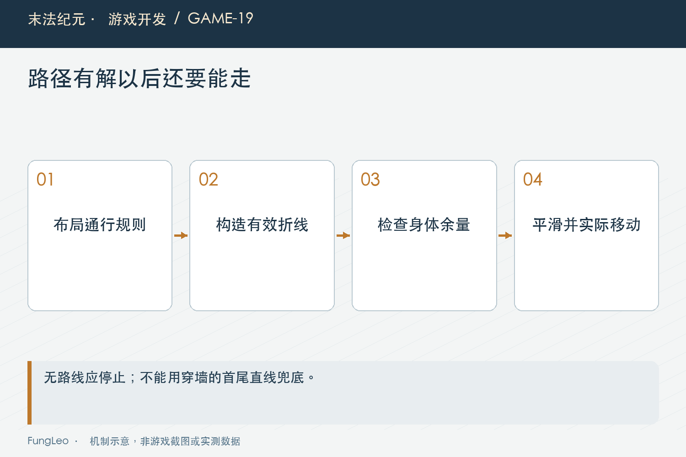

# 末法纪元·游戏开发19：看着能过的墙角，为什么角色走不过去

> 本文回顾《末法纪元》的开发过程，技术描述以 2026 年 11 月 5 日审阅快照为准。封面为主题插画，内文图为机制示意。

### 前言

各位看官，角色走在空地上，一般很难看出导航设计好不好。把它放到洞穴转角、窄门和墙边，问题就来了。

路线画着能过，角色却顶着墙；两个可走格斜着相邻，人物从墙角穿过去；路径平滑以后更顺了，却把本来绕墙的路拉成直线。

这几种现象不能都用“寻路不准”解释。网格是否允许通行、路径怎么生成、角色有多宽、实际碰撞怎样执行，任何一层口径不同，都可能产生这样的结果。

这一篇沿着《末法纪元》的洞穴布局和导航代码，拆开它们之间的关系。



### 地面图案不是可走性的最终依据

画面上的道路和墙面提供视觉信息，程序仍然需要明确通行布局。项目通过布局掩码与障碍数据决定哪些格可走，再让导航和静态碰撞沿同一事实源处理。

如果美术画了一条路，掩码却没开放，玩家看到的就是假路；掩码开放但碰撞仍堵住，又会出现路线有解、实体推不过去。

因此检查地图时，要把可走格、碰撞轮廓和正式画面叠在一起看，不能各自单独验收。修改墙体位置以后，相关产物也要同步重建。

第14篇《游戏还没做完，值得先做一个地图编辑器吗》里的编辑器应用链，就是为了减少这几份结果各自漂移。

### 斜对角可达，要看两侧是不是也能走

八方向移动不代表可以从任意两个对角格之间穿过。如果两侧都是墙，角色实际上是在挤过一个没有宽度的缝。

项目禁止这种斜穿墙角。AStar允许斜行时，也要与禁止穿角规则配套，否则图上连了一条边，实体碰撞却不可能通过。

这里适合画一个极小反例：起点和终点是两个对角可走格，另两个格阻挡。如果算法把它们连通，后面的到达判断、自动选怪和路线显示都会继承错误。

这也是为什么移动规则变化以后，不能只改一处AStar参数。连通区域判断和平滑检查依赖同样约定，也要重新验证。



### 有一条格子路径，角色还未必能站进去

寻路节点经常是格中心，角色却有碰撞半径。两格之间中心线可走，不保证身体两侧也没有撞墙。

转弯时尤其明显。把格中心逐个连接，人物可能在拐点附近擦墙；把拐点随便裁掉，直线又可能跨出合法空间。

因此需要给路径转向留余量。项目的线段检查除了中线，还检查两侧偏移，避免只验证一个没有体积的点。

下面是实际实现的核心节选。采样间距和余量属于当前工程参数，不是适用于所有角色规格的通用数值：

```gdscript
var samples := maxi(1, ceili(length / 6.0))
for i in range(samples + 1):
    var point := start.lerp(finish, float(i) / float(samples))
    for offset in [Vector2.ZERO, normal * clearance, -normal * clearance]:
        var cell := Vector2i(Iso.world_to_grid(point + offset).round())
        if not is_walkable(cell):
            return false
```

### 平滑路径，不能只追求点少

项目会尝试合并有直接可走视线的路径段，让开阔地带减少不必要拐弯。合并之前仍然经过带余量的线段检查。

如果只拿折线首尾相连，看着是少了几个航点，却可能穿过内凹墙体。路径变短不等于移动正确，点数减少更不能直接当性能和体验都提升的证明。

平滑也需要控制单次工作。当前实现限制向前尝试范围，不是对整条路径任意两点都做穷举。地图变大以后，要看路径长度和检查次数，不能只看最终留下几个点。

这些采样仍然是工程近似，需要用实际角色碰撞复核。不能因为函数叫“线段可走”，就认为所有几何边缘已经有数学上的绝对保证。

### 没有路线，不能退回穿墙直走

CaveNavigator在洞穴路线为空时返回零方向。只有已经到达最终合法格，才允许短距离向格内偏心目标修正。

这条边界很重要。常见兜底是“找不到路线就朝目标走”，在开阔地可能看不出问题，隔墙怪物一出现就原地顶墙。

对于自动战斗，零方向需要交回决策层处理：停止旧移动，判断是否改选或等待。导航器负责路线，不应该偷偷帮战斗层换怪。

第18篇《键盘、鼠标和自动移动，到底谁说了算》讲输入交接，这里也一样，失败结果要明确表达，不能沿用上一条有效方向继续跑。



### 起终点修正，也需要解释清楚

目标可能落在墙边或不可走格，布局会寻找合适的合法位置。但“最近合法格”只是一种落点解析，不意味着目标背后的真实对象已经可交互。

例如掉落在墙另一侧，最近可走格可能属于另一个连通区域。选择候选时还要判断玩家能否到达，不能仅凭目标修正后有一个坐标就决定去捡。

终点如果允许贴近物品做短修正，还要把距离与碰撞约束说明白。否则一条为了处理格内偏移的逻辑，可能被扩大成跨越整面墙的直线兜底。

地图入口和传送落点也应使用明确规则。不能为避免启动报错，无声把所有非法坐标改成地图中心，掩盖正式配置问题。

### 角色被推离路线以后，要重新判断

战斗中击退、目标移动、手动接管，都可能让角色偏离旧路径。导航缓存不能只看目的地没变，就认为旧航点始终适用。

当前导航器会检查布局、修订号、目标格以及偏航等条件，再决定是否重建。角色重新站到另一条走廊，原先那段“往前走”可能已经不成立。

这里的容差需要结合角色速度、地图尺度和碰撞处理验证。设得太小会反复重算，太大则可能长期沿错误段落贴墙。

判断是否卡住也不能只看与最终目标的直线距离。合法绕行时可能先离目标更远，后面的目标切换专题会专门讨论这个坑。

### 几个小场景，比一张大地图更能说明问题

可以准备墙角、窄通道、凹形障碍和不可达孤岛四类场景。分别检查路径有无、航点是否跨墙，以及真实角色能否完成移动。

同一个场景还应换起终点方向。某条路从左到右能走，反过来卡住，可能说明转点或到达容差有偏差。

再做一轮导航与碰撞对照：路线允许的区域，实体能通过；规则禁止的墙角，鼠标、自动战斗和键盘都不能借不同入口穿过去。

仓库有布局、导航和真实自动移动用例。本轮没有运行它们，下面提供已有检查入口：

```sh
python3 tools/run_isolated_tests.py CaveLayoutTest CaveNavigationTest CaveAutoBattleTest
```

### 调试图层只解释事实，不替规则开后门

显示可走格、路径和碰撞轮廓，有助于区分错误来源。最好给不同信息使用不同样式，不把导航节点线当作角色必然能走的轨迹。

发现误差以后，先查几份数据是不是同一布局版本，再检查碰撞半径和投影。不能为了让测试角色过墙角，就临时缩小碰撞，而普通游玩仍然使用原规格。

修复也要保留反例。墙角不能穿、窄路仍能通、不可达时停止，这几条约束要一起守住，避免一次修复只是把错误从“卡住”换成“穿墙”。

### 地图扩大以后，先保住同一套规则

内容扩张时，墙面数量和通道长度都可能增加。性能压力上来，也不能把角色碰撞换成宽松包围盒，或者让寻路放开墙角来换取更容易找到路。

更合理的是先测量哪一段重复计算：可达候选是否反复完整寻路，路径有没有不必要重建，静态碰撞能否共享不可变资源。计算可以复用，允许通行的真实轮廓不能被无声改写。

验收时也保留同一组小反例，并加入扩大后的正式地图。前者能定位规则，后者能发现规模成本。两类证据接起来，才能说明优化既没有穿墙，也没有只在小样里表现正常。

### 小结

地图可走、路径有解和角色真正能通过，是需要对齐的三层结果。

同源布局、禁止穿角、带体积余量的路径处理，以及明确的失败方向，才能让它们接起来。各位看官排查墙角问题时，先把这几层分开画出来，再决定改哪一层。

下一篇加入动态变化：门打开以后，原来的路线和连通性缓存还算不算数？

### 相关内容

- 第14篇《游戏还没做完，值得先做一个地图编辑器吗》——布局与碰撞同步生成。
- 第17篇《斜着看的世界，坐标不能跟着乱》——格子与世界位置的约定。
- 第18篇《键盘、鼠标和自动移动，到底谁说了算》——失败移动与旧方向清理。
