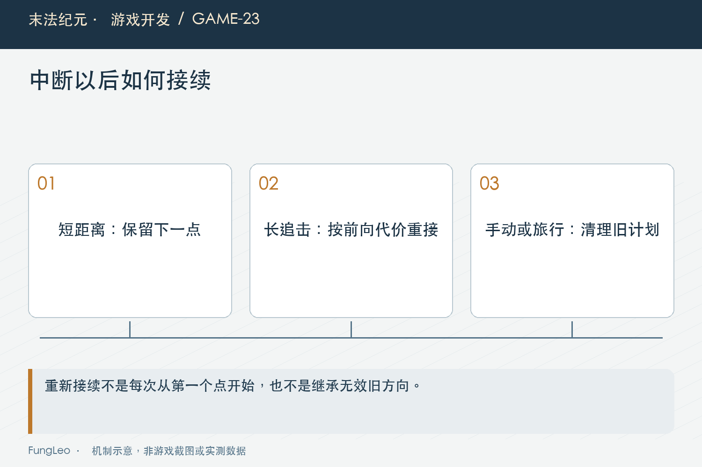

# 末法纪元·游戏开发23：自动找怪，为什么要记住上次走到哪里

> 本文回顾《末法纪元》的开发过程，技术描述以 2026 年 11 月 5 日审阅快照为准。封面为主题插画，内文图为机制示意。

### 前言

各位看官，自动战斗没找到怪时，总得做点什么。最容易想到的，就是在地图里取一批点，挨个走一遍。

可巡游点一密，角色像在给地板做检查；打完一只怪，又重新挑最近点，走着走着就开始重复绕同一片地方。反过来，把采样间隔直接拉大，窄支路可能连一个点都没落进去。

《末法纪元》为这件事分别处理了搜索范围、主路线、补漏和中断接续。它们有关联，但不能靠改一个巡游间隔全部解决。

这一篇沿着实现与验收记录，把这几层拆开讲。


### 没找到怪，先判断是不是搜索范围的问题

原先自动搜索以可视目标为主。镜头缩放会改变可见范围，某些屏外但已经探索过的近处敌人，没有进入候选。

后来的规则保留可视候选，同时补充玩家附近、位于已探索区域的屏外有效敌人。这个补充半径按世界像素定义，不随相机倍率变化。

这里没有读取未生成怪物的全图刷新点，也没有提前揭图。候选来自真实有效实例，仍经过Boss开关、黑名单和可达性判断。

手动Tab锁定还保持自己的可视范围。不能为了扩展自动搜索，直接扩大共用可视入口，把手动行为也悄悄改变。

### 搜索和巡游，回答的是不同问题

搜索问“现有候选里该打谁”，巡游问“现在没有合适目标，下一步往哪走”。加快搜索频率，不会自动让角色进入另一条支路。

同样，采样点减少，也不意味着搜索成本一定下降。候选查询和规划分别有什么工作，要单独测量。

第21篇《624个候选点，需要跑624次完整寻路吗》讨论可达筛选，这里继续复用区域信息，但巡游计划不能提前为每个点构建完整路线。真正走向某一点时，再交给既有导航处理。

把这两层分开，才容易定位“附近有怪却没发现”和“根本没去那片区域”分别是谁的问题。


### 主路线拉开以后，要补的是覆盖缺口

当前主路线采用较稀的蛇形采样，保留边界，并过滤不可达位置。它减少频繁切换小目标，让角色更像在走一条路线，而不是逐格擦地。

但固定网格可能刚好错过窄走廊。某条支路没有主点，不代表那里没有通路，也不代表探索已经完成。

AutoRoamPlan会按可达区块准备补充锚点。主路线先走，粗巡以后确有未探索缺口，再处理补点；已探索地图可以跳过不必要细扫。

这里的覆盖依据是实际迷雾规则和通行布局。不能为了让测试看起来全覆盖，就把揭示半径扩大，或者直接修改探索集合。

### 规划可以分帧，但要有清楚的完成状态

大地图的一次性构建可能超过一帧预算。项目把规划拆成工作单元，在软时间预算内推进，主点准备好以后就允许角色先走。

下面摘取真实推进接口。预算按微秒解释，间隔检查意味着它不是严格实时上限：

```gdscript
func advance(budget_usec: int = 1500) -> bool:
    var start := Time.get_ticks_usec()
    var units := 0
    while _phase < 3:
        _step()
        units += 1
        if budget_usec > 0 and units % 8 == 0 \
                and Time.get_ticks_usec() - start >= budget_usec:
            break
    return _phase == 3
```

这个返回值表示完整规划是否结束，不等于角色必须等到结束才能启动。主路线就绪另有状态，补漏扫描可以在后续继续。

### 中途遇怪，保存的是巡游进度

角色巡游到一半发现怪物，当前移动路线应该让位给追击，但巡游游标不必每次归零。

短距离战斗或拾取结束后，继续原来尚未完成的下一点，能够避免反复回到附近的旧点。旧导航方向和卡住计时则要清掉，不能因为保存进度就保存所有执行状态。

这很像在一份工作清单中插入临时任务。清单的位置可以保留，手头正在执行的动作却必须切换。

第18篇《键盘、鼠标和自动移动，到底谁说了算》讲接管时的清理，本篇多了一层：自然中断与玩家明确改命令，不采用完全相同的恢复方式。



### 追得太远，也不能执着回原点

如果战斗把角色带到地图另一头，机械回到旧游标可能产生大段折返。于是需要在保持前向进度的前提下，选择合理接续位置。

项目的接续会考虑当前位置到候选的距离，以及跨越前向巡游点的代价。它没有把距离最近当成唯一目标，也不把“永不回头”写成绝对规则。

跳过的区域后续仍可访问，未知区块也还有补漏。这样避免为了减少折返，反而把探索缺口永久遗漏。

参数只是当前实现的取舍。不能拿一组地图上的表现，证明所有布局都已最优；真正要调整，仍要记录行走轨迹和覆盖结果。

### 什么变化会让旧进度失效

切图、导航版本变化、进入另一连通区域，都会影响规划；手动接管或关闭自动，也需要按当前规则重新定位。

旅行时还要释放分帧构建状态，不保留旧地图引用。一个后台规划对象即使没有节点，也可能持有整个布局和候选数组，生命周期不能忽略。

读档以后不要把旧游标当持久进度恢复。世界实体、探索和门禁可能已重新装配，先按当前状态建立合法计划，再开始巡游更可靠。

第20篇《一扇门打开以后，哪些缓存应该作废》的失效条件在这里真正落地。保存游标是有条件复用，不是永远沿用一份列表。

### 点少了，不等于实际路就同比变短

历史验收既统计主点和补点，也通过真实Ground.route累计绕墙路线。原因很简单：直线连接的几何长度，不能代表角色绕障后的距离。

同样，主点少了，每一段可能更长，单次AStar未必更快。收益可能来自目标总次数和总路程减少，而不是每次路径查询都更省。

补点也可能产生折返。报告明确保留了这项限制，没有把新路线描述成所有阶段都更短、更顺。

持续玩法还会插入战斗、拾取和受控，测试角色的配置也会影响结果。高生存夹具通过，不能替普通角色的平衡体验作结论。

### 验证要同时看覆盖、接续和释放

可以先做纯规划对照：分帧结果与完整构建一致，过程不提前揭图，可达区块有覆盖。再走真实流程，检查遇怪、拾取后是否接续。

随后加入长距离追击、手动接管和旅行，确认旧游标或规划对象不会越过不该复用的边界。

已有用例提供了这些检查入口。本轮文章没有执行游戏测试：

```sh
python3 tools/run_isolated_tests.py AutoRoamPlanTest AutoRoamResumeTest AutoSearchRangeTest
```

### 不要用“走得动”替代巡游验收

角色一直在移动，也可能只在局部循环。观察时应记录实际访问的区域、游标推进，以及返回旧点的原因。

反过来，角色短暂停留也可能是在等待合法预算分片，不一定是卡死。需要看主点是否已经可用、规划是否继续推进，而不是见到停顿就无限加大每帧工作量。

补漏也不能变成每次战斗结束都全图细扫。它应该有自己的触发阶段和缓存条件，把有价值的探索放到正确时机。

各位看官调这类行为时，最好保留一段能复现的轨迹，再决定改间距、接续代价还是搜索条件。只凭“感觉绕”同时调三个参数，很难知道哪项真正起作用。

还有一个很小但重要的反例：极小可达区域可能没有任何主采样点，却仍然应该通过补点形成合法巡游。只有真正封闭、没有可用位置的情况，才保留空规划。

因此旧测试也需要按新规则更新。原先“主网格没有点就算空”的夹具，不能继续拿来证明空缓存正确；应另造确实无合法点的场景，同时保留孤岛补点用例。测试跟着玩法变化，但不可达、禁止穿墙和不揭图这些约束不能放宽。

### 小结

自动巡游需要兼顾搜索机会、探索覆盖、规划预算和中断恢复。

主路线负责有效移动，补点处理真实缺口，游标保存避免重复走旧路，长距离接续又防止过度折返。它们一起工作，才比一串固定采样点更接近可用的挂机行为。

下一篇看战斗目标：明明Boss还剩血，角色怎么又跑去打旁边那只了？

### 相关内容

- 第18篇《键盘、鼠标和自动移动，到底谁说了算》——中断与命令交接。
- 第20篇《一扇门打开以后，哪些缓存应该作废》——规划失效条件。
- 第22篇《自动战斗，不是写一个循环替玩家按攻击》——巡游在决策链中的位置。
