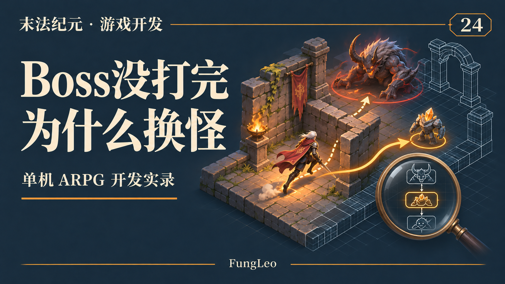
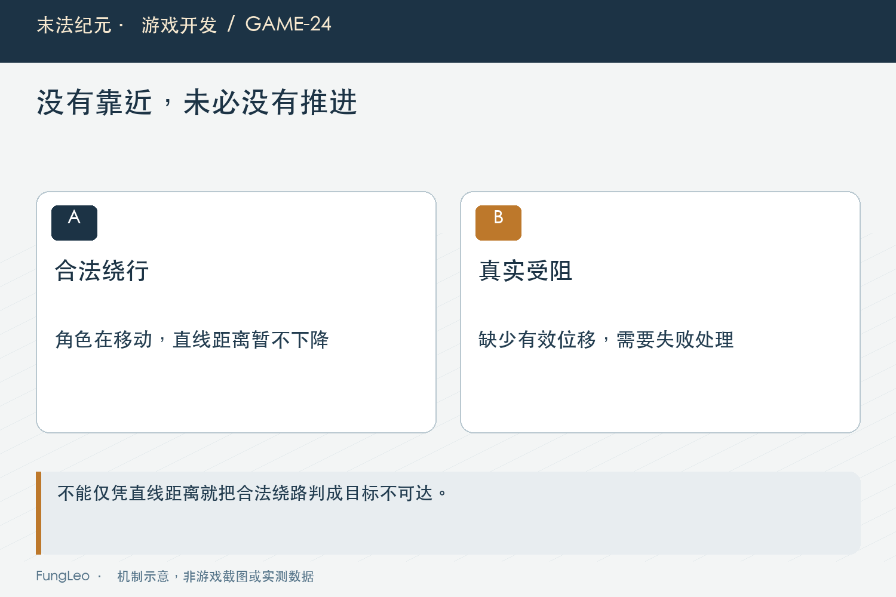
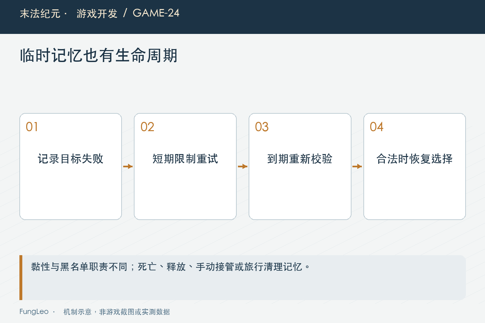

# 末法纪元·游戏开发24：Boss还剩血，角色为什么跑去打旁边那只

> 本文回顾《末法纪元》的开发过程，技术描述以 2026 年 11 月 5 日审阅快照为准。封面为主题插画，内文图为机制示意。

### 前言

各位看官，自动战斗里有一种特别影响观感的行为：Boss已经打掉一截血，角色突然转身，开始打旁边另一只。

第一反应很容易是“最近目标策略太傻，换成优先残血就好了”。但《末法纪元》这次排查，先发现一个更基础的问题：系统原本并没有每隔一段时间重新挑最近怪。

当前目标被清掉以后，重选才发生。真正要问的，是它为什么被清掉。

这一篇用工程里的历史分析和已落地修复，讲讲怎么把一个看起来像选怪策略的问题，拆成可观察的状态变化。



### 先把“换了目标”的几种现象分开

切换时如果出现不可达提示，应该先查黑名单链路；没有提示，可能是实例被释放或其他状态重置；血条回满又走回原位，还要检查脱战归位；先去捡东西，则可能是拾取优先级插入。

这些现象在玩家眼里都叫“没打完就走”，代码原因却不相同。

因此排查要记录目标实例、当前地图、切换前状态和相关提示。不能只看怪物名字，因为循环图可能同时有许多同模板Boss。

第22篇《自动战斗，不是写一个循环替玩家按攻击》讲过状态转移原因，真实反馈正好需要这些信息帮助还原。

### 目标选择没变，旧目标却被误判卡住

旧实现用角色与目标的直线距离下降量判断追击是否推进。短时间没有足够接近，就累计失败，最后把目标放进黑名单。

这在直路上容易成立，到了绕墙场景就有问题。角色正在沿合法路径横向走，甚至先远离目标，直线距离可能不减反增。

被击退、击倒也会造成类似现象。玩家并非决定放弃目标，只是暂时无法接近；程序却把正常战斗过程当成路线失败。

于是Boss还活着，目标被拉黑，系统按原来的就近策略找了旁边一只。表面是选怪变心，起点却是错误清目标。

### 追击进度，不能只用一个指标概括

落地修复把追击卡住判据改为角色自身位移，并调整连续失败条件。真正没有路线，仍然保留明确失败处理；实际站着不动，也不能无限等待。

它解决的是“正在合法绕行却被认为毫无推进”的误判，不代表只看位移就能证明所有路径都正确。角色绕圈也有位移，需要依赖目标、路线和其他状态约束继续防止空转。

巡游与手动路径的推进判断仍有自己的口径，不能把这次修复机械套到所有移动流程。

同样，诊断方案里写过的建议要和实施记录分开看。文章介绍的是后来真正落地的行为，不把所有建议都宣称已经完成。



### 黑名单是临时恢复机制，不是永久放弃

目标确实不可达时，短期拉黑可以避免角色反复撞同一个位置。但时间过长，角色可能已经跑去另一片区域，把原来的战斗割裂了。

项目为此缩短了相关时长，并增加跨重选的目标黏性记忆。当前目标被清空后，仍可以在有限时间内记住原实例，待条件允许时优先恢复。

这里不是把黑名单完全取消。否则真实不可达目标会再次把角色卡住；也不是永远追原Boss，因为它可能已经死亡、释放或仍不通。

恢复机制必须同时考虑“记得谁”和“现在是否还合法”。单独保存一个指针，不能替代有效性和可达性检查。

### 黏性优先级，要真正处在会执行的入口

下面是当前目标查找中黏性分支的源码节选，手动目标优先分支位于它前面：

```gdscript
if _sticky_left > 0.0 and _sticky_target != null and is_instance_valid(_sticky_target) \
        and _sticky_target is Node2D and _sticky_target.get("is_dead") != true \
        and not _is_blacklisted(_sticky_target) \
        and _route_reachable((_sticky_target as Node2D).global_position):
    return _sticky_target
```

关键在于这份记忆独立于当前目标。若只在重选函数里优先返回“当前目标”，而函数只在当前目标为空时才调用，那条代码逻辑上就不会起作用。

这类死分支很容易在文字方案转代码时出现。需求说得对，挂接位置却不对，必须通过真实决策入口验证。



### 保留黏性，也得尊重玩家改命令

玩家明确手动接管、关闭自动或切图以后，旧目标记忆需要清理。否则刚刚躲开一只Boss，程序又借“黏性”把角色拉回去。

目标自然受阻以后短暂记忆，和玩家明确取消，是不同中断原因。不能因为都经过清目标函数，就采用完全相同的恢复策略。

第18篇《键盘、鼠标和自动移动，到底谁说了算》里的执行权交接，在这里变成了目标选择约束。自动记忆是帮助维持合理意图，不应该覆盖玩家的新意图。

旅行以后即使新地图出现同名怪，也必须重新建立目标，不能跨场景保留旧实例关系。

### 目标回满，可能是另一条链路

历史分析还讨论过远距离退场、脱战归位与拾取抢占等放大因素。角色先被错误改选带走，原Boss再越过活动范围，就可能被回收或归位。

因此看到血量恢复，不能直接认定伤害结算没有生效。先分清原实例是否还存在，是否触发了地图本来的脱战规则。

这些因素当时有不同实施状态。修复卡住判据和黏性，并不自动证明其他候选原因都已经整改完毕。

报告应保留范围：本轮解决哪两条主链，哪些现象仍需独立证据。这样后来出现类似反馈，才不会拿一句“之前修过”把问题挡回去。

### 构造两个相反场景，断言才有分量

第一类场景让角色持续移动，但与目标的直线距离不下降。合法绕行时不应因此拉黑；第二类冻结实际移动，则仍应在失败条件成立后改选。

如果只测前者，可能把所有卡住保护都关掉来获得通过；只测后者，又抓不到正常绕行被误判。两个反例共同守住边界。

再检查黏性：黑名单仍有效时不能提前恢复，到期后目标合法才恢复；目标已释放、死亡、手动接管或旅行以后，不应继续使用记忆。

项目已有自动控制验收可作为入口。本轮未重跑游戏测试：

```sh
python3 tools/run_isolated_tests.py AutoControlAcceptance BossMultiTargetTest
```

### 复核时，别只盯最后击杀数

一次挂机杀了很多Boss，不代表中途改选已经消失。可以记录单个目标从首次攻击到结束的轨迹，以及每次清目标的原因。

同时固定角色、地图和倍率，避免一轮高攻秒杀让问题没有时间出现，下一轮低攻长期交战又把行为放大。

已有报告里的负向注入，把判据改回旧口径后能触发断言，这比单次正常通过更能说明测试抓住了主因。正式源码仍应恢复，不能把诊断注入留在玩家流程里。

日志和探针也要隔离、限频。为了看清一次目标变化，没必要把每个物理步的全部敌人写进文件。

### 参数改变以后，也要观察边界代价

把失败次数增加、黑名单缩短，可能减少误切，但也会改变真正受阻时的等待体验。不能只看原来的反馈消失，就认为所有行为都更好了。

因此验收还应记录实际不可达目标从发现到放弃用了什么过程，是否反复进入同一个失败循环，以及黏性恢复有没有把角色重新带回无法通过的地方。

数值调整最好与判据改造分别说明。前者调灵敏度，后者改变我们认定“推进”的含义，审阅者需要知道两种变化各自解决什么。

如果后续地形、速度或控制时长明显改变，再按同一组反例复核。旧阈值不需要永远固定，但不能因为调整方便，就让原来禁止的穿墙或无限空转重新成为默认行为。

### 小结

Boss打到一半换目标，可能先发生了错误的不可达判断，再被重选和活动范围规则放大。

先追清目标的原因，再修推进判据与有限黏性，比直接替换最近目标策略更接近根因。各位看官排查自动行为时，不妨把“它为什么选了新目标”再往前追一步：旧目标究竟怎么丢的？

下一篇看生成端：地图大了，刷新点多了，为什么活动怪物预算不能每个候选都重新数？

### 相关内容

- 第18篇《键盘、鼠标和自动移动，到底谁说了算》——手动意图优先。
- 第22篇《自动战斗，不是写一个循环替玩家按攻击》——目标状态与重选入口。
