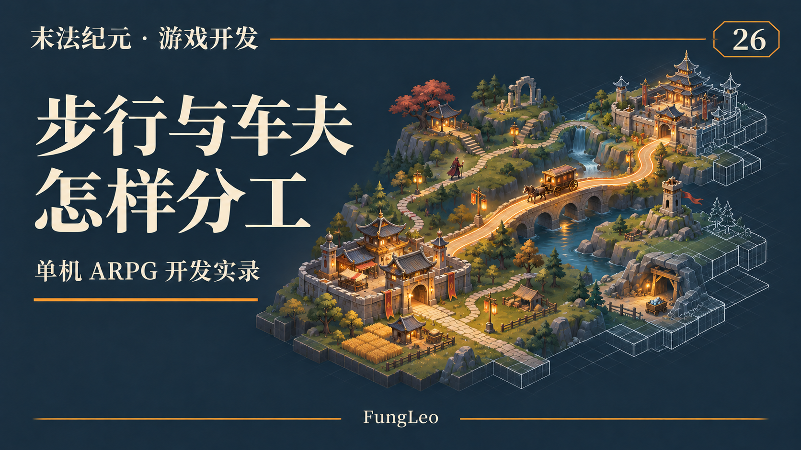
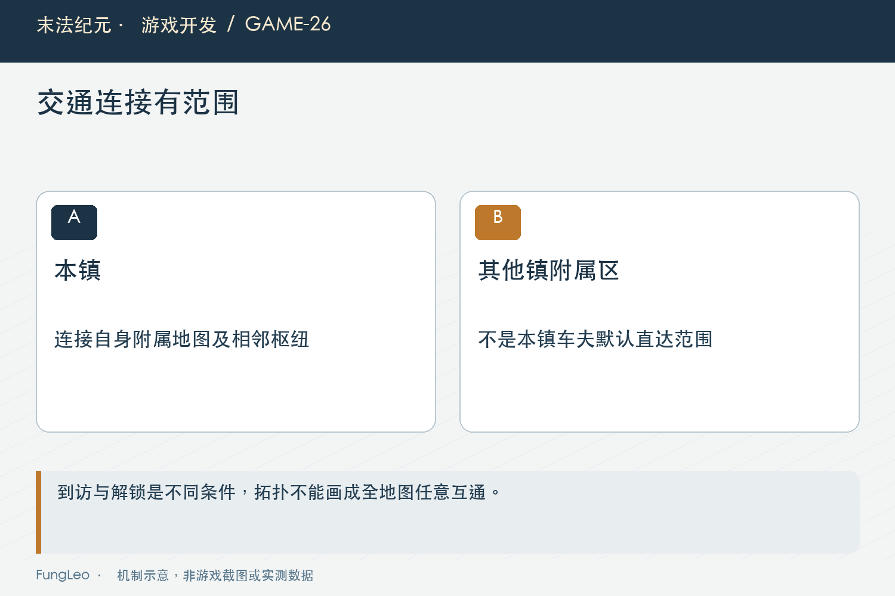
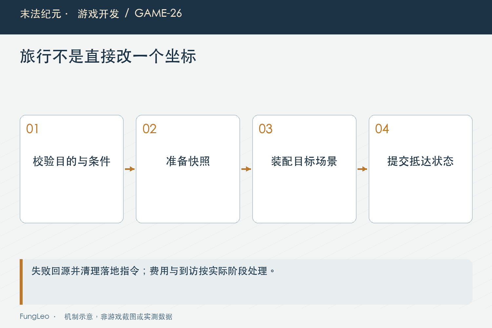

# 末法纪元·游戏开发26：免费步行和付费车夫，怎样各自有用

> 本文回顾《末法纪元》的开发过程，技术描述以 2026 年 11 月 5 日审阅快照为准。封面为主题插画，内文图为机制示意。

### 前言

各位看官，多地图做出来以后，交通规则会直接改变玩家怎么玩。

只能走路，重复回程可能让人烦；所有地方随时免费传，地图之间的道路又容易失去意义。给传送加一个价格，也不代表这两个问题自动平衡了。

《末法纪元》保留免费步行，也有车夫直达，后期还扩展了随身服务。它们不是同一个按钮换个收费数字，而是不同的拓扑、解锁、到访和落点规则。

这一篇聊这些层次怎样配合，也看看一次看似简单的旅行，为什么需要准备、抵达确认和回滚。



### 步行负责把世界连接起来

道路出口表达地图之间的实际关系。玩家可以沿相邻道路探索，不必每次出门先付费，也能在途中接触敌人、任务和资源。

免费不等于无限制。出口可能需要前置解锁，目标入口也必须有效，某些内容还要求从指定道路进入。条件不满足，应当告诉玩家为什么不能走。

因此不能把车夫目的地列表直接当成步行连接，也不能因为两张图在同一章节，就默认它们相邻。

第07篇《从产品文档到代码，中间那一步怎么拆》用出行讲过需求拆解，本篇进一步看这些连接怎样影响体验与结算。

### 车夫提供便利，不必把全世界连成一张表

项目的城镇集群模型，把枢纽和附属地图分开。当地车夫可连接本集群与相邻枢纽，不直接覆盖其他城镇的全部附属区域。

这样从一个镇去另一个镇，再换乘周边地图，仍然保留世界结构。玩家知道自己在什么区域，城镇也有作为服务中心的意义。

第一章只有单个主要集群时，效果可能接近章内直达；扩展到多镇，分级结构才更明显。

这是项目的具体产品选择，不是所有ARPG都必须采用的交通理论。关键是玩家能理解目的地为什么出现、为什么暂时不能去。



### 解锁和到访，是两条不同条件

某张地图剧情上已允许进入，不等于车夫就应当自动把玩家送过去。到访记录可以让首次探索与后续便利分开。

当前目的地生成会结合解锁和到访，并保留明确教学例外。下面是列表生成中的源码节选：

```gdscript
var visited := GameState.is_visited(id)
var taught := GameState.current_map == DEFAULT_MAP and id == "wild_trial"
var unlocked := is_unlocked(id) and (visited or taught)
```

这只是开放条件的一部分，正式列表还有入口门禁等检查。不能复制三行就认为完整旅行校验已经实现。

列表展示和最终执行也要使用一致规则。面板写着可以去，点击以后才说未到访，玩家会觉得按钮骗人；反过来，灰掉的目的地却能从另一入口直接跳过去，也说明规则分散了。

### 报价要来自实际服务入口

当地车夫和随身车夫可能有不同范围与费用规则。展示报价时，应当直接读取对应服务计算，不能UI按一套公式，执行再按另一套扣钱。

历史出行方案还记录过费用口径冲突，最后按阶段确定不同规则。复盘要保留这个背景，不能看到代码里存在多种费用入口，就认定需要立即统一。

真正要检查的是每条入口自身一致：目的地、资格、报价、实际费用与反馈是否对应。

金币不足时拒绝，重复点击不能扣两次；如果准备以后场景失败，要把预备扣除恢复。费用是玩家资源，不能只看成功截图。

### 路口落点和车夫落点，不应随意共用

步行来到另一张图，通常落在对应道路入口，便于理解方向和返回；乘车抵达，则可以落在驿站或指定安全位置。

如果都送地图中心，玩家可能不知道从哪里来，也可能落到敌人或障碍里。入口与出口、通行布局和休整规则要一起验证。

落地后自动走向某个目标，又是额外意图。只有旅行成功以后才应安排，否则失败回原图，旧坐标可能被下一次抵达错误消费。

这与第18篇《键盘、鼠标和自动移动，到底谁说了算》的命令生命周期有关：一次操作取消，相关后续命令也要取消，不能变成幽灵路线。



### 旅行不是改一个地图ID就结束

当前服务会先检查条件，再保存源地图、金币和位置等快照，进入待抵达状态。准备阶段会更新目标状态，完成世界装配后再提交到访和事件。

如果目标不匹配或装配失败，回滚需要恢复源状态，并清掉待落地移动。下面摘取回滚中的实际关键部分，省略事件通知：

```gdscript
var request := pending_travel.duplicate(true)
pending_travel.clear()
pending_landing_move = null
GameState.gold = int(request.gold)
GameState.current_map = String(request.from)
GameState.save_pos = request.save_pos
GameState.has_save_pos = bool(request.has_save_pos)
```

这是依赖前面有效请求检查的函数片段。准备和提交之间也要防重复操作，不能让第二笔请求覆盖第一笔回滚快照。

### 到访只在真正抵达以后成立

如果发出旅行请求就立刻记为到访，失败后玩家没去成，却已经解锁直达，就改变了探索规则。

项目在抵达确认时标记到访、广播地图变化等事件。其他观察者看到的是已完成的旅行，而不是半成品意图。

这也影响自动保存。要按统一流程处理待旅行状态，不能某个监听者在中间阶段直接把临时地图关系写成最终进度。

第08篇《功能越来越齐，什么时候该停下来审查一次》讨论系统交界，旅行正是典型场景：UI、资源、地图、存档单独正常，组合时仍然可能出现不一致。

### 跨图不该重置玩家已经获得的世界状态

未领取战利品、Boss等待时间和任务进度，都可能需要跨图保留。走路和乘车虽然入口不同，不能一个恢复奖励，一个顺手清掉。

第25篇《地图变大了，刷新怪物不能跟着越来越贵》讲刷新时钟，地图节点释放不代表倒计时归零。同样，奖励表现节点可以重建，奖励记录不能因此重新发一遍。

到访资格和全图探索也要区分。来到驿站，只记录抵达，不意味着周围所有地形都已揭示。

这些不变量越集中，新增随身交通时需要复制的业务越少。范围可以扩展，共用恢复规则仍然应该守住。

### 如何验证两种交通各自成立

先走一条有效道路再返回，核对入口、费用和地图身份；再乘车到已到访地点，核对报价和驿站落点。

然后分别测试未解锁、未到访、金币不足、重复请求和失败回滚。每次拒绝以后，检查原地图、金币和位置是否保持，而不是只看提示文字。

还要在两种入口下验证等待状态与未领取奖励恢复。已有章节路线、城镇落点和随身车夫测试可以作为入口，本轮未执行：

```sh
python3 tools/run_isolated_tests.py ChapterTwoRoutesTest TownCarterArrivalTest PortableCarterTest
```

### 便利程度，也需要回到游玩节奏

车费太低且范围过宽，可能让步行只剩首次走一次；费用过高，玩家为了省钱重复跑空路，又可能抵消成长节奏。

调整前可以观察常见往返任务、回城整理频率和当前金币来源。交通不是孤立经济项，背包容量、随身服务和地图长度都会改变它的价值。

不过，观察到某次跑图慢，也不一定该降价。可能入口太远、提示不清，或者路线在墙角卡住。先确认是哪一段造成负担，再决定是改规则、地图还是导航。

交通提示也值得单独看一遍。不能前往时，区分道路未解锁、尚未到访、费用不足和当前已有旅行请求，比统一显示失败更容易让玩家采取下一步。

目的地名称和推荐等级来自同一份地图定义，界面排序也应稳定。一次打开菜单位置不同，玩家容易误点；新章节暂时没有可用地图，也不应让既有分组含义突然改变。

这些细节不需要新增一套旅行规则，但它们决定玩家能否理解已有规则。程序可靠与界面清楚一起成立，便利服务才真正有价值。

### 小结

免费步行承接首次探索和世界连接，车夫承接有条件的便利；拓扑、资格、费用与落点分别定义，再沿统一旅行流程提交和恢复。

各位看官设计传送时，可以把“能去哪”和“如何可靠抵达”分开检查。前者决定体验，后者保住资源与进度，两边缺一项都容易出问题。

下一篇看地图窗口：右上角那一小块，到底应该缩下整张世界，还是专心显示身边的道路？

### 相关内容

- 第07篇《从产品文档到代码，中间那一步怎么拆》——出行需求的工程拆解。
- 第18篇《键盘、鼠标和自动移动，到底谁说了算》——落地指令与取消。
- 第25篇《地图变大了，刷新怪物不能跟着越来越贵》——跨图世界状态。
