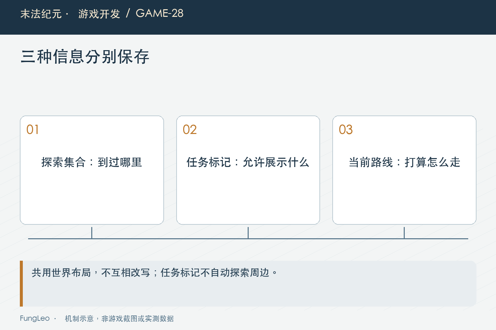
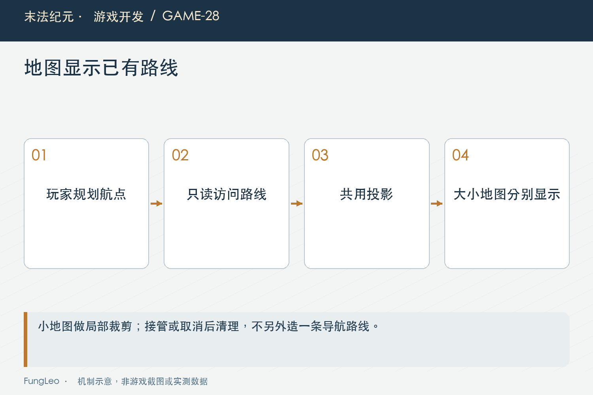

# 末法纪元·游戏开发28：迷雾、任务标记和路线，怎样讲清同一个世界

> 本文回顾《末法纪元》的开发过程，技术描述以 2026 年 11 月 5 日审阅快照为准。封面为主题插画，内文图为机制示意。

### 前言

各位看官，这一卷最后把几条线接起来：玩家走过的地方要记住，任务要告诉他方向，点击目标以后地图还要显示准备走的路线。

这几件事都画在地图里，却不是同一份状态。最容易出现的误会，是任务标记一亮，周围地形也跟着揭开；或者路线为了好看，直接从人物连到终点，穿墙这件事留给角色自己解决。

《末法纪元》用探索集合、标记规则和玩家实际行进路线分别提供信息，再交给同一个地图画布投影。

这一篇讲这些边界，也给第三卷做一个收尾。


### 探索记录保存的是经历，不是当前截图

项目以区块记录每张地图已探索的范围。玩家附近的揭示计算会把新块加入集合，存档保存必要编号，而不保存一张画面或一批绘制节点。

这样地图窗口关闭，探索仍然存在；换显示尺寸，画布可以根据相同记录重新投影。运行状态与表现分开，才能跨场景恢复。

当前区块有固定大小，边缘不足一整块也要合法处理。读取存档时，还需要过滤未知地图、重复编号和越界数据，不能让一个异常编号直接揭开整张图。

第10篇《同一种武器，为什么不能共用一份装备数据》讲实例与显示数据分层，这里也类似，持久化的是事实，画面由事实重建。

### 只有真正变化，才通知底图更新

Fog.reveal会判断是否加入了新块，实际变化后再发探索事件。下面是源码中的提交部分，前面已经完成位置与范围检查：

```gdscript
GameState.explored_maps[map_id] = blocks
if changed:
    EventBus.fog_changed.emit(map_id)
return changed
```

角色站在已经探索的区域，不应该每步都让整张底图重新生成。移动标记和探索变化分开处理，既减少重复工作，也便于解释缓存条件。

读档替换探索字典时则是另一种变化。即使块数量碰巧相同，内容或对象已经不同，画布也不能只凭数量继续复用旧底图。

因此事件通知和刷新时的身份检查各有作用，不能把其中一层当作绝对不会遗漏的唯一依据。



### 区块揭示，不等于块里所有地形都可走

区块是压缩探索记录的方式，正式绘制仍要结合通行掩码。洞壁和阻挡不能因为同块有可走格，就整片染成道路。

这也提醒我们区分探索尺度和几何尺度。一个区块被记为已探索，说明它满足当前揭示规则，不代表玩家精确踩过其中每一个格子。

若后续要求更精细的可见性，应该明确改变记录规则与成本，而不是在显示层偷偷发明第二份探索事实。

第19篇《看着能过的墙角，为什么角色走不过去》的布局同源，在地图显示里仍然重要。画布只解释已有几何，不替世界开放通路。

### 任务允许知道目标，不代表允许知道周围一切

任务标记可以在特定规则下显示未探索位置，帮助玩家理解方向。这个例外应当作用于目标信息，而不是修改探索集合。

当前地图标记会结合显式揭示、探索状态以及窗口类型判断可见。道路出口和车夫还有自己的大地图与局部视野规则。

如果把“任务目标可见”直接实现为“揭开目标附近地形”，玩家只是接了任务，就获得了原本需要探索的信息。功能看着方便，却已经改变了玩法。

所以验收时要同时检查标记出现和探索集合保持。只看截图里有一个任务图标，证明不了周围地形没有被意外揭示。

### 路线应该来自实际移动计划

玩家点击地图或任务目标以后，地图虚线应反映角色准备执行的路线。洞穴里必须使用绕障路点，不能UI另算一条漂亮直线。

Player.map_move_route提供只读结果，首点是当前角色位置，后面是未走过的航点和目的地。自动寻路没开启就返回空，洞穴路径尚未准备好也返回空。

宁可短暂不显示，也不先画一条穿墙的假路线。角色开始移动以后，已走航点裁掉，图上不需要一直保留整段历史轨迹。

这里展示的是明确点击导航的行进意图，不能顺便承诺所有自动战斗追击、巡游和技能位移都由这一个访问器显示。



### 大小地图共用数据，各自处理视野

MapCanvas的两个实例读取同一世界折线。大地图显示完整当前路段，小地图根据局部视野裁剪，并通过圆形材质限制最终画面。

世界坐标先经过共同投影，不能小地图自己再求一次路。否则一边更新了导航版本，另一边还显示旧折线，玩家就会看到两个互相矛盾的指引。

终点在圆外时，也不应把终点环画到裁剪边缘。那只是视野截断点，不是实际目的地。第27篇《右上角的小地图，该装下整个世界吗》已经解释过这个边界。

路线变化应只更新动态叠加层，不因多走了一段就重建探索底图。不同信息共用画布，不代表共用一套刷新频率。

### 跨图导航，先显示当前能执行的一段

任务可能在另一张地图，当前移动目标通常先是通向目标区域的出口。图上画到这个出口，比跨地图硬连一条世界坐标直线更诚实。

抵达并完成旅行以后，新的场景再解析下一段目标。跨图计划与当前地图折线是两个层次，不能把一个地图里的坐标拿到另一张图直接使用。

第26篇《免费步行和付费车夫，怎样各自有用》讲落地指令与回滚，失败时后续路线也要清理。否则人物回到源图，虚线却仍然指向另一张图的坐标。

道路未解锁或目标条件不满足时，要解释拒绝原因，而不是先给一条无法执行的路线来表示“差不多可以去”。

### 手动接管以后，虚线也要结束

角色已经取消点击行走，地图还留一条路线，会让人误以为程序稍后还要继续。显示访问器应跟随真实导航活动状态。

死亡、切图、读档和目标无效也类似。旧折线属于旧意图，不能仅因为目标坐标还保存在某个变量里就继续绘制。

普通打开面板则要按当前交互规则处理。如果只是查看背包而没有取消既有行走，路线不应被无理由清空。

这与第18篇《键盘、鼠标和自动移动，到底谁说了算》的输入交接正好闭合：命令生命周期定义一次，角色执行和地图显示都消费它，不再各自猜测。

### 路线显示和迷雾规则，需要分别说明限制

当前折线绘制主要跟随有效导航与窗口裁剪，不等于已经按迷雾逐段过滤。底图没有提前揭开，也不能据此宣称所有路线都绝不透露未探索通道形状。

如果产品希望只显示已知区域内的路线，或者要求未知段采用特殊样式，需要独立定义并补验证。不能在文章里把一个尚未承诺的更严格策略写成现成功能。

同样，路线方案文档仍保留历史待评审说明，但当前玩家访问器、画布实现和测试已经存在。复盘应同时读代码和记录，不能只凭文档标题判断当前状态。

把这些边界写清楚，读者才能知道正在介绍实际实现，还是进一步的设计方向。

### 验收要同时检查事实与显示

先验证角色探索只添加合法区块，读档以后能恢复；再显示任务目标，确认没有借此改变周围探索记录。

路线测试则检查未启动为空、待规划不画穿墙直线、绕障路点一致、已走段裁掉、接管后清空。地图缓存再检查路线更新不会重建静态底图。

已有路线测试有冻结场景、手工注入导航状态的夹具，它适合验证数据与绘制源的一致性，不能当成真实逐帧寻路已经完成的证据。

下面是现有入口，本轮文章未执行游戏测试：

```sh
python3 tools/run_isolated_tests.py MapRouteOverlayTest MapCanvasCacheTest MinimapViewportTest
python3 tools/run_isolated_tests.py AutoExplorationSurvival
```

### 小结

探索集合记录已经揭示的事实，任务标记表达允许知道的信息，路线解释当前移动意图。它们共享布局和投影，但保持各自的规则与生命周期。

到这里，第三卷从坐标、输入、碰撞、缓存一直讲到自动行为和地图显示，终于把“角色怎样在世界里走”接成了一条完整链路。

下一卷进入战斗、职业与数值，先从一次攻击到底怎样结算讲起。

### 相关内容

- 第18篇《键盘、鼠标和自动移动，到底谁说了算》——意图取消与显示清理。
- 第26篇《免费步行和付费车夫，怎样各自有用》——跨图计划与当前路段。
- 第27篇《右上角的小地图，该装下整个世界吗》——局部裁剪与共用投影。
