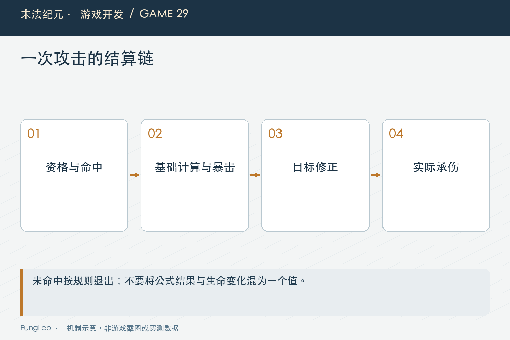
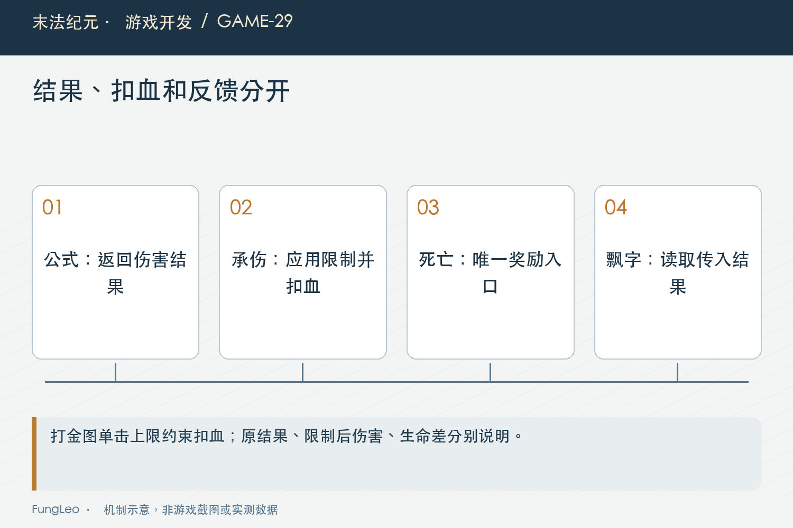

# 末法纪元·游戏开发29：一次攻击，到底在哪一步算伤害

> 本文回顾《末法纪元》的开发过程，技术描述以 2026 年 11 月 5 日审阅快照为准。封面为主题插画，内文图为机制示意。

### 前言

各位看官，上一卷把角色怎么走讲完了。这一卷开始打怪，先聊一个看起来很小的问题：点了一次攻击，伤害究竟在哪一步发生？

刀挥出去，怪物掉血，飘一个数字，似乎顺着写就行。可技能有多段，怪物会闪避，玩家可能已经死亡，投射物又晚了一点到达。入口没分清，最常见的结果就是动画播一次、血扣两次。

《末法纪元》把攻击资格、数值计算、承伤提交和视觉反馈分开处理。这篇先沿着一次攻击往下走，看看每一步应该负责什么。


### 按下攻击，还没有获得扣血资格

输入表达的是意图。目标是否有效、是否在范围、攻击间隔是否结束，以及角色当前能不能行动，都需要先检查。

自动和手动应该经过相同资格判断。不能键盘攻击尊重冷却，自动循环直接调用伤害计算；也不能因为鼠标已经点过目标，就在之后切图或目标释放时继续结算。

第22篇《自动战斗，不是写一个循环替玩家按攻击》说自动层负责调度，这里对应的是共享动作入口。先证明这次动作可以发生，再产生后续数值与状态变化。

资格失败还应有合理反馈，但失败提示不应该顺便消耗资源。玩家需要知道是距离不够、还在冷却，还是目标已经不存在。

### 公式只负责算出一次结果

Combat接收攻击、防御、技能系数、暴击和闪避等参数，返回是否未命中、伤害和暴击标记。它不直接扣生命，也不发奖励。

这样公式可以脱离场景验证，同一次计算也不必知道目标头顶数字怎么显示。下面是基础伤害部分的真实节选：

```gdscript
var raw := floorf(attacker_attack * multiplier - defender_defense * 0.5)
var base := maxf(float(min_damage), 1.0) if raw <= 0.0 else raw
```

注意取整位置，以及伤害下限只在未破防时启用。不能把它简写成“任何伤害都至少达到传入下限”，那会改变已经破防但较小的命中结果。

参数范围与默认值也属于接口语义。公式的调用方应当传入经过当前属性规则处理的数值，不是随意从某个面板标签读字符串。

### 命中、基础伤害和暴击有顺序

当前实现先判断未命中，未命中直接返回零伤害；成功命中再算基础值，之后判断暴击，最后约束结果。

顺序影响随机调用，也影响边界语义。未命中不应该再冒出一个暴击数字，暴击也不应把零命中变成有伤害。

为了说明计算，假设攻击二十、技能系数一点四、防御十，基础值按公式得到二十三；若这个教学例子的暴击倍率为一点五，则取整以后为三十四。

这些是假设数值，不是当前某件装备的实测。算例的作用，是让读者核对取整和执行顺序，不能拿它推断整个职业强度。



### 下限是方向规则，不是公式自己猜对手

玩家打高防怪物，保留一点伤害是一种规则；怪物打高生命玩家，未破防下限又有自己的产品口径。

Combat通过参数接收下限，不必为了区分双方，在公式里读取玩家节点或比较怪物ID。方向差异由调用方明确提供。

同样，怪物当前不暴击，使用集中定义的敌方参数；将来如果改变，应该有明确设计与验证，而不是某个新技能随手传一个概率。

共用公式的意义是核心计算口径一致，不代表双方所有参数和玩法待遇都完全相同。把这个区别说清楚，比笼统宣称敌我绝对对等更准确。

### 一次计算之后，还可能有目标相关规则

角色有效攻击力可以包含装备、增益和职业派生。等级关系、穿防和装备跨级等规则，又可能在特定阶段作用。

当前玩家技能会对目标计算相关输入，经过Combat后再应用装备跨级影响。这些具体规则后面会各自展开，本篇重点是它们的接入位置要唯一。

如果普攻入口乘一次，目标承伤又乘一次，同一个衰减就会被重复应用。多段或群攻尤其容易把“每目标一次”和“每技能一次”混淆。

因此梳理伤害不能只盯公式文件，还要把输入准备、结果修正和最终提交连成一条调用链看。

### 扣血入口才拥有生命变化

计算返回一个字典，不代表生命已经减少。目标承伤入口继续处理未命中、死亡状态、保护或地图级限制，再修改真实生命。

对象已经死亡时，后续命中不能再触发第二次奖励。生命归零以后，死亡流程应当只进入一次，不能每个伤害数字都再执行一遍掉落。

这与第08篇《功能越来越齐，什么时候该停下来审查一次》讲物品所有权类似：需要明确谁提交真实变化，不能多个观察者都觉得自己应该“顺手处理”。

飘字和声音可以消费结果，但不该成为决定最终扣血的唯一入口。表现缺失时，核心规则仍然需要保持一致。



### 投射物命中，要分清是显示还是结算

远程攻击里，可能施放时已经决定结果，弹道负责表现；也可能弹体真实抵达后才触发结算。两种模型都需要明确时机。

《末法纪元》的不同攻击路径有具体接线，不能看到画面上有一个弹体，就默认所有伤害都在碰撞时发生。

排查重复伤害，可以分别记录施放、结果生成、承伤和视觉命中。若前两个阶段已经提交，动画回调又调用一次承伤，就容易双扣。

弹体消失、目标释放或切图时，也要按原有模型处理。不能为了视觉顺眼，在取消后对一个新目标补发同样伤害。

### 反馈要说明自己显示的是哪一层结果

某个地图有单击上限，公式返回的数值可能大于最终扣血；目标已经残血，显示口径也需要明确。当前打金图有一个有意保留的区别：飘字和伤害事件使用传入的原伤害结果，生命只扣经过地图上限处理的部分。因此不能拿飘字直接当作血条的实际减少量，也不能宣称当前所有反馈都使用最终扣血。

这几层值可以不同，但含义必须一致。排查时分别记录公式结果、地图限制后的伤害与生命前后差；前者解释攻击结果，后两者解释真正承受了多少。面板预计值又只是特定条件下的估算，不能混作同一份账。

暴击标记说明这次结果经过暴击分支，不等于玩家必然感受到同样倍数的实际收益，后续限制仍可能影响。

因此报告“技能打了多少”时，先说明是公式输出、限制后的伤害，还是生命变化。三者混着比较，很容易把正常上限误判成丢伤害。

调试工具可以同时记录几层值，正式玩家提示则只呈现需要理解的信息，不把内部计算细节全堆到界面上。

### 用边界例子把顺序固定下来

可以先验证无防御、未破防、恰好破防、未命中和暴击上限，再验证自定义下限只影响未破防情况。

接着走真实玩家和怪物入口，检查攻击间隔、重复命中、死亡唯一性和多目标独立结果。公式单测通过，不代表入口没有多调用一次。

项目已有技能战斗和基础冒烟入口，下面命令供复核，本轮文章未运行游戏测试：

```sh
python3 tools/run_isolated_tests.py SkillCombatTest SmokeTest
```

### 先恢复一击，再谈整套DPS

玩家说伤害不对时，我会建议先选一个固定目标，关闭不相关随机因素，沿单次命中记录输入和结果。

一击的口径还没核对，就直接比较一分钟击杀数，跑路、技能轮转和刷新密度都会混进来。看着像公式问题，实际可能根本没有进入攻击范围。

确认单击以后，再看攻击频率、多段、资源和实际命中机会，最后才讨论持续输出。每一层的单位与条件分别记录，结论更容易重复。

这也避免一次同时改攻击、怪物生命和技能系数。几项一起变，体验可能改善，却很难知道原问题在哪里。

记录时也保留目标的实际等级和实例身份。循环地图里，同名怪可能来自不同生成时刻，属性并不一定相同；只记一个中文名字，后面很难还原那一次命中。条件越具体，比较才能越接近同一件事。

### 小结

一次攻击要经过资格、公式、结果修正、承伤提交和反馈。每一步的所有者与单位明确，才能防止重复结算和口径混乱。

各位看官追伤害时，可以先画一条“谁算、谁扣、谁显示”的线，再把多段和弹道接进去。很多看起来复杂的问题，都是这条线多走或漏走了一次。

下一篇继续看概率：伤害公式为什么要允许更换随机源？

### 相关内容

- 第08篇《功能越来越齐，什么时候该停下来审查一次》——真实状态提交与交界。
- 第22篇《自动战斗，不是写一个循环替玩家按攻击》——共享攻击执行入口。
