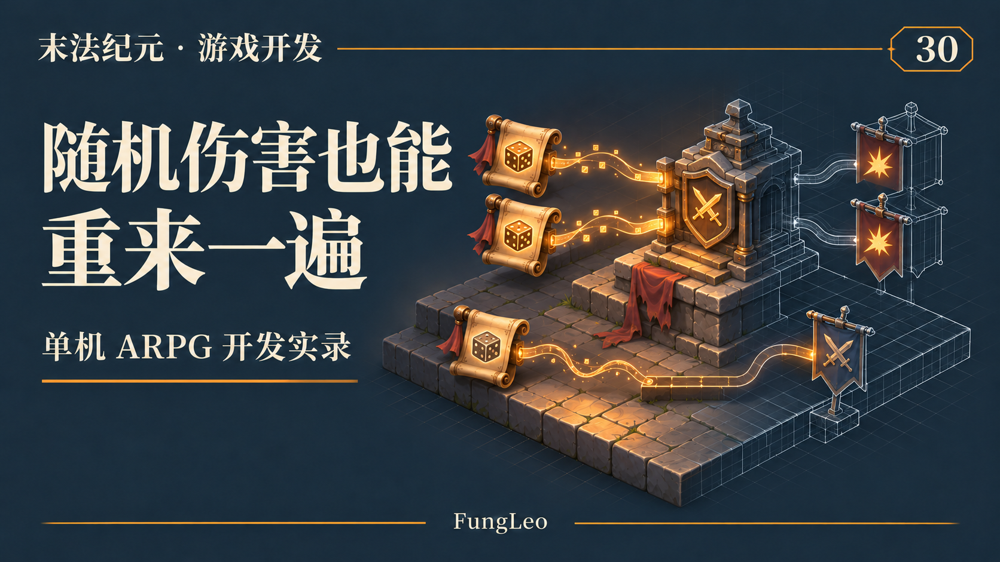
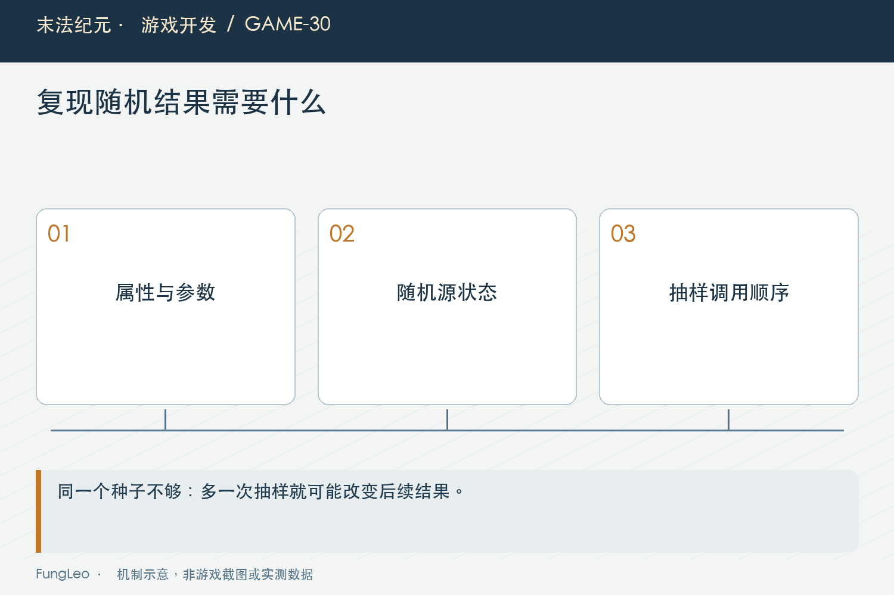
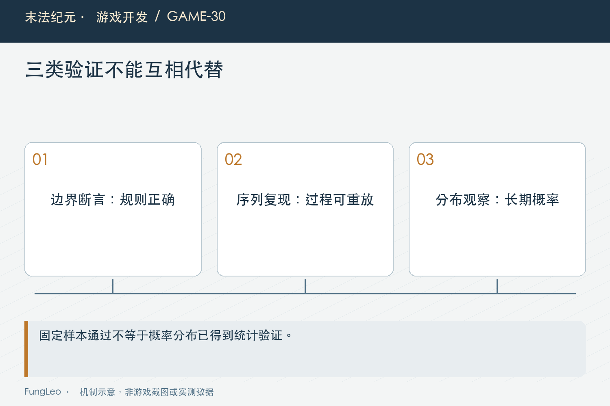

# 末法纪元·游戏开发30：伤害里有随机，出了问题怎样重来一遍

> 本文回顾《末法纪元》的开发过程，技术描述以 2026 年 11 月 5 日审阅快照为准。封面为主题插画，内文图为机制示意。

### 前言

各位看官，第29篇《一次攻击，到底在哪一步算伤害》把一次攻击的结算顺序讲清楚了。但只要有闪避和暴击，同一套属性打两下，结果就可能不同。

试玩里有惊喜是好事，排查时却容易卡住：刚才明明没掉血，再试又正常；重铸偶尔出现异常词条，下一次已经换了一组。

如果测试只能跟着正式随机流跑，失败很难还原，也容易今天绿、明天红。《末法纪元》的Combat因此允许调用方传入随机源。

这一篇聊怎样保留正式随机，又让验证能够重复，不把概率问题简单改成固定结果。



### 随机结果，也有可以检查的输入

一次伤害由属性、技能和随机抽样共同决定。只记录伤害数字，没有记录输入，当然很难复现。

排查时至少要知道攻防、系数、闪避点数、暴击参数和执行分支。如果涉及目标等级、装备影响，还要保留这些上下文。

随机源的种子与当前状态，是另一部分条件。不是写一句“用了随机”就可以放弃检查。

不过种子只控制抽样序列，不能替代完整场景快照。目标换了一只、技能多算一段，或者先消耗过随机数，结果都可能变化。

### 正式默认源，测试可以替换

Combat的接口接受use_rng。传入时使用调用方的源，否则沿默认入口取得正常随机实例。下面是源码中的选择逻辑：

```gdscript
var r: RandomNumberGenerator = use_rng if use_rng != null else rng()
```

这样正式玩法不需要每次额外准备测试参数，验证又可以控制序列。不要为了让测试稳定，把正式默认种子改成一个固定常量，导致每次新游戏都重复同样结果。

随机源注入也不意味着必须把场景全部模拟出来。对公式而言，明确的数值输入和一条可控制序列，就能检查很多边界；对实际攻击流程，再用集成场景补充。

依赖能够显式传入，调试者就少了一层“函数内部到底读了哪个全局状态”的猜测。

### 用同一种子比较同一条调用序列

下面是Godot工程上下文里的教学片段，假设Combat已注册。它验证两份独立源在相同输入和调用顺序下产生一致结果，并不是概率分布测试：

```gdscript
var left := RandomNumberGenerator.new()
var right := RandomNumberGenerator.new()
left.seed = 4513
right.seed = 4513
for index in range(20):
    var a := Combat.resolve(100.0, 20.0, 1.0, 0.2, 1.5, 6.0, left)
    var b := Combat.resolve(100.0, 20.0, 1.0, 0.2, 1.5, 6.0, right)
    assert(a == b)
```

数值和次数只是说明方法。不同引擎版本或随机实现的兼容性仍需单独核对，不能把这段写成跨所有版本永久相同的保证。

如果左侧多调用一次，之后结果就可能错位。固定种子保证起点一致，不保证任意改动以后序列仍然对齐。



### 抽样顺序也是行为的一部分

当前Combat先抽未命中，命中以后再抽暴击。未命中直接返回，不继续消耗后面的分支。

如果重构时为了“统一结构”，先把两个随机数都抽出来，再判断命中，后续攻击的序列就会变化。平均概率可能类似，固定种子快照却不再相同。

装备生成的随机顺序更值得注意。选属性、滚数值、决定百分比词条，每一步消费序列；插入一个本来不需要随机的新字段，也可能改变所有后续结果。

第10篇《同一种武器，为什么不能共用一份装备数据》讲生成快照，这里进一步说明生成过程本身也有版本语义。重构是否允许改变序列，应当有明确判断。

### 边界测试别依赖“刚好抽到了”

闪避点数为零，当前函数返回未命中概率零，可以构造稳定命中；暴击率为零，可以验证非暴击伤害。

但当前暴击率有上限。即使调用方传一，也会先夹取，不能据此声称必定暴击。接口注释与实际约束不一致时，写测试和文章都应以代码为依据，再记录需要澄清的地方。

要专门检查暴击分支，可以使用已验证会进入该分支的受控序列或测试条件，同时保留上限的独立断言。

不要让一个偶尔触发的随机分支决定测试是否完成。重复跑到通过，反而掩盖了不稳定验证方式。

### 确定性和概率分布，分别要回答

相同条件两次结果相同，只能证明可复现。它不能说明暴击比例符合设计，也不能证明所有边界正确。

分布检查需要足够样本、合理容差和明确统计口径。某次二十击出现七次暴击，不能直接认定二成概率写坏了。

同样，一次长样本平均比例接近，也可能漏掉某个临界分支的错误。边界断言守具体规则，统计观察看整体分布，两者不能互相替代。

本篇没有运行新的抽样实验，不给出一个看似精确的通过比例。正式做这类验证时，应把种子、样本数和允许偏差一起记下。



### 预览不应该偷偷改变正式随机

玩家反复悬停物品或打开确认框，通常只是查看信息。如果预览每次都滚一件产物，就可能消费原本属于战斗或最终提交的随机序列。

一方面结果难以复现，另一方面用户可能通过反复查看影响最终结果。即使没有刻意利用，也会让“同样操作为何不同”更难解释。

可以根据业务明确：预览只展示确定规则，提交时生成；或者会话先锁定产物，后续重试复用计划。不能一边承诺固定结果，一边每次刷新都重新抽样。

这些策略应当服务具体玩法，不能为了测试方便把所有随机都提前算好，再无意中改变取消和重试语义。

### 随机源隔离，也有边界与成本

把装备、地图和战斗各用独立源，可以减少互相干扰，但也新增需要管理的状态。种子从哪里来、是否保存、重试时是否重置，都要明确。

不是源分得越细越好。每帧新建并随手初始化，也可能让结果出现不期望的关联，还增加对象和调试负担。

先把当前入口允许注入，让关键测试能够控制，已经能解决不少问题。再按真实复现需求决定是否拆分正式随机流，避免提前建设复杂框架。

尤其存档恢复，不应因为一个辅助界面重新打开，就无声重置玩家正在使用的随机过程。

### 失败记录，要能还原分支

一份有用记录可以包含固定场景、数值输入、种子、攻击序号、是否命中与是否暴击。序号用来说明从哪一步开始偏离。

如果第一次结果就不同，先查输入和初始化；前几次相同，某个技能以后开始错位，再查那一段是否多消费了随机数。

这类方法比把每个内部随机值都无限写盘更有针对性。正式日志仍要限频，不输出完整玩家私有存档。

记录足以在隔离环境恢复之后，再用小用例固定错误，避免今后每次都依赖长时间试玩碰运气。

### 怎样接到现有验证里

项目的技能战斗、重铸和套装用例分别覆盖不同规则。可从对应入口开始，而不是给所有随机行为只留一个统计测试。

以下命令仅供复核，本轮文章没有运行游戏测试：

```sh
python3 tools/run_isolated_tests.py SkillCombatTest ReforgeTest SetBonusTest
```

同一次报告应注明代码和引擎版本。源码顺序变了以后，旧随机快照是否要更新，应先解释业务变化，不能看到断言红就批量替换期望。

还可以做一次有针对性的反向验证：在隔离副本中改变关键抽样顺序，确认相关快照确实失败，再恢复原实现。它帮助证明断言覆盖了这条约束，而不是刚好用了一个无论怎样都命中的样本。

这种注入只用于验证测试有效性，不应保留在正式源码。最终报告要说明改动已经恢复，哪项断言抓住了偏差，以及没有因此扩大到哪些概率结论。证据范围清楚，后续维护才不会把一个局部快照当成全部随机行为的保证。

### 小结

随机并不妨碍可靠验证，前提是把源和输入变成可控制条件，并区分边界、可复现性与统计分布。

各位看官再遇到“偶尔才有”的战斗问题，可以先保存一条能重来的序列。能重来，才容易证明修复真正发生，而不是下一轮刚好没有抽到。

下一篇看怪物生命周期：血量归零以后，还有哪些事不能跟着忘掉？

### 相关内容

- 第10篇《同一种武器，为什么不能共用一份装备数据》——生成结果与快照。
- 第29篇《一次攻击，到底在哪一步算伤害》——抽样所在的结算顺序。
