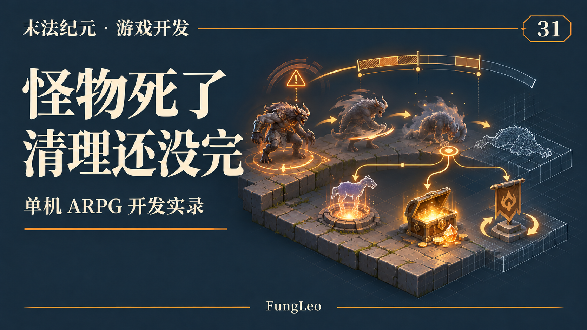
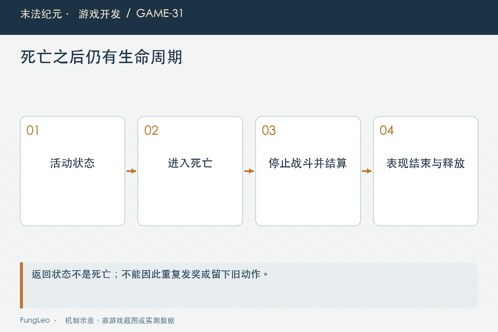
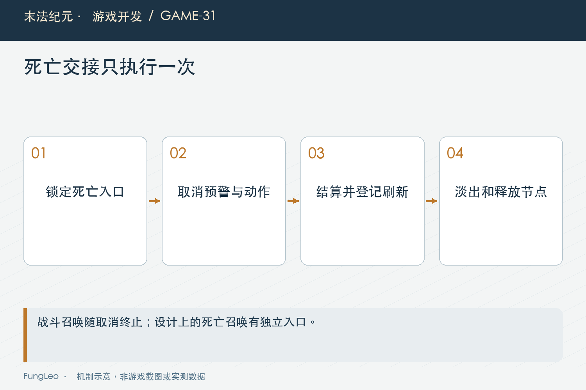

# 末法纪元·游戏开发31：怪物死了以后，状态机还没下班

> 本文回顾《末法纪元》的开发过程，技术描述以 2026 年 11 月 5 日审阅快照为准。封面为主题插画，内文图为机制示意。

### 前言

各位看官，提到怪物AI，最先想到的一般是发现玩家、追上来、攻击、追远了再回去。

可把游戏持续跑起来，很容易发现另一半问题：怪物已经死了，预警还在；血条没有消失；掉落发了两次；尸体淡出以后，某个延迟召唤又补了一只怪出来。

这些事不一定来自伤害公式，而是生命周期没有收完整。《末法纪元》的怪物节点同时承接普通AI、Boss动作、状态效果和奖励，退出战斗与死亡都需要明确清理。

这一篇先看完整生命周期，下一篇再拆一个未接战放技能的真实案例。



### 活着，只是进入决策的第一层条件

当前怪物物理流程在死亡时停止移动和战斗推进。破甲等状态也只在活着时继续计时，避免尸体还承担无用规则更新。

但表现可能仍然需要推进。死亡动画和淡出未结束，节点还在场景中，不等于它可以继续攻击；状态规则停止，也不等于画面必须瞬间消失。

这就是为什么“节点存在”和“允许参与战斗”不能混成一个判断。角色、弹体和UI引用到它时，都需要看实际生命周期。

第29篇《一次攻击，到底在哪一步算伤害》讲承伤提交，生命归零只是死亡入口，后面还有一串需要完成的交接。

### 状态转换，最好集中清退出动作

从追击进入攻击，从攻击返回出生点，都可能携带计时、预警、移动方向和动作锁。只改一个枚举值，旧动作不会自动忘记自己。

Monster的_enter在进入返回或闲置时，会清理远程前摇、践踏和章节预警，取消共享Boss动作，并处理表现状态。

这些清理放在状态边界，比每个调用方记得逐项撤销更可靠。以后增加新的脱战入口，也能沿着相同规则退出。

不过共用入口仍要遵守用途。正式死亡有自己的奖励和召唤处理，不能为了省代码，粗暴把所有退出都当成死亡。

### 第一次接战与重新接战，不是一帧接一帧重置

共享Boss动作有首放计时。真正从非战斗状态进入追击时，才重置进战相关时间；追击和攻击之间来回切换，不该每次把首放倒计时归零。

否则玩家在攻击距离边缘走动，Boss可能一直等不到放技能，或者反过来反复触发初始招式。

因此状态转换要知道原状态和新状态。一个“进入追击”的名字，还不足以表达这次是否开启了新的接战周期。

测试时可以让目标在范围边缘移动，观察普通切换是否影响原本的技能节奏，而不是只测试站桩输出。



### 死亡入口，先保证只进入一次

下面是实际_die的起始部分，后面的取消、奖励和表现已省略：

```gdscript
func _die() -> void:
    if is_dead:
        return
    is_dead = true
    state = State.DEAD
    velocity = Vector2.ZERO
```

先立起死亡状态，再继续后续处理，可以挡住重复命中或重复调用。不是等动画结束才标死亡，那段时间已经足以让其他攻击再次进入。

但一条布尔守卫也不能自动证明全部幂等。后面的延迟回调、奖励计划和刷新登记仍要核对。入口防重是第一层，不是整条业务已经完成的保证。

### 清理的不只是攻击方向

死亡会取消待触发践踏、章节预警、冲锋和共享动作，清除相关表现，并处理已生成的特定召唤对象。

这些状态若残留，玩家可能躲过尸体却还被旧预警结算；HUD也可能继续收到一条“Boss正在战斗”的心跳。

血条显示死亡，奖励结算一次，再通知生成器登记刷新状态，各自有自己的职责。界面收到死亡信号，不应该再独立发一份经验或掉落。

第09篇《从网页状态走到游戏状态，职责该怎么分》强调谁拥有状态，这里也一样：怪物提交死亡，其他系统消费结果，不要各自猜一次死亡有没有发生。

### 死亡召唤和战斗召唤，要明确区分

有些怪物的设计允许死亡后生成对象。这不等于所有已经排队的战斗召唤都可以穿过死亡继续执行。

战斗召唤在延迟回调真正运行时，需要重新检查是否仍在合法接战；死亡触发的召唤则沿明确入口处理，使用自己的奖励和生命周期约定。

如果只加一句“死亡一律不许召唤”，可能把已有玩法删掉；如果完全不检查，取消的战斗动作又会复活。

所以条件要按动作语义写，不按代码看起来方便写。延迟执行前的复核，是一次新的边界检查。



### 奖励完成与节点释放，要接好顺序

当前死亡流程会先完成必要结算与信号，再播放死亡表现和淡出，最终释放节点。生成器负责按刷新规则管理下一次出现。

这里不能只看queue_free有没有调用。物品、计时和任务事件可能发生在释放之前，重复处理就会产生重复收益。

同样，淡出中的对象不应被自动选怪重新纳入候选。筛选要检查死亡状态，不能只看引用仍有效或节点还在树上。

第25篇《地图变大了，刷新怪物不能跟着越来越贵》讲刷新时钟，下一次生成由持久状态决定，而不是旧节点一删就立刻补一只。

### 脱战归位，不应该顺便发奖励

Boss失去有效玩家或越过牵引条件后，可以进入返回状态。返回期间停止新招式，最终按规则恢复出生位置和生命。

这是一种战斗重置，不是被玩家击杀。不能共用一个“清理怪物”的函数，就把死亡奖励也顺手执行。

远距离退场又是另一种对象回收，刷新器与持久状态需要分别处理。看到怪物消失，先判断是死亡、归位还是卸载，才能解释玩家为何没拿到奖励。

文章和日志都应保留这些区别。把所有结束都称作死亡，会把排查带向错误的结算入口。

### 持久状态只保存恢复所需的信息

当前血条节点、仇恨目标和动作组件不应该直接进存档。跨图要恢复的倒计时、奖励或首杀状态，由各自持久层保存必要数据。

读档以后重新生成运行实例，再按当前规则恢复。旧节点引用即使名字相同，也没有理由跨场景继续使用。

这和第10篇《同一种武器，为什么不能共用一份装备数据》的模板与实例区别相关。怪物实例可以消失，世界进度仍然需要保持；二者不能为了方便绑成一份不可分的数据。

### 用中断点检查清理，而不只等自然死亡

可以在预警、前摇、多段间隔和召唤排队时分别杀死怪物，确认后续伤害或战斗召唤不再出现。再让它正常活到动作结束，保留原来的合法行为。

脱战、玩家死亡和切图也要覆盖。只检查“怪物血量变零”不能证明剩余动作被取消。

已有接战、动画和刷新用例可作为入口。本轮未执行游戏测试：

```sh
python3 tools/run_isolated_tests.py BossEngagementTest MonsterAnimationTest SpawnerBudgetTest
```

### 留意看似无害的表现回调

动画完成以后才解除动作锁，或者Tween结束以后触发后续动作，这些回调都需要重新验证对象和流程是否仍有效。

如果角色已经脱战，动画回调不应该把它又推进攻击；如果节点已准备释放，不能再向旧父场景添加对象。

表现可以帮助对齐时序，但不应在没有状态检查的情况下拥有独立战斗权。核心规则与视觉事件之间，要有可追踪的一次性关系。

记录清理结果时，也要检查信号和引用是否随对象结束而释放，而不是只数屏幕上还剩几个图像。

还要记录同种怪物的实例身份。一个节点死亡后，刷新器后来生成的同名怪不是原来的对象。测试如果只按名字找，可能把新实例的合法动作误认为尸体残留。把生成、死亡与释放顺序连起来看，才能判断究竟是旧引用没清，还是新的生命周期已经开始。

### 小结

怪物生命周期从生成开始，经过接战、动作、受控、脱战或死亡，再到结算与释放。死亡后仍然有清理责任，但不再有继续攻击的资格。

各位看官排查“怪死了还出事”，可以沿计时、延迟回调、表现、奖励和刷新这几条线分别追，通常比只给伤害函数再加一个判断更完整。

下一篇就看一条这样的漏洞：Boss还没接战，为什么已经开始放技能？

### 相关内容

- 第09篇《从网页状态走到游戏状态，职责该怎么分》——生命周期与所有者。
- 第25篇《地图变大了，刷新怪物不能跟着越来越贵》——死亡后的世界时间状态。
- 第29篇《一次攻击，到底在哪一步算伤害》——承伤与唯一死亡入口。
