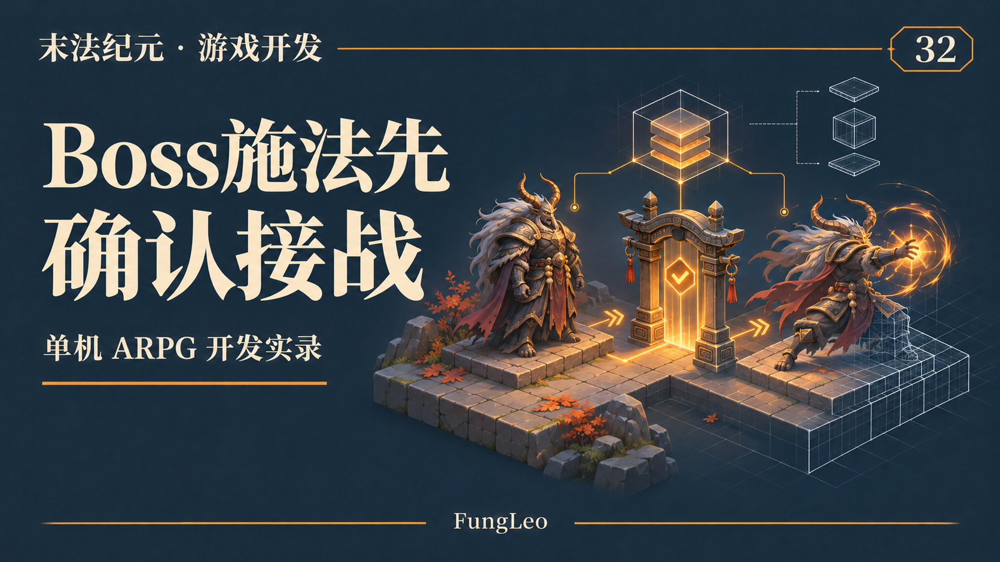
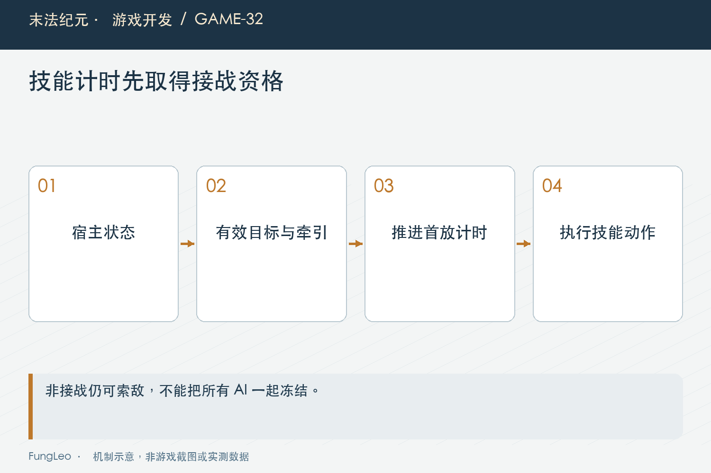
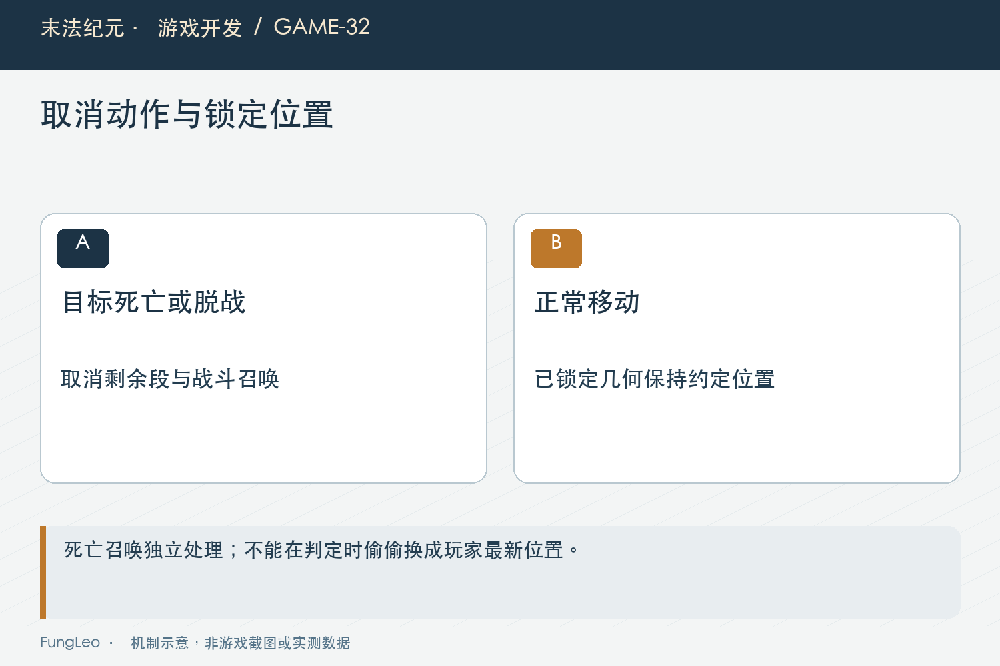

# 末法纪元·游戏开发32：Boss还没接战，怎么已经开始放技能了

> 本文回顾《末法纪元》的开发过程，技术描述以 2026 年 11 月 5 日审阅快照为准。封面为主题插画，内文图为机制示意。

### 前言

各位看官，玩家还站在远处，Boss没有追击，也没有真正进入战斗，地上却已经出现技能预警。

这类反馈很容易被解释成“技能范围太大”或者“索敌距离需要调小”。但《末法纪元》这次排查发现，问题更靠前：技能组件推进时，没有统一确认宿主是否真的接战。

场景里有玩家，不等于这只Boss正在和玩家交战。组件能找到一个目标，也不等于现在拥有施法资格。

这一篇按历史修复记录和当前源码，把入口漏检怎样形成、又怎样补齐讲清楚。



### 先分清玩家选中了谁，怪物又在做什么

玩家可以选中一个远处Boss查看信息，Boss仍然处于闲置或巡逻。选中是玩家的界面与操作状态，接战是怪物AI的状态。

如果把前者当成施法条件，查看血条都可能激活招式。反过来，怪物受到合法攻击转入追击，也未必来自玩家显式点击。

因此接战不能依靠“当前锁定是它”来判断，而应沿宿主的有效目标、追击攻击状态和牵引规则确认。

第18篇《键盘、鼠标和自动移动，到底谁说了算》讲不同意图不要混用，这里是观察、选中和仇恨之间的区别。

### 组件内部有完整招式，不代表宿主可以一直调用

共享BossAction管理首放、预警、分段间隔和恢复。宿主每次推进它，内部计时就会向前走。

如果宿主只是看到场景中存在玩家，就不断调用update，Boss还没接战，首放倒计时可能已经结束。玩家走近时看到的，甚至是一个已经蓄好很久的招式。

问题不一定在组件内的伤害计算，而在它什么时候被允许推进。增加一个范围判断，只能遮住某些表现，不能修正整个生命周期。

设计共用组件时，需要写清调用前提。可复用能力越集中，宿主边界越值得验证，否则同一个漏洞会在多只Boss身上出现。



### 状态门槛放在动作推进之前

当前共享宿主在非追击、非攻击状态不推进动作，若发现异常残留则取消，再交还普通AI继续索敌。下面是实际入口节选：

```gdscript
if state != State.CHASE and state != State.ATTACK:
    if boss_action.is_busy():
        boss_action.cancel()
        _clear_boss_visual()
    return false
```

这段依赖前面有效玩家与脱战处理，不是所有合法性只靠两种状态。它解决的重点，是闲置和归途不能继续消耗首放计时。

返回普通AI也很重要。若非接战直接冻结整只怪，它又永远没有机会发现玩家、进入追击，修复就变成禁止Boss正常工作。

### 首次计时，需要绑定一次真正的接战

从非战斗状态首次进入追击，会重置相关动作计时。追击和攻击之间转换，不应不断刷新首放延迟。

否则玩家只要在范围边缘走动，就可能让Boss永远不放技能；或者每次状态变化都当成一轮新开场，破坏原来的节奏。

验收要先在闲置状态等待足够长，确认没有预警，再让玩家合法接战，检查原定首放延迟与动作仍然成立。

“没接战时不放”和“接战后照常放”要一起守。只验证第一条，完全取消技能也能通过，显然不够。

### 旧章节的技能入口也要一起盘点

项目里不只有共享BossAction，早期Boss还有践踏、阶段狂暴、章节预警和召唤等路径。

只修共享入口，新章节正常了，旧Boss仍可能在低生命或计时触发后施法。玩家看到相似现象，却来自另一条调用链。

所以整改逐项检查阶段、预警和召唤入口，用统一接战前提约束，同时保留既有伤害、几何和冷却。

第13篇《怪物可以按章分，招式为什么不能跟着名字写死》讲能力复用，生命周期门槛也要覆盖所有实际能力入口，不能只在最漂亮的新组件里成立。



### 失去目标以后，正在准备的动作怎么办

预警已经出现，玩家死亡、离场或进入不允许交战的区域，后续段落需要按规则取消。不是只禁止下一招，当前还没结算的招式也要复核。

返回和闲置状态会清理相关预警、践踏计时和动作组件。视觉取消应当真正取消，不要把抬臂动画直接跳到落地帧，反而触发一次命中。

这与第31篇《怪物死了以后，状态机还没下班》的清理责任相连。动作进入时绑定资格，退出时撤销剩余意图，表现不能独立续命。

多段间隔尤其适合测试。第一段已经合法命中，不意味着后面几段可以越过玩家死亡继续提交。

### 延迟召唤，需要在执行时再看一次

阶段变化可能排队一个延迟召唤。排队时仍在交战，回调真正执行前，宿主可能已经进入返回。

因此执行前还要重新检查接战，不能依靠排队时的一次判断。否则预警清掉了，下一帧却突然多出一批召唤物。

死亡掉落型召唤又有自己的语义，不应被同一条接战检查误删。两种入口分别约束，既修掉越界行为，也保留原本设计。

这类边界常常只有连续操作才能触发。直接调用一次召唤函数验证有对象生成，根本碰不到取消时序。

### 目标移动，不该让锁定几何偷偷追着走

预警时锁定了位置和朝向，后续有效交战中目标移动，也应按技能原规则处理。修复接战门槛，不能顺手改变招式锁定与命中区域。

否则玩家以为在躲预警，实际伤害又跟着目标更新，生命周期修好了，危险反馈却变得不可信。

已有回归因此还检查有效交战期间目标移动不改变锁定几何。取消和继续各自有条件，不能把“重新验证目标”误写成“重新瞄准所有技能”。

固定场景比较前后几何，比只看Boss有没有放招更能发现这种附带变化。

### 测试夹具也得站在合法前提上

历史回归发现，有些旧夹具直接在闲置状态推进技能。新增接战门槛以后它们失败，不能立刻把门槛删掉恢复绿色。

需要检查夹具想验证什么。如果验证合法伤害，应明确进入追击；若测试未接战不施法，则保留闲置。原来的伤害、首放和几何断言不因此放宽。

还有夹具瞬移Boss却没同步出生点，会触发牵引归位。此时修的是场景前提，不是把正式牵引距离无限扩大。

把这些适配写进记录，审阅者才能判断是覆盖扩展，还是测试被偷偷降标准。

### 按模板与中断阶段复核

可以逐个共享模板检查闲置、巡逻、返回均不施法；正常索敌和受击后可以接战；首放、预警、命中和恢复保持原节奏。

再覆盖旧章节模板、目标死亡、免战区和延迟召唤。窗口验收则检查待机无预警、交战时表现正常，不把少数截图当成所有模板逐帧视觉证明。

以下是已有检查入口，本轮未运行游戏测试：

```sh
python3 tools/run_isolated_tests.py BossEngagementTest BossActionTest BossReviewTest ChapterTwoCombatTest
python3 tools/run_isolated_tests.py --rendered BossReviewTest MonsterAnimationTest
```

### 修复影响，要和性能结论分开

这次新增的是有限状态与目标检查，复用已有取消入口，没有因为修接战就引入新的一套计时器或常驻节点。

但这只能说明改动形态，不能直接承诺整帧变快。没有同场景性能测量，就不写帧率收益。

报告还应注明当时定向验证覆盖，而不是拿“多项通过”概括为所有测试全绿。越明确，后来排查类似问题越容易继续。

排查时也可以先关闭表现，只观察动作阶段和伤害回调，再恢复正常画面确认预警与结算对齐。前者帮助定位资格，后者检查玩家反馈，不能把诊断状态直接作为正式交付。

如果某只旧Boss仍然异常，就沿它的真实入口继续追，而不是给怪物名字增加一个临时例外。统一规则应该按行为前提表达，新增模板才能自然继承；名字白名单只会让下一只复制出来的Boss再次绕过门槛。

### 小结

Boss未接战放技能，核心是宿主没有统一守住动作推进资格。修复需要覆盖共享入口、旧能力路径和延迟执行，再把正常接战与取消都验证。

各位看官用组件化能力时，别只问组件会做什么，也问谁在什么状态下可以调用它。很多生命周期漏洞，就藏在这道门口。

下一篇聊技能本身：一项技能为什么远不止一个伤害系数？

### 相关内容

- 第13篇《怪物可以按章分，招式为什么不能跟着名字写死》——多能力入口的治理。
- 第31篇《怪物死了以后，状态机还没下班》——动作取消和延迟回调。
