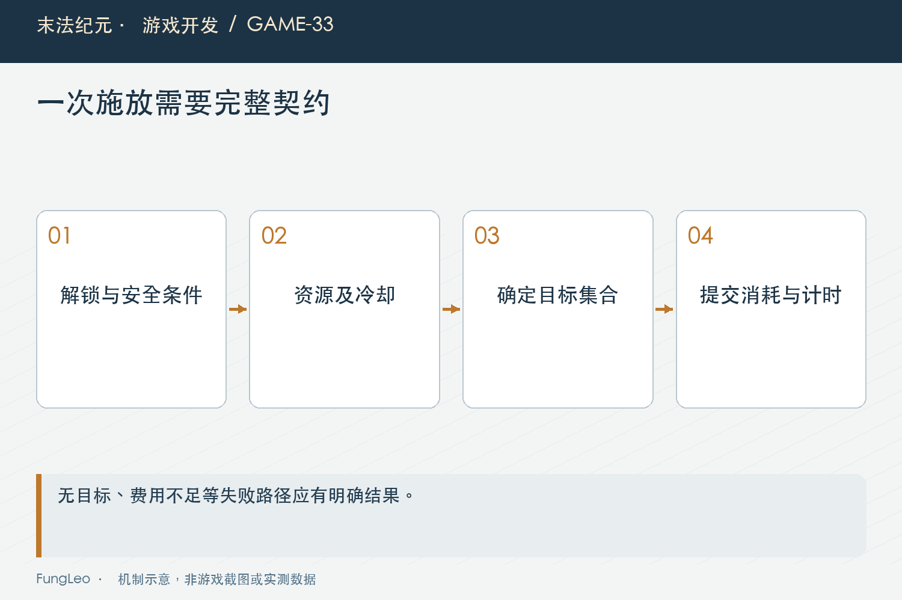
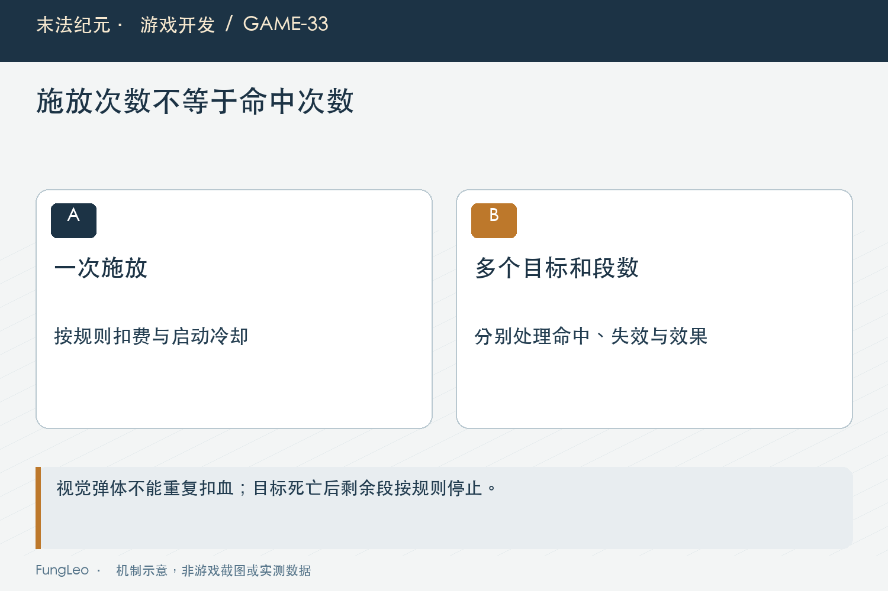

# 末法纪元·游戏开发33：加一项技能，远不止填一个伤害系数

> 本文回顾《末法纪元》的开发过程，技术描述以 2026 年 11 月 5 日审阅快照为准。封面为主题插画，内文图为机制示意。

### 前言

各位看官，普攻能打以后，加技能最容易先想伤害：这一招一点四倍，那一招打三段，再来一招无视部分防御。

表填完了，问题也跟着来了。三段是不是扣三次蓝？预警结束以后才算伤害吗？技能明明显示可用，按下去却没有目标；或者表现出了一个圈，实际攻击的又是另一片地方。

《末法纪元》的技能逐步扩展到范围、多段、增益、减益和远程表现。把这些能力接起来，需要一份完整行为约定，而不是一列系数。

这一篇先拆一项技能从定义到执行的责任，后面再看职业与资源。


### 技能定义先回答一次动作买到了什么

单体技能换取集中输出，范围技能覆盖更多目标，自身增益提供一段时间的能力，控制则改变对手行动。它们的价值不完全来自总伤害。

所以定义时除了系数，还需要解锁、消耗、冷却、范围形状、目标规则与特殊效果。一个技能如果有明确上限目标数，也要在命中集合中执行，而不是只写在描述里。

这些字段应当有单位。范围用格还是世界像素，持续时间用哪种时钟，穿防是忽略比例还是保留比例，都要说清楚。

第11篇《JSON越写越多，怎样把配置错误拦在进游戏之前》讲数据校验，技能表尤其需要把字段语义写进约束。

### 可用图标，不等于现在能成功施放

等级、技能归属、冷却、法力、攻击间隔、安全区和目标有效性，都可能影响执行。UI可以提前提示，但最终入口仍要重新检查。

否则打开面板时资源够，点确认前被另一动作花掉，就可能出现负资源；目标已经死亡，按钮仍显示可用，也不能继续拿旧引用结算。

拒绝时要保持清楚的副作用边界。没有合法目标，不应该先扣蓝；花费失败，不应先启动完整冷却，再告诉玩家放不出来。

自身增益又可能不要求锁定敌人，不能把所有技能都套进单体攻击前提，导致安全区里的合法开盾也被误拒绝。

### 命中集合先确定，再提交一次消耗

玩家攻击技能当前会先取得实际目标集合，再尝试扣法力。下面是入口中的真实节选：

```gdscript
var targets := skill_targets(skill, target)
if targets.is_empty() or not GameState.spend_mp(mana_cost):
    return false
skill_cooldowns[skill_id] = GameState.cooldown_after_cdr(float(skill.get("cooldown", 0.0)))
_attack_cd = effective_attack_interval()
```

这是依赖前置校验的片段，不是完整施法函数。它说明目标为空与费用不足都会拒绝，成功以后才进入对应计时。

攻击间隔和技能冷却也是两套信息。一次施法占用攻击节奏，不代表它们可以混成同一个显示数字。



### 范围规则不是围着目标数怪就够了

圆形可以以自身为中心，扇形需要朝向，单体有射程，线形又有长度和宽度。目标附近有很多怪，不代表当前技能实际能打中。

命中集合应该使用真实位置与形状，再应用最多目标数等规则。自动选择和手动执行最好复用这份能力，避免自动以为能打中、执行却空掉。

同时要清楚是否允许空放。当前某类攻击要求有命中对象，不能因为想做漂亮表现就跳过这条限制；若产品要改变，应该作为明确玩法变更。

范围越大，候选检查也可能越贵。先过滤有效对象，再做几何判断，比在每个候选上准备复杂效果更合理。

### 多段是多次命中，不是多次施放

当前多段技能在施放时扣费并设置攻击间隔一次，再对每个目标执行规定段数。不能每段重复扣整份费用，也不能每段再等一轮普通攻击间隔。

源码在后续段之前还检查目标是否已死，避免第一段击杀以后，剩余段继续飘字、发事件或触发重复处理。

不同目标有独立的等级、闪避和防御，群攻不能偷用第一只怪的结果复制给所有人。第29篇《一次攻击，到底在哪一步算伤害》的单击链路，在这里是按真实目标重复，而不是把最终伤害乘一个人数。

至于表现上几次落点与逻辑几次命中如何对应，要看当前模型，不能靠动画帧数决定实际段数。



### 穿防和持续破甲，属于不同层

穿防作用于本次计算输入，持续破甲修改目标一段时间的防御状态。名字都像削弱防御，执行位置却不同。

如果两者都在同一个入口随手乘一次，再在目标属性读取时又乘一次，就会重复削减。持续效果还要处理刷新、过期和死亡清理。

未命中也不能凭空获得“命中后附加”的减益。项目在结果不是未命中时才应用相应技能减益，这是一条具体边界。

这些规则应当通过实际承伤与状态读取验证，不能只检查目标字典里多了一个破甲字段。

### 击退和击倒，改变的不只是位置

击退带来位移，击倒或硬直改变行动资格，无敌帧又限制后续受击。它们与导航、输入和自动状态都会相遇。

角色被推离旧路线以后，不能继续盲用原航点方向；自动控制也不能把正常受控立刻判断为不可达，反复换目标。

第24篇《Boss还剩血，角色为什么跑去打旁边那只》已经讨论过这类放大链路。加入一个控制机制，除了验证效果出现，还要验证结束以后能恢复移动和攻击。

控制持续时长、叠加与刷新都需要明确约定。不能为了“打起来更爽”随意叠加，最后把玩家锁到完全没有操作机会。

### 视觉弹道，不要再次拥有伤害权

当前玩家远程普攻和法术的部分投射物是纯表现，调用点已经结算伤害。弹体负责飞行与结束，不引用Combat来重新扣血。

怪物远程路径又有自己的触发时机。不能因为画面都像一颗球，就把它们统一成“碰撞时再算”，无意改变已有反馈和用例。

给技能接特效时，要先问这层是表现还是规则。命中闪光可以延迟，真实结果不能被两个系统各提交一次。

缺少素材也不应该让核心规则停摆，回退表现与日志需要有明确边界。

### 预警来源和实际几何，尽量共用

专属效果如果已经负责范围表达，通用范围层不要再画另一套不同大小的盘。两个提示叠在一起，玩家不知道该信哪个。

但减少重复提示，不等于取消危险信息。圆、扇形和线的表现都应能解释实际规则，而不是装饰图案恰好覆盖附近。

几何规格变化时，判定、预览和测试一起核对。只把特效做大，没有改命中范围，会让玩家以为技能漏打；反过来则产生看不见的伤害边界。

这一层后面有地面几何专篇，本篇先把“谁提供范围事实”写进技能契约。

### 验证一项技能，要从失败到组合

先检查未解锁、冷却中、缺蓝、目标失效和安全区，再检查成功扣费一次、冷却一次、每段每目标一次。

随后加入闪避、控制、持续减益、死亡和切图。多目标技能用不同等级与位置对象，避免一排相同木桩掩盖逐目标错误。

项目已有能力和技能战斗用例，可从这里开始，本轮未执行游戏测试：

```sh
python3 tools/run_isolated_tests.py SkillCapabilityTest SkillCombatTest SkillFxShapeTest
```

静态字段通过，不代表能力已经接入施放名单；运行入口通过，也还要实际窗口复核预警和反馈。

### 不要把新增机制和调强度一次混完

接穿防、改段数、压冷却、扩范围同时发生，最终输出变了，很难知道哪项是机制修复，哪项是数值调整。

可以先在同一组参数上补齐缺失机制，确认边界，再单独比较新旧方案。报告写清角色、目标和资源条件，才能讨论平衡。

各位看官新增技能时，也可以先做一份动作清单：资格、成本、目标、结算、状态、表现、取消和恢复。少一项，往往就是后来最难复现的那个角落。

版本记录也应说明哪些技能真正接通了。配置存在、按钮能显示、自动会选择和实际结算成立，是不同完成状态，不能用一个“已支持”把中间缺口藏起来。

### 小结

技能把资源、时间、几何和生命周期绑在同一次动作里。系数只是其中一环，真正的实现要让各层沿统一入口提交。

下一篇从一项技能扩到一个职业：同一套角色代码里加入法师，哪些旧假设最容易被暴露？

### 相关内容

- 第24篇《Boss还剩血，角色为什么跑去打旁边那只》——受控与导航交界。
- 第29篇《一次攻击，到底在哪一步算伤害》——每段命中的结算链。
- 第32篇《Boss还没接战，怎么已经开始放技能了》——能力执行资格。
