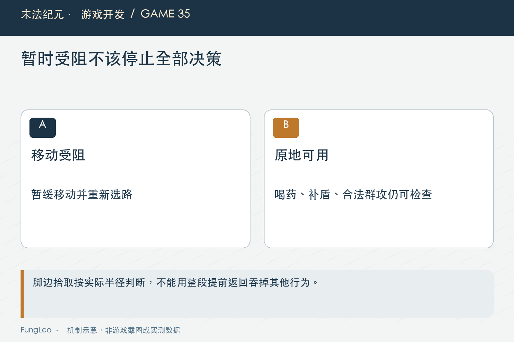
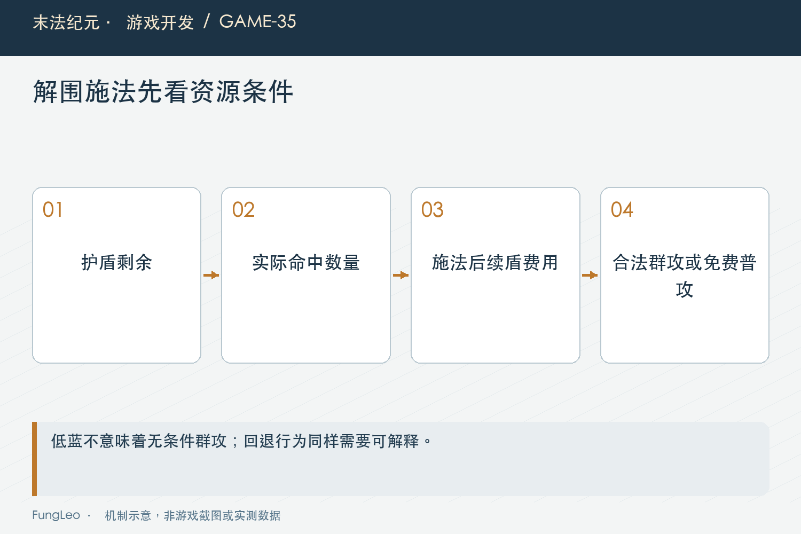

# 末法纪元·游戏开发35：怪都围上来了，法师为什么还不放群攻

> 本文回顾《末法纪元》的开发过程，技术描述以 2026 年 11 月 5 日审阅快照为准。封面为主题插画，内文图为机制示意。

### 前言

各位看官，做了远程职业以后，很容易以为自动群攻只要看附近怪物数量。两只以上，技能好了，就放。

可《末法纪元》在聚金地脉遇到过这样的反馈：群攻频率已经提高，多怪贴身时仍偶尔打普通火球，甚至像站住不动；技能在界面上又是可用的。

当时没有玩家那一刻的完整日志、蓝量和逐帧录像，因此不能把每次停顿都归到同一个原因。但代码与隔离场景确认了几条可以复现的决策链。

这一篇就讲这些链路，而不是简单把群攻范围再放大。


### 先分清“可以按”和“自动愿意选”

手动施法通常按实际费用、冷却、目标等资格检查。自动层还会考虑保盾、低蓝策略、命中收益和当前行为优先级。

因此按钮亮着，并不能直接证明自动分支出错；也不能因为有策略，就把所有停顿都当合理。需要看当时是哪条条件拒绝了动作。

第22篇《自动战斗，不是写一个循环替玩家按攻击》讲自动调度，这里是具体例子：执行能力存在，选择逻辑仍然可能在更早的位置退出。

记录蓝量、护盾剩余时间、技能冷却与自动状态，比只说“它没放”更容易定位。

### 临时寻路受阻，不该暂停原地防卫

旧流程先处理受阻等待，在一段时间内直接返回。这个返回不只停止重选与寻路，也把喝药、补盾和身边群攻机会一起挡住了。

怪物已经贴身，角色不需要走过去就能施法，却因为另一个目标的路线失败而停战。这是优先级范围过大的问题。

落地修复将维护资源与护盾放在前面，受阻分支允许检查原地可命中的敌群，再保持停止移动。下面是当前分支节选：

```gdscript
if _blocked_t > 0.0:
    _blocked_t = maxf(0.0, _blocked_t - delta)
    if _try_mage_swarm_cast(null):
        return
    _player.set_auto_move(Vector2.ZERO)
    _set_state(State.BLOCKED)
    return
```

受阻仍然有意义，只是不再等于所有战斗判断都下班。

### 当前目标，不应该遮住身边真实敌群

目标刚死亡、正在搜索节流，或者旧目标失效时，自动层可能暂时没有锁定对象。但身边其他怪物仍然存在。

如果群攻只能围绕当前目标判断，这些空档就会错过解围。修复后的入口可以从真实位置检查敌群，而不依赖一只远处目标。

同时要防失效引用。击杀和拾取事件可能在决策之间释放旧对象，进入新函数前先验证实例，不能因为参数类型写着节点就假定它仍然有效。

这与第31篇《怪物死了以后，状态机还没下班》的生命周期相连。目标不存在，意味着那条引用失效，不意味着整片战场暂停。



### 脚边的物品，为什么也可能让角色停战

历史流程要求角色靠近物品中心很小距离，保护期没结束时又停在拾取状态。实际上进入自动拾取范围以后，物品可以按原规则自行认领，不需要人物继续守着中心。

两套到达口径不同，造成不必要寻路和停战。修复针对拾取分支使用物品真实拾取半径，范围外仍保留既有优先级。

这里没有删除保护期，也没有改成任意距离直接入包。背包容量、G开关和手动丢弃等规则继续由原入口处理。

文章也不能宣称玩家那次停顿必然来自脚边物品。它是已确认的可复现来源，现场归因仍然需要当时条件。

### 一个名字不好的常量，可能被两处共用

回归曾发现，名字像拾取到达阈值的常量，同时被手动点击行走使用。若直接把它扩大到自动拾取范围，玩家会在目的地前提前停步。

这说明改常量前必须搜索调用方，不能只看命名猜影响面。修复保留原手动到达口径，拾取分支直接读取对应能力的范围。

第18篇《键盘、鼠标和自动移动，到底谁说了算》讲多种移动共用执行，本例展示复用的另一面：共享数据如果语义不清，局部调整会扩大影响。

测试失败时也应比较修改前基线，确认是新改动引起，而不是顺手把原到达断言放宽。

### 低蓝保盾，本来是在做合理取舍

法师的蓝同时承担输出和防护。自动层在低蓝时限制攻击技能，并通过不同进入、退出阈值减少反复切换，是一项明确策略。

但敌群围住时完全停止范围输出，也可能延长受击时间，继续消耗护盾法力。保留蓝的动作，未必总能带来更好生存。

因此不能简单删除低蓝保护，也不能只提高阈值。需要定义一个小而清楚的解围例外，让收益与剩余安全资源同时成立。

这类改变属于策略，不是伤害公式修复，验证时应保留单怪和真正资源不足的回退。



### 解围例外，必须保留下一次开盾能力

历史落地条件包括护盾仍有足够剩余时间、实际命中达到敌群门槛，并且施法以后仍留出下一次开盾费用。

它不是只看怪物数，也不是用一个永久固定蓝量。费用由现行统一入口计算，冷却、攻击间隔和命中形状仍然要合法。

如果盾马上到期，先按续盾流程处理；费用不够，就保留免费普攻回退。条件不成立，不强行空耗资源来追求“多放技能”。

这样策略才有可解释边界：为什么这次可以解围，另一次仍然省蓝。没有边界的强制轮放，只会把问题从停顿换成断蓝。

### 实际命中，不能用目标周围数量替代

自中心圆、朝向扇形和远距技能的几何不同。目标身边挤了几只怪，不代表法师当前位置或当前朝向能命中它们。

应按技能能力读取实际集合，再比较收益；必要站位也要经过通行约束，不能为了放近距群攻直接穿过墙。

第33篇《加一项技能，远不止填一个伤害系数》讲命中集合先于提交，这里自动选择也要尊重相同语义。策略认为有三只、执行只打一只，往往就是两边统计不同源。

候选朝向和站位搜索还需要上界，不能每物理帧对全场敌人穷举所有组合。

### 成本增加在哪里，要单独说明

受阻或无目标状态现在也可能检查一次近身群攻，逻辑更合理，但不代表计算免费。扫描要限定在攻击就绪等条件下，候选规模按当前活动集合评估。

报告没有据无头功能测试宣称实际帧率提升。若要评估性能，应固定满预算怪群、地面物、蓝量与F/G开关，记录脚本和整帧。

也不能为减少扫描把关键输入或伤害结算统一降频。候选查询、动作执行和表现分别有什么预算，需要分开看。

一项行为修复是否改善DPS、生存或帧率，都需要对应证据，不能因为玩家看起来更忙就一并承诺。

### 场景测试要把几条原因拆开

分别构造受阻时敌群贴身、保护期物品在脚边、物品在拾取范围外，以及低蓝但能保留续盾费用的情况。

每个场景只改变必要条件，确认该放时放、该回退时回退。再加目标释放和手动接管，检查不会使用旧引用或抢回执行权。

项目已有相应入口，本轮未执行游戏测试：

```sh
python3 tools/run_isolated_tests.py MageAutoSkillsTest MagicShieldTest DropToGroundTest AutoControlAcceptance
```

窗口试玩还要记录实际蓝量、盾剩余秒数和冷却，不能靠一张技能图标截图确定停顿原因。

还有一点，画面上多怪重叠，不等于怪物身体把玩家物理堵死。历史排查核对了碰撞层，确认这并不是那条受阻链的原因。先看实际配置，再决定是否改碰撞，能够避免为修自动决策而牺牲地图通行正确性。

诊断如果发现新的原因，也应当另留场景和证据，不把所有类似反馈都塞回已经修复的旧问题里。

### 小结

围住以后不群攻，可能来自受阻返回过早、拾取到达口径和低蓝策略共同作用。修复应缩小阻断范围、复用实际命中与费用规则，而不是直接加伤害。

各位看官排查自动选择时，可以先找“哪一条返回把后面的合法机会挡住了”，再判断它原本保护的规则是否仍需要保留。

下一篇把资源链完整展开：自动喝药和魔法盾，怎样共同形成有代价的续航？

### 相关内容

- 第18篇《键盘、鼠标和自动移动，到底谁说了算》——共用移动口径与接管。
- 第22篇《自动战斗，不是写一个循环替玩家按攻击》——决策返回与优先级。
- 第33篇《加一项技能，远不止填一个伤害系数》——实际命中集合。
