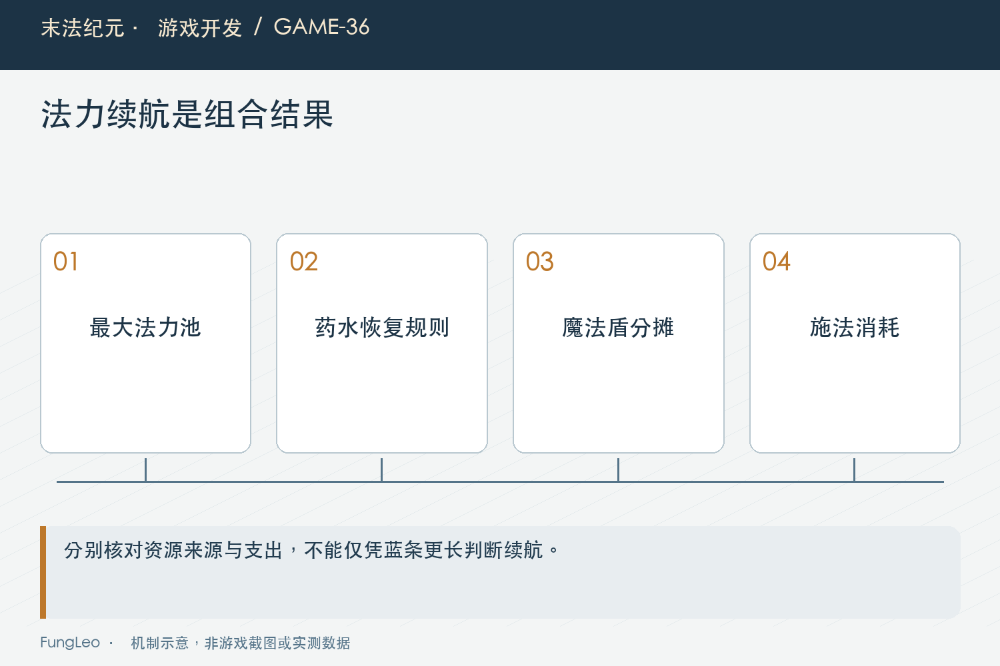
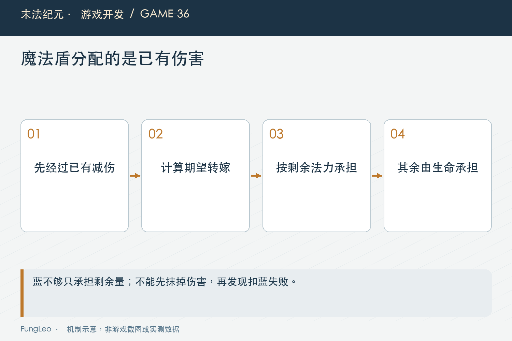

# 末法纪元·游戏开发36：蓝条变长以后，自动喝药和魔法盾才刚开始算账

> 本文回顾《末法纪元》的开发过程，技术描述以 2026 年 11 月 5 日审阅快照为准。封面为主题插画，内文图为机制示意。

### 前言

各位看官，法师说“蓝少”，可能是蓝条数字不够大，也可能是技能放几轮就空，还可能是怪物围上来以后护盾一直扣蓝。

这几件事不能只靠把法力上限乘一个系数解决。上限、费用、恢复和承伤，如果都跟着同一比例上涨，能多放几次技能也未必改变。

《末法纪元》后来调整了法师成长与计费，同时保留药水和护盾的独立规则。这一篇沿着一笔资源怎样进、怎样出，解释它们为什么必须放在一起看。


### 容量和续航，是两种目标

容量决定现在能装多少，续航决定持续战斗里收入和支出能否平衡。

如果每次技能都按最大法力的固定比例收费，只把容量翻倍，单次费用也翻倍，不计恢复时能放的次数大致没变。数字更好看，不代表战斗更连续。

而护盾按受到的伤害转嫁法力，又与怪物攻击、角色防御和装备有关。它并不是一个固定每秒扣蓝的装饰效果。

因此验收应分别观察蓝血关系、连续施法和被围攻后的资源压力，不用其中一项代替另外两项。

### 法力成长后来改过，费用也要跟着核对

早期法师方案按最大蓝百分比描述攻击法术，后续调整使用新旧法力池的加权参考池。魔法盾开盾仍有自己的容量费用规则。

当前统一费用入口同时供施放、自动选择和浮层使用。若自动仍读旧manaCost字段，它可能以为费用为零，选择一项实际根本放不出的技能。

第34篇《从武士扩到法师，原来只有一个职业也会留下这么多假设》讲职业成长来源，本篇强调同一个费用必须从统一规则获取，不能UI、手动和自动各算一次。

历史方案中的数字可以解释当时取舍，正式讲现状则回当前配置与函数，不把不同阶段拼成一套公式。

### 药水恢复量，也有等级边界

Consumable提供实际恢复量计算：较低等级使用固定值，后续按配置百分比与固定值取相应结果。

下面是正式函数核心节选，参数来自已查到的药水模板、当前上限和等级：

```gdscript
var fixed := int(tpl.get("restoreAmount", 0))
var pct := float(tpl.get("restorePercent", 0.0))
if level <= PCT_FROM_LEVEL or pct <= 0.0 or cap <= 0:
    return fixed
return maxi(fixed, int(round(float(cap) * pct)))
```

明确等级分支，是为了让旧阶段行为不依赖“某套装备上百分比恰好比较小”的数值巧合。换一种品质以后，巧合可能就消失。

规则边界应该由条件保证，再用不同装备验证，而不是只拿一个裸装样本宣布低等级完全不变。



### 自动喝药，也不能绕过玩家使用入口

手动双击、快捷操作和自动喝药都经过同一使用规则，检查数量、冷却、当前是否满值，再提交消耗和恢复。

满值时不浪费药，也不进入冷却；药水种类有各自的计时，不要UI另维护一份冷却条，关闭窗口以后计时就停住。

自动选瓶还要有明确策略。项目按缺口选择够用的较小档，若没有能补足的则选择较大恢复量，不能简单永远喝最高档。

两种资源都低时优先处理什么、缺药时是否继续战斗，也需要和产品口径一致。自动不会因为买药方便就擅自替玩家采购。

### 魔法盾转嫁的是伤害，不是取消代价

玩家承伤先经过已有减伤，再按生效护盾比例把一部分交给法力，剩余交给生命。顺序决定“总损失减少”的语义是否成立。

下面是盾吸收中的真实片段，比例来自当前Buff效果，前面已经检查合法范围：

```gdscript
var want := int(round(float(amount) * pct))
var to_mana := mini(want, int(GameState.player.mp))
if to_mana <= 0:
    return 0
if not GameState.spend_mp(to_mana):
    return 0
return to_mana
```

蓝不够就只承担剩余量，未承担的部分回到生命。不能先把应转嫁部分全部从伤害里抹掉，再发现扣蓝失败，凭空获得免费保护。

同样应走spend_mp通知HUD，直接写字典可能让真实资源和显示短暂脱节。

### 一次开盾和维持护盾，是不同支出

开盾有技能费用与冷却，受击以后转嫁又持续消耗法力。玩家满蓝时看着安全，密集战斗却可能快速花空。

因此“护盾持续三十秒”不意味着期间资源无限够用。剩余时长、当前蓝量和下一次续盾费用，需要同时看。

自动攻击策略保留续盾余量，是一种资源选择；原地解围例外又会在收益足够时允许范围输出。第35篇《怪都围上来了，法师为什么还不放群攻》已经讨论过这条边界。

不能把所有攻击一律禁掉，也不能完全取消保留。要让玩家能理解当前是在输出、保盾，还是已经资源不足。



### 提前续盾，不等于叠两层盾

当前魔法盾允许在冷却和资源合法时刷新时长与效果快照，自动会在剩余较短时尝试补盾。

重复施放是替换，不应让转嫁比例不断累加。其他增益是否允许生效中重施，则保留自己的规则，不能把魔法盾例外推广到所有Buff。

升级技能时，已经生效的护盾使用施放时快照，下一次施放才采用新效果。这让当前一次资源交易有明确含义，不因面板里买了一级就突然改写。

UI提示也应区分当前效果与技能定义。显示最新版说明，却让旧盾仍按旧比例工作，需要让玩家知道是快照规则，而不是数值没生效。

### 看蓝条，需要一笔守恒的算例

可以用一个教学例子：某次合法受击在减伤后剩一百伤害，盾希望承担三十五，但法力只有二十，就只能扣二十蓝，剩余八十由生命承担。

这里忽略额外保护与生命上限，只用于解释分配。正式测试仍要按当前取整和承伤入口检查，不能把例子当某等级Boss实测。

蓝充足、刚好够、不足和为零都应覆盖。无盾时和蓝零时的路径也要保持相应原有行为，不因为新增护盾给其他职业多扣一笔资源。

把结果分成实际扣血和扣蓝，才能判断“减伤了多少”，只看红条少掉一些容易高估收益。

### 旧档比例结转，不能反复赠送资源

法力上限公式调整时，旧档当前蓝量需要按明确口径映射。直接把新上限填满，会给所有角色免费恢复；只保留旧点数，又可能突然变成极低比例。

工程使用版本标记与一次性比例结转，重复读取不应再次赠蓝。迁移结果和角色身份也要一致，不能给非目标职业套用新成长。

这属于持久数据变化，与活动Buff和药水冷却的运行态不同。哪些跨图保留、哪些读档清理，各自有明确约定。

第10篇《同一种武器，为什么不能共用一份装备数据》的数据层次在这里仍然重要，不是所有屏幕上显示的计时都该写进存档。

### 验证持续资源，而不只检查满值截图

先测单次药水使用、冷却和满值不消耗，再测护盾不足蓝的分配、重施、到期、死亡和快照。

随后用固定怪群观察技能、药水和转嫁共同作用，记录蓝药数量、承伤与战斗时长。高蓝装备和生命偏科装都值得覆盖，不能只选最符合目标的一套。

已有资源和显示用例可以从这里开始，本轮未运行游戏测试：

```sh
python3 tools/run_isolated_tests.py PotionRestoreTest MageManaTest MagicShieldTest HudBuffTest
```

功能测试通过，也不等于所有职业配装已经平衡，需要把理论和实际游玩数据分开。

### 时间口径，也会改变看见的续航

开倍速后，技能、受击和药水计时如何推进，应沿既有游戏时钟理解。拿一倍速的现实一分钟消耗，直接和十六倍速比较，没有统一时间口径就得不出资源效率结论。

可以同时记录游戏时间与墙钟时间，并固定暂停、自动开关和角色状态。先判断单位是否一致，再比较每分钟费用和药水消耗。这样发现差异时，才不会把时间缩放误当成职业数值突然失衡。

资源恢复和消耗还要保留实际入账量，避免满值截断以后，统计仍然把整瓶标称恢复都算作有效收益。

### 小结

法力容量、技能费用、药水恢复和护盾转嫁共同决定续航。每笔收入支出走统一入口，再明确刷新、快照和迁移，资源才真正成为玩法。

各位看官看到“蓝少”时，可以先问是容量观感、输出中断，还是承伤支出。把问题分开，才知道该调哪一条链。

下一篇讲技能成长：怎样增加升阶，又不让它变成另一轮无边界的数值膨胀？

### 相关内容

- 第34篇《从武士扩到法师，原来只有一个职业也会留下这么多假设》——成长与职业口径。
- 第35篇《怪都围上来了，法师为什么还不放群攻》——保盾和解围策略。
