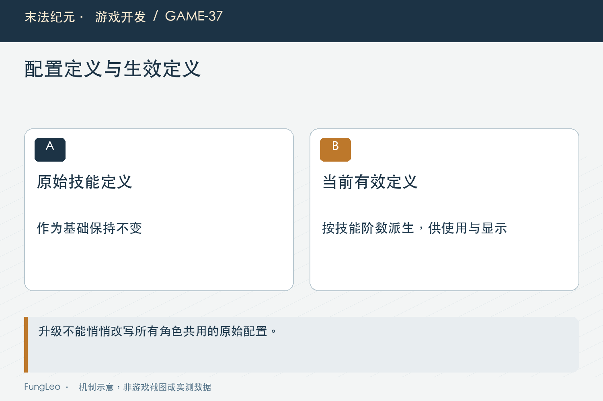
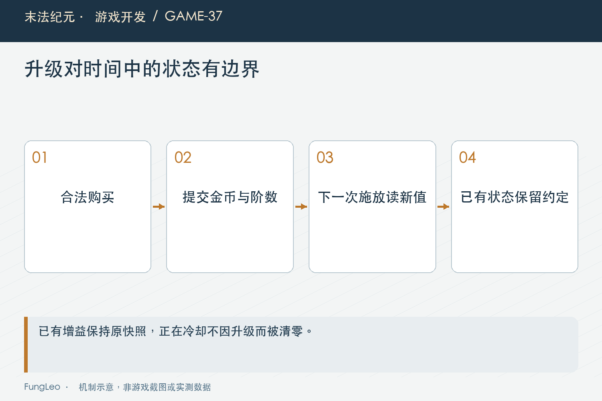

# 末法纪元·游戏开发37：技能能升级以后，怎样留下成长又不把数值推翻

> 本文回顾《末法纪元》的开发过程，技术描述以 2026 年 11 月 5 日审阅快照为准。封面为主题插画，内文图为机制示意。

### 前言

各位看官，角色等级一直涨，装备也能换，技能如果从解锁以后就永远不变，后期成长会少一层期待。

但给技能加升级，也很容易越做越大：技能点、分支树、重置、专精，最后变成另一套项目。《末法纪元》采用有限阶升级，围绕已有技能增加等级与金币门槛。

范围收住了，工程问题却没自动消失。当前阶数谁保存，手动与自动读哪份定义，正在生效的增益会不会买完立刻变强，旧档又从哪一阶开始？

这一篇聊这些边界怎样接到现有系统里。


### 先区分技能解锁与购买更高阶

角色达到基础解锁条件，默认拥有第一阶；未解锁时不能施放，也不能绕过条件直接购买高阶。

后续阶数再按配置检查角色等级、金币与当前阶。它是已有能力的有限成长，不等于新增技能树，也不应该允许一次请求跳过中间步骤。

基础普攻与主动技能是否都能升，也由定义决定。没有升级表的技能保留原规则，不能因为面板统一显示，就给所有技能硬塞一个升级按钮。

这份区分能让旧档迁移比较清楚：过去按等级解锁的能力仍然存在，但不能凭角色等级直接赠送所有已满足门槛的付费高阶。

### 基础定义保留，生效定义按阶解析

SkillProgression读取基础技能，再根据当前阶生成生效定义。修改的是独立结果，不反写共享基础表。

下面是当前解析中的节选，省略阶数与配置校验：

```gdscript
var effective: Dictionary = (base as Dictionary).duplicate(true)
if upgrade.has("coefficientMultiplier"):
    effective.coefficient = float(base.get("coefficient", 0.0)) * float(upgrade.coefficientMultiplier)
if upgrade.has("effects"):
    effective.effects = (upgrade.effects as Dictionary).duplicate(true)
if upgrade.has("debuff"):
    effective.debuff = (upgrade.debuff as Dictionary).duplicate(true)
```

因此当前成长不只有系数，还可能替换增益或减益效果。早期实施记录里的范围要结合后来职业调整理解，不能永久概括为所有技能只改伤害。

### 整体替换与逐键合并，要选清楚

高阶效果如果省略某个键，是想删除，还是沿用低阶？两种语义不同。

当前对应字段采用整体替换，可以避免高阶没写的内容悄悄继承。配置就需要把这一阶完整效果写清楚，校验也要覆盖必需条件。

如果调用方修改解析结果，还可能污染跨调用缓存。因此返回数据按只读约定使用，确实要做局部预览就另建结果。

第10篇《同一种武器，为什么不能共用一份装备数据》讲共享引用，这里同样重要。给一个角色买一阶，不应该顺便把所有角色或怪物技能模板改了。



### 玩家存的是选择，不是一份复制技能表

存档保存必要的购买阶数，完整技能定义继续来自基础数据与升阶配置。这样调整显示文案，不需要迁移每个角色的一整张技能字典。

但读取仍要检查未知ID、非法类型、越阶和等级关系，不能把任何整数都当作合法购买结果。

切换存档槽也要清理前一角色的阶数状态。一个高阶角色退出，再读低级档，缓存若没有按阶与版本正确区分，就可能错误继承效果。

兼容策略需要明确：缺失字段怎样得到默认阶，已购买的合法记录怎样恢复，错误记录怎样拒绝或按约定处理。

### 购买要一次提交，失败不留下半阶

升级前检查当前阶、下一阶配置、等级与费用。通过以后再扣金与写阶数，统一广播相关变化。

金币不足不能先写阶数再补判断；重复点击也不能扣两次买同一阶。服务入口需要基于提交时状态重核，而不是信任面板打开时的缓存。

第07篇《从产品文档到代码，中间那一步怎么拆》讲任务边界，这里可以把成功和拒绝条件做成明确用例。输入是一次购买意图，产物是一个完整新状态。

金币事件、技能事件和自动保存看到的，应该是提交后的结果，不能在中间态互相触发新操作。

### 手动、自动和提示，都读当前生效阶

按钮描述写高阶系数，实际施放仍用基础技能，就会变成花钱没效果。自动评分若读另一份旧定义，还会选出与手动完全不同的能力收益。

因此施放、快捷栏浮层与自动选择都应沿当前生效定义查询，再按各自职责展示或执行。

这不意味着每帧重新深复制所有技能。解析结果可以按技能、阶数与数据修订缓存，真实变化再失效。

当前支持的职业和技能已经比早期单职业阶段更多，也不能拿旧报告中的固定缓存规模当成今天全项目的绝对上限。



### 正在持续的增益，不应偷偷换一份交易结果

角色先施放增益，再买技能阶数，本次效果仍按施放时快照继续，下一次施放才采用新值。

否则玩家在一个持续动作中途升级，旧效果立刻跳变，却没有支付一次新的施法成本，语义会比较混乱。

魔法盾允许合法刷新时长与快照，是另一笔正常施放，不等于购买本身刷新。第36篇《蓝条变长以后，自动喝药和魔法盾才刚开始算账》已经讲过这个边界。

UI也要区分当前活动增益和下一次技能效果。两者暂时不同是明确规则，提示应该帮助理解，而不是只展示最新版数字。

### 冷却信息，也不能顺手重置

升阶没有理由把正在进行的冷却清零，让玩家通过购买连续释放。装备冷却缩减或技能定义变化，也要按现有口径区分已开始计时与下一次施放。

面板可以分别显示基础冷却、当前属性下下次冷却和剩余时间。不能把三个数字都叫冷却，却不解释它们为什么不同。

暂停、跨图和读档又有各自运行态约定，升阶不应无意改变这些生命周期。

验收时最好在技能正在冷却和增益正在生效时购买，比闲置状态点一次按钮更能发现交界问题。

### 小幅系数增长，也要经过实际公式理解

系数增加一定比例，不保证击杀时间同比减少。防御减法、伤害取整、暴击、多段和单击上限都会影响结果。

例如原先某怪恰好多打一刀，升级越过阈值以后可能明显变快；另一只仍然需要同样次数，体感变化就小。

实施记录中的确定性命中次数模型可以帮助判断数量级，但它不含完整装备、走位和技能轮转，不能直接当真人挂机TTK。

第29篇《一次攻击，到底在哪一步算伤害》的分层口径在这里继续有用：先看单击，再看频率，最后看完整战斗。

### 价格是成长节奏，不只是配置里填整数

升阶花费要与同阶段收入、药水、装备强化等竞争。只看某地图理想金币吞吐，可能低估正常玩家积累时间。

历史方案也区分过预测上限和实际经济采样。不能把最有利条件下的几分钟，当作每个玩家必然完成的升级周期。

先明确有限阶带来的收益，再根据真实资源通道校准价格；不要为让升级显得划算，同时降低费用、增加收益和改怪物强度，最后难以解释变化来源。

价格调整也要保留已有购买记录与存档语义，不能无声把角色阶数退回去。

### 验收从配置到真实施放

检查非法升阶表、默认阶、等级与费用拒绝，再看购买一次性、切槽和存读档。最后验证手动伤害、自动选择和活动增益快照。

项目已有独立用例，本轮未运行游戏测试：

```sh
python3 tools/run_isolated_tests.py SkillProgressionTest SkillRankCombatTest SkillRankSaveTest SkillRankPanelTest
```

窗口还需要查看长说明、满阶状态和缩放，不把无头逻辑通过当成所有按钮都看得见。

还应覆盖地图原有的单次伤害封顶。高阶技能仍然逐段走正式承伤，不能因为升级绕过上限。测试把普通怪是否至少承受规定次数的合法命中留作断言，才能避免成长层意外破坏打金地图节奏。升级规则成立，也要继续尊重原有世界规则。

### 小结

有限升阶的价值，在于增加清楚的成长选择，同时保持基础定义、购买状态与当前效果分离。

各位看官增加成长层时，先问谁保存、何时生效、失败怎样保持原状，再考虑幅度和价格。这样后续继续扩职业，也不必重新复制一套规则。

下一篇看一个高等级反馈：人物高了几十级，为什么打怪速度却好像没慢多少？

### 相关内容

- 第10篇《同一种武器，为什么不能共用一份装备数据》——共享定义与快照。
- 第29篇《一次攻击，到底在哪一步算伤害》——系数增长到实际收益。
- 第36篇《蓝条变长以后，自动喝药和魔法盾才刚开始算账》——增益快照与刷新。
