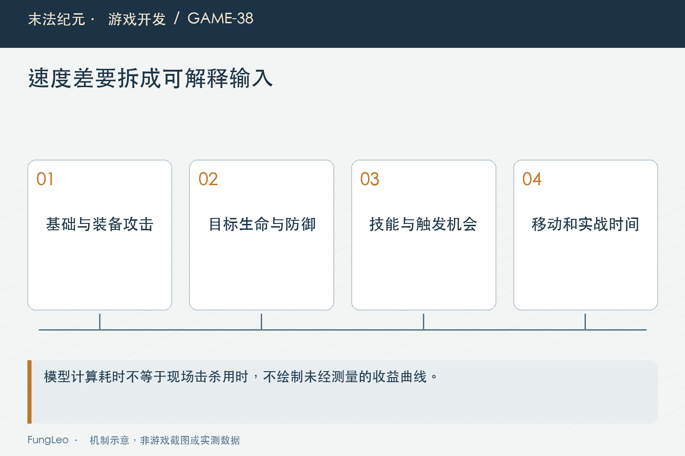

# 末法纪元·游戏开发38：差了几十级装备，为什么打怪还没明显变慢

> 本文回顾《末法纪元》的开发过程，技术描述以 2026 年 11 月 5 日审阅快照为准。封面为主题插画，内文图为机制示意。

### 前言

各位看官，等级数字很容易带来一种直觉：怪物比装备高几十级，怎么也该明显难打了吧？

《末法纪元》就收到过这样的反馈。人物已经五百多级，身上还是四百多级装备，在循环Boss图里却感觉变化不大。

要解释它，不能直接补一个“等级差惩罚”就算完成。先得弄清人物等级、装备等级和怪物实际等级分别改变了什么，原来的公式有没有我们以为存在的门槛。

这一篇讲诊断，下一篇再讲后来增加的装备跨级规则。历史分析里有过更正，我也会把这些边界交代清楚。


### 先把三个等级分开

人物等级影响基础成长、技能与穿戴资格；装备实例有自己的等级和生成快照；循环怪物在生成时读取相应规则，得到实际等级。

人物升级，不会自动把旧装备重造一遍；还活着的怪物，也未必随着玩家升级立即重算全部属性。

所以界面看见人物五百多级、目标略低一些，不一定是刷新错误，可能那批目标更早生成。复算时要读实例，而不是全部替换成当前人物等级。

第10篇《同一种武器，为什么不能共用一份装备数据》的快照和第25篇《地图变大了，刷新怪物不能跟着越来越贵》的生成生命周期，在这里共同影响结果。

### 先查调用链，不要只搜公式有没有等级参数

Combat核心不接收等级，但玩家入口还可能应用LevelGap，后续又加入EquipmentGap。只看公式文件，就宣布整个游戏没有等级机制，会漏掉外层。

历史报告曾经出现这种过度结论，后来补充更正：原有人物越级攻击规则，与当时尚未加入的装备跨级惩罚，是不同层。

因此诊断要从实际普攻和技能入口追到承伤，把输入修正、结果修正和地图限制都列出来。

第29篇《一次攻击，到底在哪一步算伤害》已经讲过这条链。模块名称里有没有某个词，不足以证明最终行为有没有对应规则。

### 曲线增长，是相对变化而不只是等级差

项目后期使用一条带线性和二次项的缩放曲线。等级越高，相同绝对等级差不一定带来同样比例增幅。

下面用Python复述Balance.scale的数学部分，作为独立教学计算，不是完整玩家或怪物复算：

```python
def scale(level):
    """输入实际等级，转换为超过六十级的曲线自变量。"""
    delta = max(0, level - 60)
    return 1 + 0.12 * delta + 0.0022 * max(0, delta - 12) ** 2

for level in (450, 510, 517):
    print(level, round(scale(level), 4))
print(round(scale(517) / scale(450), 4))
```

这组计算里，四百五十到五百一十七的曲线倍率只增加约三成六。数字差六十多，并不会自动变成数倍强度。

它解释的是曲线形状，不代表怪物生命、攻击和玩家总属性都严格按同一倍率变化，还要继续看各自组合。


### 玩家总攻击，不只来自人物基础

如果装备贡献占了大头，只提升人物基础等级，整体攻击的相对变化可能很小。旧装备虽然不随人物自动长大，但它生成时已经包含等级、品质和星级等结果。

因此不能把“旧装备不自动更新”说成“装备完全不吃等级成长”。前者讲实例快照，后者会误导整个系统的数值来源。

同样，高品质满星与套装会继续提供很强收益。新掉落只高等级、其他条件很差，也未必立刻超过旧装备。

要解释玩家为什么不换装，既看伤害公式，也看获得材料、比较提示和保留投入的途径。单纯提高掉落等级，未必产生预期行动。

### 防御增长，在减法公式里可能不明显

当攻击远高于防御减项，怪物防御增加一些，对单击造成的相对影响仍然有限。生命增长可能成为击杀变慢的主要来源。

反过来，怪物攻击刚跨过玩家防御临界点，承伤又可能突然明显增加。输出速度和生存压力不一定一起平滑变化。

所以“打得还是快”和“被打变疼了”可以同时成立，不需要假设其中一条反馈必然错。

复算时分别列出攻击项、防御项、基础命中和生命，再看哪项主导变化。只给一个总战力数字，很容易把这种结构藏住。

### 技能与群攻，进一步改变体感

普攻期望DPS不能直接代表完整自动轮转。技能系数、多段、穿防和同次命中人数，都会影响实际清场。

但也不能把某一套旧轮转估成固定倍数，长期乘到所有角色和目标上。蓝量、冷却、站位、目标死亡和命中集合都在变。

第35篇《怪都围上来了，法师为什么还不放群攻》说明过自动群攻会受策略影响，技能表上存在，不代表战斗里每次都按理想节奏释放。

因此文章不沿用旧报告中未经当前轮转验证的“技能DPS固定乘几倍”，更不把它当实机秒表。



### 探针恢复不完整，会算出另一个角色

历史诊断中，一个探针只恢复了等级和装备，却没有完整恢复基础攻防与职业，最终玩家侧数字被污染。

代码正常运行，输出还很精确，看起来像证据，实际上不是玩家当时那份状态。这比明显崩溃更容易让人相信错误方向。

修正后需要同时核对player、equipment、技能阶数和职业等输入，再调用真实门面。不要在探针里另写一份“差不多”的派生公式。

报告有更正，就应明确废弃哪些旧值和推导。不能新文换几个数字，却继续引用由旧值推出来的耗时比例。

### 模型耗时与实际击杀时间，要分开命名

生命除以长期期望DPS，是一种估算。它可以帮助比较数量级，但不包含首击时刻、整数命中次数、走位、资源和战斗中断。

如果再考虑闪避与暴击，需要说明概率口径。忽略目标闪避，却把结果称为真实TTK，就会把模型精度说得过头。

实机观察则记录同地图、同目标、同角色、同倍率的一段实际过程。游戏秒和现实秒也要分开，高倍速会让原本几秒的差异更不容易感知。

两类结果可以互相解释，不能互相冒充。模型指出哪里可能有影响，实际记录再确认它在完整玩法里表现多大。

### 对照实验只改变必要条件

可以固定装备和技能，先改变人物等级，观察基础成长；再固定人物，比较不同实际目标等级；最后比较同条件的新旧装备投影。

如果所谓“新装备对照”只是把旧属性按曲线缩放，就标成属性投影，不宣称玩家随机掉落一定得到这种结果。

真实装备还受词条和品质影响，完美对照只能回答一个受控问题。把它拿来承诺换任意高等级装备都会强多少，是另一种越界。

每轮保留来源版本与参数，才能重复核对，不必每次重新寻找一份看起来相近的存档。

### 先判断缺规则，还是已有规则没接通

如果设计明确需要固定装备更新压力，而当前只有渐进属性曲线，就可能确实缺少独立约束。这与某个函数写错，是不同问题。

先把现状解释清楚，再提出新规则、过渡和提示，让用户评估体验变化。不能用“修Bug”的名义无声削弱旧角色。

现有角色是否有可用材料、是否能走低压路线、自动出售会不会误卖过渡装，也都要随新规则核查。

这些属于下一篇的设计范围。本篇诊断不靠立即改数值来证明自己找到了原因。

### 复核从曲线和真实结算入口开始

项目已有基础曲线、动态装备与技能战斗测试，命令供后续复核，本轮未执行游戏测试：

```sh
python3 tools/run_isolated_tests.py BalanceTest DynamicEquipTest SkillCombatTest
```

独立Python片段只验证曲线算例，不能替完整存档或真实Boss实例装配。历史数据与当前新增装备规则的前后基线也要分别记录。

另外，地图上的单击上限必须按目标实际配置核对。不能拿打金场的封顶规则解释另一张没有同样限制的Boss图，也不能为了让理论耗时吻合，就临时移除已有护栏。

### 小结

等级差没有变成明显速度差，可能来自曲线相对增幅、装备快照占比、防御减法和实际技能机会共同作用。

先恢复正确角色，再分层比较，才能决定是修接线还是新增设计。各位看官看到一个精确数字时，也值得多问一句：它算的是模型、隔离复算，还是现场实际时间？

下一篇就讲新增的装备跨级二十级缓冲：怎样建立换装压力，又不在边界突然一刀切？

### 相关内容

- 第10篇《同一种武器，为什么不能共用一份装备数据》——旧装备生成快照。
- 第29篇《一次攻击，到底在哪一步算伤害》——完整结算链。
- 第35篇《怪都围上来了，法师为什么还不放群攻》——实际技能机会。
