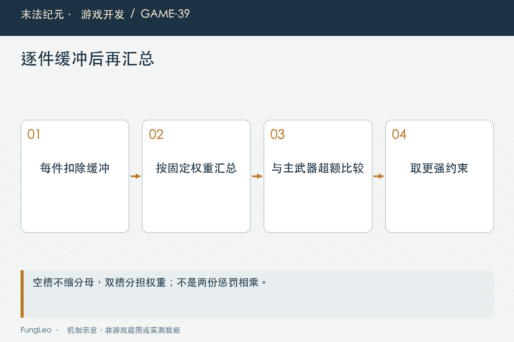
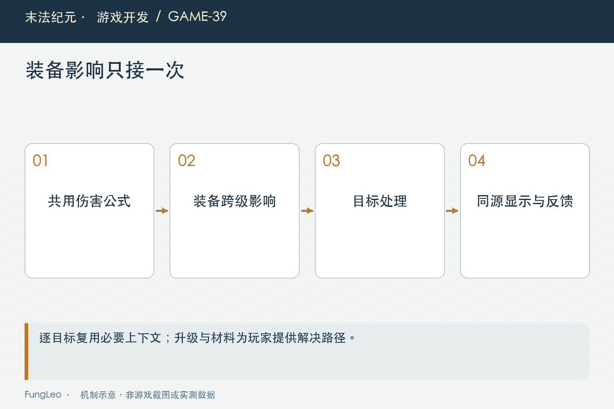

# 末法纪元·游戏开发39：装备落后二十级，怎样有缓冲又有换装压力

> 本文回顾《末法纪元》的开发过程，技术描述以 2026 年 11 月 5 日审阅快照为准。封面为主题插画，内文图为机制示意。

### 前言

各位看官，第38篇《差了几十级装备，为什么打怪还没明显变慢》解释了一个现象：等级数字差很多，实际属性比例与击杀速度却不一定同样明显。

如果产品确实希望高等级循环里有持续换装压力，就需要一条明确规则。但“超过二十级就打不动”又太容易做成断崖，让旧角色突然陷入无解状态。

《末法纪元》后来增加了装备跨级衰减：保留缓冲，再逐步降低对更高等级目标的输出，同时让玩家知道该升级哪些部位。

这一篇讲它怎样计算、怎样接到战斗，以及为什么提示和材料通道也属于这次设计。


### 比较的是目标与装备，不是人物与装备

人物升了一级，不应该无缘无故削弱当前对旧怪的输出。压力来自挑战实际等级更高的目标，所以比较对象是目标实例等级与穿戴装备等级。

高等级装备放在背包里，不代表已经解除影响；怪物生成以后保留自己的等级，也不能随手用玩家当前等级替代它。

规则只作用于规定范围的高等级目标，前期主线保持原口径。没有实际等级的测试对象，不应该借人物等级制造一份虚假的装备差。

这与第29篇《一次攻击，到底在哪一步算伤害》的逐目标输入有关，同一个群攻可以同时遇到不同等级的敌人。

### 每件装备先扣缓冲，再汇总

如果先把装备等级平均，再减二十，高等级单件可能抵消许多严重落后的部位。玩家穿一件特别高的东西，就把其他旧装的问题掩盖了。

当前规则逐件计算超过缓冲的差值，再按十四槽权重汇总。武器、防具和双槽部位各有明确权重，配置要覆盖完整槽位且和为一。

空槽按缺失装备处理，不把它从分母里删掉。否则脱下最旧的一件，反而能让综合平均更好，等于鼓励绕过规则。

左右两个槽分担该类权重，不能每边都拿整类权重，不然仅仅因为有两枚戒指就把总量算大。



### 主武器约束，与综合约束取更强一项

只算加权平均，其他高等级装备可能掩盖严重过旧的武器。反过来，只看武器，换一把新刀又能让其余旧装永久免罚。

因此当前综合超额与主武器超额取最大值，再计算一次衰减。下面是规则核心的简化表达，不是完整函数：

```text
每槽超额 = max(0, 目标等级 - 装备等级 - 缓冲等级)
综合超额 = sum(槽位权重 × 每槽超额)
生效超额 = max(综合超额, 主武器超额)
伤害系数 = 0.5 ^ (生效超额 / 额外减半跨度)
```

取最大而不是相乘，避免武器已经参与平均以后又被重复处罚。它不是惩罚越多越严厉，而是分别防两种绕过。

权重和跨度属于可校验配置，调整它们就是改变玩法，需要有明确比较与回归。

### 二十级是无额外惩罚窗口，不是第二十一等级悬崖

缓冲以内系数为一，超过以后平滑下降。按当前每额外二十级减半的参数，整套统一落后三十级时，超额只有十级；落后六十级时，超额四十，才得到四分之一系数。

这是规则算例，不是实际击杀时间。目标单击上限、技能与取整会让完整战斗不严格按系数倒数变化。

若某一件轻权重装备落后，也只贡献对应比例的超额，不会直接把全套砍成相同程度。武器是另外明确保留的强约束。

这样既能形成长期更新压力，也允许套内不同部位的正常等级跨度，不要求所有装备精确同级。

### 接到最终结果，只缩放一次

当前玩家普攻与攻击技能在Combat之后，沿同一个EquipmentGap.apply修正，再进入后续反馈和承伤。

源码中的核心如下，前面已经取得目标系数：

```gdscript
if factor >= 1.0 or bool(result.get("miss", false)):
    return result
var adjusted := result.duplicate()
adjusted.damage = maxi(1, floori(float(result.get("damage", 0)) * factor))
return adjusted
```

未命中保持零，暴击标记等信息保留，不再消费随机数。不能先把未命中也兜到一点，更不能在目标入口再乘同样系数。

怪物攻击玩家未因此一起削弱。共用Combat仍保持自身职责，装备差规则有自己的适用方向。



### 群攻多段，使用同次装备上下文

一次技能开始时捕获穿戴等级上下文，逐目标按实际等级取得系数，多段复用。不能第一段用旧装备、后面因为无关信号又换一份解释。

当然，具体快照语义也要与当前技能执行方式一致。本篇不把它扩大成所有延迟伤害永久冻结属性的通用规则。

原有人物等级差、穿透和地图承伤上限保留各自位置。第33篇《加一项技能，远不止填一个伤害系数》讲同一动作中的规则次序，这里新增一层也不能把旧次序打乱。

尤其目标有封顶时，衰减后的结果仍可能超过上限，所以击杀时间未必按理论倍数变慢。

### 上下文复用，不等于每帧扫描背包

当前入口读取固定十四个穿戴等级组成签名，与数据修订比较，决定上下文是否可复用。它不扫描背包全部候选，也不解析JSON。

目标等级对应的系数缓存有上限，装备或规则变化后替换。这样读档直接替换状态、不同信号顺序等情况，也能通过签名发现变化。

成本不是零：每次攻击或预览仍有有限等级读取。要评估整帧，仍然需要场景测量，不能因为缓存存在就承诺没有开销。

第20篇《一扇门打开以后，哪些缓存应该作废》的失效原则在这里一样成立，结果必须绑定它依赖的条件。

### 告诉玩家发生了什么，而不是只把怪物变肉

面板总攻击不应该无缘无故下降，因为影响依赖当前目标。提示应说明目标等级、武器等级、超额和当前保留的伤害比例。

换装预览也要用同一规则。新装备可能裸评分较低，却能解除明显的装备差影响；不能为了让提示看起来简单，偷偷修改全局评分定义。

“建议达到目标减缓冲的等级”是逐件规则的参考线，不是全套平均达到就保证免罚。界面说明要和计算含义一致。

短提示按目标与装备变化更新，不必每次命中弹一条，避免关键战斗反馈被说明文字淹没。

### 自动出售与保留投入，需要一起审查

高等级低星装备可能暂时评分低，却是保星升级或过渡的重要材料。若自动出售只看当前分数，新规则可能要求换装，系统却把可用材料卖掉。

因此要检查收藏、材料选择和必要过渡保护，沿既有策略扩展，不另写一套互相矛盾的“更强判断”。

也不能为保护材料无限保留所有新装，把背包压力全部推给玩家。范围与限额要明确，提示应让用户知道哪些物品为何被留下。

第10篇《同一种武器，为什么不能共用一份装备数据》区分实例与显示上下文，这里“值得留作材料”和“现在穿上更强”也不是同一个标签。

### 老角色进入新规则，要有可走的路

直接给高等级旧角色上强衰减，如果既没有金币、材料也没有低压渠道，可能把玩家卡在更新装备之前。

上线前应检查实际库存与既有合成通路，确认可以保留旧投入、得到合法过渡，而不是笼统建议回低级图，因为低级图未必产出角色需要的等级装备。

历史分析用过只读材料计划核验，规划可行不等于已经替玩家执行；也不代表任何角色都有同样库存。

新约束需要过渡设计，不能把玩家被卡住说成“终于有难度”。那是规则配套尚未完成。

### 用边界和真实战斗共同验证

先测缓冲边界、混装、空槽、双槽和主武器，再测未命中、暴击信息、缓存修订和异常配置。

然后沿真实普攻、混等级群攻、多段和换装恢复，确认只应用一次，前期不受影响，UI与实际结果一致。

已有用例入口如下，本轮未运行游戏测试：

```sh
python3 tools/run_isolated_tests.py EquipmentGapTest EquipmentGapCombatTest EquipmentGapUiTest EquipmentGapAcceptance
```

### 小结

二十级缓冲不是一个硬开关，而是一组逐件权重、主武器保护、平滑衰减与明确反馈的规则。

它只有和结算入口、材料通道及老角色过渡一起成立，才会成为可理解的成长压力。各位看官加约束时，也别只问惩罚够不够明显，看看玩家接下来有没有合法而清楚的行动。

下一篇回到地面几何：技能预警为什么必须画成椭圆，改画法时又怎样守住真实判定？

### 相关内容

- 第20篇《一扇门打开以后，哪些缓存应该作废》——上下文依赖与失效。
- 第33篇《加一项技能，远不止填一个伤害系数》——逐目标多段接线。
- 第38篇《差了几十级装备，为什么打怪还没明显变慢》——新规则前的诊断。
