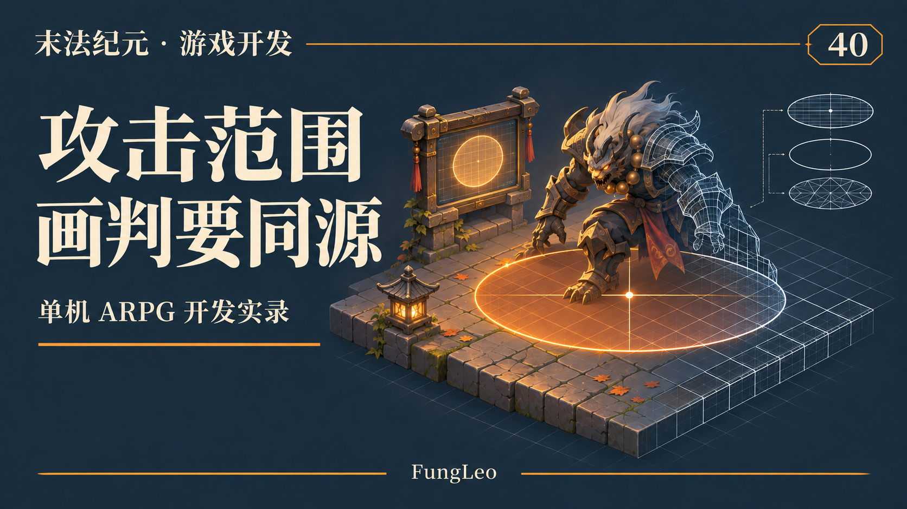
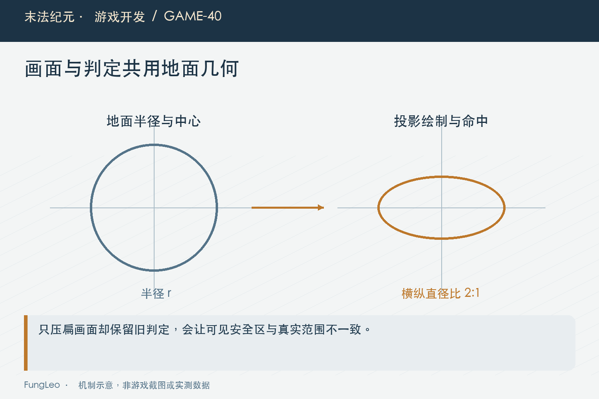
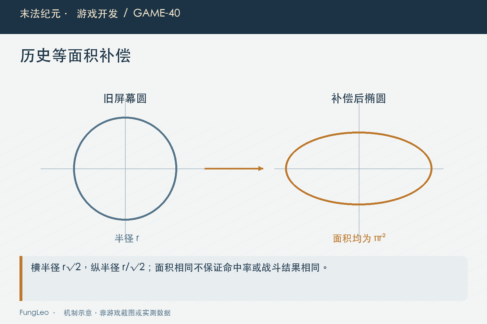

# 末法纪元·游戏开发40：地上的攻击范围，为什么不能直接画个圆

> 本文回顾《末法纪元》的开发过程，技术描述以 2026 年 11 月 5 日审阅快照为准。封面为主题插画，内文图为机制示意。

### 前言

各位看官，这一卷讲了不少数值，最后回到一个玩家一眼就能看见的问题：Boss脚下的范围提示，为什么像一张竖起来的圆片？

在《末法纪元》的等距世界里，地面本来被纵向压缩。直接在画布上画圆，得到的是朝向屏幕的圆，不是贴着地面的圆。

但修它不能只把图压扁。若判定仍然保留旧圆，玩家明明站在椭圆外，却还会受伤。一个不协调的视觉问题，就变成了规则不可信。

这一篇聚焦程序几何和验证，不讲素材制作。重点是绘制、命中与历史补偿怎样使用同一份约定。



### 先确认这个圆到底属于哪个空间

地面技能范围、脚下装饰与打坐圈，属于地面；UI按钮、血条标记或面向镜头的光点，则不一定属于地面。

所以不能搜索所有画圆调用，然后全部压扁。要先看它表达的是哪种信息，参与不参与伤害或交互。

第17篇《斜着看的世界，坐标不能跟着乱》讲过空间单位，这里继续沿相同原则：数学操作之前，先说明输入在哪里、结果表示什么。

小地图圆形窗口也是UI裁剪边界，不需要因为等距地面而变椭圆。名字都叫圆，职责可以完全不同。

### 地面比例来自投影，不靠目测调到顺眼

当前地面瓦片宽六十四、高三十二，地面纵向投影比例为二分之一。地面正圆投影以后，横纵直径自然是二比一。

Iso集中提供转换。下面是实际几何入口，输入与输出语义需要和调用位置一起理解：

```gdscript
const GROUND_SQUASH := HALF_H / HALF_W

static func to_ground(p: Vector2) -> Vector2:
    return Vector2(p.x, p.y / GROUND_SQUASH)

static func from_ground(p: Vector2) -> Vector2:
    return Vector2(p.x, p.y * GROUND_SQUASH)
```

世界点先还原到地面度量，再计算距离或角度；绘制则按对应方向投影回去。别在不同效果里各写零点四五、零点五，最后同一圈有几套比例。

### 只改画法，会把危险边界说错

假设旧屏幕圆的半径为一百二十八，只把画面纵向压半，显示上边界变成六十四，判定却还伸到一百二十八。

这时玩家根据可见边界躲开，程序仍然认定在范围里。预警失去解释能力，哪怕伤害公式完全正确，体验也会像随机挨打。

所以参与伤害的形状必须同时核对判定。纯装饰可以有独立造型，但不能用装饰边缘暗示一个不存在的安全位置。

修复时最好先把真实几何画出来，再把光效叠上去。不要让一圈模糊外辉决定程序到底打到哪儿。



### 同源，是一份几何给两边使用

BossAction生成包含形状、中心、方向、半径等字段的地面几何，命中和绘制消费它，而不是各自再根据技能表算一遍。

例如圆形命中会把世界点转到地面，再比较同一个半径。下面是当前静态判定入口的圆形分支节选，参数校验与其他形状省略：

```gdscript
var g := Iso.to_ground(point)
match String(geo.kind):
    "circle":
        return g.distance_to(geo["center"]) <= float(geo.radius)
```

同源也要检查时机。预警锁定以后，绘制用锁定中心，命中不能偷偷改成玩家最新位置，否则共享字段名仍然无法保证同一件事。

第32篇《Boss还没接战，怎么已经开始放技能了》已经讲过接战取消与锁定几何，生命周期和几何一致性需要一起成立。

### 历史等面积补偿，保住了什么

若半径不变只压缩纵向，椭圆面积只有旧屏幕圆的一半。改成同源以后，危险覆盖也会改变。

项目当时选择等面积补偿：地面长度乘以根号二，再投影压半。这样椭圆横半径变为旧半径乘根号二，纵半径为旧半径除根号二，面积与旧圆相同。

这是历史迁移口径，不是所有新增技能都必须额外乘根号二。新技能应该按已经定义的单位设计，重复补偿会把范围无故放大。

更重要的是，面积相等只保几何面积，不保证命中率、承伤期望或击杀时间完全不变。形状方向改变，玩家站位和躲闪路径也可能变化。

### 可以用一个小算例核对补偿

下面的Python仅检查几何面积关系，不是实机战斗测量，也不生成任何游戏资源：

```python
import math
radius = 128.0
horizontal = radius * math.sqrt(2.0)
vertical = horizontal * 0.5
assert math.isclose(math.pi * horizontal * vertical, math.pi * radius ** 2)
print(round(horizontal, 3), round(vertical, 3))
```

这份结果帮助读者区分半径、直径和补偿方向。进入正式调用时，还要确认配置量是格还是地面像素，不能直接拿示例数值替换技能参数。

如果只核对最终面积，中心偏移或朝向仍可能错。算例之外，四方向与斜方向边界也要测试。



### 扇形和环带，还有自己的边界

扇形需要把朝向转换到地面，再计算角度；环带要分别定义内外边界。中心、偏移和旋转的空间不清楚，就会出现“画得像对，方向却不对”。

线形招式也应核对实际判定语义与绘制，不要只因为能得到四个点，就宣称所有端部和边缘都完全一致。

环带绘制不能用一块深色实心圆假装挖洞，那可能盖住地形；拼接多边形也要避免自交和错误填充。

GroundFx集中这些原语，可以减少重复实现。但函数名正确不等于所有调用参数正确，仍然需要实际几何对照。

### 填充缩放和描边，不能一概而论

填充可以使用变换压扁，描边若直接跟着非等比缩放，横纵线宽也会变。当前描边用投影点集与折线，维持相应线宽口径。

宿主的局部坐标、旋转或额外非等比缩放也需要核对。工具默认的空间前提不成立时，不能把世界中心直接传进局部绘制就期待正确。

第27篇《右上角的小地图，该装下整个世界吗》讲画布投影，不同层的变换应分别说明。一次正确地面投影之后再压半，反而会产生二次压缩。

绘制完成后的变换恢复同样重要，别让后面的名字或血条也被无意压扁。

### 当前玩家范围提示仍有历史例外

不能因为Boss危险预警已经采用地面几何，就宣称全游戏所有玩家技能的范围筛选也全部统一。

历史实施记录明确保留过玩家提示与原屏幕度量的差异。现行玩家命中集合也有自身能力路径，介绍时需要逐项核对，而不是把“应该同源”写成“全都同源”。

单体技能本来没有地面范围，也不应为了统一反馈补一个小圆盘，暗示附近都能命中。

若后续要进一步统一，应把射程、实际集合、提示和测试当作一次明确规则变化处理，不能只替换一个绘制函数。

### 几何缓存，不改变危险信息

不变的点集和网格可以复用，位置与颜色在绘制时传入。这样减少重复构造，但不能通过降低关键边界精度来掩盖成本。

缓存有容量，也有在用资源所有权。旧网格从全局缓存淘汰以后，仍被静态绘制命令使用时，需要确保资源继续存活。

这属于后续性能治理，不影响本篇的几何语义。不能因为用了缓存，就宣称首次创建没有尖峰，或所有地图都达到目标帧率。

优化前后最好保留同场景图像与命中点对照，证明省掉的是重复工作，而不是玩家需要的信息。

### 验收从边界到窗口

取圆、窄扇、大扇、环内外等代表点，检查包含关系和投影；预警开始以后移动目标，确认锁定规则；取消和死亡时不再结算旧几何。

再看实际窗口的形状、线宽与遮挡。逻辑点落在范围里，不代表玩家真的能看清那条边界。

项目已有动作、技能形状与几何缓存用例，本轮未运行游戏测试：

```sh
python3 tools/run_isolated_tests.py BossActionTest SkillFxShapeTest
python3 tools/run_isolated_tests.py --rendered GroundGeometryCacheTest BossSkillVisualTest
```

边界测试也要写明包含关系。环的内缘算不算命中，扇形边线上如何取容差，不能靠画笔抗锯齿决定。逻辑边界与显示线宽分别定义，再用明确位置比较。若测试只检查函数执行过，没有断言真实几何或可见结果，一段直接返回的空实现也可能蒙混通过。

### 小结

地面圆画成椭圆，是坐标与度量约定；危险反馈可信，还需要判定、锁定时机、补偿和调用空间一起对齐。

到这里，第四卷从一次攻击走到职业、资源、成长和地面几何，把“怎样战斗”拆成了一组能检查的工程问题。

下一卷进入装备成长与交易一致性，先把等级、品质、星级这三条轴分别负责什么讲清楚。

### 相关内容

- 第17篇《斜着看的世界，坐标不能跟着乱》——空间和单位。
- 第32篇《Boss还没接战，怎么已经开始放技能了》——锁定与取消。
- 第33篇《加一项技能，远不止填一个伤害系数》——形状与真实命中。
