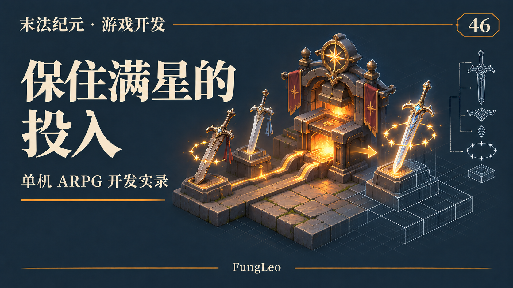
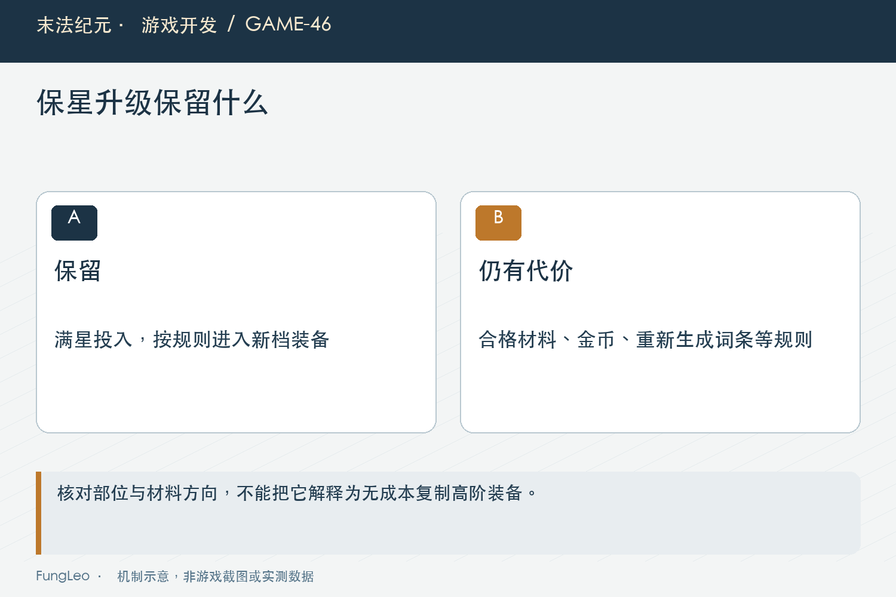
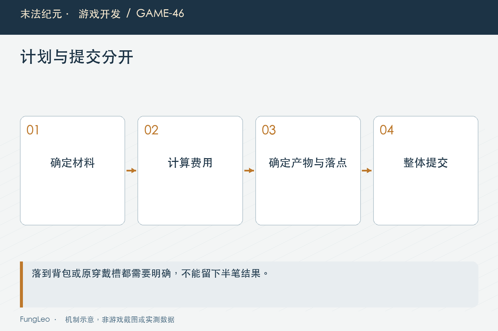

# 末法纪元·游戏开发46：保星升级，怎样保住玩家的投入

> 本文回顾《末法纪元》的开发过程，技术描述以 2026 年 11 月 5 日审阅快照为准。封面为主题插画，内文图为机制示意。

### 前言

各位看官，玩家好不容易把一把武器养到十二星，接着升了十几级，捡到更高档的新武器。新装备当然想换，但旧装备投入的金币，又实在舍不得。

如果每次换档都把成长清零，升星很容易变成一句“等下一档再说”。如果旧装备能够无限原样向上搬，新的掉落和词条选择又会逐渐失去意义。

《末法纪元》的保星升级，保留的是最高星级这份投入，同时要求新档材料、金币和重新生成的产物。本文重点不是给功能起个好听名字，而是把究竟保什么、消耗什么、最后放哪里说清楚。



### 保星不是把整件旧装备复制到新等级

当前规则需要两件不同实例的紫装：低档旧装备达到满星，更高档新装备为零星，而且必须同部位、未收藏。

成功后消耗两件材料，生成新档紫装，再把产物设为最高星级。旧装备的词条不会原封不动继承，产物有自己的随机结果与实例身份。

这项选择让系统保住长期投入，又给新档装备留下获得和筛选的价值。假如连词条、身份和所有状态都说成“原样升级”，玩家对结果的预期就会与实际完全不同。

第42篇《背包整理以后，程序怎么认出原来那件装备》区分过身份与位置，在这里还应区分身份与传承关系。两件材料被消耗后得到一件新物品，不等于旧实例只是改了一个等级字段。

### 先把材料资格写成明确条件

下面是当前规划入口的一段实际检查：

```gdscript
if int(old_item.get("star", -1)) != Upgrade.max_star() or int(new_item.get("star", -1)) != 0:
    return {"ok": false, "reason": "旧装须为 12 星，新档装备须为 0 星"}
```

前面还会检查实例身份、类型、品质和收藏状态，后面继续检查档位差与部位。不能因为两件图标相同，就把它们当作可用材料。

满星值应该由升星规则提供。提示文案里的数字也要跟随产品更新，否则以后改上限，代码已经允许新条件，界面却还教玩家准备旧条件。

另外，旧料与新料在这项操作里有方向。把两个材料格当成无序集合，可能让规划器误判该把哪件的星级送往哪一档。界面最好把职责直接写在格子旁，而不是只在失败后补一行说明。

### 跨得更远，增加的是费用

保星允许向更高档的同部位装备转移，档位差参与费用计算。当前规划结果用基础满星费用乘以跨档数，不会因为跨得远，就生成更多星级或更高品质。

这使“先换一档”和“等几档一起换”成为资源与战斗压力之间的选择。不能为了方便实现，看到更高等级就统一收一份费用，也不能把跨档数误当成等级差直接相乘。

第44篇《十级一套装备，简化了什么》讲过十级一套，保星应当沿共同分套口径比较。尤其历史实例未必恰好落在新模板的标准部位等级，材料等级与产物等级还需要分别表达。

规划结果因此区分材料门槛与真正产物门槛。确认框应该告诉玩家最后得到什么，不能拿新料原有等级冒充即将生成的等级。



### 先算产物能不能落地，再扣材料

保星涉及背包和穿戴两种来源。消耗材料以前，必须确定新物品合法，也必须知道它最终放进背包还是回到身上。

当前提交顺序是先核对完整材料快照、规划费用、检查金币与附加材料，再生成并验证产物，随后决定落点，最后才真正修改容器和扣钱。

如果产物生成失败，或者找不到合法存放位置，应该整笔拒绝。不能先拿走十二星旧装，后来发现背包满了，再尝试凭记忆把原物拼回来。

这不是要求每个函数都建一套庞大的事务框架，而是把所有仍可能失败的条件尽量放在写入之前，让真正提交阶段短而直接。

### 原来戴在右边，完成后仍然回右边

双槽装备在这里又出现了。第43篇《左右两个槽，怎样判断新装备更强》的自动选槽，是普通换装时的默认建议；保星已经知道旧料原来穿在哪里，就不该再自动选一次。

当前会记录第一件旧料的原穿戴槽。如果产物等级满足人物条件，且部位仍匹配，就回到原槽。戒指②不会因为戒指①当前分数更低，突然换到另一边。

如果产物暂时不能穿，则应进入背包，并清楚提示等级要求。保留星级不等于自动获得穿戴资格，程序也不能为了看起来顺利，悄悄降低产物等级。

这一分支尤其需要核对真实结果。有的历史文档记录的是早期产物入包行为，今天写文章必须沿当前代码说明，不能把旧修复记录当作现行规则直接照抄。

### 中间空槽，不该被广播成最终状态

旧料在身上时，合成内部会暂时清掉材料槽，再放回新物品。如果每做一步就刷新人物属性，生命、法力上限可能先降低，再升回去。

这段临时状态没有给玩家操作的意义，却可能触发数值收敛，让玩家平白损失当前生命或法力。因此应在最终穿戴完成后，统一广播装备变化。

同理，金币、背包和完成提示也应围绕同一笔结果更新。不要让界面先看见材料消失、接着以为合成失败、下一轮才看见产物出现。

最终通知不是装饰性的消息，它决定其他系统在什么时刻可以观察新状态。内部操作顺序可以有多步，对外应该尽量呈现一笔完整的业务变化。



### 加了如意，也不能把保星说成升星抽奖

当前保星还允许使用如意增加词条抽样机会，再按共用规则取优。星级本来就保到满星，额外抽样针对的是产物词条，不是重新赌能不能保住星级。

不投入时应维持原来的一次生成路径，不能因为新增可选材料，顺便多耗一段随机序列。第30篇《伤害里有随机，出了问题怎样重来一遍》讲过随机复现，调用次数变化也会改变后续结果。

如意种类、数量与费用需要先规划，并确认库存够用。扣除附加材料和写入产物也有顺序，尤其产物可能占用刚被材料腾出的格子，不能让后续清空动作覆盖它。

界面应说清额外投入实际改善的范围，别用一个含糊的“更高成功率”把玩家带向另一种理解。

### 测试要覆盖穿戴结果，不只检查星数

复核时可以从规划、落点和交易测试一起看：

```sh
rg -n 'plan_transfer|old_worn_slot|transfer_output_level' scripts/systems/equipment_fusion.gd autoload/game_state.gd
python3 tools/run_isolated_tests.py EquipmentFusionTransactionTest StarTransferLevelHintTest
```

本文未执行游戏测试。后续验证除了产物满星，还应检查两件材料只扣一次、费用正确、收藏材料拒绝、相同ID拒绝、跨档越界拒绝，以及等级刚好够与差一级的两个结果。

满背包也是有价值的案例。背包材料会腾出位置，穿戴材料则不直接腾背包格；能否容纳产物要看最终落点，不能简单地看提交前空格总数。

还有一项经常被忽视：失败后选择记录可以保留便于修正，但真实容器必须完整不动。失败提示消失，并不意味着此前没有偷偷扣过一次金币，检查需要落到实际数据。

### 预览是报价，不是提前制造产物

保星界面可以展示目标档、星级、门槛和费用，但随机词条应留到真正提交时生成。如果每次刷新预览都掷一次，单纯移动鼠标或背包刷新，就会改变随机调用序列，甚至诱导玩家反复打开面板刷结果。

能够提前确定的条件要尽量确定，尚未发生的随机结果则明确说明范围。确认以前，玩家有权知道自己付出什么、必定保留什么、哪些仍需接受随机性。把这些内容排成看得懂的几行，比一个笼统的“确定合成吗”更能减少误操作。

### 小结

保星升级承诺保住的是星级投入，同时明确消耗旧装、新档材料和费用，接受新产物的词条结果。

把资格、档位、产物门槛和落点先规划好，再一次提交，才能让这份承诺可靠。下一篇继续看一个更贴近操作的问题：战斗一直在后台进行，刚选好的旧装备为什么会突然消失。

### 相关内容

- 第30篇《伤害里有随机，出了问题怎样重来一遍》
- 第43篇《左右两个槽，怎样判断新装备更强》
- 第44篇《十级一套装备，简化了什么》
