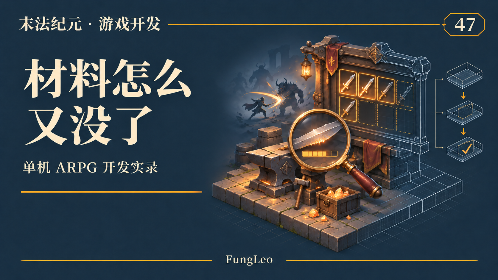
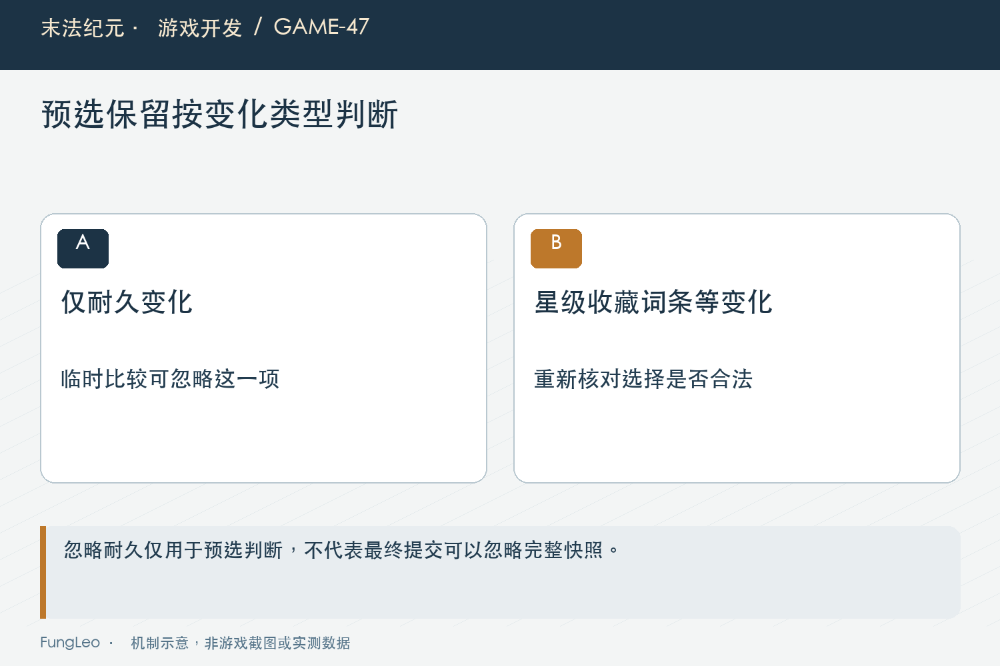
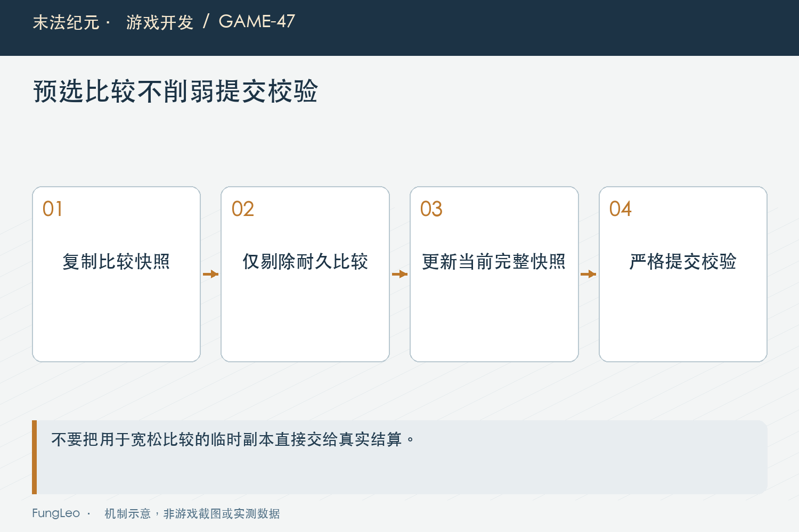

# 末法纪元·游戏开发47：战斗不停，材料预选为什么老被清空

> 本文回顾《末法纪元》的开发过程，技术描述以 2026 年 11 月 5 日审阅快照为准。封面为主题插画，内文图为机制示意。

### 前言

各位看官，随身铁匠打开了，后台仍在打怪。玩家把身上的十二星武器拖到保星材料格，刚准备再选一件，第一格突然空了。

从玩家视角看，往往是捡到掉落以后发生的，所以很自然地猜测：“是不是拾取把背包刷坏了？”

这个问题最后确实与刷新事件有关，但直接触发点是击杀磨损。装备还是那件装备，只是耐久少了一点，程序却认为材料已经变了。本文就从这次误判说起，聊聊快照应该多严格，哪些变化又应该被允许。



### 先把现象和根因分开

击杀、装备磨损、掉落与拾取在时间上紧挨着发生，肉眼看到最后一个动作，并不代表它就是造成问题的动作。

工程记录里的定向复现，是先穿好十二星武器，打开保星面板，通过真实穿戴拖拽载荷选入旧料，然后单独调用磨损入口。不需要先拾取一件新东西，预选也会被清掉。

这一步很关键。若一开始就认定是拾取问题，可能会去改自动拾取、背包排序甚至掉落队列，结果越改越远，还把原本正常的流程带坏。

排查时应当把玩家的描述当成重要线索，再用最小业务事件把因果拆开。用户没义务知道内部先广播哪个信号，那是程序要查清楚的事。

### 一次击杀，为什么会通知背包面板

当前磨损入口降低身上装备的耐久，再通过装备变更收尾广播相关通知。合成面板收到这些通知后，重新校验自己选中的材料。

这个设计本身合理。材料可能被换下、被消耗，或者已经收藏，面板不能永远相信打开时的那份内容。问题出在判断方式过于笼统。

选入材料时保存的是整份深拷贝，后来再用当前字典与原快照完整比较。耐久从八百变成七百九十九，完整相等当然失败，于是这件仍然合格的旧装备被当作过期材料清掉。

第42篇《背包整理以后，程序怎么认出原来那件装备》说过身份与快照各有作用。这里不是不要快照，而是需要说明预选阶段究竟关心哪些内容。

### 只认实例ID，看起来省事却放得太宽

最容易想到的修改，是只要找到相同ID，就保留原来的选择。这样磨损不影响了，可升星、重铸、收藏，甚至第五词条状态改变，也都一起被忽略。

那些变化可能影响材料资格，或者改变玩家准备消耗的价值。相同身份不代表仍然同意拿它做原来的交易。

反过来，继续要求全部字段相等，就会把允许的耐久变化也挡住。真正的边界应该来自当前业务：对于这一段材料预选，耐久变化可以接受，其余内容仍需比较。

不要把一次明确例外写成一个全局宽松模式。出售、重铸和其他材料流程是否能忽略耐久，需要各自分析，不能因为共用物品数据就自动沿用同一结论。



### 只排除耐久，比较其余完整内容

当前面板使用一个共用比较方法。下面摘取处理差异的核心部分，前面还检查了快照与装备类型：

```gdscript
var left := current.duplicate(true)
var right: Dictionary = snapshot.duplicate(true)
left.erase("durability")
right.erase("durability")
return left == right
```

先复制再移除字段很重要。比较函数不能为了检查方便，直接删掉真实装备里的耐久，也不能修改调用方持有的旧快照。

两份内容本来相等时直接返回，不必每次都复制。这是一个小而明确的成本控制，远比新增逐帧扫描更合适。

这种写法也保留了对未来字段的谨慎：后来新增某个会改变装备价值的标记，默认仍参与比较。若它也应被忽略，需要明确分析，而不是因为旧白名单只列了几个字段就悄悄漏过去。

### 允许变化以后，预选快照也要更新

仅仅保住格子还不够。如果里面继续存八百耐久的旧快照，最后提交时，结算层看到当前只有七百九十九，仍然会拒绝。

因此同一件装备只有耐久变化时，面板会把当前完整实例重新复制进预选。这样格子没丢，预览是新内容，提交的也是新完整状态。

这里有两个层次：预选允许某项变化，最终结算仍要求完整一致。第46篇《保星升级，怎样保住玩家的投入》提到的合成终验没有因为界面修复而被删除。

允许耐久变化的职责留在交互层，结算入口继续严格复核提交那一刻的真实材料。这比让底层永远忽略耐久更容易解释，也避免影响其他调用合成入口的路径。

### 鼠标拖到一半，战斗也可能结算

另一个很像边角问题的场景，是拖拽已经开始，但鼠标还没松开。载荷里携带开始拖动时的快照，这时恰好发生击杀，装备耐久变化了。

如果只有“已选材料重校验”使用新比较，拖拽入口仍然完整相等，就会出现选进格子以后正常、拖到格子之前却失败的奇怪体验。

因此穿戴来源和背包来源的拖拽，也复用相同的耐久比较边界。但原槽、原下标与身份令牌检查仍然存在，拖动期间换装或整理导致来源不再对应，不能随便抓另一件东西顶上。

通过检查以后，应读取当前完整实例作为新选择。拖拽载荷表达的是用户开始时的目标，不应该强迫真实装备退回旧耐久。



### 修理和磨损，是同一规则的两个方向

不能只测耐久减少。玩家也可能在面板打开时修理，耐久从低值恢复到上限，同样会让整份字典变化。

如果规则确实是耐久不影响预选资格，那么增加与减少都应保留。不要偷偷写成“当前耐久小于旧耐久才放行”，把症状修成另一条没有产品依据的规则。

同时发生耐久与收藏变化，则应该失效。测试若只修改一个耐久字段，能够证明例外有效，却不能证明其他保护仍在。混合变化案例能防止比较函数误写成“看到耐久不同就直接接受”。

材料被真正换掉、ID消失或者星级改变，也应继续拒绝。修复的目标是减少误打断，同时保留玩家对具体材料的控制。

### 材料保住了，不代表确认按钮也保住了

这次修复完成以后，还有另一个表面相似的问题：格子不空了，第一次风险确认却被战斗事件不断撤销。

它们需要分开分析。材料预选回答“还是不是这两件”，风险确认还包括如意、费用、产物门槛和自动穿戴结果，不能因为材料能保留，就直接删除所有确认重置。

下一篇专门讲这层问题。这里先记住，用户一句“又要重新来”，背后可能是选材、预览、确认或提交中的任何一层。排查记录应该明确是哪一层恢复到了初始状态，才不会做出一半有效的修复。

### 验证应当沿真实入口注入事件

后续复核可以从比较方法与定向测试开始：

```sh
rg -n '_same_material_except_durability|_source_equipped|_revalidate_selection' scripts/ui/equipment_fusion_panel.gd
python3 tools/run_isolated_tests.py EquipmentFusionUiTest EquipmentFusionTransactionTest
```

本文校对了路径与命令，没有执行游戏测试。工程记录中的既有回归，则包含磨损、修理、拖动期间变化、真实拾取，以及收藏或星级改变继续撤销预选等情形。

运行成本也要如实说。这里仍按事件检查少量材料，没有新增逐帧轮询；比较时可能产生短期副本，但没有做整帧性能对照，就不能宣称帧率提高了多少。

如果后续新增材料槽位，应重新核对数量与事件频率。今天只有两件的合适写法，扩成几百件时未必仍然划算，成本判断应跟随真实规模。

保留预选也不意味着后台自动替玩家确认。选材仍然可见、可以撤回，最终消耗必须来自明确提交，这条交互边界没有改变。

### 小结

这次问题的核心，是把允许变化的耐久误当成材料已经改变。修复需要明确例外、更新最新完整快照，并保留其他资格与结算检查。

先用真实事件找到原因，再把比较边界落在合适层次。后台战斗可以继续，玩家也不必为正常磨损一遍遍重新拖入同一件装备。

### 相关内容

- 第42篇《背包整理以后，程序怎么认出原来那件装备》
- 第46篇《保星升级，怎样保住玩家的投入》
