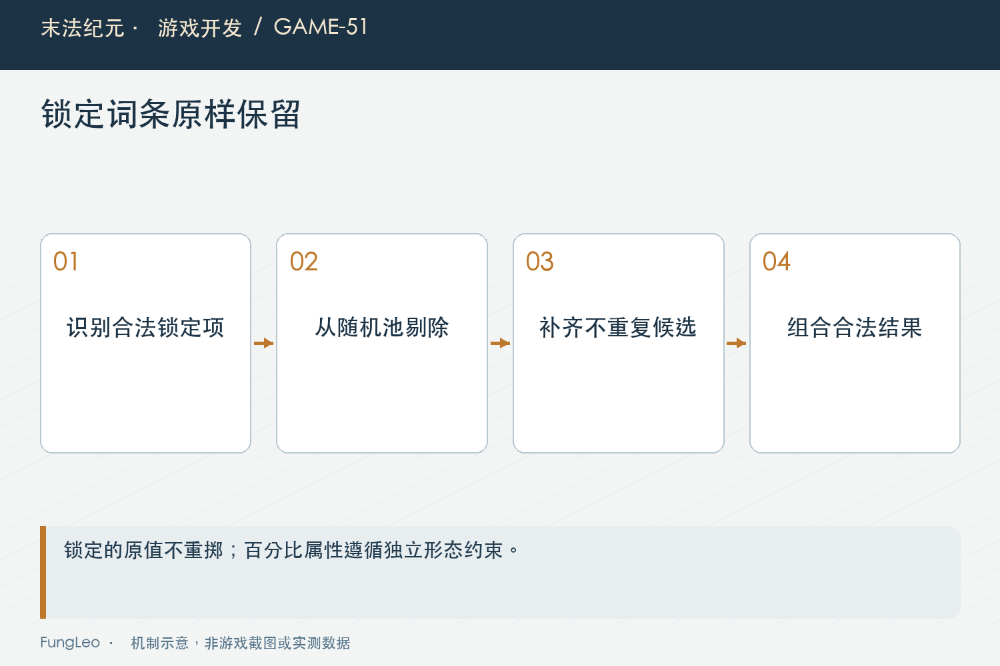
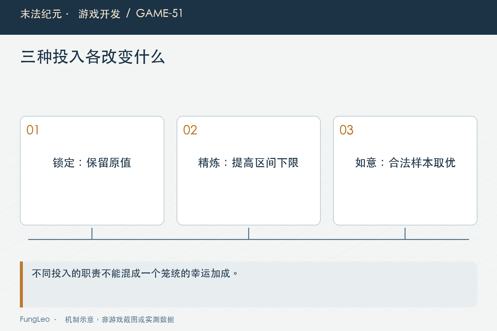

# 末法纪元·游戏开发51：锁词条以后，重铸规则怎样变

> 本文回顾《末法纪元》的开发过程，技术描述以 2026 年 11 月 5 日审阅快照为准。封面为主题插画，内文图为机制示意。

### 前言

各位看官，一件装备四条属性，三条满意，只剩一条不合用。重铸一下，四条一起重来，原本满意的也没了，玩家自然会问：能不能把好的锁住？

界面上加几个小锁很容易，规则却不能只是“生成完以后把旧属性贴回去”。锁定会改变候选池、费用、可重掷条数，也会影响百分比属性和额外抽样。

本文沿《末法纪元》的重铸实现，把这些变化一项项拆开。重点不是把随机变成必得，而是让玩家的额外投入有明确作用，程序也能解释每一条属性为什么留下、为什么改变。


### 先分清重铸保留什么

普通重铸改变词条，不替换装备身份，也不重新生成等级、品质、星级和基础数值。它与第46篇《保星升级，怎样保住玩家的投入》的保星产物有不同语义。

因此实现可以在当前实例上提交新的词条数组，但应先在临时结果里完成随机与验证，再扣费用、写回。不能先把旧词条清空，然后发现候选不够，再尝试恢复。

锁定进一步承诺某些已有词条原样保留。这里的原样包含属性名与数值，不只是保证下一次仍然出现攻击力，却把攻击值重新掷一遍。

如果界面用小锁表示保留，底层却只提高抽到概率，玩家就会把一次正常随机理解成规则失信。交互符号越直观，语义越应当严格。

### 锁的是属性身份，不是列表第几行

词条展示顺序可能调整，固定属性与百分比属性也分在不同数组里。用“第二行被锁住”作为长期含义，很容易在重绘或排序后指向另一条。

当前锁定集合按属性键表示，并先去空、去重，再核对这些属性确实存在于目标实例，也能在配置中归类。

第42篇《背包整理以后，程序怎么认出原来那件装备》的身份思路在这里仍然适用：界面位置方便显示，真正提交需要稳定含义。同一属性在锁数组里重复两次，不能算作两条锁，更不能收两份费用。

遇到不存在或无法识别的属性，应该明确拒绝。静默丢掉非法锁定项，会让玩家误以为已经保护，最后却被重新生成，这是比直接报错更糟的体验。

### 至少留一条能够变化

当前最多锁住实例现有条数减一。普通四词条紫装最多锁三条，已经具备五条的实例最多锁四条。

注意这里看的是当前条数，不是某个固定写死的三。规则入口如下：

```gdscript
static func max_lock_count(item: Dictionary) -> int:
    return maxi(0, ReforgeAffixes.current_count(item) - 1)
```

全部锁住以后还允许扣钱重铸，就成了花钱买原样返回。即使程序执行成功，也没有给玩家一个合理动作。

白装没有词条，也应在前面拒绝重铸。不能因为费用足够、身份合法就让操作继续，最后弹一句重铸成功，装备却从头到尾没有可能发生变化。



### 锁定条目先保留，再从池里排除

随机器收到锁定固定词条与锁定百分比词条后，先复制进结果，并把它们的属性键记入已占用集合。

随后构建剩余候选池时排除这些键，避免再抽到相同属性。若采用生成完再贴回的办法，不但可能出现重复，还会把原本抽到的其他条目挤掉，最终条数和概率都很难解释。

普通规则最多一条百分比词条。如果已经锁住百分比项，就不应该再抽第二条；没有锁住时，再按当前生成规则决定是否出现。

锁定条目不消耗重新掷数值的随机调用，未锁部分照规则生成。最终候选不足时明确失败，不能少给一条也照常扣钱，更不能从别的部位池里临时借一条凑数。

### 费用跟等级与有效锁数一起计算

当前重铸费用由基础费用、等级项和锁数倍率组成。这里的锁数是去重以后的有效条数，界面预览与结算使用同一口径。

实际计算的核心是：

```gdscript
var multiplier := 1.0 + lock_factor * float(maxi(0, locked_count))
return int(round(float(base) * (level_base + factor * float(maxi(0, required_level))) * multiplier))
```

当前锁定系数是零点五，锁一条对应一点五倍，锁两条对应两倍，并不是每加一条就连乘一点五。

基础费用配置缺失时返回错误值，让按钮禁用并反馈，不能偷偷回退到一份旧常量。否则调配置以后看起来什么都没变，开发者会把时间浪费在错误方向上。

服务场景还可能有费用倍率，最终扣款应由结算入口统一应用，别让面板显示普通价，随身服务却扣另一份钱而没有说明。

### 精炼提高下限，不会偷偷改掉锁定值

重铸还能投入紫装作为精炼材料，折算有效件数，提高这次未锁定词条的数值下限。材料档位与星级影响折算，不是简单地每放一件都给同样收益。

锁定词条既然承诺原样保留，就不参与这次下限抬升。不能一边说已经锁住，一边借精炼顺便修改数值，哪怕改得更高，也改变了规则含义。

精炼也不等于必定获得上限。当前封顶的是区间下限分位，仍然保留剩余范围的随机性。文案若只说“提升六成”，很容易让玩家误解为最终属性直接乘一点六。

这类说明最好紧贴投入预览，明确有效件数、下限范围和实际消耗件数的区别，避免拿四件低档料投入后，玩家觉得只算了一件就是吞材料。



### 如意增加抽样，取优不等于必胜

如意的另一种作用是增加抽样次数，再按共用装备评分选出最好的一次。它不扩大词条池、不新增条数，也不把数值上限向外推。

锁定在每次抽样中都要成立，精炼下限也应保持相同，比较的只能是同一笔投入下的候选结果。不能第一份样本锁三条，第二份样本又把锁忘了。

第43篇《左右两个槽，怎样判断新装备更强》提醒过评分的局限。这里取的是候选样本中的最高公共评分，不承诺符合所有流派的主观最优，也不保证一定比重铸前那份旧词条更高。

尤其不要把多次抽样写成“保底升级”。当前旧结果并不会自动作为免费候选加入，投入增加的是这次机会，不是保证永远不倒退。

### 没有锁定和额外投入，保持原有路径

新增功能经常顺手改变旧调用顺序。即使公式没变，多调用一次随机函数，也会让固定种子的结果变掉。

当前不带锁与如意的路径仍尽量保持原有随机调用。只有实际增加抽样时才走多次分支，后续排查才能判断变化是来自新规则，还是无意增加了调用。

第30篇《伤害里有随机，出了问题怎样重来一遍》讨论过这类复现边界。这里还应检查锁定值逐字保持、同键不重复、最多一条百分比，以及失败时金币和材料没有变化。

### 测试应覆盖锁数与候选池的交叉

复核入口可以从规则、随机器与锁定用例一起找：

```sh
rg -n 'validate_locks|max_lock_count|locked_stats|_roll_affixes_best' scripts/systems/reforge.gd scripts/systems/item_factory.gd autoload/game_state.gd
python3 tools/run_isolated_tests.py ReforgeTest ReforgeLockTest ReforgeSessionTest
```

本文没有执行游戏测试。后续应重点测重复锁、空锁、非法属性、全锁拒绝、锁住百分比项、剩余候选不足，以及穿戴目标和背包目标的刷新结果。

费用还要与锁数变化同步。选择一把新装备后，旧目标的锁不能无声带过去；取消一条锁以后，预览与最终扣款也必须同口径下降。

### 数值没变，也可能是合法随机结果

至少一条允许变化，并不保证每次随机都产生不同数字。候选池可能再次抽到同类属性，数值也可能恰好相同，这与全锁造成的必然不变不是一回事。

界面应区分本次结果未变与规则执行失败。合法抽样仍按约定扣费，校验失败则不扣；若把两者都写成没有变化就退钱，实际上又增加了一条免费重试规则。是否需要这种保护，应由产品明确决定，不能藏在错误处理分支里顺手实现。

### 小结

锁词条是对具体内容的保留承诺。它要求身份稳定、候选排除、费用一致，并留出真实可变部分。

精炼负责下限，如意负责抽样，锁定负责保留。把三种投入的作用范围拆清楚，重铸才能既提供选择，也保持结果可解释。

### 相关内容

- 第30篇《伤害里有随机，出了问题怎样重来一遍》
- 第43篇《左右两个槽，怎样判断新装备更强》
- 第46篇《保星升级，怎样保住玩家的投入》
