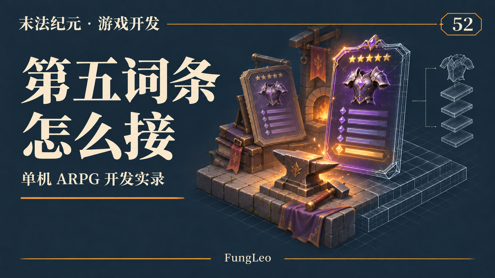
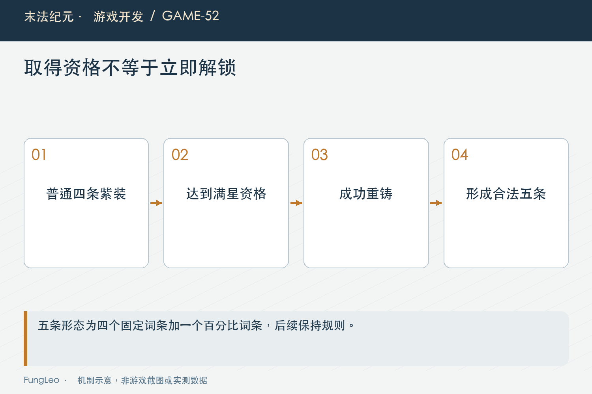
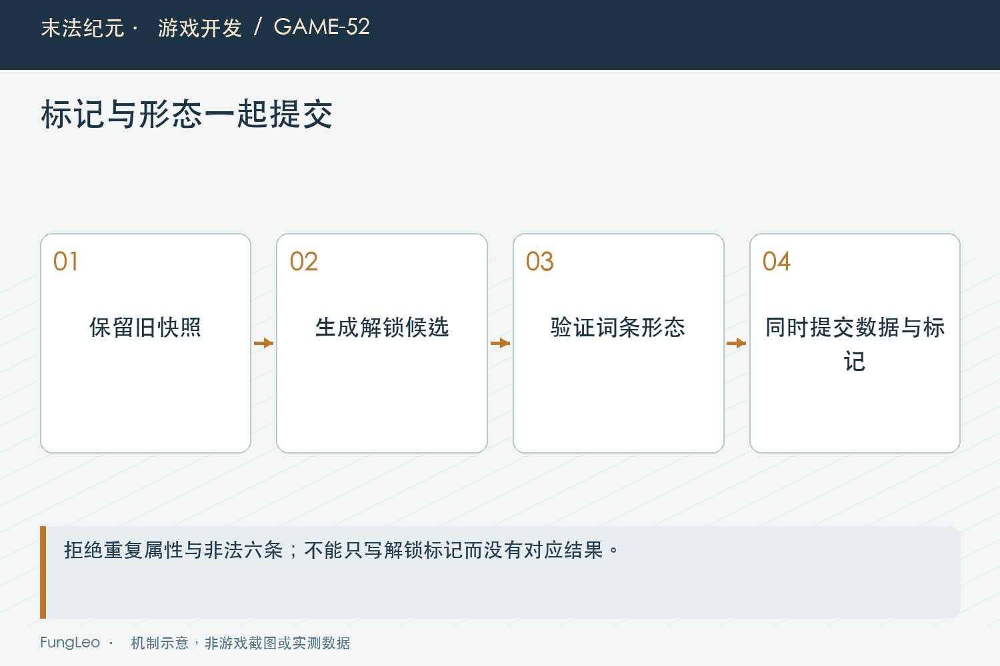

# 末法纪元·游戏开发52：第五词条，怎样接进老装备

> 本文回顾《末法纪元》的开发过程，技术描述以 2026 年 11 月 5 日审阅快照为准。封面为主题插画，内文图为机制示意。

### 前言

各位看官，紫装已经十二星了，接下来还能怎么成长？一个很直接的想法，是再开放一条词条，让满星装备有新的投入目标。

可这个改动不是把品质配置里的四改成五。那会让普通掉落、商店生成、保星产物与旧存档一起改变，原本想奖励一次后期重铸，最后变成全世界的紫装都多了一条。

《末法纪元》选择让满星紫装在成功重铸时解锁第五词条。这篇作为本阶段收尾，聊聊一个看似很小的数值扩展，怎样同时接进规则、结算、界面和历史实例。



### 满足资格，和已经解锁是两种状态

当前资格是紫装、十二星。满足它，表示下一次成功重铸可以解锁，并不表示物品现在已经拥有五条。

实例用一个扩展标记表示解锁状态。没有标记的历史满星装备仍然保持原有四条，低星升到满星也不会凭空多出一条。

下面是当前规则入口的实际节选：

```gdscript
const FIELD := "reforgeAffixTier"

static func unlocked(item: Dictionary) -> bool:
    return item.get(FIELD, 0) == 1
```

这区分了资格、当前形态与本次目标。程序不必通过数一数词条猜玩家是否已经完成过解锁，也不会把字段缺失误解成一次需要补偿的异常。

第41篇《装备等级、品质和星级，为什么要分三条轴》强调过实例快照，这里继续遵守同一个方向：已经获得的装备，不能仅因规则表增加了一项能力，就在显示或读档时自动改变内容。

### 基础品质规则仍然保持四条

普通紫装依旧按品质配置生成四条，扩展形态由实例标记决定。当前条数与本次重铸目标条数分开计算，避免一个函数既表示已经拥有多少，又表示马上应该变成多少。

这条区分直接影响锁定上限。第51篇《锁词条以后，重铸规则怎样变》说过最多锁当前条数减一，因此首次解锁前最多锁三条，解锁之后才可以锁四条。

不能看到目标会变成五条，就允许玩家把当前四条全部锁住。那样首次解锁会变成毫无取舍地保留整套旧属性，改变了原本重铸至少一条的约束。

提示应在操作前说清楚：当前四条、本次成功后五条、首次最多锁三条。让玩家从按钮变灰猜规则，是最省界面空间、也最费解释的一种做法。

### 第五条对应明确形态，不是随意加一个数组元素

当前五词条形态为四条固定属性，加一条百分比属性，属性键不能重复。它并不是在任意旧四条后面，简单追加一个百分比条目。

重铸本来就会重掷未锁部分，扩展后按新目标生成完整合法组合。锁定部分原样保留，剩余部分按候选池补足，同时保证百分比数量约束。

这要求每个装备模板都有足够候选。只看一个武器能生成成功不够，护甲、戒指与其他模板也必须支持四个不同固定属性，并有可用百分比属性。

配置校验应提前发现池子不足，否则玩家付出金币，进入随机器才报错，虽然可以不扣资源，仍然是本来可以在开发阶段避免的坏体验。



### 先在副本解锁，成功以后再写回

当前结算入口先完成目标、锁定、精炼材料、如意和金币检查。准备随机结果时，复制目标实例，只在这份候选上设置扩展标记。

核心过程如下，省略了上下文中的其他检查：

```gdscript
var unlocks_fifth := ReforgeAffixes.eligible(item) and not ReforgeAffixes.unlocked(item)
var roll_item := item.duplicate(true)
if unlocks_fifth:
    roll_item[ReforgeAffixes.FIELD] = 1
var rolled := _roll_affixes_best(roll_item, rng, locked_stats, Reforge.floor_ratio(effective), tries)
if not bool(rolled.get("ok", false)):
    return _reforge_fail(Localization.tr_key("msg.reforge.p003"))
```

只有得到合法结果，才同批扣费、扣材料，并写回新词条与标记。随机或校验失败，真实装备仍然是四条，也没有提前开出一个没有内容的解锁状态。

如果只先写标记，后面失败以后忘记撤回，下一次重铸就会把一件四条装备当成五条实例，问题可能直到保存或重新打开面板才暴露。

### 如意多抽几次，也只能得到五条

如意增加的是同一目标形态下的抽样次数。首次解锁时，每份候选都应是合法五条，最后按共用评分取其中一份。

后续重铸继续保持五条，不会每点一次再加一条，也不会因为投入更多如意，就从五条扩成六条。扩展次数不是消耗次数的累积奖励。

锁定、精炼与抽样的边界仍然沿用前文。锁定保原值，精炼抬未锁下限，如意多选几份，扩展标记决定条数与形态。

这些职责分开以后，功能组合虽然变多，每一个因素仍然能单独解释。如果把它们都写成“提高重铸效果”的一个倍率，最终很难核对究竟哪一层改变了结果。

### 保星得到新实例，不继承旧标记

一件已解锁五条的十二星紫装，拿去保星升级，会被消耗并生成新档满星产物。新实例仍按普通紫装形态生成，不自动继承第五词条标记。

这与第46篇《保星升级，怎样保住玩家的投入》的承诺一致：保住星级投入，不是复制旧物品全部成长状态。新的满星装备仍有自己的首次重铸目标。

同样，普通掉落不会因为随机到了紫装，就顺便执行满星扩展。工厂的公共生成能力与某一次业务动作授予的状态，应该留在不同位置。

这里最好用业务测试直接证明，而不是只在注释里写一句不继承。产物有同样的十二星，最容易让后来维护者误以为可以顺手补齐全部后期能力。



### 存档兼容，是旧数据不变与新形态严格并存

这次落地时存档格式升到十六，旧的十一到十五按已有兼容路径读取，不会把历史满星装备自动重掷成五条。

新字段缺失按未解锁处理；字段存在时，只允许定义好的状态。标记为解锁，却不是四固定加一百分比，应拒绝；无标记却有五条，也不能为了“帮玩家修好”而自动补标记。

错误品质、低星却带扩展、重复属性、六条词条、两条百分比，都属于需要拒绝的新形态异常。扩展能力越强，越不能为了兼容把合法性检查一起放宽。

与此同时，未解锁旧实例继续交给原有存档规则，不要借一次字段升级，额外收紧历史数据的其他容忍边界。兼容改造应清楚说明自己改变了哪一部分。

### 现有属性汇总能遍历，不代表所有界面都能显示

装备加成和评分原本按数组遍历，新增一条通常能自然参与计算。但固定高度的卡片、只画四行的面板，以及写死三把小锁的界面，都可能截断内容。

既有工程验收覆盖了不同窗口尺寸和界面缩放，检查第五行、四锁状态和费用按钮是否仍可访问。这里引用的是当时记录，不是本次写文章重新启动游戏得到的截图。

提示词和图示也不能假装成现有运行画面。文章配图可以解释规则，真实面板截图应在发布时按实际版本补拍，尤其文字行数与缩放最需要现场确认。

### 多一条，不等于总战力增加四分之一

条数从四到五，看上去增加四分之一，但属性收益还受基础数值、百分比方向、锁定选择与当前搭配影响。无锁重铸可能让某项属性下降，不能承诺每次都更强。

既有采样用固定种子、相同基底比较四条与五条整套，记录了评分、生命、攻击和简化普攻耗时的分布。它也观察到部分属性封顶更频繁，说明后期上限确实值得继续关注。

不过简化普攻模型不包含技能循环、移动和Boss阶段，不能直接写成真实通关时间。单候选生成的微秒计时，也不能变成完整游戏帧率结论。

这类记录最有价值的地方，是把收益与代价摊开，告诉后续试玩该看什么，而不是挑一个最好看的百分比替所有场景下结论。

### 验证从状态迁移开始

后续可以沿集中规则与专用回归检查：

```sh
rg -n 'current_count|target_count|valid_state' scripts/systems/reforge_affixes.gd
python3 tools/run_isolated_tests.py FullStarReforgeTest FullStarReforgeBalanceTest ReforgeLockTest
```

本文没有执行游戏测试。重点应包括升满星仍四条、首次成功才解锁、失败不扣资源、后续不增到六条，以及背包和仓库保存后重新读取保持一致。

还应把非法形态作为明确样本保留。只测试顺利解锁，很难证明存档入口不会接受绕过正常业务构造出来的五条装备。

### 小结

第五词条不是全局改一个数量，而是一项有资格、有触发动作、有实例状态的成长能力。

把当前形态、目标形态与解锁提交拆开，保护旧快照，严格验证新组合，再检查界面与收益分布。装备成长这一阶段走到这里，真正要守住的始终是同一件事：玩家每一次投入，程序都能给出清楚而可靠的结果。

### 相关内容

- 第41篇《装备等级、品质和星级，为什么要分三条轴》
- 第46篇《保星升级，怎样保住玩家的投入》
- 第51篇《锁词条以后，重铸规则怎样变》
