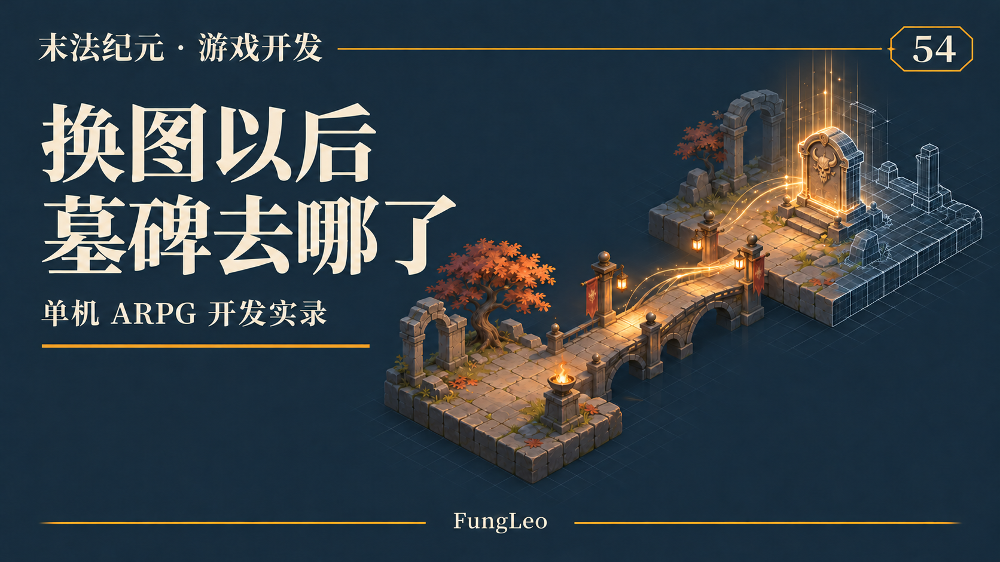
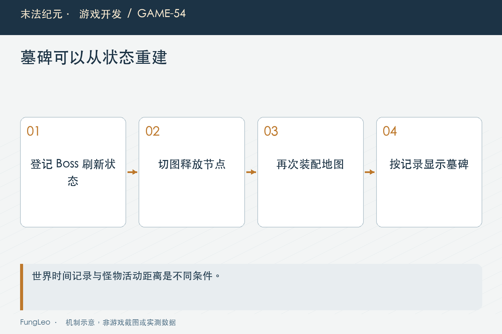

# 末法纪元·游戏开发54：Boss死了换张图，墓碑为什么没了

> 本文回顾《末法纪元》的开发过程，技术描述以 2026 年 11 月 5 日审阅快照为准。封面为主题插画，内文图为机制示意。

### 前言

各位看官，Boss刚被击杀，原地留下墓碑，倒计时也在正常走。玩家换张图，再回来，墓碑却不见了。走到原来的位置，还是没有；时间到了，Boss又凭空出现。

这时候很容易怀疑存档没保存死亡状态。但《末法纪元》当时的探针恰好证明，刷新时间还在，丢的是重新建立表现的机会。

本文沿这次跨图问题，讲清世界状态和地图节点的生命周期，再顺便区分另一类也需要跨图恢复的内容：尚未领取的战利品。两者有关联，却不是同一份记录。



### 墓碑是一份死亡状态的可视化

Boss死亡以后，刷新系统保存等待到期的世界时间与死亡位置。墓碑节点只是把这份状态画出来，顺便显示剩余时间。

切图时地图节点释放是正常行为。回到地图后，新的刷新器应该读当前状态，决定显示墓碑、等待刷新，还是生成怪物，不能要求旧墓碑节点跨图一直活着。

这与第53篇《掉落动画没飞完，奖励归谁》的掉落表现有相同边界：节点表示某件事，不等于节点本身就是那件事的全部事实。

因此排查第一步不是给墓碑加永久单例，而是检查死亡记录是否存在。如果记录仍有剩余时间，问题应沿装配与重建继续找，不能先把存档层推倒重来。

### 当时的关键变量，是进图时离Boss有多远

历史探针分了几段：近处击杀有墓碑；销毁地图，经过一段时间，在入口重建没有墓碑；再走近仍不补建；直接在Boss旁装配却正常。

同一份死亡状态，区别只是装配时人物离刷新点的距离。这使问题指向生成入口中的距离筛选，而不是刷新时钟失效。

当时报告也统计了多张地图的入口距离，但那些点位和占比属于当时数据，今天不能原样当成当前地图目录的全局事实。

最值得保留的是这套对照方法。只测一张入口恰好很近的地图，功能会长期看似正常；把同一状态放在远近两种装配位置，隐藏前提就露出来了。

### 怪物的生成条件，挡住了墓碑的重建

旧逻辑先检查固定点与人物的距离，太远就返回。后面才读取刷新等待状态，决定要不要放墓碑。

这个顺序把两件事绑在一起：不应该现在生成远处怪物，变成了不应该显示远处Boss已经死亡。前者是活动成本控制，后者是世界事实的表达。

而更新循环只会给已存在的墓碑更新倒计时，不会补建缺失对象。所以首次装配漏掉以后，走近也没有新的机会，直到等待结束生成Boss。

这类缺陷很容易藏在早返回里。每条判断单看都合理，组合起来却把另一项职责提前截断。读代码时要问的不只是条件对不对，还要问它应该保护哪一段工作。



### 先处理等待状态，再决定是否生成怪物

当前生成入口把等待分支放到距离与预算之前。下面摘取现行核心流程，前面仍保留点位解锁检查：

```gdscript
var remaining := _remaining(point)
if remaining > 0.0:
    if bool(point.get("tombstone", false)):
        _place_tombstone(point, remaining)
    point.entry = null
    return false
```

此处返回的是没有生成怪物，不是没有工作发生。墓碑已经按状态建立，远处怪物仍然遵守后面的活动距离与数量预算。

更新路径也会在等待期补建墓碑。建立方法发现已有有效标记，就只更新剩余时间，不会每轮都再创建一个。

这不是靠把距离阈值调大掩盖问题，也不需要为每个受影响地图加特殊配置。修复落在职责顺序上，地图将来换位置，规则仍然成立。

### 同一世界时钟，才能跨场景继续倒计时

刷新记录保存到期时间，剩余值由到期时间减当前世界时间计算。它不依赖某个墓碑节点自己的倒计时器是否一直运行。

如果切图释放节点时，顺手把刷新计时也丢了，再回来就只能从头等待；若每次建墓碑又减一次时间，则可能提前刷新。

当前状态键还包含地图、怪物与点位序号，避免同一种Boss在不同位置共用一份记录。显示名称可以改，稳定定位依据不能跟着中文文案走。

墓碑上的数字按显示到的整数秒变化重绘，实际到期判断仍读取世界状态。减少文字重画频率，不应把刷新规则也改成每秒才有机会执行。

### 未领取战利品，是另一份持久记录

Boss死了，并不代表它掉的装备都已入包。满包或自动拾取关闭时，某些精英与Boss战利品需要登记为未领取记录。

这份记录保存物品实例、地图、位置、批次与领取身份。回图时可以据此重建地面物，成功领取以后删除记录。

刷新墓碑则保存怪物什么时候回来。捡完战利品不应该让Boss立刻刷新，Boss刷新也不应该自动把旧战利品算作已经领取。

两个系统如果共用一个“此点已处理”的开关，第一次顺利击杀也许看不出问题，第二轮刷新与旧掉落叠在一起，就会开始丢状态或重复发奖。


### 先恢复节点，不要重新掷一次奖励

重建未领取物时，应该使用已保存的完整实例，不能再根据掉落表随机生成一件。否则玩家跨图回来，装备的词条和品质可能已经换了。

第42篇《背包整理以后，程序怎么认出原来那件装备》的稳定身份仍然重要：记录身份用于注销未领取项，装备实例身份用于识别具体物品，两种键承担不同职责。

领取成功以后，真实奖励进入玩家容器，未领取记录退出，地面节点结束交互。若只销毁节点却不删记录，回图又能领一份；若先删记录再发现入包失败，则失去了恢复依据。

登记时机也要看装配顺序。当前掉落有延后登记的路径，是为了等最终落点赋好，不能在位置仍是默认值时就把错误坐标持久保存。

### 持久保护也有明确的容量规则

不能把存在未领取系统简单写成所有奖励永久无限保留。当前普通地图有逐图上限与旧记录淘汰规则，具体容量从地图配置读取。

高产循环地图若启用保全选项，则把阈值用于自动停战，手动继续时保留奖励，不走普通淘汰。这里的产品差异需要看实际地图字段，不能从一张图推广到全游戏。

状态增长的代价包括地面表现、保存体积和恢复时间。保护规则应当让玩家看得懂，也给系统明确边界，但不能为了性能悄悄删除已经承诺保全的奖励。

下一篇会继续讲满包积压。这里先把保护范围说清楚，避免把后来的优化误写成早期所有地图就具备的保证。

### 回归要把销毁与重建真的做一遍

后续可从刷新器、世界记录和存档入口一起检查：

```sh
rg -n '_place_tombstone|spawn_remaining' scripts/world/spawner.gd autoload/game_state.gd
rg -n 'unclaimedLoot|spawnRespawn' autoload/save_manager.gd
python3 tools/run_isolated_tests.py SmokeTest
```

本文没有运行游戏测试。有效的验证应先构造死亡状态，在远处装配后立即检查墓碑，再释放地图并重建；还要测试删除标记后补建，以及到期后只生成一次Boss。

战利品则检查满包失败、跨图回来仍是原实例、成功领取后不再重建，以及保存再读取后的数量与位置。只让镜头移远再移回来，不等于场景生命周期真的经历过重建。

还要保留未解锁点位和远处怪物预算检查。修复墓碑不能顺便让所有远处怪物提前活动，正确表现不应该靠增加不必要实体换来。

历史报告当时还处于提出方案阶段，文章采用当前代码确认后续已经具备的行为。日期、状态说明与实现入口一起看，才能避免把当年的待办清单照搬成今天仍未修复的问题。

### 小结

这次墓碑消失，暴露的是状态还在、表现漏建。把等待状态处理从怪物生成条件里拆出来，才能既保留距离预算，也正确恢复世界信息。

未领取战利品同样需要数据与节点分层，但它负责奖励归属，不负责刷新时间。每份记录只回答自己的问题，跨图与读档才不会把几种生命周期搅成一团。

### 相关内容

- 第42篇《背包整理以后，程序怎么认出原来那件装备》
- 第53篇《掉落动画没飞完，奖励归谁》
