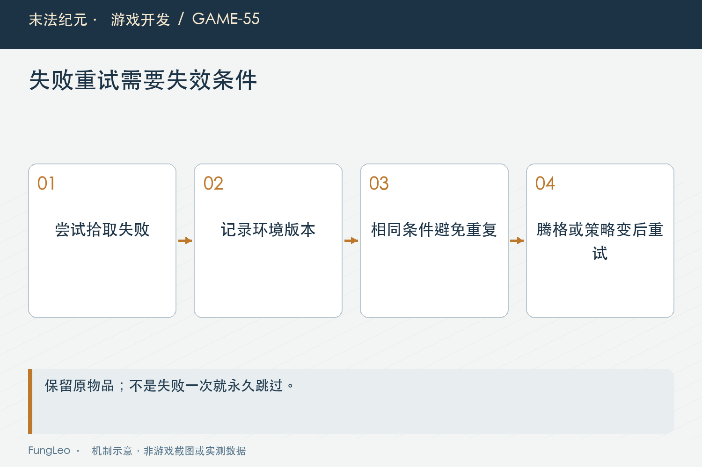
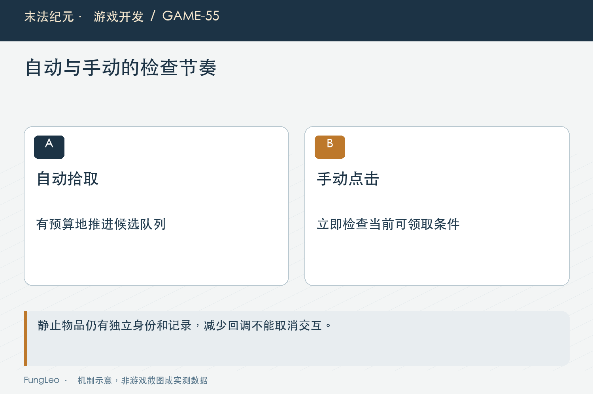

# 末法纪元·游戏开发55：满背包，不是异常情况

> 本文回顾《末法纪元》的开发过程，技术描述以 2026 年 11 月 5 日审阅快照为准。封面为主题插画，内文图为机制示意。

### 前言

各位看官，挂机游戏里的背包迟早会满。如果程序把满包只当作一个偶尔出现的错误分支，等玩家真正连续刷图，就会发现掉落留了一地，提示不断弹，画面也越来越慢。

这时说一句“请及时清理背包”当然容易，但玩家正在比较装备、等待合成材料，或者已经主动选择保留高品质掉落。满包本身就是正常玩法的一部分。

本文沿《末法纪元》的积压处理，讲讲容量不足时怎样停止无意义重试，又在腾格以后恢复，并保留金币、堆叠与自动出售这些仍可能成功的例外。


### 没空格，不等于什么都捡不了

一个背包每格都有东西，可以称为格子占满。但如果已有药水还能叠加，新药水仍可能入包；金币不占物品格，处理规则也不同。

自动出售开启时，符合条件的装备可能直接换成金币，也可能以更优候选替换原来保留的一件。这些流程不能被一个粗略的“背包满了”提前挡掉。

因此容量判断要与具体物品结合。全包没有空位是一条便宜信息，不是最终业务结论，更不能被多个入口各自解释成不同含义。

第53篇《掉落动画没飞完，奖励归谁》讲认领成功才进入表现，这里继续强调：尝试失败应保留掉落，仍然能成功的分支则应正常完成，不能为了避免报错干脆全部关闭。

### 提示节流，不等于工作已经节流

地面上有几百件装备，每件都反复尝试入包，发现不行，再让提示冷却挡住文字。玩家看到的消息少了，背包扫描和出售评分却可能仍在持续执行。

这是一个常见误区：把不再输出日志或提示，当成不再做昂贵工作。两者只是碰巧出现在同一段代码里，并没有天然关联。

尤其自动战斗自己限制了找掉落频率，也不能证明物品节点自身没有重试。一个动作有多个发起入口，优化必须沿实际调用链检查，不能只改最显眼的一处。

要先统计失败交易实际调用次数，再决定怎样缓存结果。画面清静了是体验变化，调用变少了才是这一步计算成本变化的证据。

### 失败一次以后，等条件变化再试

当前自动拾取记录上次失败所处的共享版本。版本没变，就不再重复进入同一笔拾取交易；发生影响结果的变化，才允许再试。

核心代码如下，前面已经让金币和坐骑保留原来的分支：

```gdscript
var revision := LootRetryState.revision()
if _failed_pickup_revision == revision:
    return false
var success := _try_pickup(announce,quiet_block)
if not success:
    _failed_pickup_revision = revision
return success
```

这里只缓存失败，不把成功缓存成一份可以再次领取的结果。成功以后沿正常认领与清理流程退出，避免同一地面物被处理两次。

版本表达的是相关环境改变，不是固定等几秒。腾出位置后应该尽快恢复，不必再等待一个与容量无关的长冷却。



### 什么变化，值得让失败结论失效

库存、装备、出售设置、数据重载和等级都可能影响结果。库存变化不仅是腾空格，也包括堆叠数量减少；装备和等级则可能改变候选保护。

金币不能每增加一点，就唤醒全部积压。普通入账通常没有改变自动出售可用条件，当前服务只在金币封顶状态切换时使相关失败失效。

这个边界与第48篇《点了确认还得重来，怎样锁定同一笔交易》很像：事件发生了，不表示当前判断就一定过期。需要分析它影响哪一项条件，而不是把所有通知都当作全量重做的命令。

当然，漏掉失效也会出问题。玩家清空一格，掉落却永远不恢复，比重复计算更难察觉。因此缓存设计必须把恢复路径和省掉的工作一起列出来。

### 读档替换容器，也不能困在旧版本里

只监听事件，还会遇到历史调用直接腾格，或者读档整体替换背包数组。服务若一直拿着旧容器引用，可能看不见新的容量条件。

当前实现会识别背包引用变化，并共享检查空位变化。每个物理帧最多做一份共用空位查找，而不是每件掉落都扫描一次背包。

这是一项兼顾现有调用边界的补充，不意味着以后可以随便跳过库存通知。正常业务仍应通过统一入口广播，避免每个消费者都被迫补一套兜底观察。

也不能把空位检查当成完整可入包判定。它只帮助发现某类变化，堆叠余量与策略判断仍由已有事件和实际拾取入口完成。

### 手动点击，不能被旧失败记录拦住

玩家主动点击某件掉落，是一次明确的即时请求。它应该进入原来的检查与反馈，而不是因为自动拾取几秒前失败过，就无声拒绝。

缓存只约束自动重复尝试，不能吞关键输入。手动请求仍可能因为满包失败，但应该得到当前条件下的准确说明。

同样，悬停与点击需要及时唤醒静止表现，不能让性能优化把物品变成看得见却点不动的贴图。省掉的是无意义轮询，交互资格并没有改变。

这类区别很适合做对照测试：相同状态自动请求很多次，只发生一次真实尝试；随后手动点一下，原入口立即被调用。两种预期同时成立，才能证明优化边界正确。



### 倍速放大的，不应该包括所有装饰检查

战斗倍速推进游戏时间，技能和伤害需要遵守原来的时间语义。地面装饰重画、距离复查与失败搜索，却未必需要随倍率一起变得更频繁。

当前部分预算按未缩放步长处理，避免游戏时间加速把同样的失败检查反复放大。但这不等于降低战斗碰撞或技能响应频率。

也不能简单说八倍速就是八倍物理回调。实际回调次数还受引擎配置影响，应分清时间步长、检查间隔和真实执行次数。

文章可以说明怎样避免预算被倍增，却不能据此推导完整战斗帧率提高几倍。真正的窗口测量还要包含Boss、技能、渲染与掉落生成峰值。

### 积压可以静止，奖励不能被优化掉

后续密集掉落使用共享静态表现缓存，并让适合的持久装备进入静止调度。它减少的是重复绘制准备与空转，真实实例和未领取记录仍然保留。

当前集中唤醒也有每显示帧的拾取尝试预算，避免腾格后所有积压在同一轮同时冲进交易入口。这里延后的是自动处理队列，不是删除奖励。

但普通掉落的期限、持久掉落的保护、地图的停战阈值仍各有规则。第54篇《Boss死了换张图，墓碑为什么没了》已经说明，不能把某张循环地图的保全策略宣传成全游戏无限保留。

准备引入空间索引或对象池以前，也要先看已完成的测量。历史分析列过候选方案，不表示每一项今天都已经实现，写复盘应把计划与落地分开。

### 条件恢复以后，才是这类测试的重点

后续可以沿重试状态、地面入口与定向测试检查：

```sh
rg -n '_failed_pickup_revision|LootRetryState' scripts/entities/ground_item.gd scripts/systems
python3 tools/run_isolated_tests.py LootRetryTest GroundLootIdleTest GroundLootVisualCacheTest
```

本文没有运行游戏测试。历史第一阶段记录覆盖同状态大量请求只尝试一次、手动入口不受阻、普通金币不触发重试、封顶切换恢复，以及满格药品仍能堆叠。

实际复核还应做卖掉一件、消耗一份堆叠、换装、切换出售预设、读档替换容器和切图。每次都核对原实例最终只入账一次，持久记录在成功后正确注销。

性能验收则固定积压数量、容量、倍率、窗口和战斗负载，比较帧时间分布与内存。少了一千次失败调用是有价值的局部证据，但它本身不是一份完整帧率报告。

### 小结

满背包是正常状态，程序需要在这段时间持续正确地工作。区分占满与不能接纳，缓存无变化的失败，并为每一项相关变化准备恢复入口。

可以少做重复工作，却不能少给奖励；可以让自动处理排队，却不能挡住手动输入。把这些边界守住，玩家才有时间从容整理背包，而不是被系统催着处理异常。

### 相关内容

- 第48篇《点了确认还得重来，怎样锁定同一笔交易》
- 第53篇《掉落动画没飞完，奖励归谁》
- 第54篇《Boss死了换张图，墓碑为什么没了》
