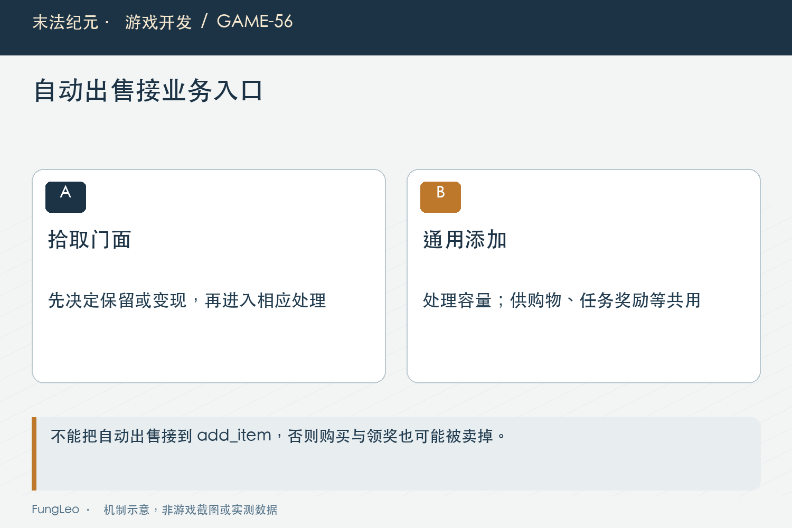
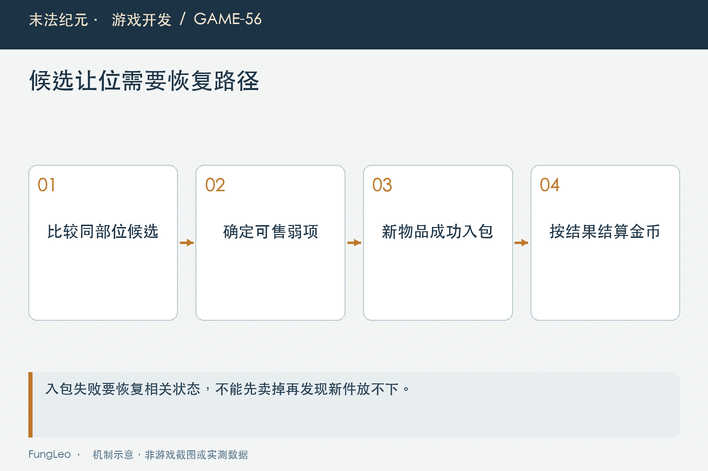

# 末法纪元·游戏开发56：自动出售，为什么只能接在拾取入口

> 本文回顾《末法纪元》的开发过程，技术描述以 2026 年 11 月 5 日审阅快照为准。封面为主题插画，内文图为机制示意。

### 前言

各位看官，挂机久了，背包不断进低价值装备，玩家希望系统捡到就卖，不必隔一会儿打开商店。这项功能看起来只要在入包函数前面加一个判断。

可物品进入背包，不一定来自地面掉落。商店购买、任务奖励，也可能调用同一个添加接口。如果把自动出售塞在最底层，刚花钱买来的装备，转眼又被系统回收了。

《末法纪元》因此把拾取设成明确的业务入口。本文讲的不只是函数放哪里，还包括共用筛选、候选保护、满包替换和收集事件怎样一起接好。


### 容器能力，不应该替业务猜来源

添加物品回答的是能否把这一份数据放进背包，涉及空格、堆叠与容量。它本身不需要知道玩家是打怪捡到，还是刚完成任务。

自动出售回答的却是这次拾取是否应直接变现，它需要设置、人物等级、装备价值与金币状态。这是带来源含义的业务判断。

如果混进通用添加接口，所有调用者就被迫带一个“这次不要自动卖”的例外参数。以后新增领奖入口，忘记传一次，奖励就可能当场消失。

第09篇《从网页状态走到游戏状态，职责该怎么分》讨论过状态职责，这里也是同样的问题：公共能力保持清楚，具体动作在自己的入口组合能力，比让底层猜调用者更可靠。

### 拾取门面先判断，再决定入包或变现

当前地面物品调用GameState的统一拾取门面，装备自动出售开启时，先走筛选；不符合出售条件则继续正常入包。

实际入口的开头如下：

```gdscript
func pickup_loot(item: Dictionary) -> Dictionary:
    var sellable_now := String(item.get("kind", "")) == "equip" and auto_sell_enabled()
    if not sellable_now:
        var placed := add_item(item)
        if placed:
            EventBus.item_picked.emit(String(item.get("itemId", "")))
        return {"ok": placed, "auto_sold": false, "gold": 0, "listed": 0, "reason": ""}
```

这是节选，后面还有预设判断与出售提交。非装备不会因为开启选项就被一股脑回收，任务和购物仍沿它们自己的添加流程。

门面返回成功与否、是否自动售出、挂牌价值和实际入账，让地面表现知道该继续留地，还是完成认领，而不用自己再判断一次装备价值。

### 等级门槛，要在运行时再检查

当前自动出售六十级开放，设置界面会反映这项限制，但业务入口仍然复核等级与开关。

只让低等级按钮变灰并不够。设置来自存档，可能经过迁移、导入，未来也可能新增其他调用入口。任何一条路径都不应绕过真正的开放条件。

这并不是把同样逻辑随意写两份。等级常量与判断口径应由共用规则提供，界面负责解释，结算负责执行，两个层次读取同一依据。

同样，危险的暴力预设不属于可持久化的常规自动策略。手工清理时的一次选择，不能无声延续到以后每次捡装备。



### 手工清单与自动出售，共用价值判断但保留差别

装备批量清单与拾取出售都读SellGearPolicy的价值判断，包括收藏、星级、品质、档位和升级候选等原因。

共用这一部分，可以避免手工清单认为应保留，自动出售却完全不看同一条件。但两种交互并不必须逐条相同，自动出售缺少让玩家临时取消勾选的机会。

例如破损装备在手工预设中可以作为提示，玩家仍可取消；拾取自动出售则把破损作为否决项，避免没有复核机会时卖掉可修物品。

空穿戴槽也需要额外保护。手工清单里的默认选择可以由玩家修改，自动路径如果把第一件同部位装备立刻卖掉，人物就可能一直填不上这个槽。

### 更强候选，也不能无限占满背包

早期只要比已穿装备更强就保护，会出现身上迟迟没换装，背包一批同部位候选都被永久保留的情况。

当前候选额度沿部位槽位数，一般部位一件，双槽部位两件。排位还考虑跨档换装优先级与评分，不应该简单概括成只看颜色，或者只看一个最大分数。

第43篇《左右两个槽，怎样判断新装备更强》讲过比较目标，候选判断仍应使用同一替换预览。当前排名之外的冗余候选可以按预设处理，而品质、收藏、星级等硬保护继续生效。

因此“最多留两枚戒指”也不是整个背包的绝对上限。高品质等受保护物品可以更多，额度约束的是这部分可出售候选的保护范围。

### 新件进前排，旧候选让位也要安全提交

自动拾取时，新装备还没进背包，必须和已经保留的同部位候选一起排名。若只与身上比较，每件新掉落都可能觉得自己值得留下。

新件进入额度后，可以找到掉出额度且允许出售的旧候选，由业务层执行让位。规则层只返回目标身份，不直接修改背包或金币。

当前执行顺序先暂时腾出旧格，尝试让新件入包，成功以后再给旧件的实际售价入账。若入包失败，就把旧件恢复原格。

这里不能先正式卖掉旧件，再尝试添加新件。否则第二步失败，玩家既没有新装备，也失去原来保留的装备，最终只剩一条莫名其妙的出售提示。



### 没有进入背包，也仍然算一次拾取

自动售出的装备没有留下背包条目，但玩家确实完成了这次拾取。收集任务、音效和统计如果挂在拾取事件上，仍应收到一次正确通知。

当前成功出售路径会发出物品拾取事件与成交事件。它们表达不同事实，不能因为没有入包就两者都省掉，也不能让地面动画结束时又发第二次。

第53篇《掉落动画没飞完，奖励归谁》已经区分认领与播报。这里继续沿同一边界：业务成功时记录动作，视觉完成时说明结果，不能由动画存在与否决定任务有没有进度。

让位路径也要确认新件只触发一次拾取，旧件只成交一次。两个物品都出现在同一操作里，不代表可以把它们都算成新拾取。

### 金币封顶时，自动出售要提前决定

当前自动策略遇到金币已满，会拒绝自动售出，尽量让装备正常入包。若背包也不能接纳，就保留未认领掉落。

这与已经确认成交以后按实际入账结算，是两种时刻。前者尚可决定不卖，后者不能因钱包放不下而把物品又退回去，具体口径后面专篇讲。

返回值因此保留挂牌价值与实际到账，提示不能把理论售价冒充余额真实增加。第55篇《满背包，不是异常情况》的失败缓存也需要在封顶状态切换时失效，而不是每涨一枚金币就唤醒所有积压。

### 检查调用链，比只看筛选返回值更重要

后续可以沿拾取门面与定向回归检查：

```sh
rg -n 'pickup_loot|auto_sell_enabled|_evict_for_pickup' autoload/game_state.gd scripts/entities/ground_item.gd
python3 tools/run_isolated_tests.py AutoSellPickupTest SellGearQuotaTest
```

本文没有运行游戏测试。需要覆盖低等级开关为真、空槽第一件、同分候选、收藏与带星保护、金币封顶，以及满包让位失败恢复。

还要从真实购物和任务发奖入口验证，装备正常留下，而不是只测试拾取函数自己返回正确。防止误接层级的关键证据，是其他来源没有被意外卷进去。

性能上，当前单件拾取排名可以先限定同部位，再做较贵判断，避免每次新掉落都对整个背包各部位重新评分。整包清单则一次建立共用排名，不应每一行重复全量计算。

### 拒绝出售，最好说明是哪一层保护

预设不允许、等级未开放、空槽保护、金币已满，看上去都是装备没卖，但玩家下一步能做的事情不同。反馈应把有用原因转成可理解的文案，内部排查字段则不必原样暴露。

尤其自动出售开启以后仍然留下一件金装，可能正是品质保护在正常工作。若只显示开关已开而完全不说明范围，玩家很容易把正确的保护当作功能失效，再切到更激进的设置。规则说明清楚，也能减少这种误操作。

### 小结

自动出售不是通用入包的附属开关，而是拾取动作里的明确策略。共用价值规则，同时保留自动交互更严格的保护，再把让位、入账与拾取事件一起提交。

入口放对地方，后面新加商店、任务或奖励，才不会每次都担心一件刚送到玩家手里的装备，下一秒又被系统替他卖掉。

### 相关内容

- 第43篇《左右两个槽，怎样判断新装备更强》
- 第53篇《掉落动画没飞完，奖励归谁》
- 第55篇《满背包，不是异常情况》
