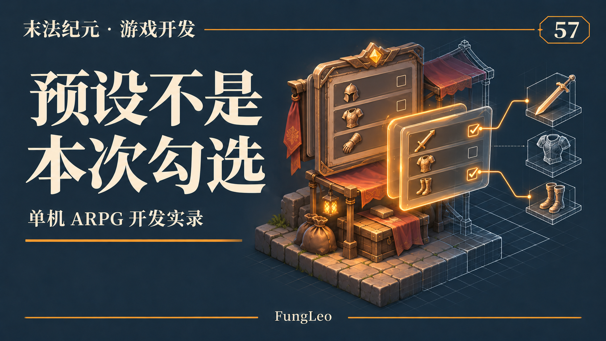
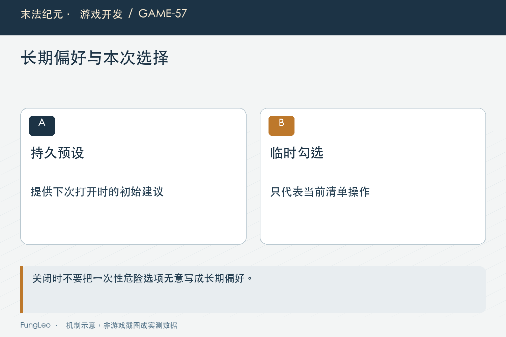
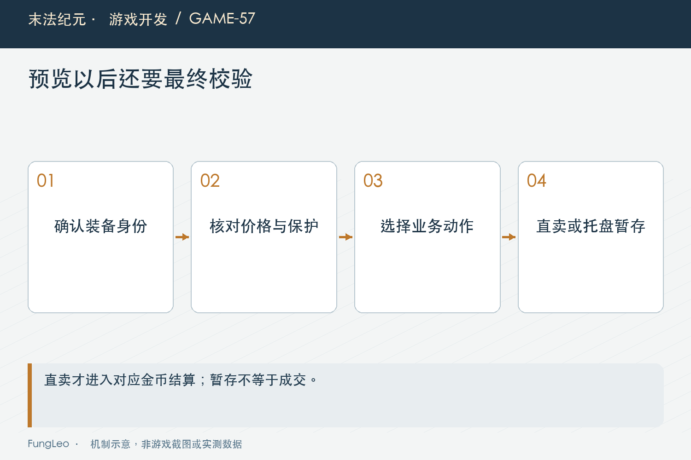

# 末法纪元·游戏开发57：预设和本次勾选，不能是一份状态

> 本文回顾《末法纪元》的开发过程，技术描述以 2026 年 11 月 5 日审阅快照为准。封面为主题插画，内文图为机制示意。

### 前言

各位看官，快速出售窗口打开，系统按谨慎预设勾好一批装备。玩家取消两件，再手动加入一件带星旧装。关掉窗口，下次打开，究竟该恢复哪一份选择？

如果把这些勾选都保存，下次很可能自动选中原本只打算处理一次的高价值物品；如果任何变化都直接重算，又会把玩家刚取消的装备勾回去。

《末法纪元》把长期预设和本次清单分开。本文就聊这两份状态为什么不能共用，以及同一套清单怎样同时支持背包直卖和货郎暂存。



### 预设回答习惯，勾选回答这一次

谨慎、标准和积极，是玩家希望系统如何默认筛选的长期偏好。它们可以保存到设置，下一次打开时继续作为起点。

本次勾选则是对当前具体实例的决定。取消一件准备给别的用途，手选一件虽然有价值但已经不需要的旧装备，都只属于这一次窗口。

因此存档保存预设身份，不保存展开清单、行号或预计金币。否则背包整理和装备消耗以后，一份过期位置列表就可能指向完全不同的物品。

第42篇《背包整理以后，程序怎么认出原来那件装备》讲过下标不是身份，这里还要加上时间边界：即使稳定ID仍然存在，也不表示玩家上周的勾选能自动授权今天出售。

### 默认不选，不等于禁止手选

清单里有几种不同保护。收藏与不可售是硬门槛，不能靠勾选绕过；高价值、带星、档位等则可能只是默认保留，玩家明确手选后可以进入额外确认。

若把它们都写成“不可卖”，玩家处理旧装备会被迫找另一条绕路。若把它们都写成“默认不选”，收藏又失去了真正保护作用。

当前清单结果区分默认选中、能否手选和原因集合。界面根据这些字段解释，而不是自己再拼一套品质与评分条件。

第56篇《自动出售，为什么只能接在拾取入口》讲过共用价值判断，这里的好处就是预设、提示与最终重核可以沿相同口径，但不同原因仍有清楚的强弱边界。

### 暴力清理，只是一种本次动作

后来增加的暴力预设绕过大部分价值判断，但仍保留收藏与可售硬门槛。它适合玩家明确要清一批装备时使用，不适合悄悄记成以后一直采用的默认值。

当前持久化集合只有三种常规预设，保存入口也会拒绝暴力档：

```gdscript
func set_sell_gear_preset(preset: String) -> bool:
    if not SellGearPolicy.PERSISTABLE.has(preset):
        return false
    settings.sellGearPreset = preset
    EventBus.settings_changed.emit()
    return true
```

这同时保护了交互预期与存档枚举。新增界面选项时，不是把字符串写进设置就完成了，还要核对它是否应该跨会话存在。

一次性覆盖值可以交给当前清单，但关闭以后就结束，不能下次打开背包时又替玩家选中整包装备。



### 一行预览，要保留什么内容

当前行记录具体实例ID、显示用背包位置、完整物品快照、价格、人物等级、预设和保护判断。

这些内容不是为了把运行数据再复制成另一套长期模型，而是为了确认时回答：现在准备出售的，还是不是刚才展示的那件，以及当时的条件有没有变化。

行里保留原始默认选中，玩家实际勾选另由本次状态管理。否则用户手动勾上一件，程序把默认选中也改成真，最终就看不出它原本需要风险确认。

这层区分特别容易在界面重绘时丢失。重建控件可以，交易含义不能跟着控件初始化一起被覆盖，尤其不要用复选框当前外观反推长期规则。

### 确认时按身份定位，再重算当前判断

背包整理后，原装备换了格子，不应直接误卖新占据旧格的东西。最终检查按实例ID建立当前索引，再比较内容和价格。

当前还会核对等级、预设和保护结果。下面是实际重核中的一段：

```gdscript
if int(current.get("price", -1)) != int(row.get("price", -2)) \
        or bool(current.get("protected_upgrade", false)) != bool(row.get("protected_upgrade", false)) \
        or bool(current.get("default_selected", false)) != bool(row.get("default_selected", false)):
    return {"ok": false, "reason": Localization.tr_key("ui.review.game_state.002")}
```

这比只检查装备还在更严格。一次换装或新候选加入，可能改变原来的升级保护；即使物品词条没动，玩家看到的风险条件也可能已经不同。

所以不要把“无关新掉落能继续”扩大成“任何新增装备都不影响”。只有本单相关内容与判定仍一致，旧确认才有继续使用的依据。

### 评分上下文必须和预览一致

当前同部位候选有保留额度，清单生成时会统一建立排名上下文。最终重核也必须使用相同规则，否则默认选择可能在两个入口之间无故翻转。

如果预览考虑了背包内更优候选，结算却只和身上装备比，就会频繁报清单已变化。玩家什么也没动，程序自己用了两套输入。

这类故障不是增加一次刷新就能解决。需要先找到两次判断的上下文差异，再让它们共用权威入口。

成本上也应该一次准备排名，再逐行使用。每一行各扫整包，清单越长，工作越容易成平方增长；这里没有理由每帧重做全部规则。



### 直卖和暂存，共用清单却不是同一次成交

背包直卖核对通过以后，移除所选实例并入账。货郎模式则先把物品放进托盘，只有最后成交才给金币。

因此托盘空位不足时，应整批拒绝移入，不能无提示地只装下前几件。玩家选的是整个集合，部分成功需要另有明确产品约定。

第50篇《批量合成，不能循环调用单次合成》讨论过批量动作边界，这里同样不能循环执行单件移入，让中间通知把一笔完整选择切成半批状态。

清单可以共用筛选和快照验证，但提交路径必须保留各自时机。一个按钮叫确认，并不表示两种模式都已经完成出售，文案应告诉玩家是直接卖出还是先放入托盘。

### 暂存期间，物品仍然需要唯一持有者

装备离开背包进入托盘以后，不能只藏在某个即将关闭的控件数组里。当前全局托盘状态负责持有未成交物品，界面负责显示和发起动作。

关闭未成交窗口需要按退回规则处理，放不下的也不能静默消失。保存策略同样要照顾暂存归属，不能写出背包已经扣除、托盘却没有记录的半份存档。

最初方案与后来落地还经历了调整，尤其金币封顶时的成交口径已经改变。写这篇时采用当前交易入口，不把旧方案里的容量拒绝规则照搬成现状，下一篇会单独展开。

### 风险确认，要覆盖玩家额外选入的东西

手选默认保护的装备时，需要明确说明名称与原因，而不是只多弹一次毫无内容的“确定吗”。玩家应该知道自己正在放弃星级投入或升级候选。

最终业务入口仍接收这次已确认风险的意图，并核对同一批实例。不能把它变成一个永久的“以后都允许卖高价值装备”开关。

取消、改预设、换目标或关闭以后，相关临时确认都应结束。控件只是动作入口，真正的授权范围是当前清单中的具体物品。

### 验证应观察关闭前后和两种模式

后续复核可以从预设保存与出售终验一起检查：

```sh
rg -n 'PERSISTABLE|default_selected|manual_selectable' scripts/systems/sell_gear_policy.gd
rg -n 'validate_equipment_sale|take_equipment_for_sale' autoload/game_state.gd
python3 tools/run_isolated_tests.py SellGearPreviewTest
```

本文没有运行游戏测试。应覆盖取消后重新打开、暴力档不落档、收藏不可选、手选带星需要确认、整理后仍定位原实例，以及组内内容变化整批拒绝。

托盘路径还需检查空位不足、已有暂存、关闭退回与最终成交。直接模式则核对扣除数量和实际入账，不能拿暂存成功当成出售成功。

清单的行顺序也应稳定，不能每勾一件就按选中状态重排，把下一次点击的目标挪走。数量、总价可以即时更新，正在审阅的物品位置则尽量保持，这样玩家才能连续取消几件，而不是追着跳动列表操作。

### 小结

预设是长期偏好，本次勾选是当前决定，风险确认是对具体投入的授权。三者有关联，却不应该写进同一份可变状态。

把默认规则、玩家调整和最终重核分开，清单既能省操作，也能保留控制权。共用窗口可以少写界面，但业务成交时机与物品归属仍要各自讲清楚。

### 相关内容

- 第48篇《点了确认还得重来，怎样锁定同一笔交易》
- 第50篇《批量合成，不能循环调用单次合成》
- 第56篇《自动出售，为什么只能接在拾取入口》
