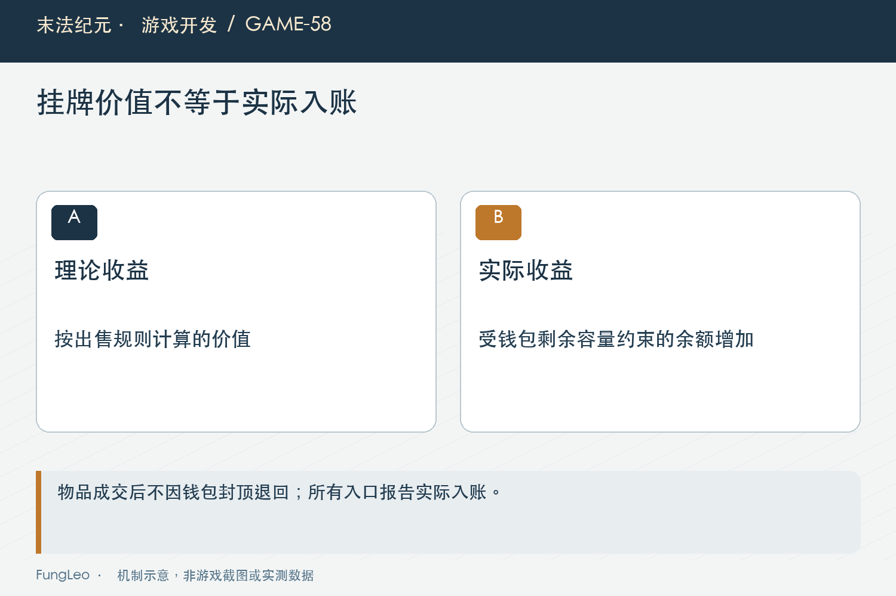
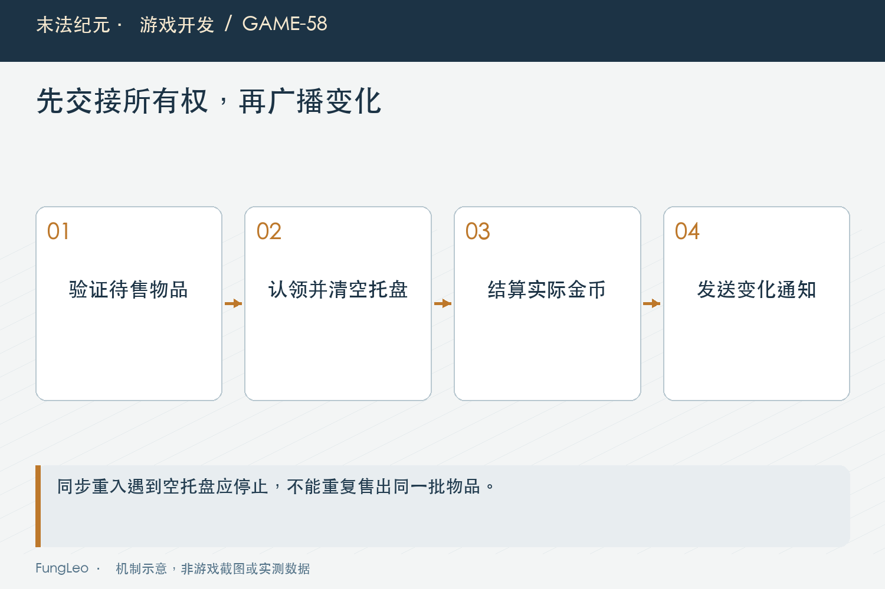

# 末法纪元·游戏开发58：金币封顶，卖出去的物品怎么办

> 本文回顾《末法纪元》的开发过程，技术描述以 2026 年 11 月 5 日审阅快照为准。封面为主题插画，内文图为机制示意。

### 前言

各位看官，玩家钱包只剩十枚金币的空间，选中的装备能卖五十。点击出售以后，应该整单拒绝，还是照常成交，只收到十枚？

两种口径都能设计，但必须明确，并且让所有入口说同一种话。《末法纪元》最终采用的是照常出售，金币按上限截断，提示与返回值使用实际入账。

这项改动看起来只关乎一个上限判断，实际会影响单卖、批卖、托盘归属和同步事件。本文就沿这笔五十与十的差额，讲清交易里什么叫成功，什么数字才算真的到账。


### 先把产品口径说清楚

早期出售方案曾把金币容量当作前置条件，放不下就拒绝。后来玩家明确希望有钱也能继续清包，于是改为成交不退物，拿不满的部分说明原因。

当前规则不是所有游戏理应如此，而是这个项目已经确认的选择。复盘时应把规则变更写出来，不能把旧方案直接描述成程序错误，也不能把后来的口径说成从来没有变化。

尤其测试里曾经存在相反预期，修改时应说明是产品行为变更，而不是为了让失败断言变绿就偷偷删掉保护。

规则选定以后，执行边界就清楚了：合法物品已经被确认出售，不因钱包容量退回；非法物品、收藏保护与过期清单，仍然在成交以前拒绝。

### 挂牌价值与实际入账，是两个数

挂牌五十描述物品定价，实际入账十描述钱包余额增加。它们都真实，却不能在返回值里混用。

当前金币入口在零与上限之间夹取，并返回增量；出售统一门面直接复用它：

```gdscript
func _gold_gain(listed: int) -> int:
    return add_gold(listed)
```

因此调用方应使用返回的gained，不得为了显示好看又填回listed。否则提示写增加五十，余额却只加十，玩家看到的就是账不对。

这个区别也影响成交事件、统计和批量结果。只把界面文字改成实际值，底层事件仍广播理论价，后续任何订阅方都可能继续记错账。

### 完全封顶，零入账也仍然可能成交

当前手动出售在金币已满时，合法物品仍可清掉，实际入账为零，并说明超出上限未计入。这与余额还有一点空间的情况遵守同一口径。

不要在零收益时临时恢复另一套隐藏规则，比如悄悄退回托盘，或者只卖部分物品。那样玩家很难预测同一个按钮下一次会做什么。

如果以后要新增二次确认，需要明确调整交互约定；不能因为开发者觉得更保险，就在某一个出口独自加上，其他出口却照卖。

当然，零入账必须反馈清楚。只弹“出售成功”而没有数量、实际收益与截断说明，会让玩家误以为金币漏加，或者怀疑系统吞掉了某些装备。



### 四个出口，必须一起改

单件卖给货郎、托盘批量结算、旧的一键低价值出售、背包勾选直卖，都属于同一类确认出售，不能一边允许封顶成交，一边仍然提前拒绝。

当前它们沿统一入账门面，返回各自接口需要的实际金额。字段名称有的叫price，有的叫gold，名字不同，不代表允许混入挂牌总额。

第57篇《预设和本次勾选，不能是一份状态》讲过两种清单提交时机。直卖核对后直接成交，暂存只是转移归属；等托盘最后成交时，再使用同一金币口径。

清点调用方时不要只搜新界面。旧接口可能还被工具或其他功能使用，保留下来的路径也需要符合当前规则，否则从不同入口操作相同物品，会出现互相矛盾的结果。

### 托盘先认领，再广播金币变化

托盘还有一项比金额更隐蔽的风险：金币入账会同步广播事件，订阅方可能在回调里再次触发成交。

如果等入账完成以后才清空托盘，第一次回调执行时物品仍在，第二次就可能拿同一批再卖一次。单线程并不自动排除这种同步重入。

当前正式托盘提交先取出本批，验证可售，清除全局托盘归属，再进入售金逻辑：

```gdscript
var items := GameState.trade_tray.values()
if items.is_empty():
    return {"ok": false, "count": 0, "gold": 0}
for item in items:
    if not item is Dictionary or not Shop.can_sell(item):
        return {"ok": false, "count": 0, "gold": 0}
GameState.trade_tray.clear()
GameState.set_trade_staged_count(0)
return shop_sell_staged(items)
```

这段的前提是后面的当前结算没有另一个可拒绝的容量分支。若未来又加入手续费或其他条件，应先完成全部必要验证，再交接所有权，不能照抄顺序而忽略前提。

### 低层算价入口，不等于正式托盘所有权

当前仍保留接收物品数组的批量售金门面，它负责检查、算价与入账，物品从哪里来、是否已经被认领，由调用方负责。

因此正式界面应走持有全局托盘的提交入口，不能随便把同一个显示数组连续传给低层函数，假定底层会替所有调用者记住卖过什么。

第50篇《批量合成，不能循环调用单次合成》的批量原子边界，在这里表现为明确的所有权转移。先知道谁拥有这批物品，再允许什么入口把它转成钱。

重复点击也不能只靠按钮变灰。真正的托盘已经清空，第二次业务请求看到空集合，才是防止重复成交的实际依据。



### 差额提示，只应该有一个负责方

单件出售由业务层发成功提示，某些批量窗口则在界面汇总结果。如果两边都顺手补一条封顶提醒，同一笔操作就会弹两次。

当前业务返回截断标志，让负责成功提示的一侧在结果后面补充说明。顺序也要合理，先说卖了多少、实际收到多少，再说为什么与挂牌值不同。

这不是为了少弹消息就省掉真实信息，而是给每种反馈明确所有者。金额用实际增量，差额有解释，次数不重复，玩家才能把这笔账完整理解。

日志和测试同样应核对提示来源。只检查含有“封顶”两个字，抓不到重复弹窗或文案顺序颠倒的问题。

### 拾取自动出售，是尚未成交的另一种决策

第56篇《自动出售，为什么只能接在拾取入口》提到，金币已满时自动出售会尽量保留装备。这与手动确认后照常卖，并不冲突。

自动策略还处在决定卖不卖的阶段，玩家没有逐件确认，保留物品是当前明确的保护。手动出售则已经表达了清掉这些物品的意图。

金币地面拾取也有自己的满额规则，不能因为出售门面允许零入账，就把所有金币掉落也无条件认领消失。不同业务共享加钱能力，不等于共享同一个前置决策。

所以检查时既要确保四种出售统一，也要确认没有把这项规则错误扩散到未确认的自动处理与其他奖励入口。

### 用余额差验证，别只相信返回成功

后续可以从统一门面和托盘提交查起：

```sh
rg -n '_gold_gain|gained <|commit_tray' autoload/game_state.gd scripts/systems/trade_service.gd
python3 tools/run_isolated_tests.py SellGearTransactionTest TradeTraySaveTest
```

本文没有运行游戏测试。实际用例可设置只剩十空间、挂牌五十，检查成交成功、余额增加十、原物品离开、返回金额也是十。

再测完全封顶、刚好装下、多件总价与非法物品拒绝。托盘路径应在金币事件中尝试重入，确认同一批不会被卖两遍，保存恢复也不会把已经成交的物品重新放回来。

这些小金额是解释边界的教学算例，不是修改真实玩家钱包的操作建议。测试应使用隔离状态，不能为了验证上限去改玩家正在用的档案。

还应检查统计里的成交数量与入账金额不要被混成一个成功条件。零入账仍然可能售出三件，数量不能因为收益为零就写成零；相反，返回金额为正也不能证明每件选中物品都已正确退出容器。两份结果分别核对，才不会把一个字段的正确当成整笔交易都正确。

### 小结

金币封顶时怎么卖，是产品决定；决定以后，物品归属、实际入账、事件返回与提示必须一致。

先校验，再认领本批，最后按实际余额增量结算。挂牌价可以说明价值，但不能冒充收益；界面显示成功，也必须对应一笔只发生一次的真实成交。

### 相关内容

- 第50篇《批量合成，不能循环调用单次合成》
- 第56篇《自动出售，为什么只能接在拾取入口》
- 第57篇《预设和本次勾选，不能是一份状态》
