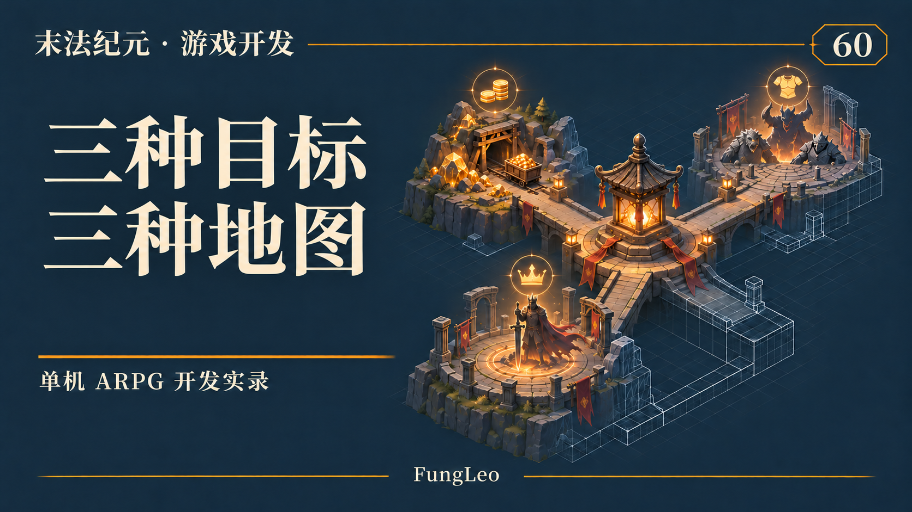
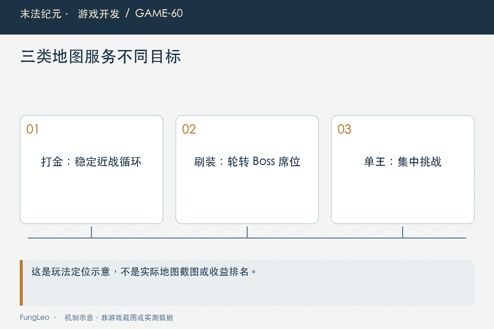
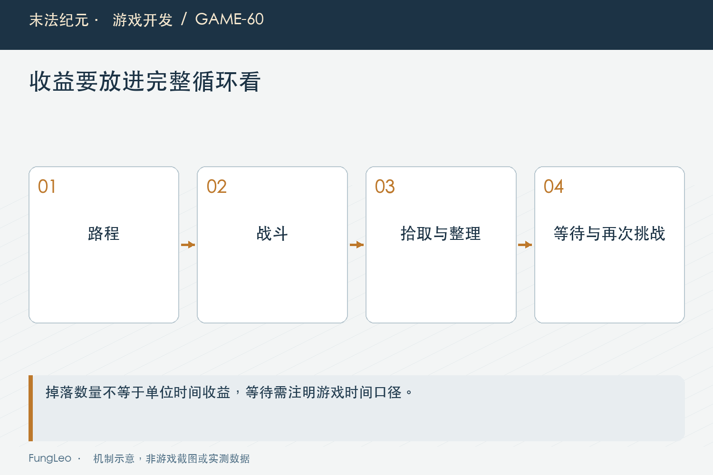

# 末法纪元·游戏开发60：打金、刷装、单王挑战，为何分地图

> 本文回顾《末法纪元》的开发过程，技术描述以 2026 年 11 月 5 日审阅快照为准。封面为主题插画，内文图为机制示意。

### 前言

各位看官，主线打完以后，如果所有后期需求都塞进一张地图，会发生什么？金币最多、装备最好、经验也最快，玩家当然只去那里，其他地方慢慢失去意义。

《末法纪元》后来把金币循环、批量刷装与单王挑战放到不同地图。它们复用怪物、掉落和刷新系统，但目标、压力与收获节奏不一样。

这篇不逐张抄参数表，而是讨论怎样让几张循环图各有用途，以及为什么地图定位不能只靠一句介绍，还要落实到战场布局、伤害与产出规则。



### 先定玩家来做什么，再决定放多少怪

聚金地脉面向稳定打金，百首禁域面向较密集的装备获取，孤王绝域则强调隔一段时间来打一场硬仗，再迎接集中掉落。

同样叫循环，它们需要的活动间隔不同。打金希望操作平稳，批量刷装要考虑容量与候选处理，单王则需要在一次战斗里形成足够投入和反馈。

如果先把怪物摆满，再靠调金币数量补定位，很容易得到一张哪里都难受的图：跑得累、收益不清楚、打完还需要不停整理。

因此地图定位应先对应实际行为：站在哪里、多久换目标、多久需要处理背包、什么时候离开。数值表最后要能解释这些行为，而不是只解释怪物等级。

### 打金图收拢战场，减少没有意义的追逐

聚金地脉早期点位较分散，后来收成单片战场的多个营地，让角色在合理活动范围内持续战斗，而不是不断跑远路。

当前配置有九十六个固定普通怪席位，同屏普通怪预算三十二。席位总数与同时活动数量必须分开，不代表进图就有九十六个完整怪物一起跑。

怪物类型也服务于站桩目标。远程怪在外面点名，会让近战角色不停追逐，因此后来替换为近战来源，同时保留对应归一数值。

这类修改说明地图体验不只是伤害倍率。射程、移速、营地间距与活动距离相互作用，怪物血量不变，也可能因为少了追人而明显改变操作感。

### 单击上限，约束的是扣血而不是展示数字

高成长角色可能用一个技能直接秒普通怪，让出产速度脱离原先节奏。当前打金图设置单次扣血上限，防止一次命中清空整条生命。

实际共用函数如下：

```gdscript
static func capped_damage(raw: int, max_hp_value: int, cap_pct: float) -> int:
    if cap_pct <= 0.0 or max_hp_value <= 0 or raw <= 0:
        return raw
    return mini(raw, maxi(1, int(round(float(max_hp_value) * cap_pct))))
```

这里按当前源码取整，限制的是每次命中与最大生命比例的关系。当前打金普通怪采用一半比例，其他不启用的目标仍走原伤害。

飘字保留原伤害展示，实际扣血受限，两者有意承担不同含义。调试时若只拿飘字与血条作差，会把产品规则误判成结算错误。

多段技能还要按实际命中次数理解，单击上限不是限制整个技能总伤害。不能把两种口径混在一起，随手给一个多段技能又加第二层封顶。



### 守卫掉更多，不代表每秒赚得更多

打金图部分守卫更耐打、攻击更高，单只金币也更多，还提供更好的装备机会。它们的用途是让战场中有值得停留的目标。

可收益必须除以时间。血量增加六倍，金币只增加四倍，不会因为单次金币数字更大，就自动成为最快打金对象。

若维护者看到更强怪金币效率反而低，顺手把奖励补到绝对更高，就可能把原来有意保留的取舍抹掉。数值表需要同时写定位，而不是只留一列倍率。

还要看玩家真实击杀方式。单击上限、技能冷却与移动会影响耗时，不能机械地把血量倍率当作击杀时间倍率，再得出精确每小时收入。

### 百首禁域，席位与同时承伤是两种压力

这张图有一百个Boss席位，但当前同屏预算十八。百首强调轮转与供给规模，不是无条件让一百只同时围住玩家。

入口要求等级、主线进度与十四槽紫装，离开后重新进入仍要复核。只在第一次开门检查，后来换掉装备还可直接传入，会使门槛失去意义。

掉落方面，装备组增加尝试次数，而金币、药品和如意保持各自规则。别把装备产量翻倍简写成所有奖励翻倍，否则经济估算会把几个不相关出口一起放大。

第55篇《满背包，不是异常情况》讲过积压，这张图还需要保全未领取奖励与自动停战阈值。刷装定位带来高产出，也必须承担容量和恢复成本，不能只设计一地装备的爽感。

### 承伤倍率，要跨过真实防御条件再讨论

历史反馈里，满星紫装角色在百首禁域几乎不掉血，原因不是Boss完全没攻击，而是攻击仍在破防条件以下，长期只走很小的保底。

后来调整攻击倍率，使承伤进入可感知范围。但历史报告还指出，刚跨过破防线时，实际差值可能比保底还小，不能只配到数学阈值就宣布难度增加。

第29篇《一次攻击，到底在哪一步算伤害》讨论过伤害链，这里要把实际防御、攻击间隔、同时接战数量与药品恢复一起看。

报告中的某个等级、某套存档只代表当时样本。今天多了第五词条与其他成长后，应重新检查极端组合，不能把旧的每击百分比继续当所有角色的稳定表现。



### 单王挑战，用一次长战斗换集中反馈

孤王绝域只有一个Boss席位，重生间隔是三十分钟游戏世界时间，血量和攻击都为单场挑战服务。这里的半小时不是现实等待时长：刷新沿统一世界时钟推进，受游戏倍速与暂停影响，退出以后也不会另算离线流逝。它不是把百首图删到只剩一只，再保留原来的刷图定位。

较长战斗要求玩家准备资源，击杀以后大量装备集中铺开，并有明确的紫装保证条目。进入门槛相近，也不意味着两张地图应该拥有相同单位时间产量。

当前装备掉落还带等级偏移，让产物有机会进入后续档位。但第44篇《十级一套装备，简化了什么》的十级分套与部位偏移仍然存在，不能直接承诺每件都恰好比人物高十级。

集中掉落也天然会超过小背包容量，所以未领取保护和再次整理领取属于正常流程，不是测试时应该回避的异常。

### 收益比较，必须把等待与路程算进去

单只掉八十多件，看起来远胜其他地图，但若刷新间隔半小时，还要花时间战斗、清包和回来，长期收益不能只看一次击杀截图。

打金图相反，单只数字不惊艳，却能持续循环。百首图则受接战、刷新轮转、处理材料与容量影响，产出不等于玩家每分钟真正完成的收入。

这类比较至少区分单次、战斗单位时间和完整循环单位时间。模型算例可以解释方向，正式结论则需要固定角色与路线测量。

尤其不要把游戏倍速后的短时爆发，直接乘成全天收益。积压、上限、材料用途和角色成长都会改变长期过程，线性外推往往会高估。

### 共用生成器，保留定位差异

这些循环图由共同构建工具生成配置与布局，运行时继续使用已有刷新、伤害与掉落系统。地图差异主要通过明确参数与规则表达。

修改时应同步生成器、地图说明与验收，不能只手改生成产物，下一次重建又丢掉。本文只写文章，不修改这些数据。

复用也不意味着把所有倍率统一。共享基础入口，让各图的目标仍然能在配置中看清楚，比复制三份怪物脚本各自改伤害更容易维护。

### 验证要对准各图的职责

后续可以从目录说明与定向回归检查：

```sh
python3 tools/check_map_catalog.py
python3 tools/run_isolated_tests.py GoldFieldCapTest SoloBossFieldTest BossFieldDamageTest ArenaDropTest
```

本文没有执行这些命令。打金图重点看站位与单击上限，刷装图检查装备组与积压保护，单王图检查单席刷新和保证掉落，不能用一项公共冒烟覆盖全部定位。

性能还要区分席位配置量、活跃实体量、同屏特效和实际积压。地图能加载，不代表密集持续战斗已经达到目标帧率。

### 小结

分地图的价值，是给玩家不同目标与节奏，而不是把同一套内容换几个名字。布局、强度、掉落和容量保护，都应服务于这份定位。

共用系统保证规则一致，明确差异保留选择空间。最后用完整循环衡量收益，地图才能各有用途，而不是互相争夺一个谁都比不过的最优答案。

### 相关内容

- 第29篇《一次攻击，到底在哪一步算伤害》
- 第44篇《十级一套装备，简化了什么》
- 第55篇《满背包，不是异常情况》
