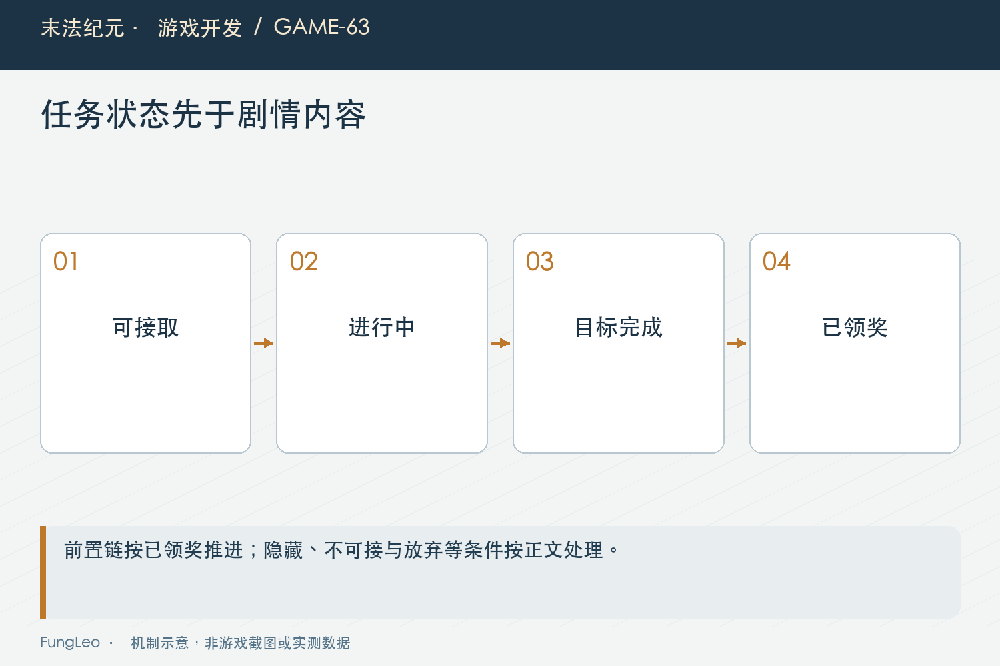
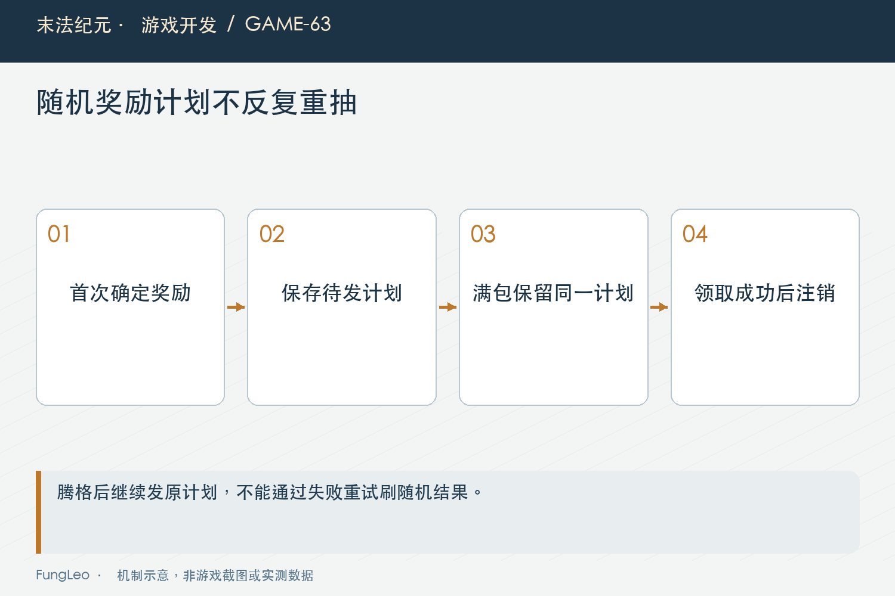

# 末法纪元·游戏开发63：任务系统，先画状态再填剧情

> 本文回顾《末法纪元》的开发过程，技术描述以 2026 年 11 月 5 日审阅快照为准。封面为主题插画，内文图为机制示意。

### 前言

各位看官，写一个任务，最先想到的通常是人物和对白：谁让玩家去打怪，回来以后说什么，再给一把什么武器。

可真正把程序写起来，问题很快变成另一种样子。怪打够了是不是已经结束？奖励装不下怎么办？玩家退出再进，还能不能领？后续任务究竟在击杀以后开放，还是领奖以后开放？

《末法纪元》的任务系统先把这些状态拆开，再往里面填内容。本文从任务推进与发奖边界出发，聊聊一段剧情怎样成为可以保存、失败重试和继续扩展的游戏流程。


### 完成目标，与领取奖励不是一回事

当前任务有锁定、可接、进行中、目标完成、已领奖和放弃等状态。正常路线从前置条件成立，走到接取、推进、完成，最后交付领奖。

目标打够以后，只表示具备交付资格。金币、物品与解锁是否已经提交，是后面另一件事，不能用一个完成布尔值同时表示两种事实。

否则满包时会很难处理：先写完成，后续任务可能提前开放；不给完成，玩家又会觉得刚打过的怪白打了。把目标完成和已领奖分开，两边都能如实表达。

界面也应该说清当前需要做什么。进行中提示目标，完成后提示交付人，已领奖再显示后续线索，不能一直保留同一句“击败若干怪物”。

### 能推导的状态，不必全部保存

当前锁定和可接由前置任务链推导，存档主要记录玩家实际做过的事情。没有记录，不等于任务不存在，要继续读模板和前置状态。

下面是当前状态推导的末段，前面已经处理存档记录与无效模板：

```gdscript
var prev := String(tpl.get("prev", ""))
if prev.is_empty():
    return STATE_AVAILABLE
return STATE_AVAILABLE if state_of(prev) == STATE_REWARDED else STATE_LOCKED
```

注意这里要求前置已领奖，而不是前置刚达标。这样剧情交付和奖励解锁仍然处在明确节点，不会因为玩家最后一下击杀，就自动跳到下一段。

推导减少了一份需要同步的状态，但前置链必须合法。引用不存在、形成环路或者错误跨章，都应该在配置和链路检查中发现，不能指望界面打不开时再排查。

### 接取资格，要让提示与实际入口共用

NPC头顶亮了可接标记，点进去却因为等级不足被拒绝，会让玩家觉得提示在骗人。反过来，任务可以接，头顶一直没反应，也会漏掉引导。

当前接取条件由共用入口检查，包含状态、等级、活动任务数量，以及明确传入时的发布人和地图条件。界面查询资格，接取动作再执行校验。

这与第56篇《自动出售，为什么只能接在拾取入口》的业务门面相似：显示能够解释条件，实际动作仍须负责守住条件。按钮变亮本身不是一份永久有效的授权。

另外，可接与可交付不是同一种标记。NPC能打开任务面板，不表示他一定还有新任务，已经完成等待领奖，也属于可以处理的事项。



### 推进读事件，还要核对目标与范围

击杀和收集沿已有事件进入任务系统，不需要每帧遍历所有怪物，猜玩家最近做了什么。当前只给进行中的任务计数。

同一种怪可能出现在多张地图，因此目标类型与目标身份匹配以后，还要检查任务允许范围。否则回旧图随便杀一只，就可能推进当前章节的特定目标。

当前范围检查的核心如下：

```gdscript
var scope = tpl.get("mapScope", [])
if not (scope is Array) or (scope as Array).is_empty():
    return true
return (scope as Array).has(GameState.current_map)
```

空范围表示不限定，不是没有任何地方能推进。配置约定要写清，不能让内容作者靠尝试猜字段含义。

计数达到要求以后就停止增加，转入完成状态。重复事件不能让数字不断越界，也不应顺手把奖励发掉，推进与交付仍然分开。

### 对话任务，也需要明确触发时机

交谈任务看起来只有点一次NPC，但接取时是否立即达标、要找的是发布人还是另一个交付人，仍需要由规则表达。

如果界面一打开就发交谈事件，接取发生在事件之后，可能出现玩家已经聊过，却还得再点一次。反过来，先发事件再检查任务状态，也可能推进尚未接到的内容。

因此验收要走真实接取和交互顺序，不要只直接调用完成函数。剧情文字看起来连续，不代表业务事件的先后也自然正确。

放弃和重接同样如此。主线保护、支线重新计数与专用收集物清理各有范围，不能看到一个放弃按钮，就把所有任务和已开放门禁一起回收。

### 满包以后，奖励应该留在哪一层

交付时先检查完整奖励能否进入容器，再发金币和经验。当前会准备背包与仓库副本，用于试放奖励以及处理工具兑换。

第59篇《背包容量，也是一个经济参数》解释过整份预检。任务奖励有一件装备和几份附加物品时，不能装备先进去，药水放不下，然后返回失败让玩家重新点。

目标完成状态应保留，告诉玩家清理空间后再来。失败不能既让任务变成已领奖，又让背包缺少一半奖励。

这一步证明的是容量前置失败不产生半份奖励，不能仅凭副本就把整个发奖入口称为已经解决所有重入与磁盘故障。完整可靠性仍需沿事件和保存路径分别验证。



### 随机奖励，失败重试不能重新抽

如果每次交付都先生成随机装备，再检查容量，满包就成了反复重掷的按钮。玩家清理一格以前，奖励品质和词条可能已经换了很多次。

当前使用持久发奖计划，首次有效尝试抽定实例，以后复用同一身份和属性。即使暂时放不下，下一次面对的仍然是原来那件奖励。

第42篇《背包整理以后，程序怎么认出原来那件装备》的稳定身份在这里有了另一种用途：它不只是保证扣对材料，也保证发的是同一份资产。

计划属于待发状态，不代表奖励已经到账。它需要进入保存链，成功领取以后再清除；纯金币、经验或解锁没有物品计划时，也不必平白增加一份空记录。

### 已领奖以后，后续才接着开放

当前交付成功写入已领奖，再清掉待发计划并通知任务完成领取。正常再次请求，会因为状态不满足而拒绝，不应又发一遍物品。

章节门禁和永久工具发放也可能在这一阶段生效。要核对的是具体解锁键是否被存档接受，而不是只看运行时某个字典里曾经出现过真值。

第62篇《随身商店和铁匠，怎样复用NPC服务》讲过工具补领，已发放事实与实际持有不同。任务一旦完成，缺失恢复应由明确机制负责，不能把整条任务倒退回来再领一次全部奖励。

后续任务引导则读取真实发布人和地图。状态正确却不知道下一步去哪，技术上能继续，体验上仍然像断线。

### 保存需要同时保住进度与待发结果

仅保存任务状态不够。专用收集物、随机奖励计划与已提交解锁，都可能影响重新读取以后还能否继续。

迁移旧档时，也不能因为某个新字段缺失，就把玩家所有任务清零。缺省与非法数据需要按各自策略处理，不能用一个大范围重置掩盖问题。

更重要的是检验交付前后两个快照。完成未领奖时读取，应恢复交付资格与原奖励；已领奖以后读取，应保留成长和解锁，并拒绝重复领取。

不要拿只包含任务ID和状态的教学字典，就宣称完整存档兼容已经解决。它只是状态结构示例，真实恢复还有其他相关事实。

### 验证沿状态转换走，而不是只背一段对白

后续可以从状态、计划与已有回归检查：

```sh
rg -n 'state_of|_reward_plan|quest_reward_plans|STATE_REWARDED' scripts/systems/quest.gd
python3 tools/run_isolated_tests.py QuestRewardPlanTest QuestReacceptUiTest ChapterSixQuestsTest
```

本文没有运行游戏测试。应覆盖前置达标但未领奖、错误NPC、范围外事件、满包失败、同奖励重试、保存重读，以及成功后再次请求。

还应检查现实操作顺序：对话、接取、完成、回交、关闭窗口、再打开。直接设置状态可以隔离某条分支，却不能证明正常流程真的有路走到那里。

### 小结

任务系统先回答玩家处在哪个阶段，再解释这一阶段能做什么。目标完成、奖励计划与正式领取分开，剧情才能安全跨过满包、切图和读档。

对白让任务有内容，状态与交接让内容能可靠发生。先把这张流程图画清楚，后面增加章节时，才不是每多一段故事就重新发明一次领奖规则。

### 相关内容

- 第42篇《背包整理以后，程序怎么认出原来那件装备》
- 第59篇《背包容量，也是一个经济参数》
- 第62篇《随身商店和铁匠，怎样复用NPC服务》
