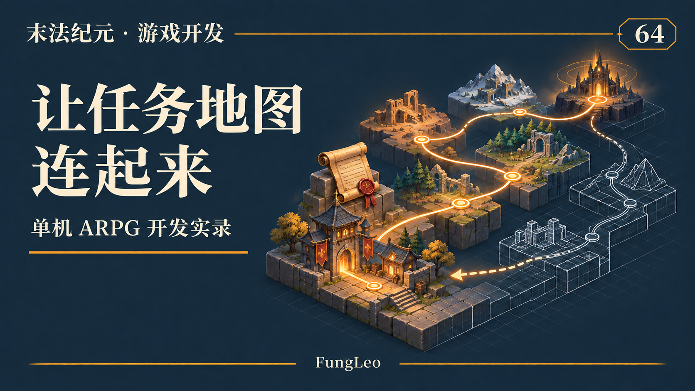
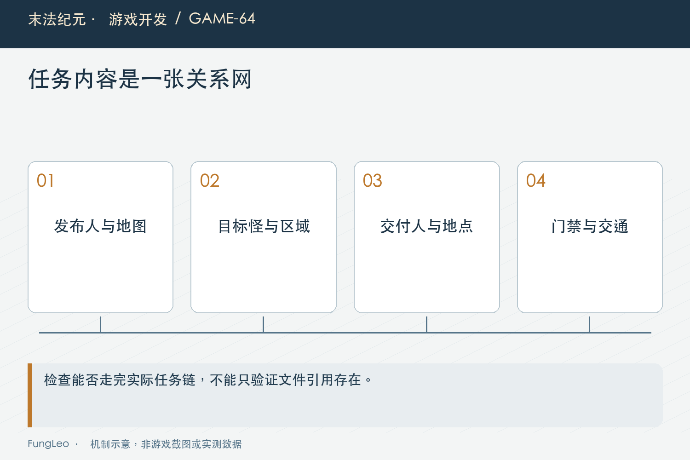
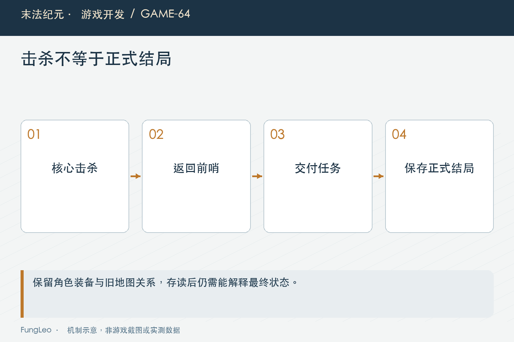

# 末法纪元·游戏开发64：六章内容，怎样避免任务和地图脱节

> 本文回顾《末法纪元》的开发过程，技术描述以 2026 年 11 月 5 日审阅快照为准。封面为主题插画，内文图为机制示意。

### 前言

各位看官，一章里几张图、十几个任务，分开看都没问题。等六章接起来，却可能出现下一位NPC找不到、任务要杀的怪不在允许范围、刚开了门却回不去领奖的情况。

这些问题往往不在某一段复杂算法里，而在两份正确数据之间少了一条真实联系。剧情写了前往下一城，地图出口却还指向旧位置，玩家就被留在半路。

《末法纪元》扩展后续章节时，把任务、地图、交通和结局一起验收。本篇继续沿这张关系网，聊聊内容越多，怎样避免游戏只是很多份能通过校验的文件。



### 内容清单，不等于玩家路线

列出六张地图、若干怪物和一组任务，只能说明资源准备了什么。玩家怎样从起点走到终点，需要另一张路线图。

路线里应标出接任务、进入目标图、通过门禁、达成目标、回交和获得下一步线索。每一次跨地图，都要有真实出口或已允许的交通方式。

第12篇《地图越来越多，为什么拆成一图一目录》讲过地图目录，目录组织能让维护者找得到配置，却不会自动保证剧情路线走得通。内容管理与玩法连通要分别检查。

尤其旧工程文档还使用过总表路径，当前地图已拆目录。复盘应保留当时设计背景，但检查入口要跟着现行结构走，不能让读者去找一个已经被替代的文件。

### 前置链的两端，都要连到真实世界

任务的前置ID合法，只证明能够找到上一条记录。发布人、交付人、目标怪与范围还需要映射到地图里的实际对象。

同名NPC不是稳定依据，地图里有没有对应身份、他站在哪张图，以及交付时是否仍然可达，都要沿引用检查。

第63篇《任务系统，先画状态再填剧情》讲过任务状态，前置已领奖以后开放下一条。但下一条如果指向只存在于对白中的人物，状态正确也无法继续。

因此审阅不止查字段存在，还要问它能否在世界中被找到。任务目标怪有模板，却没有在允许地图安排刷新，同样属于内容链断口，而不是任务计数器的问题。

### 地图范围，与目标来源一起核对

击杀、收集和交谈使用不同推进来源，范围核对也不能只做一份机械字符串比较。

击杀任务要检查怪物确实能在范围内出现；收集若依赖特定来源怪，需要核对其任务物品路径；交谈则要保证目标NPC所在地图被允许。

如果目标怪在两张图出现，范围可以刻意限制，但必须能解释。不能因为复制任务卡时忘改地图，导致一场正常击杀始终不计数。

这类问题适合建立交叉清单，再配一条真实事件验证。静态引用证明某个对象存在，事件推进证明它以当前身份和地图上下文进入了任务系统，两份证据互相补充。



### 门禁只锁正向，别把领奖路线也锁住

章节推进常用领奖解锁后续道路。当前后续章节的设计强调返回边不锁，让玩家能够回到枢纽和旧内容。

如果一扇门既挡前进又挡返回，玩家在目标完成以后，可能被困在交付人外面。单独测门禁开关都正确，整条流程却形成死锁。

交通也不能成为绕过门禁的暗道。未满足条件时，车夫或快捷旅行不应直接把玩家送到尚未开放的目标区域。

所以需要同时核对步行边、目的地资格和落点，不能只检查地图出口。交通是另一条可达路径，复用地图身份也不代表自动继承所有剧情条件。

### 下一步线索，要从当前主线状态推导

玩家领完章节奖励，下一条任务可能在另一张地图。若界面只把旧目标删掉，没有新的方向，玩家会觉得主线突然结束。

当前下一主线线索会找到可继续的任务，并解析发布人地图。下面是实际生成线索的一段节选：

```gdscript
var giver := String(entry.get("giver", ""))
var map_id := MapService.map_for_npc(giver)
if map_id.is_empty():
    continue
entry["giverMap"] = map_id
```

这一行本身很简单，前提却是任务选择与NPC地图定位都成立。不能只把一个地图名写进提示，就认为跨章引导已经完整。

提示应告诉玩家去哪张图、找谁，而不是把内部ID直接摆出来。若人物在任务面板、地图与头顶标记中名字不一致，引用虽然没断，理解成本仍然很高。

### Boss倒下，仍然不是正式结局

第六章把核心击杀、回前哨确认和正式结局分成不同节点。击杀完成战斗目标，回交流程再提交剧情和唯一奖励。

这样人物成长与章节结束有明确交接，也给玩家一次回看故事的机会。不能在Boss死亡回调里顺手写结局标记，让后面的任务对白变成事后补手续。

对应地，玩家在击杀以后退出，重新进入应恢复目标完成但未正式结局；领奖以后再读档，则不能倒退，也不能重复拿终章奖励。

第54篇《Boss死了换张图，墓碑为什么没了》讲过世界状态与地图节点。终章Boss节点释放，不表示结局状态消失；结局状态存在，也不需要让旧Boss节点永远常驻。



### 结局以后，不把角色成长一起清掉

当前设计保留等级、装备和财富，旧图与支线仍可访问。正式剧情结束与存档重开，是两种完全不同的产品行为。

回信只在首次结局展示，常驻NPC对白可以重读。一次性表现与可反复访问内容也要分别保存含义，不能用每次进城都弹一遍来弥补状态不清。

更晚加入的循环地图和随身任务，又会依赖主线完成事实。早期规划曾把结局后扩展留到以后，今天不能照着旧的“不新增第七章”写成当前内容上限。

第60篇《打金、刷装、单王挑战，为何分地图》已经讨论循环地图。这正说明完成标记是内容之间的接口，新增后续玩法时可以读取它，不必把原来的结局流程重新拆掉。

### 运行时开了门，还要确认存得下来

历史整链验证特别检查了解锁字段的保存契约。某个单数字段在交付代码里能生效，并不表示存档白名单也接受同一种写法。

如果只验收当场能走出去，玩家退出再进才发现门关了，或者存档被拒绝，整章仍然不能算交付。

因此关键节点要做保存往返：领取奖励、收集状态，交给实际存档校验，再恢复运行态，检查章门禁与结局仍在。

这不是要求每个对白字句都跑一次完整存档，而是把跨章依赖的关键事实选出来。它们承担后续可达性，比某一帧文字是否显示更需要持久证据。

### 整链测试很有用，也有自己的边界

当前CampaignChainTest会沿前置链推进后续章节，检查发布人和交付人存在，逐节点接取与领取，并在结局后做保存恢复。

但它为了聚焦链路，会模拟目标完成，并清理测试背包避免奖励占满。这能证明任务关系和交付流程，不能证明玩家真的沿路线走过所有地形，或在正常掉落下从不满包。

如果把这项通过写成全剧情自动通关，就夸大了证据。实际移动需要路线测试，战斗目标需要对应章节用例，满包发奖由专门奖励计划测试覆盖。

这种分工反而让测试更可靠。每个用例把自己的前提说清楚，最终组合起来审视完整流程，比一段不知做了多少作弊设置的长脚本更容易判断。

### 把晚接任务和旧图回访放进验收

玩家不会永远严格按攻略走。提前击杀Boss、暂时不交任务、先回旧图补支线，都会暴露章节之间的隐藏假设。

刷新与任务计数不能互相卡死，放弃支线也不该回收已经正式获得的章门禁。主线推进让支线从锁定变可接，属于推导状态变化，不等于程序擅自替玩家写了支线进度。

内容验收还应保留这些差异。检查存档时只比较某个状态字符串，会把正常推导误认为副作用；只看总任务数，又抓不到一条支线被错误自动完成。

### 用不同层次的入口交叉复核

后续可以先查任务与地图引用，再运行定向场景：

```sh
python3 tools/check_map_catalog.py
python3 tools/run_isolated_tests.py CampaignChainTest ChapterSixRoutesTest ChapterSixQuestsTest QuestRewardPlanTest
```

本文没有执行这些命令。历史审阅结论也只适用于当时记录的代码与数据基线，发布前如果任务或交通已变，应重新沿关键关系核对。

文档里的数量用于说明当时章节规模，不当作当前所有支线的精确总数。随着后期任务继续增加，稳定身份、前置关系和可达路线比静态清单数字更重要。

### 小结

任务与地图对齐，需要同时看到状态链、真实对象、交通边和持久解锁。每一份配置合法，只是开始；玩家能接、能做、能回交，退出以后还能继续，才是一条可靠路线。

章节扩展越多，越要把这些接口写清楚。故事可以各有风格，跨章的工程约定应尽量一致，让新内容接进来，而不是让旧内容跟着不断重写。

### 相关内容

- 第12篇《地图越来越多，为什么拆成一图一目录》
- 第60篇《打金、刷装、单王挑战，为何分地图》
- 第63篇《任务系统，先画状态再填剧情》
