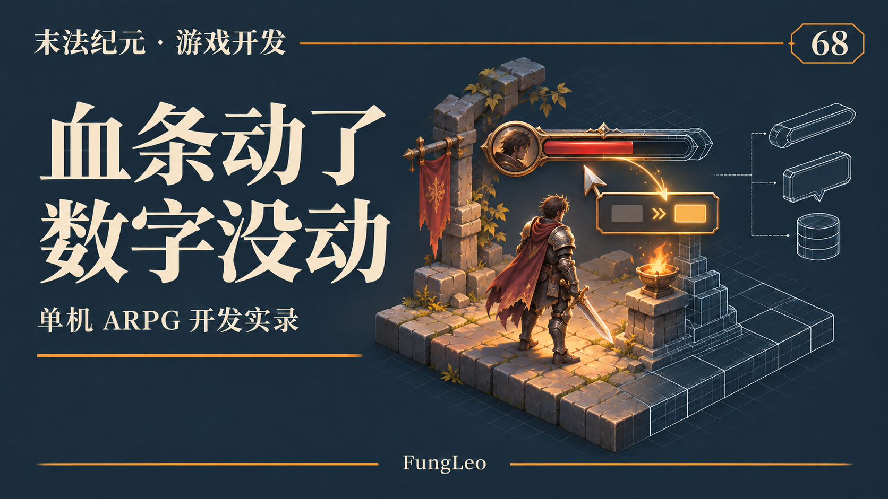
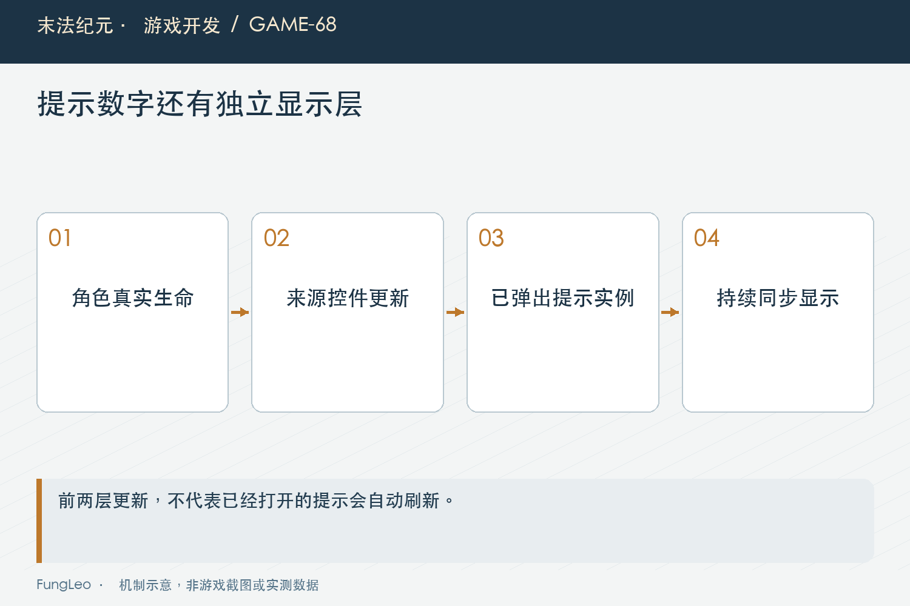
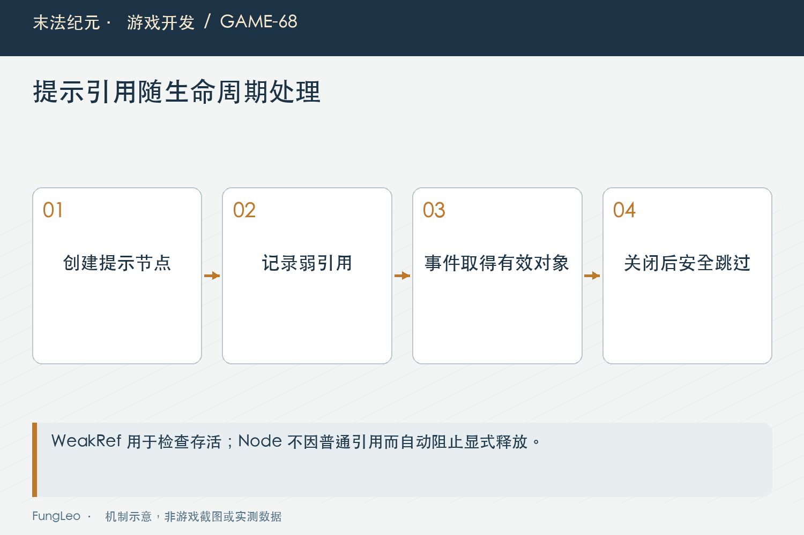

# 末法纪元·游戏开发68：悬停数字，为什么不跟血条更新

> 本文回顾《末法纪元》的开发过程，技术描述以 2026 年 11 月 5 日审阅快照为准。封面为主题插画，内文图为机制示意。

### 前言

各位看官，把鼠标停在血条上，提示显示当前生命与上限。怪物打了一下，血条缩短了，提示却没变；移开再放回来，数字又对了。

如果只听前半句，很容易去查伤害结算或生命事件。如果只听后半句，又可能说这是引擎提示的刷新习惯，让玩家重新悬停就行。

《末法纪元》后来把血蓝和经验的持续悬停提示接到了已有事件链。本文沿这个很小的显示问题，讲讲来源控件更新以后，为什么屏幕上已经存在的另一份内容仍然可能过期。



### 先看三份数据，别急着怀疑战斗

这里至少有三层：角色真实生命、血条控件的值、已经弹出来的提示文字。血条正确变化，说明前两层很可能已经正常收到更新。

再把鼠标移开重进，提示读到新值，也说明来源控件上保存的提示内容未必有问题。真正停在旧状态的，是先前已经创建的显示节点。

这种对照能大幅缩小排查范围。若角色真实生命没变，沿战斗查；真实值变了、血条没变，沿事件订阅查；只有持续提示不变，则沿提示实例的生命周期查。

第29篇《一次攻击，到底在哪一步算伤害》讲过结算链，本篇不重新计算伤害。一个显示端故障，不应该为了让文字对上而改动真实生命，更不能另建一份看起来正确的假数值。

### 更新来源文本，不等于重建已经打开的提示

原HUD收到生命、法力和经验事件时，本来就会更新进度以及tooltip_text。因此多广播一次相同事件，不一定解决问题。

在项目当时的提示路径里，已经弹出的原生提示拥有自己的显示内容，来源属性改变不会让现存节点自动重新生成。两份内容在弹出时相同，之后却走上了不同更新路径。

这不是一句所有提示永远不刷新的通用结论，而是针对当时引擎、控件和实际实现找到的断口。写复盘应说清哪个显示对象没接上，不能把原因扩大成整个UI系统都失效。

如果每次生命变化都强制关闭再打开，数字也许能更新，但会带来闪烁、等待时间重新开始和鼠标交互变化，未必是合适的修复。

### 保留轻量显示节点，沿现有事件同步

当前血蓝条通过自定义提示创建一个面板和文字节点，再保留文字的弱引用。HUD写入最新值时，控件直接刷新仍然存在的文字。

下面是实际创建末段，前面已经准备好样式和字号：

```gdscript
panel.add_child(label)
_live_tooltip_label = weakref(label)
_refresh_live_tooltip()
return panel
```

提示依然只是显示对象，不持有角色状态，也不参与生命计算。真实数值继续由GameState负责，HUD负责把事件结果写入控件。

这样修改集中在断掉的一层：让已经显示的内容收到更新，而不是在每个伤害、回血、药品与技能入口各补一段提示逻辑。



### 为什么用弱引用，而不是一直保存节点

提示关闭以后，由原来的界面生命周期释放。这里的Label继承Node，并不是靠引用计数决定寿命的RefCounted；普通变量持有它，也挡不住queue_free释放节点。因此，本例使用弱引用的重点，是在更新时安全取得仍然存在的对象，避免把新数据写向已经释放的提示。

当前刷新先取弱引用指向的现存Label，取不到就返回：

```gdscript
var label := _live_tooltip_label.get_ref() as Label if _live_tooltip_label != null else null
if label == null:
    return
```

没有提示时，不需要为了同步新数字再创建一个隐藏窗口。下一次正常悬停会按最新状态建立内容，避免把暂时显示变成长期缓存。

弱引用也不是所有生命周期问题的万能解法。创建方、关闭方与更新方仍要明确：提示由界面负责释放，来源控件只尝试同步仍然有效的显示对象。至于避免循环引用导致引用计数对象无法回收，那是RefCounted的另一类问题，不能拿来解释本例中的Node释放。

这两个语义可以对照Godot官方的[Node说明](https://docs.godotengine.org/en/stable/classes/class_node.html)和[WeakRef说明](https://docs.godotengine.org/en/stable/classes/class_weakref.html)。记住get_ref在对象不存在时返回空值，就更容易理解这里为什么先检查再写文字。

### 当前值和上限，都需要进入显示更新

受伤改变当前生命，换装、升级或其他成长还可能改变上限。只更新分子不更新分母，数字会在另一种操作里再次过期。

血蓝条的属性写入会触发刷新，HUD沿事件把当前值和上限都交进去。显示还会重新绘制比例，但条形与提示仍是两种不同输出。

第45篇《升星与套装，怎样互相放大》讲过装备与套装影响，最终上限应来自统一属性入口，提示不在本地根据装备再算一遍。

连续写入多个属性时，中间可能短暂经历旧值与新上限组合。当前工作规模很小，最终同一同步更新完成后应一致；如果以后引入昂贵格式化，再考虑合并，不能先为小问题建立一套复杂刷新框架。

### 经验条为什么后来又出现同样问题

血蓝修好以后，底部经验条仍然使用普通进度条，没有进入持续提示同步机制。因此获得经验时，条在走，浮动数字却还是弹出时的内容。

这说明相似外观不代表共享实现。看见血蓝提示正常，不能推断HUD里所有资源条都已经具备同样能力。

当前经验条使用自己的轻量提示控件，HUD处理经验事件以后先更新值、上限和来源文字，再调用同步：

```gdscript
_exp_bar.refresh_live_tooltip()
```

这一调用依赖前面的完整写入顺序，不能只加一个函数名却忘记更新来源文本。真正复用的是事件刷新与弱引用的模式，不必把不同资源条的所有绘制代码强行合成一类。



### 升级时，进度归零不代表数字应该停住

经验跨级会结转，新等级需要的经验上限也会变化。提示应同时反映当前余量与新的需求，不能只把旧经验不断加上去。

第61篇《毕业材料越积越多，怎么设计消耗出口》讲过多种经验来源，它们最后沿统一经验入口结算，HUD不必知道这次来自击杀、献祭还是仓库兑换。

因此测试不应只增加一点经验，还要跨过等级边界。一次更新当前值的用例，很容易遗漏分母变化和升级后的结转。

关闭提示再增加经验，随后重新打开，也要显示最新内容。持续更新与再次创建是两个路径，都需要正确，不能修好其中一条又破坏另一条。

### 没有必要为一个数字每帧轮询

生命、法力与经验本来就有事件，沿它们同步少量文字即可。新增每帧读取角色、重建提示，只会制造不必要工作和更多释放机会。

当前每次数值事件更新常数规模内容，提示活动时持有很少节点，没有新增存档字段。它解决的是显示同步，不是另建一个长期业务缓存。

如果事件频率很高，仍可以观察文字设置是否带来布局负担，但不能因为担心假设中的性能风险，先把提示降到很慢的固定轮询，让玩家再次看见旧数字。

第55篇《满背包，不是异常情况》讲过减少无意义重复工作，原则在这里一样：先复用已有变化依据，再评估真正需要更新的最小范围。

### 字号与位置，属于另一份验收

第67篇《高分屏，不是把所有控件乘一个数》解释过提示可能不在普通UI画布缩放链里，文字需要按它实际所在层应用倍率。

因此数字实时正确以后，还要检查高倍率、屏幕边缘与长数值，确认提示不出屏、不遮住关键位置，血量变大时也能容纳完整文本。

这类视觉验证不能仅靠字符串相等。相反，一张显示新数字的截图，也不能证明鼠标不动时确实实时更新，因为它可能刚好是在重新悬停后拍的。

需要把数据证据和视觉证据分别收集，再说明各自支持的结论。界面问题经常发生在两者交界，单看一种结果很容易过早宣布完成。

### 保持提示存活，再注入真实业务事件

后续可以沿控件与定向测试复核：

```sh
rg -n 'live_tooltip|refresh_live_tooltip' scripts/ui/hud_status_bar.gd scripts/ui/hud_experience_bar.gd scripts/ui/hud.gd
python3 tools/run_isolated_tests.py HudLiveTooltipTest SmokeTest
```

本文没有运行游戏测试。现有定向用例装配正式HUD，保留提示节点，调用受伤、回血、耗蓝、回蓝与经验入口，再比较同一个文字节点。

它直接创建自定义提示，验证的是节点与真实事件链，并没有代替操作系统窗口里的鼠标悬停延迟、位置与外观验收。把这个前提写清楚，比笼统说真实悬停全部通过更准确。

还应在释放提示以后继续发事件，检查不会访问失效节点；重新创建时再核对最新值。这一步能证明修复不仅会更新，也能正确结束。

### 小结

血条更新而悬停数字不变，原因可能是已经打开的显示实例没有进入后续事件链。找清角色状态、来源控件与提示节点三层，才能修在真正断掉的位置。

沿已有事件更新活着的提示，关闭以后释放，再次打开读取新值。一个很小的数字，也需要明确的数据来源、更新时机与生命周期，这正是第七卷这些交互问题共同的底层功课。

### 相关内容

- 第45篇《升星与套装，怎样互相放大》
- 第61篇《毕业材料越积越多，怎么设计消耗出口》
- 第67篇《高分屏，不是把所有控件乘一个数》
