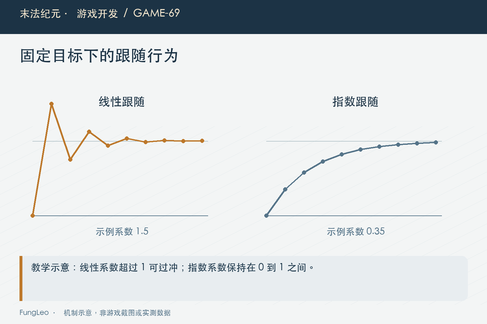
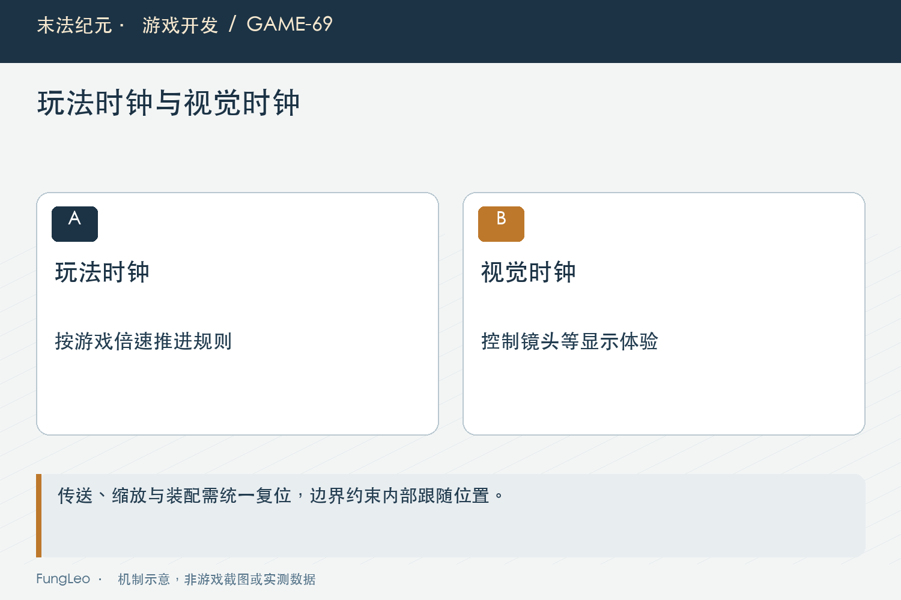

# 末法纪元·游戏开发69：倍速一开，镜头为什么越跟越晃

> 本文回顾《末法纪元》的开发过程，技术描述以 2026 年 11 月 5 日审阅快照为准。封面为主题插画，内文图为机制示意。

### 前言

各位看官，人物明明站在一小块地方，镜头却在地图两边来回跳。把倍速调低，晃动减轻；怪物和掉落一多，镜头又像追不上人一样越甩越远。

直觉很容易指向击退、寻路或者Boss震屏。但《末法纪元》这次问题最后定位到相机平滑：玩法时间被放大以后，原来的跟随系数可能越过稳定范围。

第八卷从这里开始。咱们先不急着换架构，用隔离对照把“人动了”和“镜头自己发散了”区分开，再看稳定跟随还需要哪些恢复边界。


### 看到了地图外，不代表角色越界

现场画面里出现地图边缘，第一反应通常是人物被击退穿出去了。但镜头位置、人物位置与实际通行坐标，是三份不同信息。

历史排查先检查玩家移动、击退和相机调用，没有找到足以解释数千像素跳动的正常位移，再用固定目标的最小场景复现镜头往返。

这一步排除了自动找怪和复杂Boss动作作为必要条件。它们可能增加负载、改变目标，却不是让镜头发散必须存在的环节。

第40篇《地上的攻击范围，为什么不能直接画个圆》讲过等距空间，地图菱形的矩形包围盒还会留下角落空白。有限位不等于视口永远只显示可走地面，也不能据此直接判断角色碰撞失败。

### 线性追赶，系数不是越大越快越好

当时项目使用的原生平滑行为，可用下面的教学递推说明。它来自工程记录中的源码核对与隔离验证，不是本轮重新测量引擎：

```text
c = 平滑速度 × 本次时间步长
新位置 = 旧位置 + (目标位置 - 旧位置) × c
```

系数在零到一之间，朝目标单调靠近；大于一会越过目标，但过冲还不等于发散。固定目标、固定系数时，一到二之间会左右交替并逐渐收敛；等于二时误差等幅往返；超过二才会越纠正偏差越大。

这是误差每步乘以一减系数的结果。真实运行的步长会变化，目标也在移动，所以这些条件用于解释机制，不能把现场任何一次抖动都直接判成持续发散。

因此把平滑速度调得更高，不一定能缓解追不上，可能让过冲更明显。仅在最后把画面夹回边界，也没有修好内部持续增长的跟随状态。

固定目标情况下，误差每次乘一减系数，可以帮助判断收敛方向。但这是简化推导，不是把理论阈值直接当成用户现场帧率诊断工具。

### 倍速与大帧，为什么会叠加

玩法使用缩放时间，倍速会放大相关时间步长；卡顿又会拉长某次更新间隔，两者可能共同推高插值系数。

历史隔离试验固定目标只移动一百像素，不加载怪物、掉落和任务，再控制等效步长。镜头仍能出现过冲和持续往返，关闭原平滑的对照则稳定落位。

这个证据说明问题可以由相机自身路径触发，却不能证明真实玩家电脑恰好跑在某个帧率。受控等效步长与整机GPU性能是两件事。

倍速也不等于物理回调次数必然同比增加。第55篇《满背包，不是异常情况》已经拆过这种误解，分析时应分别记录倍率、实际间隔与更新次数。



### 视觉跟随，改用独立的真实时间

当前StableFollowCamera从单调微秒时钟获取真实间隔，不拿缩放delta直接驱动镜头，也不通过除以当前倍率倒推时间。

后者在零倍率、暂停切换和运行时改变倍率时，都要额外小心。独立时钟让镜头视觉有自己的时间依据，玩法移动、伤害和奖励仍沿原来的规则。

当前读取时间的节选如下：

```gdscript
var now := Time.get_ticks_usec()
var real_delta := maxf(0.0, (now - _last_usec) / 1000000.0)
_last_usec = now
advance_follow(real_delta)
```

这不是让暂停菜单里的镜头继续偷偷移动。真正暂停仍受节点处理模式约束，恢复以后再通过跟随步长上限控制第一次追赶。

### 指数跟随，把一步追赶限制在合理范围

当前系数使用指数形式，而不是速度直接乘时间步长：

```gdscript
var dt := clampf(real_delta, 0.0, MAX_REAL_STEP) if is_finite(real_delta) else 0.0
var alpha := 1.0 - exp(-FOLLOW_RATE * dt)
_follow_position = _bounded(_follow_position).lerp(_bounded(_target.global_position), alpha)
```

对于合法非负步长，系数不会因为这一帧更慢就无限变大。目标固定时，可以单调接近，不必先越过去再拉回来。

当前真实步长最多按零点一秒推进，这是长卡顿或暂停恢复后的视觉限制。它没有把游戏逻辑减速，也没有抹掉玩家已经发生的真实位移。

跟随有意保留一点滞后，明确传送则应立即复位。不能为了避免普通移动发散，把所有旅行都变成从旧图慢慢飞过去。

### 脱离父变换，但仍由玩家负责释放

相机仍挂在玩家节点下面，退出世界时跟着释放；同时开启顶层变换，避免父节点移动先带走相机，再叠一遍内部平滑。

所有权与变换继承不是同一个关系。脱离父变换，不等于另建一个全局相机单例，更不需要每次移动创建Tween。

每帧只做固定数量的时间、向量与指数计算，状态也很小。但说明工作量固定，只能表达算法成本，不能据此承诺整场战斗达到六十帧。

这类小组件的好处，是输入目标、内部位置与复位入口都明确，测试不用再猜引擎内部是否已经偷偷推进了一次。



### 约束内部位置，不只夹最终画面

当前跟随位置和目标都按视口、缩放与地图矩形边界约束。地图比视口小时居中处理，避免低端大于高端的反向夹取。

非有限内部状态也会在写入变换前检查，损坏时回到合法目标；异常时间步长不继续把NaN传播到整条画面链。

第67篇《高分屏，不是把所有控件乘一个数》说明缩放会改变可见空间，相机边界同样需要跟随当前zoom，不能继续用上一档视口范围。

不过地图仍然是原来的矩形限制，没有声称已经解决等距菱形边缘全部留白。修复范围越清楚，后面越不容易把另一种视觉问题误当成同一个回归。

### 传送、装配与缩放，共用明确复位

切图出生、随机传送和显示倍率变化以后，旧位置与旧时间基准都需要清掉。当前通过统一snap入口处理，普通相机仍保留原复位语义。

测试夹具也要跟着更新。如果脚本瞬间把人物挪到新位置，马上截图，却没有告诉新相机这是明确位移，截图可能还停在跟随过程里。

适配夹具应调用正式复位入口，保持原来的点击、通行和范围断言。不能为了测试通过，简单扩大命中范围，掩盖镜头根本没对齐目标。

固定取景的渲染基准则要防止跟随脚本反过来覆盖它的路线，这也是测量前提的一部分。

### 压力测试证明稳定，不等于证明流畅

历史窗口压力场景使用真实Boss与大量掉落，但冻结了玩家自动决策，只注入固定阶跃，并故意制造一次长停顿。

它能检查中心有限、方向单调、不过冲和退出后资源释放。它不是完整玩家挂机过程，也不代表一百Boss集中同屏是普通地图的日常负载。

记录还明确指出极端场景仍然很慢。因此应说镜头在低帧与倍速下不再发散，不能说修相机已经解决全部掉帧。

后续复核入口如下，本文未执行游戏测试或重新采样：

```sh
python3 tools/run_isolated_tests.py StableCameraTest CameraLifecycleTest
python3 tools/run_isolated_tests.py CameraStressTest --rendered
```

### 用同一条轨迹比较倍率

确定性验证可以给相机输入相同的真实时间序列和目标轨迹，再分别设置不同玩法倍率。若视觉层已经独立，固定输入下得到的位置应一致，而不是只比较最后都到了终点。

只看终点会漏掉中间剧烈过冲，因为一个来回晃动的镜头也可能最终停住。逐帧检查方向、误差与最大单步，更接近玩家实际感受，也能区分立即落位与平滑追赶这两种合法行为。

还需要单独测试退出。相机仍由玩家持有，世界释放以后不应留下目标引用、额外计时器或全局订阅。一次九十帧的轨迹正确，不能替代反复切图后的生命周期检查，这两类用例应该分别保留。

同样的测试前提要写进记录，避免以后换了目标轨迹或取样方式，还拿两份不同条件的数据直接比较。

### 小结

这次问题不是镜头追得不够用力，而是时间步长放大后，原来的追赶方式可能越修越远。

隔离人物与相机，再拆开玩法时间、视觉时间和明确复位，才能既保持平滑，也在卡顿、缩放与旅行后恢复。稳定是流畅的前提，但稳定修复与性能提升，仍然需要两份不同证据。

### 相关内容

- 第55篇《满背包，不是异常情况》
- 第67篇《高分屏，不是把所有控件乘一个数》
