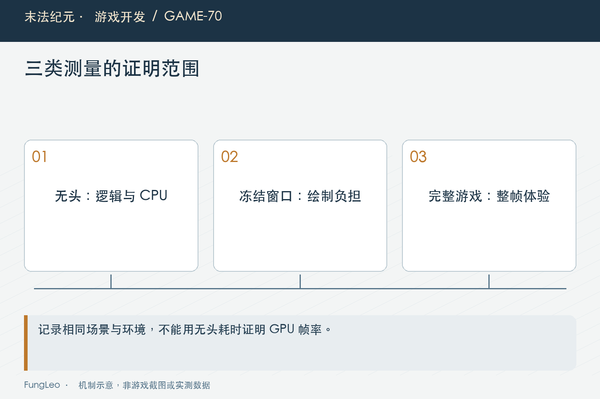

# 末法纪元·游戏开发70：大地图为什么卡，先测量再改架构

> 本文回顾《末法纪元》的开发过程，技术描述以 2026 年 11 月 5 日审阅快照为准。封面为主题插画，内文图为机制示意。

### 前言

各位看官，地图从几十格扩到几万格，游戏开始卡，最容易想到的答案是地图太大。接着就有人建议分块、换TileMap、上线程，甚至重做整套地形。

这些方案未必错，可它们解决的到底是哪一段工作？如果卡在首次巡游的几百次寻路，先重写绘制系统可能收效有限；如果脚本已经不重画，渲染已有命令仍然很贵，盯着脚本循环也不够。

《末法纪元》的大地图优化走过几轮分析与分阶段验证。这篇重点不在展示一个漂亮倍数，而在讲清怎样拆问题，避免在证据出现以前就把工程架构换掉。


### 先区分进图卡一下，还是走路一直卡

场景装配、首次巡游、探索新区域、小地图重建与稳定移动，并不在同一个时间点发生。用户一句卡，可能对应多种不同现象。

历史基准先单独量同步装配、投影、刷新检查和巡游构建。它能比较CPU入口，却没有覆盖首次真正绘制，更不是GPU或正式游玩帧率。

这项限制必须和数字一起写。否则一个函数减少九成耗时，很容易被读成整款游戏快了九倍，而它可能只在进图时调用一次。

第69篇《倍速一开，镜头为什么越跟越晃》已经区分稳定与流畅。性能诊断也一样，测量对象先明确，结论才有落脚处。

### 地图很大，不代表所有分支都逐格贴纹理

早期分析曾把不同地图的绘制路径混在一起。实际章节二与部分野外主题使用不同分支，有的是同色填充与阻挡几何，有的才是逐格纹理。

因此先沿当前地图ID和主题定位实际入口，再核算可行走格、阻挡格、碰撞形状与刷新点。总格数只是规模，不能直接推成每帧同样多次昂贵操作。

同样，刷新点很多，不代表全部都通过距离与解锁筛选；碰撞形状多，也不能仅凭数量断定稳定物理耗时最高。

这一步看起来像认真读代码，却能省掉后面大量无关改造。优化的对象应该是实际发生的工作，而不是从文件长度想象出来的负担。

### 小地图，先把底图和标记拆开

人物每走一点，玩家标记当然要移动；地形轮廓却没有因此变化。如果把它们画在同一个重绘入口，动态信息会反复带着整张底图重建。

当前MapCanvas把静态地形与动态标记分层，移动更新标记，地图、尺寸、探索和样式等相关变化再更新底图。

投影参数也按地图与尺寸准备，逐点只做必要变换，不再为每个顶点重复查世界边界和比例。

第20篇《一扇门打开以后，哪些缓存应该作废》讲过缓存失效，分层并没有让失效消失。探索变化、读档替换、缩放和隐藏后重开，都需要验证，否则省掉绘制的同时也可能留下过期地图。


### 探索区块，不能顺手泄露洞壁

按已经探索的区块组织几何，可以减少全图反复查询。但区块里面仍要核对可行走掩码，不能为了方便直接画一个实心方块。

否则玩家只走到区块边缘，旁边墙后的地形就被提前显示。性能改善变成玩法信息泄露，代价不应被一句近似处理掩盖。

测试应同时确认底图重建次数与画面内容。只断言调用少了，抓不到探索清空以后旧网格仍然存在；只看截图相似，也证明不了人物移动没有重做底图。

这里的架构收益不是用了缓存三个字，而是变化来源与更新范围重新对齐，读者照搬时也应该先找自己的失效事件。

### 刷新预算，一轮统计一次就够了

刷新器原来可能对每个候选再统计一遍活跃怪物，形成重复扫描。当前一轮准备局部预算，成功生成与退场在同一轮同步增减。

这比立刻维护一个跨所有事件的永久计数器简单，也不需要先给每个刷新点加长重试间隔。生成响应和墓碑到期仍沿原规则。

第54篇《Boss死了换张图，墓碑为什么没了》解释过墓碑不是怪物生成本身，优化刷新时不能因为预算满，就顺手把等待状态显示一起跳掉。

验证也不能只看最后数量没超。初始化、死亡补位、距离退场和外部释放，都要检查同轮预算正确，并保留独立生成调用的必要兜底。

### 只问可达，没必要先算完整路线

首次巡游需要筛选候选点是否能到达，旧路径却为每个候选执行完整寻路和平滑。几百个点集中在一个时刻，就形成明显尖峰。

当前用连通区域做可达筛选，真正选择移动目标以后再建立完整路线。两种问题拆开，原来的碰撞间隙与禁止穿墙仍然保留。

还要区分尚未构建与合法空结果。空列表若每帧都被当作没初始化，无路可走的场景反而会一直重复最重的准备。

连通数据后续移到装配阶段，是把工作从游玩移到加载，不是凭空消失。加载增加多少、首次操作减少多少，应分别记录，避免只展示收益不说代价。



### 绘制脚本缓存，不等于渲染调用已经合批

后面的真实窗口测量发现，脚本不再频繁重建以后，全探索地图仍有大量绘制调用。命令被缓存，只省了生成命令的脚本，不一定减少渲染工作。

于是同色静态格用三角网格合并，纹理地面再沿图集与网格处理，保留轮廓、顺序、网格线与透明边缘。

不能把这些阶段合并成一句“地图改成缓存就好了”。底图分层、投影缓存和几何合批分别消除不同成本，验证入口也不同。

同样，不能为了少碰撞对象就把不规则墙全包成大矩形。当前共享不可变形状资源，保留实体轮廓，几何正确性没有拿来交换速度。

### 反事实对照，帮助判断该先处理哪一层

历史渲染基准固定镜头路线，冻结主要玩法，分别隐藏地面、隐藏地图UI，与正常绘制比较。这样能看到不同显示层的相对负担。

为避免窗口遮挡后系统跳过绘制，基准还显式绘制并核对完成帧数。否则一个被遮住的窗口，可能制造极其漂亮却没有意义的帧时间。

但冻结玩法的诊断帧间隔，包含调度与限帧，不是独立GPU时间，也不是玩家边打怪边探索的最终FPS。

局部对照可以指导下一步，综合试玩还要把战斗、刷新和探索放回去。诊断工具主动简化世界，交付说明就要主动说出省略了哪些内容。

### 数字只在相同条件下比较

地图、探索程度、窗口、引擎、渲染后端和路线变了，都可能影响结果。美术同期更新时，装配总耗时也不能完全归因于某一段代码。

因此阶段记录既保留耗时，也保留上下文、行为断言与已知干扰。不要拿无头投影结果，去直接减实际窗口帧时间，拼出一个不存在的总收益。

复跑入口可以按问题分别选择：

```sh
python3 tools/run_isolated_tests.py MapPerformanceTest MapCanvasCacheTest SpawnerBudgetTest CaveConnectivityTest
python3 tools/run_isolated_tests.py MapRenderBenchmark --rendered
```

本文没有运行这些测试或重测历史基准。正文说明的是记录中的方法与现行架构，发布前若引用具体数字，应保留对应版本和测量条件。

### 架构重写，应该由剩余证据决定

经过分层、预算复用、连通筛选与合批，主要成本已经变化。最初建议的分块或其他方案，可能仍有价值，却不能因为写进过计划就必须实施。

每一阶段完成后重新观察，是为了让下一步由剩余问题决定。已经便宜的路径继续优化，可能只增加缓存与维护成本，对整帧没有明显帮助。

也要保留行为回归。缓存测试、路线测试与实际窗口各有范围，不能因为某张图快了，就放宽通行或探索断言，让错误一起被包进优化成果。

### 小结

大地图卡顿不是一个单一问题。先把装配、CPU准备、动态更新与实际绘制分开，再让每个阶段有相应证据，架构选择才不会变成猜测竞赛。

真正值得复用的，不是某个优化后的倍数，而是从局部测量、明确代价到综合复核的顺序。少做无关重写，也是一种重要的工程效率。

### 相关内容

- 第20篇《一扇门打开以后，哪些缓存应该作废》
- 第54篇《Boss死了换张图，墓碑为什么没了》
- 第69篇《倍速一开，镜头为什么越跟越晃》
