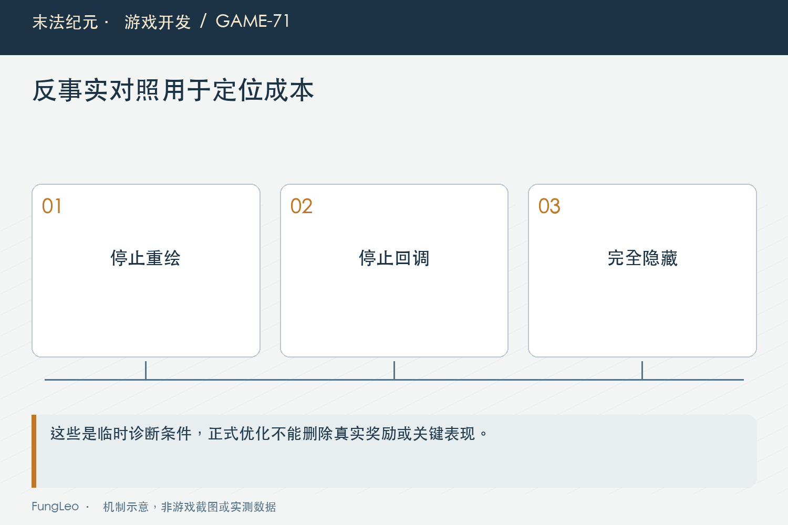
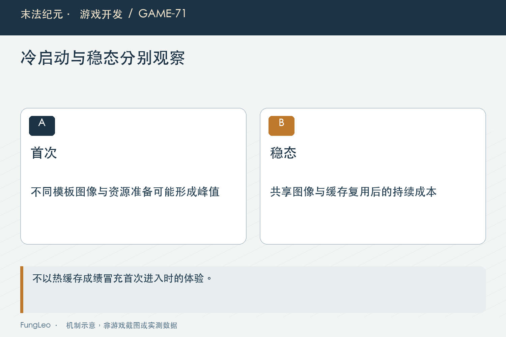

# 末法纪元·游戏开发71：2400件掉落，先优化绘制还是寻路

> 本文回顾《末法纪元》的开发过程，技术描述以 2026 年 11 月 5 日审阅快照为准。封面为主题插画，内文图为机制示意。

### 前言

各位看官，背包满了，地面上留着两千多件装备，再开倍速，游戏像幻灯片。听起来最可疑的是自动拾取：是不是每件装备都在找人、算距离、判断能不能进包？

《末法纪元》先处理了重复失败交易，倍速放大的额外工作减少了，但窗口仍然很慢。后续实际对照发现，密集地面装备的表现成本也不能忽略。

这篇专讲怎样从一个合理猜测，走到有条件的性能证据。真实奖励要保留，诊断时可以暂时关闭某些路径，但不能把诊断开关直接变成正式优化。


### 先消掉明确重复，再确认剩下什么

第55篇《满背包，不是异常情况》讲过失败版本缓存。同样条件下，满包物品不必不断进入交易入口，手动点击和状态恢复仍保留。

这项修改有直接的调用次数证据，却不能保证整帧已经足够快。一次失败交易很贵，与它占整个场景多少比例，需要分别测量。

历史窗口基准显示，第一阶段让倍速前后的差异缩小，但仍有明显卡顿。因此下一步不是继续凭直觉重做寻路，而是观察渲染、物理回调和可见物本身的相对负担。

局部优化有效与整体问题未解决可以同时成立。前一项没有白做，后一项也不能被已经通过的逻辑测试掩盖。

### 压力夹具，需要固定哪些东西

当时基准使用隔离项目、固定种子与实际窗口，指定地图、满包、掉落数量和同屏摆放方式，再冻结部分玩法，减少输入变化。

把玩家、怪物与刷新等冻结，是为了单独比较掉落，不代表正式游戏允许这样省工作。测试用的极端密集同屏，也不是每个玩家日常都会遇到的画面。

记录还要写预热、采样时长与真实帧间隔，不能拿游戏delta反推真实帧率，倍速下尤其容易算错。

第70篇《大地图为什么卡，先测量再改架构》说明过窗口遮挡可能影响测量。是否真正绘制、采了多少帧，都应进入证据，不能只有一列看起来很准确的毫秒数。

### 三种反事实，回答不同问题

历史探针先停止重绘但保留静态表现，再停止物品物理回调，最后完全隐藏掉落，观察帧间隔变化。

停止重绘后仍然贵，说明已经缓存的绘制命令和对象仍有成本；停止物理再改善，说明回调也有贡献；完全隐藏差异更大，则提示可见表现值得优先处理。

这些差值不能机械相加，称作独立CPU与GPU耗时。关闭一层会改变整体调度和渲染行为，插桩本身也可能有开销。

它们的用途是决定先往哪里继续找，不是给每个系统分一张精确百分比饼图。尤其不能据此说寻路完全没有成本，只能说这组夹具下另一个方向更值得优先验证。



### 正式优化，保留节点与真实奖励

后来对高密度静止装备引入共享图像，把重复的品质光柱、底座等表现预先绘出，再由原节点显示。

物品实例、点击区域与持久记录继续存在，认领飞行和保护动画仍沿原流程。渲染源节点不登记可拾取物或奖励，避免为了生成一张图片又发出一份掉落。

这与第53篇《掉落动画没飞完，奖励归谁》的表现与归属分离相接：可以复用视觉结果，不能把同模板装备合成同一个资产实例。

高密度时停止细小浮动、名称转为悬停显示，属于明确的表现取舍；不是隐藏关键物品，也不是减少奖励数量来换一张更快的图。

### 共享键，决定哪些图真的可以共用

同模板、同品质、同持久标记与同数据版本，才属于当前缓存里的同一种表现。仅按模板保存，会把不同品质的光效混起来。

数据重载需要清队列与旧图，节点还要识别表现依据变化。否则逻辑已经更新，地面仍显示旧颜色或旧标记，缓存正确性就失去了依据。

当前容量有界，超过可用组合时可退回原画法，而不是随便拿另一张代替。没有素材或没有可用窗口绘制条件，也保留原路径。

这种回退很重要。缓存是加速层，不能成为新内容是否能显示的唯一前提，更不能让无头逻辑测试因为没有GPU图像就无法验证物品业务。

### 单模板结果，为什么特别漂亮

第一组大量同模板装备，只需建立很少的共享图像，大部分对象很快进入复用。它适合确认这个方向有没有潜力，却是缓存有利场景。

后来补了十种模板、三种品质的混合持久掉落。稳定后同样改善明显，但首次图像建立持续更久，开始阶段仍然卡。

所以不能拿单模板稳定数据，宣传为任意两千四百件装备都达到同样帧率。模板组合、缓存命中、是否首次生成，都改变实际成本。

这也是压力样本要保留结构信息的原因。物品数量相同，只写两千四百，远远不足以说明两组负载可比。



### 缓存建立，也是一项真实工作

共享图片需要离屏绘制、裁透明区域和图像读回，第一次出现新组合仍可能有明显停顿。一次只生成一张，限制的是单次工作范围，不保证没有大帧。

如果预热两秒，缓存实际还在排队，接下来的采样就混合了准备与稳态。记录应该如实标出，不能把它叫稳定阶段，又在比较时只挑最好看的一段。

相反，缓存已经生成以后，也不该故意每轮清空，再宣称稳态优化没效果。冷启动与稳定运行是两个问题，分别保留入口才方便继续改进。

内存同样有代价。图像数量上限可以估算理论空间，真实裁切后大小与渲染资源占用还需观察，不能只报PNG文件体积。

### 没有混合旧基线，就别计算混合提升倍数

历史混合补测没有完全对应的旧版本基线，因此可以说当前稳定阶段是什么表现，不能声称这一组精确提升多少倍。

低帧版本采样时间短，实际只有很少帧，分位数也不够稳定。它能说明卡顿数量级，不能把每个P95小数点都当成可靠统计。

这类克制不是削弱成果，而是帮助读者判断下一步。需要更多样本，就增加合适采样；需要完整战斗，就把冻结的系统放回来，而不是用一种数据回答所有问题。

本轮文章没有重新运行这些基准，引用的是记录中的方法与边界，当前设备、引擎或美术变化后应重新建立对照。

### 像素一致与没有重复奖励，都要检查

共享图像可能在透明边缘、品质色和持久标记上出现差异，因此已有窗口用例把原画法与缓存画法作像素对照。

但图像一致不证明业务安全。还要检查没有多出来的拾取组节点，没有第二份持久记录，数据重载和退出后临时源视口及时释放。

正式拾取继续走原门面，悬停和点击仍能作用于正确实例。密集时看起来像一张统一画面，玩家选择的仍然是一件具体物品。

第42篇《背包整理以后，程序怎么认出原来那件装备》的稳定身份，在性能工作里同样不能丢。共享纹理是合理复用，共享可变实例则可能直接改变奖励归属。

### 后续优先级，随着证据继续调整

这个阶段暂缓了空间索引与更大规模调度，不是说它们永远无用，而是先处理了已经测到的主要表现问题。

后来完整Boss负载又暴露静止回调与地面技能成本，才继续推进下一步。下一篇讲静止物品怎样交给共享调度，避免每个物理步空转。

复核入口可以分开选择，本文未执行测试：

```sh
python3 tools/run_isolated_tests.py GroundLootVisualCacheTest LootBacklogBenchmark --rendered
python3 tools/run_isolated_tests.py LootRetryTest GroundLootPerfTest AutoSellPickupTest
```

第一组看实际绘制与缓存，第二组保住重试、拾取和交易语义。它们互相补充，不能拿其中一组通过就代替所有场景。

### 小结

两千四百件掉落慢，不能只凭数量就决定先改寻路。固定夹具、做反事实对照，再把正式实现与诊断停用分开，优化方向才有证据。

共享表现带来收益，也留下首次生成、混合组合与完整战斗的成本。把冷与热、局部与整体分别写清楚，下一阶段才能继续往真正剩下的问题走。

### 相关内容

- 第53篇《掉落动画没飞完，奖励归谁》
- 第55篇《满背包，不是异常情况》
- 第70篇《大地图为什么卡，先测量再改架构》
