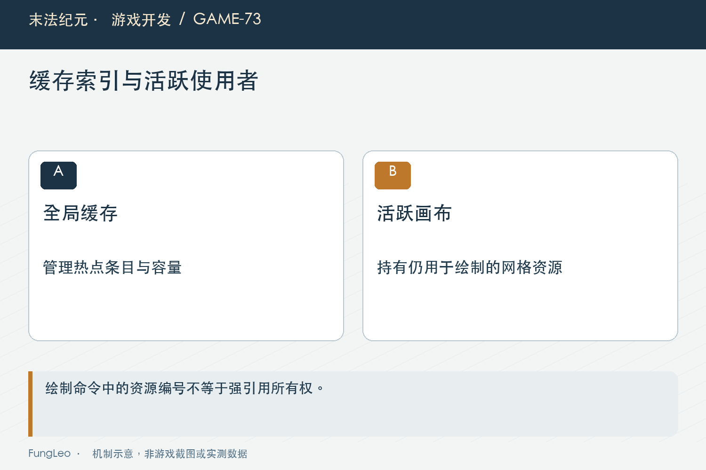
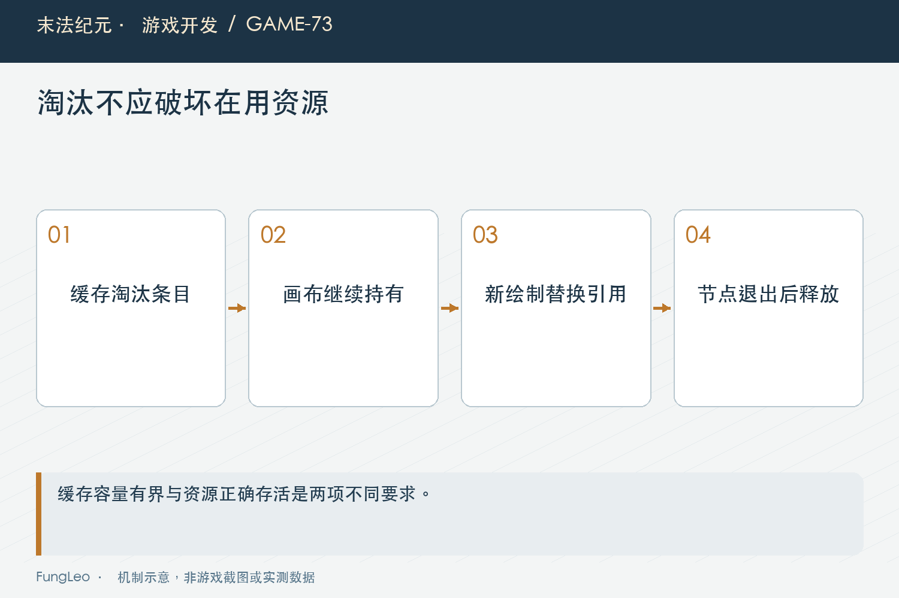

# 末法纪元·游戏开发73：缓存有上限，画面怎么还是消失了

> 本文回顾《末法纪元》的开发过程，技术描述以 2026 年 11 月 5 日审阅快照为准。封面为主题插画，内文图为机制示意。

### 前言

各位看官，扇形预警的点集和网格已经缓存，重复绘制便宜了。再加一个数量上限，超过就淘汰最旧项，内存看起来也受控了。

可实际窗口测试里，画好的静态扇形突然缺了一块，还出现网格为空的报告。缓存容量没有超，伤害规则也没改，问题到底出在哪里？

《末法纪元》这次补强，处理的是缓存管理与绘制资源所有权。对象从查找表里删掉，不表示它已经不被画面使用；一个资源编号还留在命令里，也不表示真实资源一定有人保着。


### 先说缓存省掉了什么

地面扇形按半径、张角、方向和段数生成点集，再三角化成网格。相同几何重复出现时，可以复用原点附近的不可变结果，位置和颜色每次传入。

圆和环带也有各自可复用部分。它们不需要保存某只Boss或某张地图节点，才能跨场景共享。

第40篇《地上的攻击范围，为什么不能直接画个圆》讲过地面投影，这里仍走GroundFx的统一空间规则，没有通过少画危险边界或减少精度换速度。

缓存解决重复准备，不保证首次组合零成本。创建和上传仍然存在，数量上限则解决另一件事：避免所有曾经见过的组合永远驻留。

### 淘汰规则，只说明不再从这里查到

当前扇形几何有固定容量，满了移出旧项；环带也有自己的有界缓存。它们控制的是全局复用表，不是整个渲染系统所有活跃资源。

如果某个旧网格还在一张静态画布上显示，它虽然不再属于热点集合，仍然有使用者。把缓存表当唯一所有者，淘汰时就可能释放还需要的资源。

这像图书馆把一本书从推荐目录移走，不意味着读者手里那本也应该突然变空白。查找资格与正在使用，是两个不同状态。

所以先问淘汰意味着什么：只是降低以后命中机会，还是同时取消当前使用？对于这个绘制缓存，后者显然不符合预期。

### 绘制命令保存编号，不等于保存强引用

历史窗口验证定位到CanvasItem绘制命令保留资源RID，而没有替当前脚本持有那份ArrayMesh强引用。

全局缓存移除最后一个拥有者以后，命令里的编号还在，真实网格却可能已经释放。没有再次执行绘制的静态画布，就继续引用一个失效资源。

这解释了为什么很多普通用例看起来没事：网格仍在缓存时，有人替它保着；持续重绘时，也可能很快重新取得资源。真正危险的是画一次、停在那里、随后别处制造大量新组合。

不能据此泛化成所有引擎资源句柄都一样。这里的结论来自当前路径和实际窗口故障，应针对具体API与所有权验证，不靠名称相似推断。



### 活跃画布，保留自己提交的网格

当前绘制前先让画布保留网格，再提交绘制：

```gdscript
var geometry := sector_geometry(dir,radius,arc_rad,segments)
_hold_mesh(canvas,geometry.mesh)
canvas.draw_mesh(geometry.mesh,null,Transform2D(0.0,center),color)
```

这份引用不改变几何，也不把节点写回全局缓存。它表达的是当前画布还有一组命令需要这些资源。

全局表可以继续按容量淘汰，其他对象也能继续生成新组合。静态画布则直到自己的引用被替换或节点释放，仍能保住所需网格。

规则层与渲染层的职责因此清楚：缓存负责复用，画布负责活跃使用的生命周期，不再让一个容器兼做两份承诺。

### 引用集合也不能只追加不结束

若每次绘制都往metadata数组里追加，虽然画面不丢了，却可能积累所有历史网格，等于绕开了缓存上限。

当前按绘制调用所在显示帧准备本轮引用，同一帧多个扇形继续加入，新帧再次调用时替换旧集合：

```gdscript
var frame := Engine.get_process_frames()
var refs: Array
if int(canvas.get_meta("ground_fx_mesh_frame",-1)) != frame:
    refs = []
    canvas.set_meta("ground_fx_mesh_frame",frame)
    canvas.set_meta("ground_fx_mesh_refs",refs)
else:
    refs = canvas.get_meta("ground_fx_mesh_refs")
refs.append(mesh)
```

注意静态画布没有新绘制调用时，引用不会因为时钟进入下一帧就自行清空。它仍然需要保留最后那批显示资源，这是刻意行为。

因此解释时不能简化成每帧都释放。真正边界是新的相关绘制替换持有集，或者画布本身结束生命周期。

### 全局有界，不代表全部驻留严格等于上限

修复以后，全局热点表仍有限，但活跃画布额外保留正在使用的网格。总驻留量会与实际绘制命令用量相关。

如果还宣称全进程最多只有缓存上限那么多网格，就是把两类所有者混在一起。正确说法应列出全局复用容量，以及每个活跃画布当前用量。

这不是无限制保留的借口。需要验证引用集合不会随重复绘制不断增长，节点释放后能退出，旧地图不会因为全局回指而留下。

第72篇《静止物品，为何还在每个物理步工作》的共享调度也一样，减少工作与控制所有权要同时考虑。只看某个数组长度小，不足以证明整个系统没有额外驻留。



### 环带缓存，也要检查同一类风险

发现扇形问题以后，不能只修复一条可见报错。Boss技能还有环带网格路径，它的缓存清理也可能影响已经提交的命令。

当前环带绘制复用同一持有保护。参数与上限可以不同，资源被命令使用这一事实却相同，适合沿调用关系检查同族问题。

但检查范围要有限依据。并不是全仓搜索到cache就一律加metadata强引用，纹理、数字点集与节点缓存可能有不同所有权。

先列谁创建、谁查找、谁提交、谁释放，再确定需要哪一种保护。盲目延长所有资源寿命，可能把一次画面消失修成长期内存增长。

### 只检查缓存长度，抓不到这次故障

纯逻辑用例可以证明第几项被淘汰，数量没有超过上限，但它未必真正提交渲染命令，更不一定显示一个静态旧画布。

历史补测故意画出旧网格，再生成超过容量的新组合，最后检查旧图像是否仍完整。最初像素丢失保留为原因证据，而不是删掉断言避开渲染差异。

这类用例需要真实绘制，并对照旧画法的形状。只断言没有报错也不够，资源可能不报异常却悄悄缺图。

第71篇《2400件掉落，先优化绘制还是寻路》讲过窗口对照，图像正确性与业务正确性都需要自己的证据。性能工作尤其不能只留下速度断言。

### 新旧图像一致，仍要检查伤害规则没变

网格缓存负责表现，不参与目标命中。扇形方向、投影与边界仍应沿同一几何来源，不能为了缓存键方便把角度取粗一档。

超过支持段数时，当前有原算法回退，保持精度。这样的回退比悄悄减段更可解释，也便于后续扩展规则。

验证还包括动作执行和危险区域，防止只看填充像素一致，却漏了描边或实际判定被另一次改动影响。

文章本轮没有重新运行窗口或战斗测试，描述的是工程记录中的补强与当前源码结构，不把旧快照全量通过冒充覆盖所有后续修改。

### 复核应同时观察数量与画面

可以从持有入口、扇形和环带测试开始：

```sh
rg -n '_hold_mesh|ground_fx_mesh_refs' scripts/systems/ground_fx.gd scripts/systems/boss_skill_visual.gd
python3 tools/run_isolated_tests.py GroundGeometryCacheTest --rendered
```

后续应覆盖超过容量、旧画布不重绘、同一画布连续多轮绘制和节点退出，分别检查像素与引用数量。

性能统计也别漏掉首次创建与上传。增加正确持有后，某些资源寿命变长是预期代价，应记录实际规模，而不是为了继续报最小内存数字又去掉必要引用。

跨地图复用也有同样边界。几何只含不可变数值，不保存地图节点，才适合留在全局；画布局部持有则随节点结束。若以后往缓存项加了宿主引用，就必须重新检查退出行为，不能继续沿用今天跨图安全的结论。

### 小结

缓存淘汰只决定未来复用，不应该破坏当前画面。资源句柄、脚本强引用与活跃绘制命令之间的关系，要由明确所有者承接。

全局表有界，画布保住当前使用，重画或释放时结束旧引用。把这份交接写清楚，缓存才能既省重复工作，又不在最需要静态稳定的时候把画面抽空。

### 相关内容

- 第40篇《地上的攻击范围，为什么不能直接画个圆》
- 第71篇《2400件掉落，先优化绘制还是寻路》
- 第72篇《静止物品，为何还在每个物理步工作》
