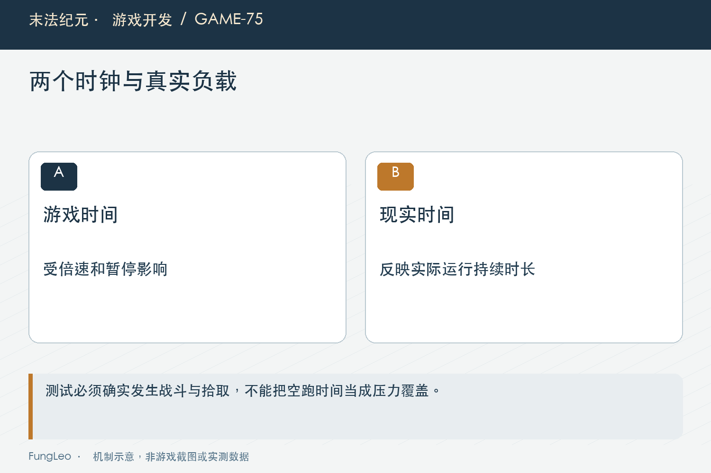
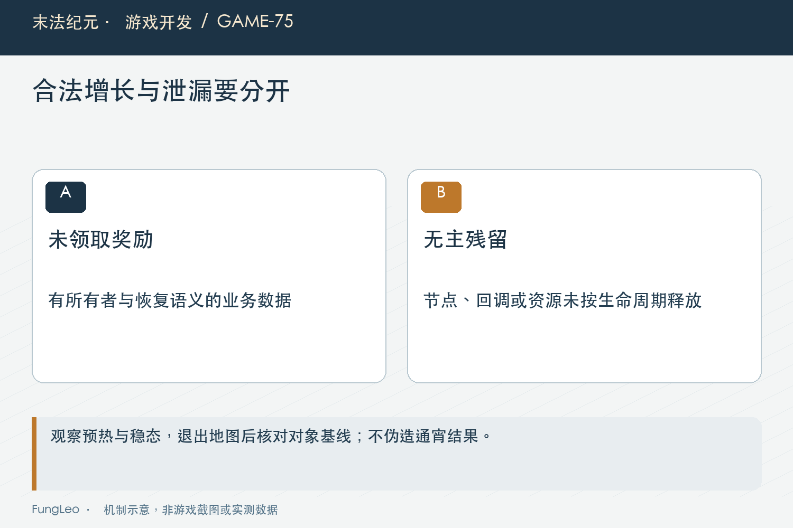

# 末法纪元·游戏开发75：挂机一晚还稳定，应该测些什么

> 本文回顾《末法纪元》的开发过程，技术描述以 2026 年 11 月 5 日审阅快照为准。封面为主题插画，内文图为机制示意。

### 前言

各位看官，游戏连续跑了十分钟，没有闪退，是不是就能说挂一晚上也没问题？如果人物早就死了，或者找不到怪一直站着，这十分钟又能证明什么？

《末法纪元》早期做过长时稳定性压测，后来又增加跨地图自动战斗与高负载流程检查。它们解决不同阶段的问题，时长、负载和统计口径不能混用。

这篇不是一份已经完成的通宵验收报告，而是沿现有工具与历史结果，梳理持续运行需要看什么。时间长只是条件之一，真实工作一直在发生，数据才有意义。


### 先证明测试没有变成空转

没有崩溃的进程，也可能已经停止正常玩法。挂机开关仍然为真，不代表人物在移动、接战、击杀或拾取。

当前跨图长跑会检查实际移动与击杀，运行中还断言角色存活、自动决策持续开启。统计从真实事件获得，而不是直接调用发奖函数凑数量。

这是稳定性测试最重要的负载证明。若一张地图十分钟只发出一次动作，内存曲线当然很平，却没有覆盖持续创建和释放的路径。

第72篇《静止物品，为何还在每个物理步工作》提到过短期流程检查，高生存角色也需要合适装备，避免其他规则让它只走路不击杀。夹具前提错误，应该修夹具而不是取消击杀断言。

### 游戏时间、现实时间与样本数量分别记录

当前AutoRoamSoakTest默认三张地图各推进六百游戏秒，允许固定步长加速。三十分钟游戏过程，不等于电脑真的持续运行了三十分钟。

工具同时报告现实耗时与游戏秒，避免把加速回归写成真实长时间运行。它适合发现循环与生命周期问题，不能代替设备热起来以后的一晚窗口表现。

历史早期十分钟报告也有自己的时间与参数，不能把它与后来倍速夹具相加，拼成一个并不存在的长跑时长。

真正准备验收通宵，需要明确现实持续时长、采样间隔、倍率和完成条件。本文不提供新增长跑结果，也没有读取玩家正在用的档案。

### 哪个场景在跑，要写清楚

只装Game场景，可以覆盖地图、怪物、寻路与拾取；正式Main还包含HUD、面板和其他UI。两者负载并不相同。

早期方案有交互脉冲，周期性开关窗口、接管移动和清包；后来的跨图用例则更聚焦实际世界循环。不能看到都叫Soak，就认为覆盖范围一样。

第74篇《耐久只变一点，为什么整个背包都刷新》说明隐藏面板也可能做重活，长跑若完全不装UI，就无法证明这条路径没有重复刷新。

同样，冻结刷新、无敌或注入高属性，是为了保证某类压力能持续；它们应写进夹具说明，不能用这种角色推断普通玩家的药品续航和经济收益。



### 节点增长，先判断是不是合法积累

背包满后，持久战利品会留地，节点和记录随击杀增长可能是玩法结果，而不是泄漏。缓存首次建立，也会带来阶段性上升。

如果不区分，测试可能把正确奖励判成泄漏；若为了曲线平稳定时删掉所有地面物，又可能把真正的积压问题遮住。

因此至少同时记录击杀、掉落、未领取数量、背包占用与节点数。合法奖励增长有业务对应，无主残留则缺少这样的解释。

第54篇《Boss死了换张图，墓碑为什么没了》的地图保全策略也已演变。历史审阅里曾提出的无上限风险，不代表今天仍然完全没有保护，更不能直接采用当年的候选建议修改当前奖励。

### 清包夹具与积压夹具，应该分开

为了看纯粹生命周期，测试可以模拟玩家定期出售，维持负载稳定；为了看满包积压，则应保留物品并观察保护和停战阈值。

两种场景都需要，但结论不同。第一种能发现一轮轮创建后有没有回收，第二种能发现数量变大以后保存、恢复和交互是否失控。

若使用自动回血或高生存属性，也应记录干预次数。它能让测试继续跑，不代表实际角色在相同时间里不用补给。

尤其不要在报告里只展示最终金币，省略期间主动清包、出售或注入资源的步骤。稳定性证据与经济证据应保持各自完整。

### 观察趋势，不只看最后一张快照

节点、对象、内存与帧时间需要连续采样。启动阶段加载资源上升很正常，后半段是否持续漂移，通常比第一帧与最后一帧差多少更有解释力。

峰值也不能丢。平均很平，首次开地图或自动保存却偶尔停顿很久，玩家仍然能感受到。

历史工具会避开部分预热再比较前后区间，但阈值属于对应场景的验收约定，不是所有游戏都适用的泄漏定律。

孤儿节点为零也不代表所有资源都已释放。对象可以仍在树里、被全局集合持有，或者合法存在却数量失控，因此需要多项指标互相解释。



### 跨图以后，应该回到怎样的基线

当前长跑在每张地图退出后等待必要帧，再比较节点数量与进入前基线。它能发现共享调度、规划任务或实体引用跨图残留。

实际断言节选如下：

```gdscript
world.queue_free()
await get_tree().process_frame
await get_tree().process_frame
assert(get_tree().get_node_count() <= baseline_nodes + 8, "退出地图应释放活动实体和分帧规划")
```

容差是这个夹具的约定，不代表任意多八个对象都合理。若以后新增长期服务，应解释它的所有者与数量，再决定是否调整基线。

第73篇《缓存有上限，画面怎么还是消失了》讲过活跃资源持有，合法缓存跨图复用与旧地图节点残留也不能混淆。数字变化必须能追到对应职责。

### 真实窗口，还需要确认一直在绘制

无头适合逻辑与CPU长跑，不能证明显卡、透明叠加和窗口管理没有问题。窗口跑一晚，又可能因最小化或遮挡改变负载。

因此记录窗口可见状态与实际绘制样本，区分正常游玩和强制绘制诊断。一个不再真正出图的窗口，不能用低帧时间证明渲染稳定。

测试并行也会影响结果。为了缩短回归时间可以并行逻辑用例，性能对照则应避免其他测试争抢资源，再说明机器和引擎条件。

短期固定窗口基准支持局部比较，通宵真实负载还要观察温度、内存、资源增长与操作恢复，不能用一个中位数代替全部体验。

### 保存与恢复，也属于长期循环

持续战斗会改变等级、金币、任务和未领取记录，自动保存会越来越接近真实大档案。只冻结资产数量的测试，覆盖不了保存规模增长。

需要在隔离目录验证保存失败反馈、切图恢复、重新启动，以及奖励数量和实例身份不重复。不能为了压测方便写进正式槽位。

早期工具曾使用备份真实目录再恢复的办法，当前仓库优先使用隔离运行器与独立用户路径。复用旧文档命令以前，必须确认脚本今天仍然存在且路径安全。

本篇因此不提供已经退出当前仓库的早期SoakTest直接启动命令，后续入口使用现有场景，避免读者照抄历史路径后误触正式环境。

### 报告既写完成，也写中途退出

崩溃、超时、死亡或没有击杀，都应记为不同失败原因。不能只要退出码为零，就把提前退出的一段时间算成完整长跑。

当前用例明确打印完成标记，运行器还需要验证这个标记出现。采样实际间隔若突然拉长，也应保留，而不是把停顿期间没采到的数据当作不存在。

后续逻辑复核可以从现有入口开始，本文没有执行：

```sh
python3 tools/run_isolated_tests.py AutoRoamSoakTest AutoExplorationSurvival
```

它们不等于一晚验收。若安排真正长时测试，应先固定负载与现实时间，再按计划保留原始样本和退出状态。

### 小结

挂机稳定不是进程一直活着，而是真实玩法持续发生，资源增长能解释，退出能释放，保存后还能正确继续。

把时间、场景和干预写清楚，区分合法积累与无主残留，再同时看趋势与峰值。十分钟的证据可以很有价值，但它始终只能证明那十分钟真正覆盖过的事情。

### 相关内容

- 第54篇《Boss死了换张图，墓碑为什么没了》
- 第72篇《静止物品，为何还在每个物理步工作》
- 第74篇《耐久只变一点，为什么整个背包都刷新》
