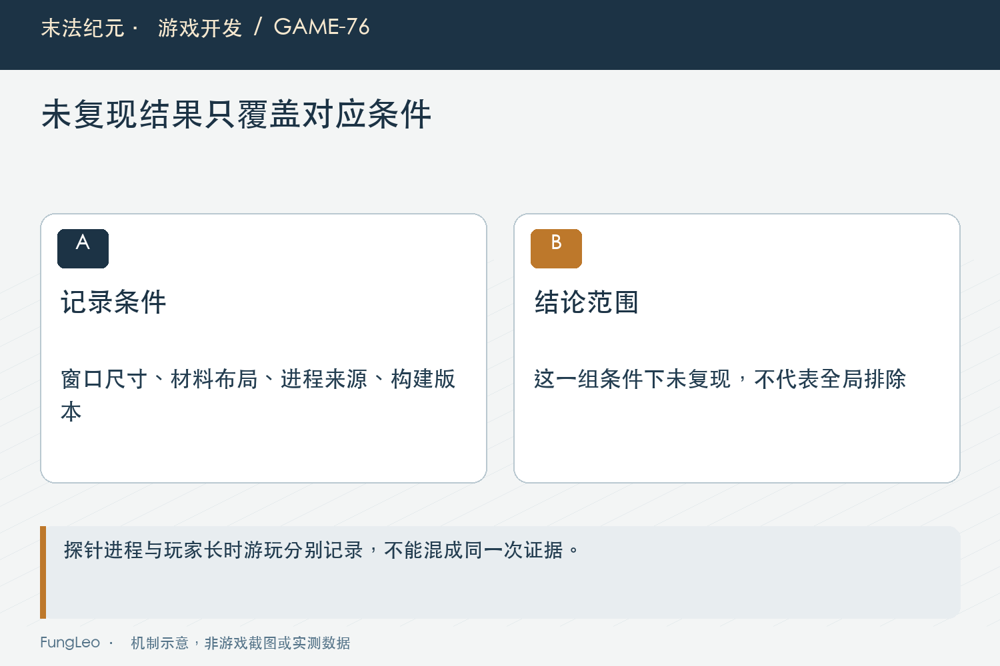
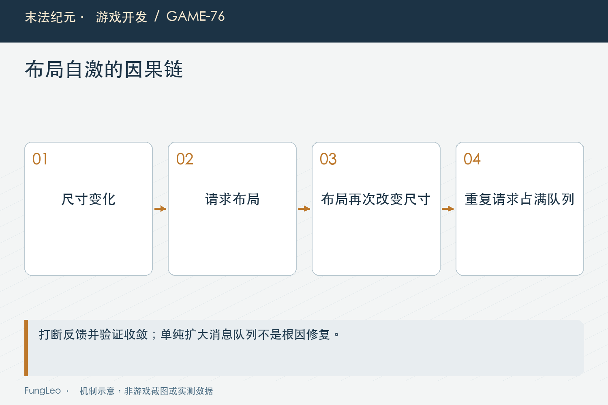

# 末法纪元·游戏开发76：重铸闪退，为什么第一轮解释错了

> 本文回顾《末法纪元》的开发过程，技术描述以 2026 年 11 月 5 日审阅快照为准。封面为主题插画，内文图为机制示意。

### 前言

各位看官，玩家重铸装备时闪退，日志里同时有界面尺寸异常、很多保存记录和原生崩溃栈。看起来线索已经足够，补上有限值检查，回归通过，就能宣布解决了吗？

《末法纪元》这次调查没有这么顺利。首轮把异常尺寸当作根因，第二轮又一度怀疑地图与墓碑，最后才用确定条件抓到布局自激把消息队列撑爆。

这篇不把过程改写成一开始就知道答案的故事。咱们保留错在哪里、后来什么证据推翻了它，以及怎样避免一段说得通的解释，过早变成已经证实的结论。


### 崩溃附近出现的错误，不一定是引信

首轮日志中的非有限尺寸确实值得修。异常值进入UI变换，会产生其他问题，增加检查也有独立价值。

但有问题的代码，与这次崩溃的必要原因，不是同一件事。有限值守卫通过，最多证明那条传播路径被挡住，不能自动证明闪退已经被阻止。

后续仍然出现同类原生崩溃，而对应日志没有那些尺寸告警，首轮因果解释就需要撤回。不能为了维护之前的判断，说新的崩溃肯定是另一个完全无关的问题。

第69篇《倍速一开，镜头为什么越跟越晃》的隔离对照也说明，合理机制只是起点。要把它写成原因，需要能连接触发、变化和结果的证据。

### 先分清每份记录是谁产生的

调查中还发现，一些被当成玩家长时间运行证据的崩溃，实际上来自验证进程。启动时间、存活时长与触发者混淆，会把整个故事带偏。

玩家真实游玩的长时记录，与几秒钟探针崩溃，都可以有价值，但必须分别标识。它们可能命中相似栈，也不能假装经历了同样负载。

因此整理日志先建立来源清单：哪个进程、什么构建、什么操作、使用哪份隔离输入。时间上相邻不代表属于同一场景。

这一步不炫技，却决定后面推理是否站得住。证据归属错了，再精确的函数偏移和计数也可能被解释成错误原因。

### 连续四十次没崩，为什么仍然不能排除重铸

第二轮在一组环境里连续重铸没有崩，曾据此把重铸从触发条件中排除，转向地图加载与墓碑。

后来发现关键窗口高度与材料布局并未覆盖。动作名字相同，不表示执行到同一种布局状态，未命中条件的四十次重复，不能替代一次正确条件的复现。

这不是说负面结果没有用。它说明这组具体条件下没有发生，也帮助缩小矩阵；问题在于把局部未复现升级成全局不可能。

第67篇《高分屏，不是把所有控件乘一个数》讲过可用逻辑空间，窗口高度、滚动阈值和内容量都可能改变布局路径。取证不能只记点了什么按钮。



### 栈帧相似，是合并线索，不是根因答案

几份原生崩溃记录有共同核心帧，可以提示它们可能走到同一类失败位置。可栈上最后出错的绘制回调，未必是最早制造问题的业务代码。

消息队列已经异常时，最终访问可能在渲染路径暴露。看到绘制相关帧就认定贴图损坏，或者看到地图对象就认定Boss资源有问题，都太快。

第二轮的实验矩阵与记录清单因此仍有保存价值，即使当时推论后来被推翻。原始观察可以复用，解释需要随新证据更新。

历史文档顶部应明确标记已被后续取代，不能让后来维护者只读最早那份摘要，又把错误修复重新搬回来。

### 决定性方向，是谁在不停排任务

后续日志出现消息队列耗尽，调查转向布局请求数量，而不是继续猜哪张纹理损坏。真正问题是控件尺寸变化又触发布局，布局再改变尺寸，持续排入延迟调用。

这条闭环借渲染错误表现出来，但上游在UI布局。窗口高度与内容接近滚动阈值时，特定路径可以稳定重复触发。

于是取证从偶发背景相关，变成对照明确条件：相同窗口、相同候选与投入，观察布局次数和是否完成。

这里应当区分最终定位与报告中某些引擎内部解释。项目层已经证明自激与队列负担的因果，不代表每一句原生失效内存细节都经过完整引擎源码调试确认。

### 调大队列，只是把症状往后推

引擎提示可能建议增加消息队列容量，但如果请求无界增长，更大的容器并不修复闭环。

早期报告还写错了默认容量，后续目标引擎实测纠正为三十二MB，并移除了不必要覆盖。今天介绍修复，就不能继续引用旧的四MB默认值。

这类数字看起来只是注释，实际可能诱导维护者继续扩大配置，掩盖问题。错误结论既要在代码收口，也要在文档标注清楚。

有限值守卫继续保留，因为它有独立防御作用；队列容量回到适当默认，因为这次根因并不需要靠它兜住。两项处理可以同时成立。



### 修复先打断自激，再解决布局振荡

早期防护按帧限制请求，阻止同帧无限排队；后续收口用公共调度保留dirty，保证执行期间来的末次变化不会丢。

同时，内容适配不再用容易反复变化的最小尺寸差迭代边距，而采用实际排版后的外框与滚动区尺寸差，减少跨帧振荡。

所以不能把最终实现写成只加一个帧号判断就万事大吉。止住同帧爆发与让布局真正收敛，是两种不同目标。

下一篇专门拆这层调度。本文先把调查顺序讲清楚：能控制请求数量，才能观察剩余振荡；振荡修好以后，还要检查首轮窗口响应没有变慢或漏布局。

### 回归要保留当时真正触发的尺寸

当前ReforgeLayoutStabilityTest覆盖多个窗口高度，使用真实面板、较多候选和满投入取优，检查连续帧稳定、结果可滚动与费用消耗。

这些条件比泛泛地循环点重铸更有针对性。测试要保存触发边界，而不是只把一次成功流程改成永久绿色。

但短时回归仍不能证明三小时或一晚零崩溃。第75篇《挂机一晚还稳定，应该测些什么》强调时间与负载，这里同样不能把确定性修复推广成所有崩溃都已消除。

实际窗口与无头各有价值。布局数值可以自动检查，文字、滚动与显示位置还需要窗口证据，不能只留退出码。

### 取证工具，也需要保护现场

旧探针存在改写工作区或依赖不安全环境前提的做法，后续收口改为一次性快照，明确只读输入副本，拒绝在正式项目身份下启动。

因此本文不复用历史报告里的临时启动命令。历史记录用于理解过程，当前操作应沿已经加守卫的隔离入口。

诊断日志也有容量与失败处理。写日志不能为了保留新记录就覆盖旧证据，普通高频事件可以聚合，关键重铸与Boss事件仍保留必要落点。

增加日志有成本，取证完成要清理临时插桩。不能让为了查一次闪退新增的逐事件写盘，长期成为另一项卡顿来源。

### 用反证审查自己的结论

一个好的解释应该允许被推翻：拿掉怀疑条件还会不会崩，只修这一项是否阻止原复现，把修复撤回能否再次命中指定断言。

如果答案都只是再跑一会儿没问题，因果强度仍然有限。尤其条件很多时，应一次改变一个关键因素，并保留失败结果，不要事后只挑支持最初判断的样本。

本轮未执行复现或读取玩家日志，后续可从正式回归入口核对：

```sh
python3 tools/run_isolated_tests.py ReforgeLayoutStabilityTest FrameLayoutSchedulerTest --rendered
python3 tools/run_isolated_tests.py DiagnosticProbeGuardTest CrashTraceTest
```

这些用例覆盖布局与工具边界，不是新增一次长时崩溃率统计。

### 小结

首轮解释错，不是因为日志没有价值，而是把伴随异常、局部未复现和背景相关，过早拼成确定因果。

保留原始观察，允许结论更新，再用明确触发矩阵、反证与当前回归收口。排查最重要的产物不只是一次修复，还包括后来维护者能够看懂：哪些证据成立，哪些推断已经撤回。

### 相关内容

- 第67篇《高分屏，不是把所有控件乘一个数》
- 第69篇《倍速一开，镜头为什么越跟越晃》
- 第75篇《挂机一晚还稳定，应该测些什么》
