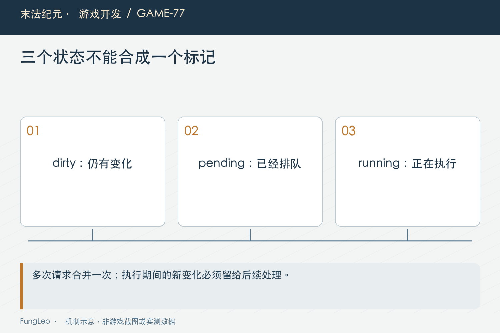
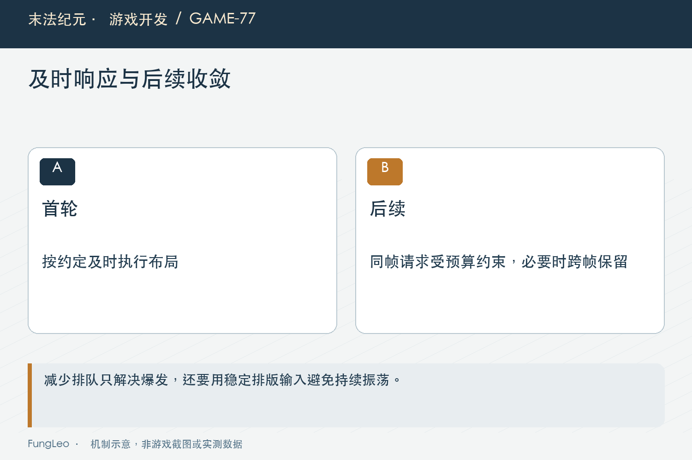

# 末法纪元·游戏开发77：延迟调用，也能把界面拖垮

> 本文回顾《末法纪元》的开发过程，技术描述以 2026 年 11 月 5 日审阅快照为准。封面为主题插画，内文图为机制示意。

### 前言

各位看官，容器尺寸变化，不能立刻再改布局，那就延迟调用。这个建议很常见，也通常有用。但如果延迟动作自己又引发尺寸变化，会发生什么？

《末法纪元》的重铸闪退最后就落在这条闭环上。延迟只是把动作排到后面，没有自动限制一帧里能排多少次，也没有保证布局最终收敛。

第76篇《重铸闪退，为什么第一轮解释错了》讲取证，本篇继续拆实现：为什么简单去重还不够，怎样同时保住首轮响应、末次变化与宿主退出后的安全。


### 延迟不等于下一帧，更不等于只执行一次

尺寸信号排一个布局动作，动作修改最小尺寸，容器重新计算，又发出新信号。每一轮都很合理，组合起来却能不断往队列里塞工作。

如果把所有call_deferred理解成每帧最多一次，就会低估这类反馈。它是一种调度方式，不是一份节流契约。

因此排查需要统计真实执行次数与排队次数，观察它们是否与输入数量相符。一次点击带出成千上万轮布局，问题已经不是单次函数稍慢。

增加队列容量，只能让无界请求多装一会儿。解决闭环要在请求入口与布局计算本身，而不是把容器做得足够大，等下一次内容更多再出问题。

### 只记本帧执行过，会丢掉最后一次变化

最简单的保护是看帧号，本帧做过就返回。它能止住同帧自激，但执行期间内容确实又变化了，新的有效请求也可能一起被丢掉。

结果就是窗口大部分时候正常，偶尔少算最后一行，直到下一次无关事件才补上。防崩溃变成了显示不完整，仍然不是可靠终点。

当前公共调度器因此分别记录dirty、pending、running与上次执行帧。它们回答是否需要更新、是否已排队、是否正在执行和本帧预算是否用过。

几个布尔值不是为了显得复杂，而是把原来混在一个标志里的不同事实拆开。状态含义清楚，才知道某条请求应该合并、等待还是立即处理。

### 请求只标脏，有空再安排一次

当前request先记住需要更新，已经排队或正在执行时，不再重复入队：

```gdscript
func request() -> void:
    _dirty = true
    if not _pending and not _running:
        _arm()
```

这样同一批尺寸变化可以合并，但dirty不会因为后来的请求而消失。真正动作执行前清掉本次脏标记，执行中若又收到请求，就重新变脏。

这与第74篇《耐久只变一点，为什么整个背包都刷新》的显示帧合并相通，减少重复工作不等于忽略变化。关键是保留最后仍未被覆盖的状态。

同时，调度器不替宿主决定交易是否有效、面板是否可见。它只负责动作何时执行，业务条件仍由动作入口自己检查。



### 本帧执行完了，新的请求留到下一帧

当前执行末段会检查动作期间是否重新变脏，再决定安排后续：

```gdscript
_last_frame = Engine.get_process_frames()
_dirty = false
_running = true
_action.call()
_running = false
if _dirty and not _pending:
    _arm()
```

每显示帧至多一次动作，阻止同帧无界增长；若还有脏状态，下一帧仍有机会处理，而不是默默忘掉。

这只限制执行速度，不自动证明布局收敛。如果每一帧都在两个尺寸之间来回变化，队列不再爆，也仍然是需要修的振荡。

因此调度器测试与真实布局稳定性测试必须分开。前者证明请求语义，后者证明某个窗口在具体内容和尺寸下最后能停住。

### 首轮响应，不应无条件再拖一帧

后续扩展回归发现，高界面倍率下某些窗口一帧内没有完成必要布局。最终实现保留首轮同帧延迟合并，只有本帧已经执行过的新请求才跨到下一帧。

这使刚打开面板的体验接近原来，同时继续防止同帧递归排队。不能简单说所有请求都等下一帧，拿响应延迟换一个容易实现的节流。

同步flush入口也遵守同帧预算。用户打开或改变分区可以要求及时布局，但如果这一帧已经做过，就保留dirty，不再绕过保护直接执行。

第66篇《拖拽交易，为什么总和弹层打架》的拖窗与分区布局会用到这些入口，公开操作都应经过同一调度，不能私下调用内部动作重新形成旁路。

### 宿主释放以后，排队动作应安全结束

每个宿主持有一个调度实例，调度器弱引用宿主。执行前检查对象有效、仍在树里、没有排队删除，动作本身也仍然有效。

这样关闭窗口或退出世界以后，旧请求不会继续访问失效控件。只有脏时安排一次性帧回调，也避免为了调度永久增加一个每帧轮询器。

不过弱引用只是这里的持有关系，不表示所有Callable都天然无风险。新增动作闭包时仍要看捕获了什么，不能把另一个旧面板强引用藏进去。

第73篇《缓存有上限，画面怎么还是消失了》说明资源所有权，调度回调同样需要明确谁拥有谁、什么时候结束，不能只看表面没有新增Node。



### 真正的布局，也要去掉不稳定反馈

原内容适配用缓存最小尺寸减去刚写进去的滚动最小尺寸推边距，这些值会随着布局重新计算，可能让下一轮输入依赖上一轮输出。

当前改为使用实际已排版的外框与滚动区尺寸差，单次设置目标尺寸，首次尚未稳定的部分由后续容器信号校正。

这项调整处理的是计算依据，不是仅靠调度把坏循环降速。窗口接近需要滚动的阈值时，尤其应观察连续多帧是否稳定。

不能为了通过稳定断言，把滚动区域固定成一个超大高度，导致按钮出屏。收敛、边界和内容可读都需要同时满足。

### 共享入口，别留下旧面板各自排队

一个浮窗修好，另外三个旧面板仍直接延迟调用相同布局函数，系统依然可能在另一条路径重现问题。

后续收口把这些调用接入公共调度，人物面板通过公开请求接口，不再越过外层去调用私有布局动作。

共享的价值是维护同一契约，不是把所有UI更新都塞进一个全局大队列。每个宿主仍有自己的脏状态和动作，彼此生命周期独立。

这也方便测试多个窗口并开。背包请求不会消耗人物窗口的全部预算，某个窗口退出，也不应该取消另一个仍在使用的动作。

### 测一百次请求，还要测动作里再请求

现有调度测试覆盖同帧多次请求、动作内再标脏、同步入口、暂停与宿主销毁。它们分别针对不同状态，不能只用计数最终为一来包办。

尤其动作期间请求应该留下下一次更新，空闲后又请求应该正常唤醒；若两种情况都简单忽略，计数看起来更少，功能却已经丢失。

真实重铸窗口则在多个高度、较多候选和满投入下连续取优，检查多帧稳定、边界与结果可滚动。它把当时触发条件保留下来，不再依赖人工偶然碰到。

本轮未执行这些测试，后续可沿入口复核：

```sh
python3 tools/run_isolated_tests.py FrameLayoutSchedulerTest SettingsTest
python3 tools/run_isolated_tests.py ReforgeLayoutStabilityTest FloatingWindowInputTest --rendered
```

### 调度正确，不等于整张界面已经便宜

每帧一次的动作如果本身很重，仍然会卡。第74篇《耐久只变一点，为什么整个背包都刷新》把整包重建拆成局部更新，就是另一层工作。

同样，限制布局不会减少所有渲染开销，也不证明真实存档长时操作零崩溃。报告应说明修复了哪条闭环、覆盖哪些窗口与尺寸，而不是把一个公共调度器说成UI性能万能药。

后续若内容规模继续增加，还要量首轮构建、列表刷新与图标装配。调度让工作有秩序，工作量本身仍需各自优化。

日志也应记录实际执行而非每次请求都刷屏。否则一段自激会先制造海量取证文本，干扰原来的时间关系；调试时保留少量计数和边界事件，更容易看见请求是否最终收敛。

### 小结

延迟调用只是把事情放到后面，不能替我们决定一帧做多少次，也不能保证最后状态不会丢。

标脏、合并、同帧预算与宿主检查是一层保护，稳定的布局计算又是另一层。两者一起成立，窗口才既能及时响应，也不会在没有新输入时把自己越改越忙。

### 相关内容

- 第66篇《拖拽交易，为什么总和弹层打架》
- 第74篇《耐久只变一点，为什么整个背包都刷新》
- 第76篇《重铸闪退，为什么第一轮解释错了》
