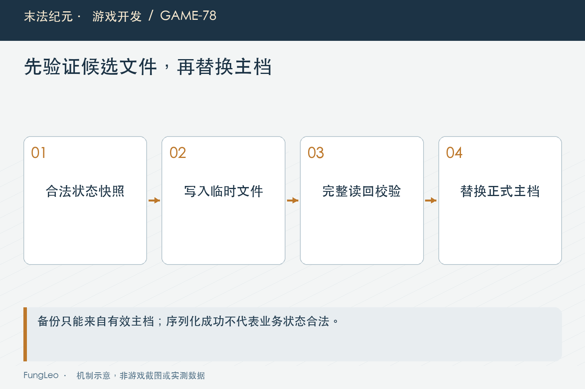
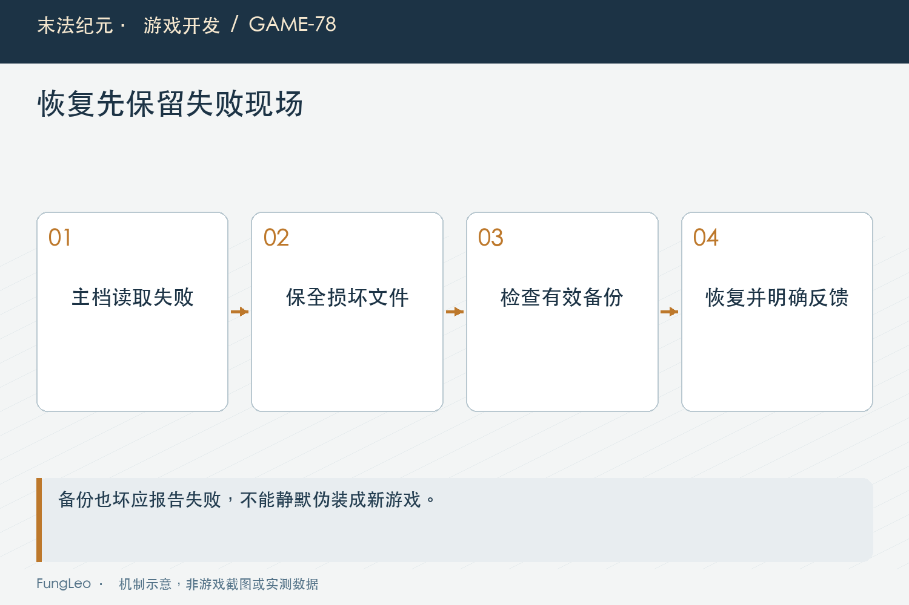

# 末法纪元·游戏开发78：本地存档，怎样写坏了还能救回来

> 本文回顾《末法纪元》的开发过程，技术描述以 2026 年 11 月 5 日审阅快照为准。封面为主题插画，内文图为机制示意。

### 前言

各位看官，单机游戏最怕什么？一次闪退已经很糟，如果再把几小时进度写成一份打不开的文件，玩家往往连继续玩的心情都没有了。

把字典转成JSON，只是存档最简单的一步。真正需要考虑的是写入失败、主档损坏、备份是否可信，以及恢复以后能不能明确告诉玩家用了哪份进度。

《末法纪元》沿临时写入、读回校验、有效备份和损坏保全建立这条链。本篇先谈文件可靠性，版本兼容留到下一篇，避免把打不开的文件与不再支持的旧格式混成一个问题。


### 保存之前，运行态也可能已经不合法

保存不是把任何内存内容都照单全收。当前先收集快照，写入槽号，再通过完整结构检查，发现非法字段就拒绝并留下原因。

如果一份运行态已经含未知装备或错误数组，直接落盘只会把问题推到下次读取。玩家以为保存成功，重启才知道进度没法恢复，反馈太晚。

当前也避开尚未交接完整的托盘状态与旅行中间态。文件写得再完整，如果里面是半笔业务，仍然不是可靠存档。

第58篇《金币封顶，卖出去的物品怎么办》讲过托盘所有权，保存边界需要看得见这种交接。不能把序列化成功等同于所有业务都处在可以恢复的时刻。

### 临时文件，先承担本次写入风险

当前先写同目录临时文件，写完关闭，再校验内容，最后才替换主档。主档不直接承担逐段写入时的半成品状态。

底层入口的末段如下，前面已经把JSON写进临时文件：

```gdscript
if not _verify_written(tmp, text):
    push_error("[SaveManager] 写入校验失败（内容不完整），已保留现场：%s" % tmp)
    return false
var err := DirAccess.rename_absolute(tmp, path)
if err != OK:
    push_error("[SaveManager] 替换存档失败（err=%d）：%s" % [err, path])
    DirAccess.remove_absolute(tmp)
    return false
return true
```

这条流程减少截断内容覆盖有效主档的机会，但不能夸大成对所有断电、硬件和文件系统故障的绝对保证。当前代码没有因此获得无限历史版本。

所谓原子写入，需要说明实际做了什么，而不是只给函数取一个带atomic的名字，就省略读回与错误检查。

### 写入函数返回以后，还要确认字节完整

磁盘不足或中断可能留下截断文件。如果只看文件能打开，或者JSON恰好可解析，也不一定证明与准备写入的内容一致。

当前读回与预期文本逐字比较，失败就不替换主档，保留临时现场。这样本次保存可以立即报错，而不是等下次启动才回退到更旧备份。

结构校验与写后校验也不同。前者判断数据是否符合游戏契约，后者判断准备的内容是否真的完整落到本次文件。

两份检查都重要，不能拿其中一个代替另一个。内容合法但没写完整，或者完整写了非法状态，最后都可能无法继续。



### 备份只能来自有效主档

当前替换主档之前，只有旧主档通过校验，才把它留成最近有效备份。旧主档已经坏了，就不能覆盖掉仍然可用的备份。

如果每次保存都无条件复制主档，玩家第一次损坏以后再点一次保存，可能连最后一份好备份也一起换成坏内容。

备份失败也应中止并反馈，不能悄悄继续说已经可靠保存。备份不是装饰性的额外文件，它承担明确恢复职责。

同时，单份备份通常比主档旧。恢复成功意味着能回到最近有效快照，不意味着闪退前最后一秒的所有进度都一定存在。提示需要诚实表达这个差异。

### 主档坏了，先保留现场再恢复

读取先验证主档，不可用再尝试备份。备份合法时，可以把坏主档另存为corrupt，再用可靠内容恢复主档。

当前保全路径的一段节选：

```gdscript
if DirAccess.rename_absolute(path, corrupt) != OK:
    return false
return _write_json_atomic(path, data)
```

前面还处理主档是否存在与旧损坏文件。恢复本身也可能失败，不能因为备份能读，就宣称磁盘自愈已经完成。

当前返回来源与提示区分主档、备份和恢复失败。玩家需要知道是正常继续，还是回退到了一份旧快照；维护者也需要知道坏文件有没有保留下来。

### 备份也坏，不要伪装成新游戏

两份都不可用时，应明确失败。静默返回一个空字典，再让上层当成新角色，会把恢复机会变成更难察觉的覆盖风险。

同样，界面可以让玩家选择另一个槽或导入，但不能因为当前槽打不开，就自动保存默认状态到原路径。

第76篇《重铸闪退，为什么第一轮解释错了》讲取证，损坏文件可能解释故障，不能为了让目录整洁把它立刻删掉。保全与恢复是相关但不同的动作。

当然，当前只保留有限现场，不是永久归档系统。要长期保存重要版本，导出副本仍然是一种独立用途，不能把最近有效备份当成无限回滚。



### 新角色覆盖，与导入覆盖有不同清理语义

明确新建角色覆盖槽位以后，主档成功落盘才清理旧角色的备份，避免将来恢复时又把旧人找回来。

导入则保留已有损坏现场，先验证输入，归一槽位和名字，再验证最终准备写入的内容。不能只检查原始文件合法，就忽略归一后发生的变化。

目标槽号与导入文件内原槽号可能不同，写进去的必须对应目标。角色名也有长度与文件名规则，导出名称不能直接把路径分隔符带进文件系统。

这些是边界输入处理，不应改写玩家原始导入源文件。复制进目标槽是一笔操作，来源文件仍然是独立证据或备份。

### 自动保存，同样需要反馈与节奏

当前自动保存有关键事件、周期与退出等触发，并用短时间去抖合并频繁变化。静默成功可以减少打扰，失败却不能静默。

读档应用期间也要抑制自动保存，避免每写回一项运行态就触发一份新快照。尚未建立活动槽时，不应该偷偷创建一个默认目标覆盖。

第74篇《耐久只变一点，为什么整个背包都刷新》说明信号可能密集，保存同样不能看到事件就立即无限写盘。但合并意味着存在明确时间窗口，不能承诺每个事件瞬间都已经持久化。

托盘、旅行和死亡等特殊状态，还需沿各自规则确认什么时候允许保存。统一入口的价值就是这些条件不散落成每个窗口各自猜测。

### 保存测试，必须用隔离目录

存档测试会重置角色、构造坏文件、覆盖槽位和恢复备份。如果误指向玩家真实目录，测试本身就可能造成比待测故障更大的损失。

当前优先使用隔离运行器和独立项目身份，诊断工具还有启动前守卫。不要照抄早期备份后再恢复真实目录的临时办法当作日常测试方式。

本文没有读取或改写真实档案，也没有运行故障注入。后续可以从现有定向入口开始：

```sh
python3 tools/run_isolated_tests.py SaveTransferTest TradeTraySaveTest
rg -n '_write_json_atomic|_verify_written|_restore_backup' autoload/save_manager.gd
```

验证应检查失败后主档字节不变、有效备份没有被坏主档覆盖、恢复来源可见，以及导入源文件没有被修改。

### 恢复以后，还要把完整世界装回来

文件通过不代表画面已经恢复。任务、装备、未领取物和当前地图需要按已有应用顺序重建，不保存Node或失效的运行时引用。

第63篇《任务系统，先画状态再填剧情》的待发计划就是一项例子。只恢复任务完成状态，却丢掉已抽定奖励，文件语法再漂亮也会改变玩家资产。

因此文件层验证与业务往返测试互相补充。前者关注写入和保全，后者确认恢复出来的仍是同一段进度，不重复发奖也不遗漏归属。

还要核对失败提示本身是否到达玩家。启动时HUD尚未建立，服务立即广播的文字可能无人接收，当前有延后续档提示的处理。数据层知道恢复过，界面却完全不说明，仍然会造成进度倒退的误解。

### 小结

可靠存档不是保证永远不坏，而是在失败发生时尽量不覆盖好数据，能明确恢复，也能保留解释问题的现场。

先验运行态，临时写入并读回，备份只留有效内容，恢复来源与失败都说清楚。文件机制和业务快照一起成立，玩家才有机会在一次意外以后继续冒险。

### 相关内容

- 第58篇《金币封顶，卖出去的物品怎么办》
- 第63篇《任务系统，先画状态再填剧情》
- 第76篇《重铸闪退，为什么第一轮解释错了》
