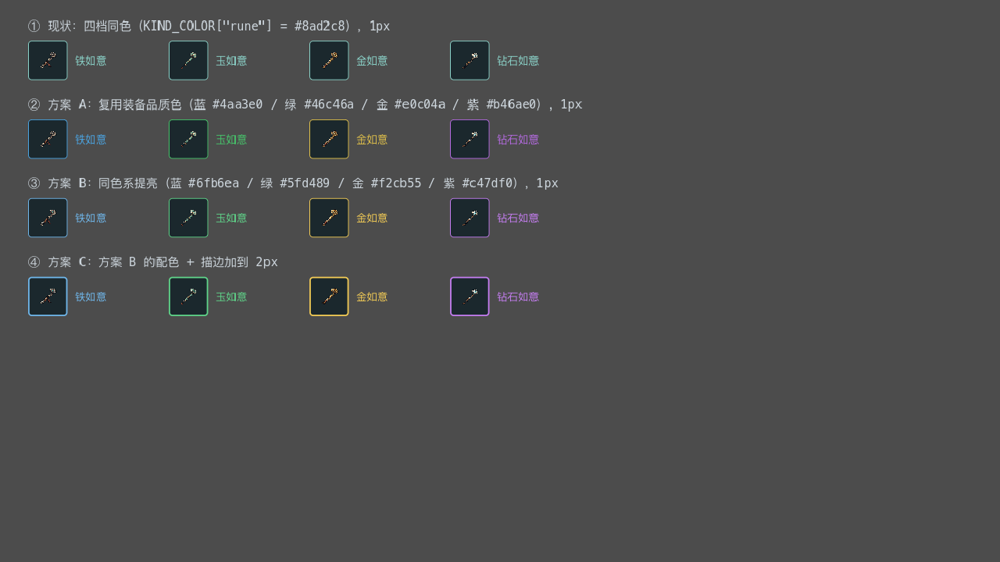
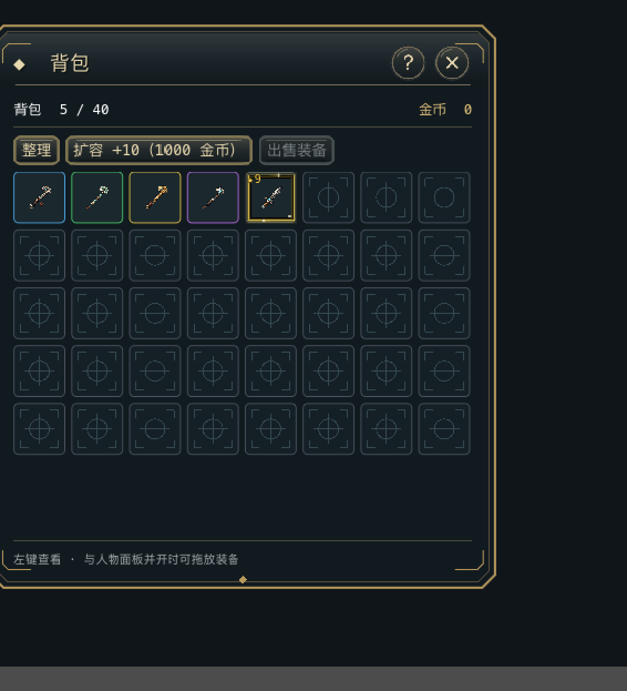

# 111 · 如意边框分色：为什么"长得差不多"，以及怎么改

> 用户反馈（2026-10-30）：背包里的如意四档看起来差不多，建议 **铁=蓝 / 玉=绿 / 金=金色 / 钻石=紫** 的边框便于区隔。
> 本文是**现状分析 + 方案**，未改动任何生产代码。

---

## 1. 现状：确实分不出来，而且是结构性的

### 1.1 数据面

`data/runes.json` 四档如意，字段只有 `id / name / successBonus / dropBossOnly / price`——**没有任何视觉标识**：

| id | 名称 | 成功率加成 | 售价 |
|---|---|---|---|
| `rune_iron` | 铁如意 | +5% | 300 |
| `rune_jade` | 玉如意 | +10% | 800 |
| `rune_gold` | 金如意 | +15% | 2000 |
| `rune_diamond` | 钻石如意 | +20% | 60000 |

### 1.2 颜色面：四档共用一个色号

背包、仓库、商店托盘、地面掉落，四处都在算"这个格子该用什么颜色"，而它们**调的是同一个函数**：

```gdscript
## scripts/systems/item_util.gd:29
const KIND_COLOR := {
	...
	"rune": Color("8ad2c8"),   # 四档如意统统拿到这一个青绿色
}

## 四个消费点，逻辑一模一样：装备看品质，其余看品类
# scripts/ui/inventory_panel.gd:412   _item_color()
# scripts/ui/warehouse_panel.gd:256   （内联在刷新循环里）
# scripts/ui/shop_panel.gd:587        _item_tint()
# scripts/entities/ground_item.gd:487 （内联在 _draw 里）
```

所以「铁如意」和「钻石如意」的**边框色、文字色完全相同**。价格差 200 倍的两种东西，在背包里长得一样。

### 1.3 图标面：实测四张图几乎无差异

用脚本解码四张 `assets/sprites/items/rune_*.png`（均 48×48，主色统计见下表）：

| 图标 | 非透明像素 | 内容包围盒 | 平均色 |
|---|---|---|---|
| `rune_iron` | 272 | 31×32 | `#5f524a` |
| `rune_jade` | 212 | 31×33 | `#686f60` |
| `rune_gold` | 265 | 32×33 | `#6f5639` |
| `rune_diamond` | 205 | 31×31 | `#5f5952` |

四个平均色都落在**暗褐 / 暗灰**区间，明度差不到 10%；而且如意只占 48×48 画布的中间 31×32（约 1/3 面积），在 52px 的背包格里被缩到 34px 显示，差异进一步消失。

### 1.4 最关键的一条：格内文字根本不显示

`ItemSlot` 在背包里显示的是「图标 + 2 字简称（铁如 / 玉如 / 金如 / 钻石）」。但 `SampleArt.decorate()` 最后一行是：

```gdscript
# scripts/systems/sample_art.gd:183
if texture != null:
	button.text = ""      # 有图标就清空文字
```

四档如意**都有图标**，所以格子里只剩那张几乎一样的图 + 同色边框。玩家能拿到的区分线索是零。

> **这条决定了方案方向**：不能指望"加文字标识"或"改简称为金色/紫色"，因为文字压根不显示；**改图标的成本远高于改边框**（四张新美术资产 vs 一行数据）。
> 用户提的"用边框颜色区分"不只是偏好，是这个界面里**唯一低成本且真实可见**的手段。

---

## 2. 设计

### 2.1 把散落四处的"该用什么色"收敛成一个函数

现在四处重复着同一段 `if 装备 → 品质色 else 品类色`。本次新增如意分档，如果继续在四处各加一个 `if rune`，就会变成**四份必须同步维护的判定**（08 坑 64 的老相识）。

所以先收敛：

```gdscript
## scripts/systems/item_util.gd（新增）
## 界面强调色唯一入口：格子边框 / 格内文字 / 名牌 / 地面绘制都用它。
static func item_accent_color(item: Dictionary) -> Color:
	var kind := String(item.get("kind", ""))
	if kind == "equip":
		return quality_color(String(item.get("quality", "common")))
	if kind == "rune":
		return rune_accent_color(String(item.get("itemId", "")))
	return kind_color(kind)

## 如意按数据分档；未配置（老档 / 将来新增）回落品类青绿，不落到白色。
static func rune_accent_color(rune_id: String) -> Color:
	var tpl = DataLoader.get_entry("runes", rune_id)
	var accent := String(tpl.get("accent", "")) if tpl is Dictionary else ""
	return ACCENT_COLOR.get(accent, KIND_COLOR["rune"])
```

四处消费点改成一行 `ItemUtil.item_accent_color(item)`。**行为等价、少三份重复判定**，是这次顺带的净收益。

### 2.2 颜色写在数据里，不写在代码里

`data/runes.json` 每条加一个 `accent` 字段（取值为品质键名，不引入新枚举）：

```json
{"id": "rune_iron",    "name": "铁如意",   "accent": "steel",     ...}
{"id": "rune_jade",    "name": "玉如意",   "accent": "jade",      ...}
{"id": "rune_gold",    "name": "金如意",   "accent": "gold",      ...}
{"id": "rune_diamond", "name": "钻石如意", "accent": "diamond",   ...}
```

理由：将来加第五档如意（比如"龙纹如意"）时，**只改数据就能有颜色**，不用回头翻代码；而且 `DataLoader` 能校验 `accent` 是否合法，写错当场报错而不是静默变白框。

🔴 **不复用 `quality` 字段**。`quality` 在项目里有装备语义（`ItemUtil.display_name` 会给装备拼「稀有 xxx」前缀、`QualityFrameOverlay` 按它选动画框、`Shop.item_quality()` 按它排序报价）。给如意塞 `quality: "legendary"` 会把这些装备向逻辑全部点亮，属于典型的口径污染。

### 2.3 四个候选配色（真实渲染，非示意）

已用 `tools/rune_border_preview.tscn` 在 1280×720 窗口下渲染真实 `ItemSlot` + 真实图标出图：



（图：`docs/素材/previews/111-如意边框配色对照.png`，由 `tools/rune_border_preview.tscn` 窗口模式渲染真实 `ItemSlot` 产出）

| 方案 | 色值（铁/玉/金/钻石） | 描边 | 评价 |
|---|---|---|---|
| **① 现状** | 全部 `#8ad2c8` | 1px | 四档一模一样 |
| **② A 复用品质色** | `#4aa3e0` / `#46c46a` / `#e0c04a` / `#b46ae0` | 1px | 不新增常量，与装备品质色同一套语义；但蓝色在深底上偏暗，且「紫框」容易让人以为是传说**装备** |
| **③ B 同色系提亮** ⭐ | `#6fb6ea` / `#5fd489` / `#f2cb55` / `#c47df0` | 1px | 明度拉高后四个色相在 52px 格子上都能一眼分开，且与装备品质色**错开一点**，不会误读成装备品质 |
| **④ C = B + 2px** | 同 B | 2px | 最醒目，但全库格子描边都是 1px，单独加粗会和空格/装备格不一致 |

**推荐 ③ 方案 B（1px）**：目的就是"便于区隔"，B 在真实尺寸下区分度明显优于 A；而 2px 会打破全库描边一致性，收益不抵代价。

---

## 3. 会影响哪些界面（不是只有背包）

因为颜色走单一入口，**改一处、四处同步生效**：

| 界面 | 现状 | 改后 |
|---|---|---|
| 背包格 | 四档同色边框 | 蓝/绿/金/紫边框 |
| 仓库存取格 | 同上 | 同上（同源） |
| 货郎出售托盘 | 同上 | 同上（同源） |
| 地面掉落 | 掉落物下方的品质光柱/底座用同色 | **看不出差异（落地时实测推翻，见 §9.2）**：`_draw_label()` 对非装备直接 `return`、`_draw_quality_augment()` 只对装备生效 ⇒ 如意落地无名牌无光柱。代码仍走同一入口以保持一致，但该场景对如意**不产生可见变化** |

用户只提了背包，但**同一件物品在不同界面颜色不同**只会更困惑。四处同源是这套设计天然的结果，不额外写特例。

---

## 4. 风险

| # | 风险 | 对策 |
|---|---|---|
| 🔴 R-1 | **只在背包写特例**，导致同一如意在背包是紫色、在仓库是青色 | 改单一入口 `item_accent_color()`，禁在面板里写 `if kind == "rune"` |
| 🔴 R-2 | 以为"格内有文字可区分"，去做文字/简称改动——白做 | 已实测 `decorate()` 有图标即清空 `text`，所以只能靠边框（§1.4） |
| 🔴 R-3 | 用 `quality` 字段承载如意分档，污染装备语义 | 新增独立 `accent` 字段（§2.2） |
| ⚠ R-4 | `accent` 缺失/写错时落到白色或崩溃 | 回落 `KIND_COLOR["rune"]`；`DataLoader` 校验取值合法 + 四档都配（§5） |
| ⚠ R-5 | 光柱/底座等装饰也吃这个色，可能出现"紫色光柱太扎眼" | 出图核对地面掉落与背包两处；若过亮，只调 `diamond` 一档的明度 |
| ⚠ R-6 | 老存档里已有的如意实例没有 `accent` 字段 | 颜色**按模板 id 查数据表**，不写在实例上 ⇒ 老档读进来照样有色，不需要迁移 |

---

## 5. 启动校验（防"漏配静默变青绿"）

`DataLoader` 已有的 runes 校验块（`data_loader.gd:515`）追加两条：

1. `accent` 必须存在且为字符串，取值必须在 `ACCENT_COLOR` 的键集合内（`steel/jade/gold/diamond`）；
2. 四档之间 `accent` **不得重复**——重复了不报错，但玩家会看到两只一模一样的如意，属于"数据看着合法、体验上等于没做"。

这条不是洁癖：坑 65 就是"纯数据开关漏配不报错也不影响功能"，只能靠启动校验兜住。

---

## 6. 待办（R 编号，确认后按序落地）

| # | 内容 | 文件 |
|---|---|---|
| **R1** | `ACCENT_COLOR` 常量（4 色）+ `item_accent_color()` / `rune_accent_color()` | `scripts/systems/item_util.gd` |
| **R2** | 四条 `accent` 字段 | `data/runes.json` |
| **R3** | 启动校验：取值合法 + 四档不重复 | `autoload/data_loader.gd` |
| **R4** | 四个消费点改为调用 `item_accent_color()`（删掉各自重复的 equip/kind 判定） | `inventory_panel.gd` / `warehouse_panel.gd` / `shop_panel.gd` / `ground_item.gd` |
| **R5** | 新测试 `tests/rune_accent_test.gd`（约 6 条）：四档颜色互不相同 / 色值逐个对表 / 未配置回落青绿 / 装备仍走品质色 / 非如意不受影响 / 数据字段齐全不重复 | `tests/` |
| **R6** | 负向 `tools/verify_111_negative.py`：删 `accent` 一档 / 改错色值 / 四档重复 / 删回落 → 对应断言必须变红 | `tools/` |
| **R7** | 出图核对（背包 + 地面掉落两个场景），预览工具从"对照图"改成"实机背包图" | `tools/rune_border_preview.*`、`docs/素材/previews/` |
| **R8** | 文档：08 坑清单（若本轮有新坑）、产品文档 05 §5.7 配色表补一行"如意按数据分档" | `docs/` |

## 7. 验证计划（四层 + 负向 + 出图）

| 层 | 判据 |
|---|---|
| `--import` | 0 ERROR / 0 WARNING |
| 默认隔离集 | 96 PASS（95 + `RuneAccentTest`） |
| `--all` | 165 PASS / 0 FAIL / 3 SKIP |
| `--quit` | 配置校验通过 ✅，**且无 leak 告警**（末行以下也要看） |
| 负向 | N-1…N-4 全部有牙，还原后复绿 |
| 出图 | ~~背包四格边框四色分明；地面四件掉落光柱四色分明~~ → **只出背包**（地面看不到差异，§9.2）；出全景 + 2 倍放大两张 |

## 8. 我建议不做的事

- **不新增四张如意图标**：那是美术资产，成本高，且用户要的是边框区分；边框已经足够。若将来美术给到新图，本方案不冲突。
- **不在格子上叠品质角标/数字**（如"Ⅰ Ⅱ Ⅲ Ⅳ"）：52px 格子的四角已被星级、收藏、升级箭头、等级角标占满（工程 76/77 有明确排布），再塞会挤爆。
- **不改 `KIND_COLOR` 里 `rune` 的值**：它仍是"未配置时的兜底色"，改它会让回落语义变化。

---

## 9. 落地记录与实测（2026-10-30，已完成，方案 A）

### 9.1 与方案的三处偏差

| # | 方案写的 | 实际做的 | 为什么 |
|---|---|---|---|
| 1 | 地面掉落「钻石如意落地自带紫光，远处就能认出」 | **地面什么都不变** | 实测 `_draw_label()` 对非装备直接 `return`，`_draw_quality_augment()` 也只对装备生效。见 §9.2 |
| 2 | 四处消费点改调 `ItemUtil.item_accent_color()` | 顺带把 `Shop.item_quality()` 的兜底上提为 `ItemUtil.quality_of()` | 不这么做会**静默丢掉一个有测试守着的兜底**。见 §9.3 |
| 3 | 出图 = 背包 + 地面两个场景 | **只出背包**（全景 + 2 倍放大） | 地面看不出差异，出图只会误导 |

### 9.2 地面掉落那条口径被实测推翻

方案 §3 写「改一处、四处同步生效」，其中把地面写成「钻石如意落地自带紫光」。落地时按这个去出地面图，出来四件如意的画面**一模一样**，查下来是两条 `return`：

```gdscript
# scripts/entities/ground_item.gd
func _draw_label(kind, quality, col, center) -> void:
	if kind != "equip":
		return                       # ← 如意永远不显示地上名牌

func _draw_quality_augment(kind, quality, col) -> void:
	if kind != "equip":
		return                       # ← 光柱 / 底座也只给装备
```

地面上的如意图标只有 32px、没有名字、没有光柱，只有一圈固定浅黄的落地高亮环（`Color(1.0, 0.94, 0.70)`，与强调色无关）。

结论：**颜色入口仍然收敛（代码一致性该做），但地面这个场景对如意不产生任何可见变化。** 玩家能看到分色的只有 **背包 / 仓库 / 货郎托盘**三处，三处同源。

> 教训已记入 08 坑 100：靠「视觉区分」解决可用性问题的方案，出图前先 `grep` 那条绘制函数的前置 `return`。

### 9.3 收敛时差点丢掉一个有测试守着的兜底

四处「装备看品质、其余看品类」的副本并不等价：

| 文件 | 原实现 | 缺 `quality` 时 |
|---|---|---|
| `inventory_panel._item_color` | 裸 `item.get("quality", "common")` | 白框 |
| `ground_item._draw` | 裸 `item.get("quality", "common")` | 白色光柱（若该画） |
| `shop_panel._item_tint` | `Shop.item_quality(item)` | **回退模板 `defaultQuality`** |
| `warehouse_panel` | 裸 `item.get("quality", "common")` | 白框 |

`Shop.item_quality()` 的兜底有 `smoke_test.gd:2077` 专门守着，是刻意的口径。若收敛时直接照抄裸取值，**货郎托盘的兜底会静默消失**——缺 quality 的装备从「按模板品质上色」变成白框，没有任何测试会红。

处理：把兜底逻辑上提为 `ItemUtil.quality_of()`，`Shop.item_quality()` 改一行委托。四处同时获得统一口径，调用点零改动（`Shop.item_quality` 仍有 5 个调用方，全部无感）。

### 9.4 交付物

| 层 | 文件 |
|---|---|
| 数据 | `data/runes.json`：四档各加 `accent` 字段（`steel/jade/gold/diamond`） |
| 逻辑 | `scripts/systems/item_util.gd`：新增 `ACCENT_COLOR` 常量、`item_accent_color()`、`rune_accent_color()`、`quality_of()`；`scripts/systems/shop.gd::item_quality()` 改为委托 |
| 消费点 | `inventory_panel._item_color` / `warehouse_panel` 内联 / `shop_panel._item_tint` / `ground_item._draw` 全部改调唯一入口（各自删掉重复的 equip/kind 判定） |
| 校验 | `autoload/data_loader.gd`：runes 校验块加 `accent` 合法（取值来自 `ItemUtil.ACCENT_COLOR.keys()`）+ 四档不重复 |
| 测试 | `tests/rune_accent_test.gd` + `tests/RuneAccentTest.tscn`（7 条）；默认集 95 → 96 |
| 负向 | `tools/verify_111_negative.py`（7 条：5 条跑测试 + 2 条跑启动校验） |
| 出图 | `tools/rune_border_preview.*` 改为实机背包出图（全景 + 2 倍放大）；`docs/素材/previews/111-背包如意四色{,-放大}.png` |

### 9.5 验证结果（四层 + 负向 + 出图）

| 项 | 结果 |
|---|---|
| `--import` | 0 ERROR / 0 WARNING |
| 默认隔离集 | **96 PASS**（95 + `RuneAccentTest`） |
| `--all` | **165 PASS / 0 FAIL / 0 SCRIPT ERROR**（3 SKIP 为已知美术欠账） |
| `--quit` | 配置校验通过 ✅，无 leak 告警 |
| 负向 `verify_111_negative.py` | **7/7 有牙**，还原后测试复绿 + 启动校验通过 |
| 出图 | 背包首行四格：蓝 / 绿 / 金 / 紫 四色描边分明；第 5 格史诗装备仍金黄 + ★9 角标（未被污染） |

负向覆盖：删一档 `accent` / 把色值改错一位 / 两档重复 / 回落改成纯白 / 背包绕过唯一入口 / 非法 `accent` 值（启动层）/ 两档重复（启动层）。



### 9.6 未做 / 后续

- **实机点验**：开背包看四档如意边框是否如截图、去仓库与货郎托盘确认三处一致。
- 正式四张如意图标（当前四张图平均色明度差不到 10%，是本次改边框的根因；美术给到新图后本方案不冲突）。
- 第五档如意：只需在 `runes.json` 加一条带新 `accent` 的数据 + 在 `ACCENT_COLOR` 加一个色号，无需改任何消费点。
