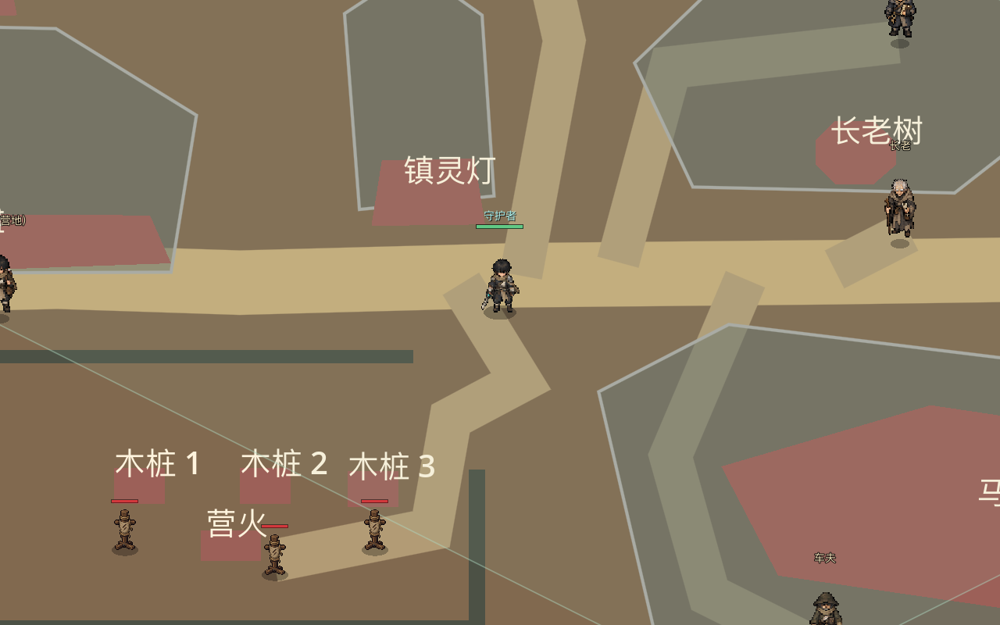

# 幸存者营地白盒正式接入与验收

本记录保留白盒阶段的历史验收数据。当前正常游戏已接入正式美术，见 [幸存者营地正式地图接入与验收](29-幸存者营地正式地图接入与验收.md)；下文的白盒画面、可走率和性能数字均为当时基线。

## 进入方式

正常启动游戏，创建新档或读取位于“幸存者营地”的存档，即进入矩形白盒营地。也可由其他地图通过车夫或步行出口返回。独立设计样板仍可在 Godot 中运行 `tests/CampWhitebox.tscn`，按 `O` 切换全图/玩家视角；正常游戏不使用该测试场景。

## 布局与维护

- `data/map_art/camp_whitebox_v1.json`：唯一原画坐标源，记录 1672×941 参考画幅、3200×1800 世界矩形、10 个实体足迹、6 段围栏、道路和 9 个服务/出口目标。实体与围栏均为整体多边形，屋顶等视觉轮廓不承担碰撞。
- `tools/build_camp_whitebox.py`：按 64×32 等距投影和 14 世界像素玩家留边，将同一多边形源编译到 `data/layouts/camp.json` 的 110×110 掩码，并只更新 `data/maps.json` 的营地条目。变更源文件后运行 `python3 tools/build_camp_whitebox.py`，不要手改生成的掩码和坐标。
- `IsoGround` 从源文件装配矩形地面、道路、实体示意和 16 条整体碰撞；寻路读取对应编译掩码。正常游戏的 NPC、两个出口、三个训练木桩、相机边界及小/大地图也使用新坐标。其余地图仍走原有纹理图集路径。
- 旧营地美术数据保留在 `data/map_art/chapter1_v2/camp.json`，供回看和后续美术复刻，不在正式营地加载。旧布局版本存档在读取时把营地玩家、营地未领取物与营地刷新点坐标迁到新出生区；旧营地迷雾重置，其他地图的迷雾保留。迁移按版本幂等。

## 验证

2026-10-15 在 Godot 4.7.2、GL Compatibility、1280×800 窗口及隔离测试项目执行：

| 检查 | 结果 |
| --- | --- |
| `CampLiveIntegrationTest`（无头与实际窗口） | 正常 `Game.tscn` 装配通过；3200×1800 矩形世界与大地图投影一致；NPC 5、出口 2、训练木桩点 3；9 个目标均有正式路线；旧存档迁移幂等 |
| `SmokeTest` | 全部通过，包括营地安全区、NPC 交互、切图和战利品持久化 |
| `ChapterOneMapArtTest`、`MapTextureBatchTest` | 营地验证整体白盒，其余三张第一章地图保留纹理图集与多格实体约束 |
| `MapCanvasCacheTest`、`MapLoadingCacheTest`、`CaveNavigationTest`、`ChapterOneAcceptance`、`ChapterTwoRoutesTest` | 全部通过 |

独立白盒的内部格中心 5495 个，其中 5013 个可走（91.2%）；正式地图采用同一源编译，静态碰撞为 16 个实体/围栏多边形和 4 条外边界。正式营地加载在这台设备的隔离无头测试中测得约 15 ms，实际窗口测得约 200 ms。两者包含不同的引擎渲染条件，不能据此推断稳定帧率或与旧营地直接作性能收益比较。

目前白盒是几何示意，尚未把已通过的原画分拆成最终运行美术。后续应以局部 1:1 美术实机样板验证建筑遮挡、纹理接缝和全场景长时间游玩表现，再替换白盒绘制层；正式玩法数据与通行事实源可保留。
