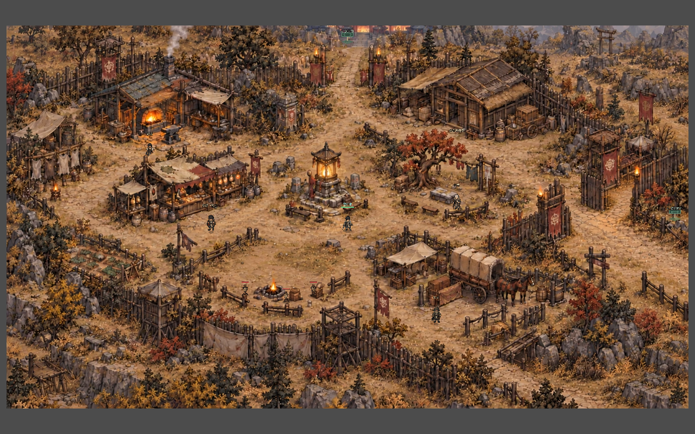
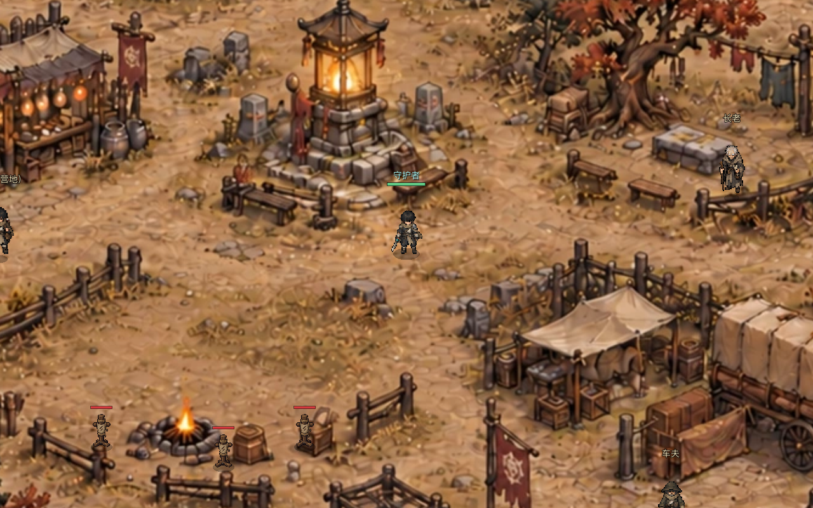

# 幸存者营地正式地图接入与验收

本记录说明第一章幸存者营地从已验收的矩形白盒升级为正式美术地图的实现、实机证据与维护方式。正常进入游戏即可看到正式地图；白盒测试场景仍可单独打开，用于检验通行和实体轮廓。



## 视觉和数据结构

- 以已确认的 `docs/游戏创意/第一章地图视觉设计稿/幸存者营地-v1.png` 为构图基准，编辑生成无静态人物与木桩的 `art_source/environment/camp_final_v1/clean_plate.png`。`tools/build_camp_final_art.py` 将其确定性转换为一张 1672×941 WebP 底图、六张透明的整体实体前景及 `assets/maps/camp_final_v1/manifest.json`。六个前景为铁匠棚、仓库、货郎摊、镇灵灯、长老树、马车，依接地点排序，玩家走到后方时会被遮挡。训练木桩仍是游戏怪物，NPC 也仍由游戏生成。
- 正式地图在屏幕和世界坐标中均为 3200×1800 的横向矩形；背景一次绘制，六个前景各一个静态精灵，不为每个地面格创建节点。原画和运行素材以清单中的 `layout_id` 与 1672×941 画幅校验；只在营地加载。其余地图继续沿用原有图集、网格、实体和碰撞路径。
- `data/map_art/camp_whitebox_v1.json` 仍是实体足迹、外围围栏、服务点与出口的唯一几何事实源。`python3 tools/build_camp_whitebox.py` 编译 `data/layouts/camp.json` 通行掩码与 `data/maps.json` 营地数据。每个大型实体只有一个整体碰撞多边形，不拆成瓦片。两座建筑的占地轮廓扩大到与画面一致；移除已由动态怪物承担碰撞的三只木桩静态轮廓；补齐外围栅栏和岩石。正式环境已有围墙视觉提示，营地不再叠加绿色安全区调试线，`MapService` 的安全区逻辑保持原样。
- 前景位于相同底图的对应画面位置并依据接地点计算绘制深度，角色、NPC、出口和木桩仍由既有系统管理。修改美术时先更新源稿及裁切脚本，再编译运行资源；修改通行时先更新上述几何源，再编译布局，避免视觉、碰撞和路线分叉。

## 行为验收

2026-10-15，Godot 4.7.2、GL Compatibility、1280×800 实际窗口及隔离测试项目：

| 检查 | 结果 |
| --- | --- |
| 正常 `Game.tscn` 装配 | 3200×1800 矩形地图、一张底图、六个整体前景；五名 NPC、两个出口、三只训练木桩保留；九个服务点/出口均有正式寻路路线。 |
| 通行与碰撞 | 地图内格中心 5495 个，其中 4027 个可走，约 73.3%；四个建筑/外围采样点同时由通行掩码和物理碰撞阻挡；三处旧木桩静态占地可走；实体与围栏合计 22 个整体多边形，加四条地图外边界。独立白盒验收实际驱动玩家走到九个目标均通过。 |
| 存档与地图功能 | 旧营地落点及未领取掉落迁移幂等；其他地图迷雾保留；小/大地图矩形投影、相机限制和营地安全区判定继续通过。 |
| 美术检查 | 全图和玩家视角实际窗口截图已保存于同目录；货郎摊遮挡在窗口中检查通过；未发现绿色安全区直线或人物烘焙重影。 |

前一版白盒的可走率为 5013/5495（91.2%），此前的窄建筑足迹和未补齐的外围使视觉上被占据的区域仍可穿过。现在为正确碰撞收紧至 73.3%，已用九目标实际移动检查主要路线。设计底线调整为 70%，避免再以错误的空旷面积作为验收目标。

## 绘制成本与资源代价

在同一设备、同一 1280×800 GL Compatibility 窗口、同一冻结玩法的 `MapRenderBenchmark` 中，营地原白盒基线为中位 1.772 ms、P95 25.695 ms、P99 81.478 ms、峰值 107.191 ms、约 242.2 次绘制；正式地图复测为中位 1.378 ms、P95 3.628 ms、P99 18.820 ms、峰值 25.761 ms、约 169.2 次绘制。绘制调用减少约 73 次。分位数和峰值仅来自单轮采样，易受机器负载影响；此测试冻结战斗与交互，不能代表完整游戏 FPS。

运行底图约 688 KiB，六张前景磁盘文件合计约 1 MiB；按 RGBA8 展开约 7.64 MiB，实际 Godot 导入格式、GPU 占用和上传峰值需在目标平台另测。场景装配在隔离无头测试测得约 61 ms；它与先前白盒不同时间点和渲染条件的数字不能直接解释为加载性能变化。当前未做长时间自动战斗与纹理显存连续采样，不据此承诺整机帧率提升。

## 复核入口

```bash
python3 tools/build_camp_final_art.py
python3 tools/build_camp_whitebox.py
python3 tools/run_isolated_tests.py CampLiveIntegrationTest ChapterOneMapArtTest MapTextureBatchTest SmokeTest
python3 tools/run_isolated_tests.py --rendered CampWhiteboxAcceptance CampLiveIntegrationTest
DEGENERATEAGE_RENDER_ONLY_CAMP=1 python3 tools/run_isolated_tests.py --rendered MapRenderBenchmark
```


