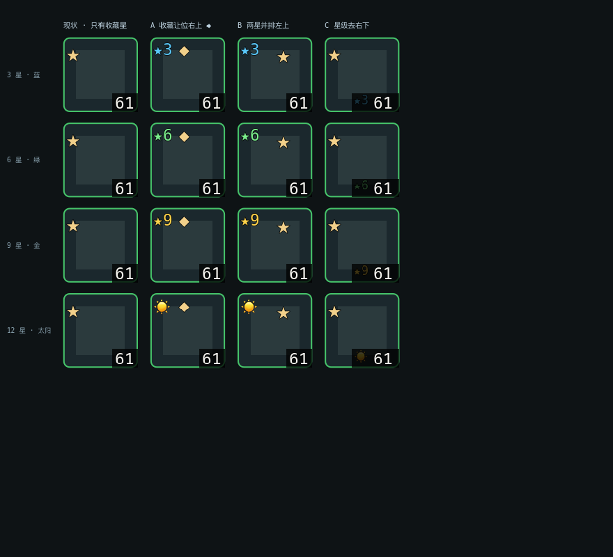

# 76 · 背包装备星级角标显示方案

> 状态：**已实施**（2026-10-20，Q1—Q5 全部按建议拍板）
> 关联：产品 05 §5.8｜工程 64 / 66｜data/upgrade.json（`maxStar: 12`）｜08 §11.4 第 24 项
> 需求原话：一件装备加星后在背包与人物面板的**左上角**加五角星；6 星以下蓝、6—8 绿、9—11 金、12 星变 ☀️。

---

## 一、结论

**可实现，且成本很低**（约 60 行 + 10 组断言），但有三处**不是"加个 Label"就能过去**的硬约束，其中第 1 条会直接推翻你给的字符选择：

| # | 约束 | 影响 |
|---|---|---|
| 🔴 1 | **⭐ 是彩色 emoji，`font_color` 对它无效；单色 ☀ 实测同样染不上色** | 「6 星以下蓝色」用 ⭐ **做不到**，必须换成真字形 ★（U+2605）；12 星只能是 emoji 本色，"金色太阳"做不出来 |
| 🔴 2 | **左上角已被「收藏 ★」占用**，且 52×52 格子的**四个角全都占满了** | 星级徽标没有空位，必须让谁挪开 |
| ⚠ 3 | **星级色与品质色是同一套（蓝/绿/金）** | 绿装 +9 星 会出现"金角标 + 绿边框"，有误读风险 |

第 1 条是实测结论，不是推测，证据见第二节。

---

## 二、实测：★ / ⭐ / ☀ / ☀️ 到底能不能染色

项目**没有自带字体**（`project.godot` 无 `theme/default_font`），用的是 Godot 内置默认字体 + **macOS 系统字体 fallback**。所以字形能否显示、能否着色，只能跑出来看。

探针脚本渲染结果（`/tmp/glyph_probe.png`，40px）：

| 码位 | 字符 | 实际渲染 | 能否 `font_color` 染色 |
|---|---|---|---|
| U+2605 | ★ | **实心单色星**（灰白） | ✅ 能 |
| U+2B50 | ⭐ | **彩色 emoji 星**（金黄渐变，带白边） | ❌ **不能**，颜色由 emoji 位图决定 |
| U+2600 | ☀ | **灰白单色太阳**（无 VS16） | ⚠ **实测染色后仍是灰白**（见下） |
| U+2600 U+FE0F | ☀️ | **彩色 emoji 太阳**（橙色） | ❌ 不能，但**不需要** |

> 追加实测：给单色 `☀` 设 `font_color = #ffb347` 后，渲染结果**依旧是灰白**——它其实也来自 Apple Color Emoji 的灰度呈现，同样不认 `font_color`。所以「金色太阳」这个想法**只有两条出路**：用彩色 emoji 本色，或自绘太阳形状。前者零成本，后者要多画一个 `Control`（约 20 行 `draw_*`）。
> 反过来，`★`（U+2605）是**真·矢量字形**，染色完全正常——这是它能承担四档配色的唯一原因。
| U+2726 / U+2739 / U+25C6 | ✦ ✹ ◆ | 单色 | ✅ 能 |

补充：`Font.has_char(0x2605)` 返回 **false** —— 说明默认字体本身不含这些字形，全靠系统 fallback。macOS / Windows 都有 ★（分别来自系统符号字体），**Linux 精简环境可能缺**（首发 macOS，可接受，但要知道这件事）。

**结论**：讲"蓝/绿/金三档变色"的方案，**只能用 ★（U+2605）**。用 ⭐ 的话四档颜色只剩一档（永远是金色 emoji），需求里的配色规则直接报废。

**12 星的 ☀️ 反而是可以的** —— 它是唯一"固定一个颜色就够了"的档位，彩色 emoji 在这里不违反规则，而且橙色太阳的辨识度确实比单色高。两条路都留给你选（Q2）。

---

## 三、现状：为什么"看不出加没加星"

### 3.1 数据层完全齐备，缺的只是显示

- 每个装备实例自带 `star` 字段（`0—12`，上限来自 `data/upgrade.json` 的 `maxStar: 12`）。
- `ItemUtil.display_name()`（`item_util.gd:85`）**已经在名字里拼了 `+N`**：`"紫 破晓之刃 Lv61 +6"`。
- `equipment_sale_preview.gd:235` 的标题**已经在用 `★%d`** 写法。

所以「玩家分辨不出」不是数据缺失，是**格子外观没画**。而且 `★N` 这个写法项目里已经有了，不需要新造语言。

### 3.2 背包格当前画了什么

`inventory_panel.gd:309 _refresh()` → 每格只设 `text = _short_name(item)`（模板名前 2 字）；
`SampleArt.decorate()`（`sample_art.gd:160`）在**有图标时把 `text` 清成 `""`**，图标 `icon_max_width = 34` 居中。

**所以格子里除了 34px 图标，一个字都没有。** 有星没星，肉眼确实分不出。

### 3.3 🔴 真正的障碍：四个角已经全占满了

`item_slot.gd` 在 `_ready()`（:122—217）里一次性建了 6 个角标，坐标如下（格子按 52×52 算）：

| 角 | 控件 | 坐标 / 字号 | 何时出现 |
|---|---|---|---|
| **左上** | `_favorite_marker` 收藏 ★ | `offset(2, 0)`，**16px**，金色 `PanelChrome.GOLD_LIGHT` | 装备被收藏时 |
| **左上** | `_potion_marker` 药品符号 | `offset(3, 2)`，15px | 药品格（与装备互斥，不冲突） |
| **右上** | `_upgrade_marker` 升级 ↑ | 右对齐 `-21…-2`，**19px**，绿/灰 | 「穿上更强」时 |
| **左下** | `_fusion_marker` 「已选」 | 12px | 打开合成面板预选时 |
| **右下** | `_level_badge` 穿戴等级 | 黑底方块 + 11px 数字（`_level_badge_layout()` :252） | 装备格恒有 |
| 中心 | 图标 34px | — | 有素材时 |

**左上角那颗 ★ 是收藏标记，不是星级。** 你要求"左上角加五角星"，如果直接叠上去，会和它**完全重合**（都在 `offset_left≈2, top≈0`，字号 16 vs 12）。

这是本方案唯一需要你拍板的设计冲突 —— 不是技术难点，是**位置分配**问题。

---

## 四、三个布局选项

量算依据：`★12` 在 11px 字号下约 **24×17**；收藏 ★ 16px；升级 ↑ 19px。格子宽 52（仓库/商店 46）。

### 选项 A（推荐）· 左上让给星级，收藏标记换符号搬到右上

```
┌──────────────────┐          ┌──────────────────┐
│ ★6            ◆↑ │  52×52   │ ☀             ◆↑ │  12 星：太阳顶替星级
│                  │          │                  │
│       [图标]      │          │       [图标]      │
│ 已选         61  │          │ 已选         61  │
└──────────────────┘          └──────────────────┘
```

- 左上：`★6` 星级徽标（11px，带 1px 黑描边）
- 右上：收藏标记 `◆`（U+25C6，12px，金色）+ 升级 `↑`，右对齐排成一行（12+19=31px < 52 ✅）
- 收藏**换符号**的理由：★ 在玩家认知里就是"星级"，收藏再占一个 ★ 是语义抢占；且 `★N` 已在出售预览里表示星级，符号要统一。

**代价**：收藏标记的符号与位置都变了，老玩家要重新认一次。**收益**：四角各司其职，不再有任何重叠。

### 选项 B · 最小改动：两个 ★ 并排留在左上

```
┌──────────────────┐
│ ★6 ★          ↑ │   星级 24px + 收藏 16px = 40px，勉强塞下
│                  │
│       [图标]      │
│ 已选         61  │
└──────────────────┘
```

- 收藏符号、位置都不动，只把星级插在它左边，把收藏星右移 26px。
- **代价**：两个 ★ 挨着，玩家第一眼分不清哪个是星级哪个是收藏 —— 而"分不清"正是你要解决的问题。**不推荐**，但改动确实最小（只动 `item_slot.gd`）。

### 选项 C · 不碰任何既有角标：星级去右下角和等级合并

```
┌──────────────────┐
│ ★             ↑ │   左上保持原样（收藏 ★）
│                  │
│       [图标]      │
│ 已选      ★6·61 │   右下：星级 + 等级同一块黑底
└──────────────────┘
```

- 右下的 `_level_badge` 本来就是"黑底小方块"，把 `★6` 拼进去最省事，`_level_badge_layout()` 已有缩字号防溢出的循环。
- **代价**：**没有满足你"左上角"的要求**，且右下会挤（`★11·9999` 需要约 40px，52px 里放得下但要缩到 9px 字号）。列出来是因为它在"实现风险"上最低。

> 我推荐 **A**。B 是"花力气解决了一个问题但没解决它"，C 是"位置不对但你最省心"。

**下面是三种布局的等比渲染对照**（`docs/工程文档/76-星级角标布局对比.png`，52×52 放大 3 倍，绿框模拟 rare 绿品质边框）：



从图里能直接读出三件事：

1. **收藏星（现状）比任何星级徽标都大**（16px vs 11px）——所以 B 方案里它会把 `★6` 压成陪衬，两颗星并排确实分不清。
2. **C 方案右下放不下**：`★11` + `61` 挤在同一条黑底里，字形被压到 9px，比左上角难认得多。
3. **12 星用彩色 emoji 太阳（☀️）是唯一自然的做法**，它在深色底上比灰白的单色 ☀ 醒目一个数量级。

---

## 五、推荐方案（选项 A）的详细设计

### 5.1 配色与字形表

| 星级 | 徽标文本 | 颜色 | 说明 |
|---|---|---|---|
| `0` | **不显示** | — | 否则满背包蓝星，反而变成噪音 |
| `1—5` | `★5` | `#5ac8fa` 亮蓝 | 与 uncommon 蓝 `#4aa3e0` 拉开明度 |
| `6—8` | `★8` | `#7bee8c` 亮绿 | 与 rare 绿 `#46c46a` 拉开明度 |
| `9—11` | `★11` | `#ffd24a` 亮金 | 比 epic 金 `#e0c04a` 更亮更暖 |
| `12` | `☀️`（彩色 emoji） | emoji 本色（橙金） | 单独 **13px**，比星号大 2px；单色 `☀` 实测染不上色（§2） |

**为什么不用品质色原值**：品质色（`item_util.gd:20`）就是 `uncommon 蓝 / rare 绿 / epic 金`，星级若取同色，绿装 +9 星 会变成"金角标 + 绿边框"。改用**同色系更亮的版本**，一眼能分出"这是星，不是品质"。

### 5.2 字号与布局

- 字号 **11px**（与等级角标同档），`★12` 实测约 24×17，52px 格子里留 26px 给右上收藏，不挤。
- **12 星单独用 13px**：emoji 太阳在小字号下射线会糊成一团橙点，加 2px 才认得出是太阳。
- 加 `outline_size = 2` + 黑色描边 —— 深色图标上不加描边必糊（收藏 ★ 现在就没描边，金色叠在白图标上尚可，蓝色叠在深色装备图上会消失）。**注意：`outline` 对 emoji 无效**（彩色位图不吃描边），12 星太阳在浅色图标上可能不够清楚，实机确认时留意。
- 位置：`PRESET_TOP_LEFT`，`offset(2, 0)`；收藏标记改为 `PRESET_TOP_RIGHT`，`offset_left = -34, offset_right = -20`（`↑` 占 `-21…-2`，两者不重叠）。
- `mouse_filter = MOUSE_FILTER_IGNORE`（必须，否则抢拖放与 tooltip，`equipment_level_badge_test.gd:39` 已有同类断言）。

### 5.3 代码改动点（4 处，全在 UI 层）

| 文件 | 改动 |
|---|---|
| `scripts/systems/item_util.gd` | 新增 `star_badge_text(star)` / `star_badge_color(star)` 两个静态函数 —— **配色与文案的唯一来源**，测试与 UI 共用，禁止在 `item_slot.gd` 里写颜色字面量 |
| `scripts/ui/item_slot.gd` | ① `_ready()` 里建 `_star_marker: Label`（插在 `_favorite_marker` 之后，保证压在品质框之上、`_drag_cover` 之下）；② 新增 `_refresh_star_badge()`；③ `item` setter（:51）追加一次调用；④ 收藏标记按 Q1 结果调整位置/符号 |
| `scripts/ui/character_panel.gd` | **不用改** —— 槽位是 `EquipmentSlot extends ItemSlot`，`button.item = ...` 已触发 setter |
| `scripts/ui/drag_ghost.gd` | **不用改** —— `slot_copy()`（:53）第一行就是 `copy.item = source.item`，setter 自动带上徽标 |

**存档 / 数据 / 结算零改动**，纯派生显示，schema 仍 14，`_is_valid_save` 不碰。

### 5.4 连带自动覆盖的位置（不用额外改，但要知情）

| 界面 | 格子尺寸 | 会显示吗 |
|---|---|---|
| 背包 | 52×52 | ✅ 需求要求 |
| 人物面板 14 槽 | 52×52 | ✅ 需求要求 |
| 仓库 | 46×46 | ⚠ 自动（见 Q3） |
| 商店货架 | 46×46 | ⚠ 自动（见 Q3） |
| 合成材料格 | 由面板给定 | ⚠ 自动（见 Q3） |
| 出售托盘 | 46×46 | ⚠ 自动（见 Q3） |
| 拖拽幽灵 | 跟随源格 | ✅ 自动，视觉一致 |
| 快捷栏 / 技能栏 | 另一套 `HotbarSlot` | ❌ 不涉及 |

46×46 的格子里，`★11`（24px）+ 收藏 `◆`（12px）刚好 36px，仍放得下，但余量只有 10px。若 Q3 选"只背包+人物"，就用 `role` 判断，一行条件。

---

## 六、风险清单

| # | 风险 | 处置 |
|---|---|---|
| 🔴 R1 | **用 ⭐ 做不出颜色档位**（emoji 固定配色） | 一律用 ★(U+2605)；12 星单独决定用单色 ☀ 还是彩色 ☀️ |
| 🔴 R2 | **左上角与收藏 ★ 重叠** | 必须按 Q1 拍板；不做决定就实施 = 两个星叠在一起 |
| ⚠ R3 | 星级色与品质色同源 | 用亮化版本（§5.1），并在实机复验里加一条"绿装 9 星是否误读为金装" |
| ⚠ R4 | ★ 依赖系统字体 fallback，`has_char` 为 false | 首发 macOS 无问题；若某天换 Windows/Linux 需实测。**不要**为此引入自带字体（会牵动全局排版） |
| ⚠ R5 | 新手会以为"有星=更强"而忽略品质 | 星是升星结果，0 星不显示反而让"有没有投入"更清楚；不改 |
| ⚠ R6 | `text_scale` 拉到 2.0 时 11px 星标不变大 | 与现有收藏 ★ / 药品符号行为一致（它们也是固定字号）。若要跟随缩放，`_level_badge_layout()` 有现成算法可抄，但会让徽标在某些倍率下溢出 —— **建议保持一致，不跟随** |
| ⚠ R7 | 一键出售 / 自动出售**不保护套装件**（已知欠账） | 本次不碰，与工程 63 判据有冲突风险 |

---

## 七、验证计划

### 7.1 测试（扩展 `tests/equipment_level_badge_test.gd`，**隔离集条数 53 不变**）

| # | 断言 | 抓什么 |
|---|---|---|
| 1 | `star = 0` → `_star_marker.visible == false` | 0 星不该有徽标 |
| 2 | `star = 3` → 文本 `★3`、颜色 = 蓝 | 蓝档 |
| 3 | `star = 6` 与 `8` → 绿 | 绿档边界（**6 归绿不归蓝**） |
| 4 | `star = 9` 与 `11` → 金 | 金档边界 |
| 5 | `star = 12` → 文本 == `"☀️"`（**必须含 U+FE0F**）、字号 13 | 满星档；**不校验颜色**（emoji 不可着色） |
| 6 | 人物槽（`EquipmentSlot`）同样出现，文本一致 | 需求第二处 |
| 7 | `DragGhost.slot_copy()` 副本带徽标 | 拖拽不丢 |
| 8 | 药品 / 材料 / `item = {}` → 不显示且不残留 | 复用格子 |
| 9 | 四组倍率（1.0/1.5/2.0 混合）下 `★11` 矩形不出格 | 溢出 |
| 10 | `_star_marker.mouse_filter == IGNORE` | 抢事件 |

### 7.2 负向（必须"有牙"）

| # | 注入 | 期望 |
|---|---|---|
| N-1 | `star > 0` 改成 `star >= 0` | 用例 1 红（满背包蓝星） |
| N-2 | 6 星判据写成 `> 6` | 用例 3 红（6 星掉到蓝档） |
| N-3 | 1—11 星的颜色改成品质色原值 | 配色断言红 |
| N-3b | 12 星的字符串去掉 U+FE0F（写成单色 ☀） | 用例 5 红（会渲染成灰白太阳，不是 emoji） |
| N-4 | 去掉 `mouse_filter` | 用例 10 红 |
| N-5 | 去掉 setter 里的刷新调用 | 用例 2 红（换装不更新） |
| N-6 | 12 星判据写成 `>= 11` | 用例 4/5 红 |

### 7.3 四层回归

`--import` → 隔离集（53 PASS / 0 FAIL）→ `--quit`（配置校验通过 ✅ + 0 SCRIPT ERROR）；
存档 `md5(slot_1)` 保持不变；schema 仍 14；本地化**条数不变**（`★N` 是符号+数字，**不新增 key**，避免又撞号）。

### 7.4 实机复验（新增 08 §11.4 第 24 项，约 6 条）

① 0 星装备格子干净无徽标；② 3 星蓝、6 星绿、9 星金、12 星太阳，逐档肉眼可辨；
③ 收藏一件 6 星装备，收藏标记与星级**不重叠**；④ 人物面板同一件装备显示一致；
⑤ 拖拽过程中幽灵带上徽标；⑥ 绿装 9 星时**不会**被误读成金装（配色区分度）。

---

## 八、拍板结果（全部按建议）

| # | 事项 | 裁决 | 实施 |
|---|---|---|---|
| Q1 | 左上角归属 | **A：收藏改 `◆` 搬到右上** | `_favorite_marker` → `PRESET_TOP_RIGHT`，10px |
| Q2 | 12 星字形 | **彩色 ☀️ 13px** | `star_badge_text()` 返回 `"☀️"`（含 U+FE0F） |
| Q3 | 显示范围 | **所有装备格都显示** | 不判 role，只判 `kind == "equip"` 且 `star > 0` |
| Q4 | 是否带数字 | **带**：`★6` | `"%d"` 显式拼数 |
| Q5 | 颜色边界 | **1—5 蓝**（6 归绿） | `low / mid / high` 三档断言 |

### 实施时补的一处几何校正（必须记录）

方案阶段只估算了「52px 放得下」，实施前用真实字体量了一次（`/tmp/measure.gd`）：

| 字符 | 字号 | 实测宽 | 摆位 | x 区间 |
|---|---|---|---|---|
| `★11` | 11px | **24.0** | 左上 `offset_left=2` | `[2, 26]` |
| `◆` | 10px | **8.0** | 右上 `offset_left=-26` | `[26, 36]` |
| `↑` | 19px | 13.0（字符，右对齐） | 右上 `-21…-2` | `[37, 50]` |

**三者刚好卡边，没有余量。** 因此两处校正：

1. 收藏 `◆` 从方案里的 12px 降到 **10px**，坐标 `-26…-16`（不是 `-37…-20`）。
2. **46px 的仓库 / 商店格**（Q3 允许连带显示）里星级**再缩 2px**（`custom_minimum_size.x < 50` 时 `font_size - 2`，下限 8px），否则 `★11` 会与 `◆` 咬字。方案阶段写的「降 1px」不够，实测要 2px。

这一段的判据已固化成断言（`★11@11px 宽 ≤ 26`、`◆@10px 宽 ≤ 37`、收藏 `offset_left < 0`），改字号或挪位会当场变红。

---

## 九、实施记录与仍没做的事

**已实施**（改动 3 处，全在 UI / 工具层，存档、结算、本地化零改动）：

| 文件 | 内容 |
|---|---|
| `scripts/systems/item_util.gd` | `STAR_BADGE_COLOR` 三档 + `star_badge_text / star_badge_color / star_badge_font_size`，**配色唯一来源** |
| `scripts/ui/item_slot.gd` | 新建 `_star_marker`（左上）；`_refresh_star_badge()` 挂进 `item` setter；收藏标记改 `◆` 10px 搬右上 |
| `tests/equipment_level_badge_test.gd` | 扩展 20 组断言（六档文案 / 三档配色 / 12 星含 U+FE0F / 人物槽 / 拖拽副本 / 药品 / 几何不重叠 / 脏档 / 清空） |
| `tools/verify_76_negative.py` | 8 条负向逐条注入变红后自动还原 |

**验证**：负向 8/8 全红；隔离集 53 PASS / 0 FAIL（未新增测试文件，条数不变）。

**仍没做**：

- 没有实机看配色 —— 颜色是否够区分只能在真屏幕上判断，已登记 08 §11.4 第 24 项（7 条判据）。
- 没有动「一键出售 / 自动出售保护套装件」那条欠账（与工程 63 判据冲突，需单独排期）。
- 没有改 `plan_four` 之类遗留命名问题（与本次无关）。
- 未 push（按铁律）。
